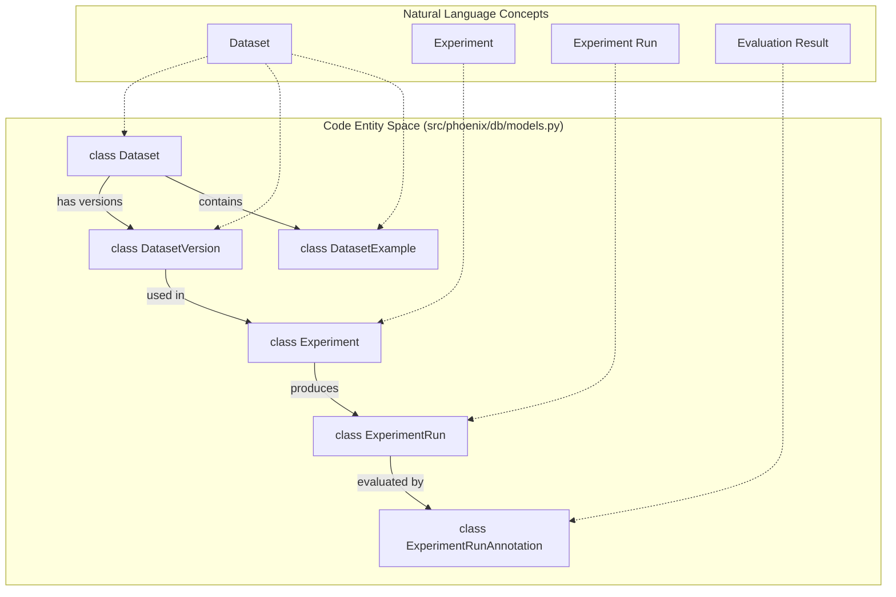
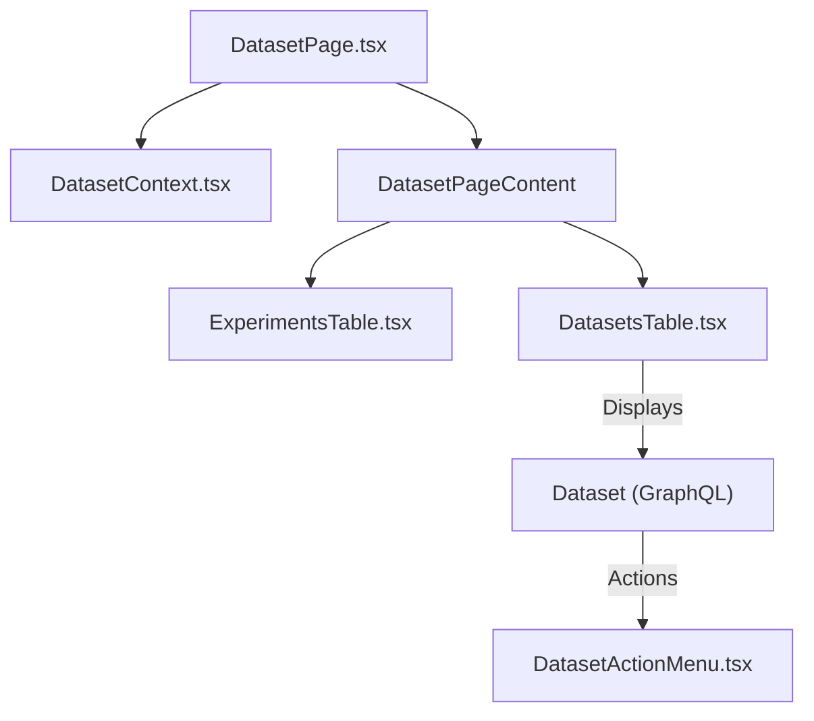
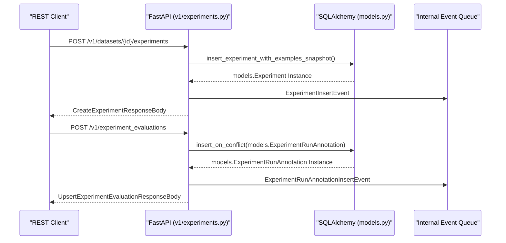

<!-- source: DeepWiki mcp.deepwiki.com · repo arize-ai/phoenix · page 5.3 Datasets & Experiments · fetched 2026-10-27 -->

# Datasets & Experiments

<details>
<summary>Relevant source files</summary>

The following files were used as context for generating this wiki page:

- [app/src/components/FocusHotkey.tsx](app/src/components/FocusHotkey.tsx)
- [app/src/components/ShareLinkButton.tsx](app/src/components/ShareLinkButton.tsx)
- [app/src/components/dataset/__generated__/DatasetLabelFilterButtonQuery.graphql.ts](app/src/components/dataset/__generated__/DatasetLabelFilterButtonQuery.graphql.ts)
- [app/src/components/table/styles.ts](app/src/components/table/styles.ts)
- [app/src/contexts/FeatureFlagsContext.tsx](app/src/contexts/FeatureFlagsContext.tsx)
- [app/src/pages/dataset/DatasetPage.tsx](app/src/pages/dataset/DatasetPage.tsx)
- [app/src/pages/dataset/datasetLoader.ts](app/src/pages/dataset/datasetLoader.ts)
- [app/src/pages/datasets/DatasetsPage.tsx](app/src/pages/datasets/DatasetsPage.tsx)
- [app/src/pages/datasets/DatasetsTable.tsx](app/src/pages/datasets/DatasetsTable.tsx)
- [app/src/pages/datasets/__generated__/DatasetsPageQuery.graphql.ts](app/src/pages/datasets/__generated__/DatasetsPageQuery.graphql.ts)
- [app/src/pages/datasets/__generated__/DatasetsTableDatasetsQuery.graphql.ts](app/src/pages/datasets/__generated__/DatasetsTableDatasetsQuery.graphql.ts)
- [app/src/pages/datasets/__generated__/DatasetsTable_datasets.graphql.ts](app/src/pages/datasets/__generated__/DatasetsTable_datasets.graphql.ts)
- [app/src/pages/experiment/ExampleDetailsPaginator.tsx](app/src/pages/experiment/ExampleDetailsPaginator.tsx)
- [app/src/pages/experiment/ExperimentCompareGridPage.tsx](app/src/pages/experiment/ExperimentCompareGridPage.tsx)
- [app/src/pages/experiment/ExperimentCompareMetricsPage.tsx](app/src/pages/experiment/ExperimentCompareMetricsPage.tsx)
- [app/src/pages/experiment/ExperimentComparePage.tsx](app/src/pages/experiment/ExperimentComparePage.tsx)
- [app/src/pages/experiment/ExperimentCompareTable.tsx](app/src/pages/experiment/ExperimentCompareTable.tsx)
- [app/src/pages/experiment/ExperimentMultiSelector.tsx](app/src/pages/experiment/ExperimentMultiSelector.tsx)
- [app/src/pages/experiment/__generated__/ExperimentCompareMetricsPage_experiments.graphql.ts](app/src/pages/experiment/__generated__/ExperimentCompareMetricsPage_experiments.graphql.ts)
- [app/src/pages/experiment/__generated__/ExperimentCompareTableQuery.graphql.ts](app/src/pages/experiment/__generated__/ExperimentCompareTableQuery.graphql.ts)
- [app/src/pages/experiment/__generated__/ExperimentCompareTable_comparisons.graphql.ts](app/src/pages/experiment/__generated__/ExperimentCompareTable_comparisons.graphql.ts)
- [app/src/pages/experiment/__generated__/ExperimentMultiSelector__data.graphql.ts](app/src/pages/experiment/__generated__/ExperimentMultiSelector__data.graphql.ts)
- [app/src/pages/home/homeLoader.ts](app/src/pages/home/homeLoader.ts)
- [app/src/pages/project/projectLoader.ts](app/src/pages/project/projectLoader.ts)
- [app/src/pages/trace/TraceDetailsPaginator.tsx](app/src/pages/trace/TraceDetailsPaginator.tsx)
- [src/phoenix/db/alembic.ini](src/phoenix/db/alembic.ini)
- [src/phoenix/db/engines.py](src/phoenix/db/engines.py)
- [src/phoenix/db/insertion/dataset.py](src/phoenix/db/insertion/dataset.py)
- [src/phoenix/db/migrate.py](src/phoenix/db/migrate.py)
- [src/phoenix/db/migrations/__init__.py](src/phoenix/db/migrations/__init__.py)
- [src/phoenix/db/migrations/env.py](src/phoenix/db/migrations/env.py)
- [src/phoenix/db/migrations/versions/10460e46d750_datasets.py](src/phoenix/db/migrations/versions/10460e46d750_datasets.py)
- [src/phoenix/db/migrations/versions/3be8647b87d8_add_token_columns_to_spans_table.py](src/phoenix/db/migrations/versions/3be8647b87d8_add_token_columns_to_spans_table.py)
- [src/phoenix/db/migrations/versions/cf03bd6bae1d_init.py](src/phoenix/db/migrations/versions/cf03bd6bae1d_init.py)
- [src/phoenix/db/models.py](src/phoenix/db/models.py)
- [src/phoenix/server/api/input_types/DatasetFilter.py](src/phoenix/server/api/input_types/DatasetFilter.py)
- [src/phoenix/server/api/routers/v1/__init__.py](src/phoenix/server/api/routers/v1/__init__.py)
- [src/phoenix/server/api/routers/v1/datasets.py](src/phoenix/server/api/routers/v1/datasets.py)
- [src/phoenix/server/api/routers/v1/experiment_evaluations.py](src/phoenix/server/api/routers/v1/experiment_evaluations.py)
- [src/phoenix/server/api/routers/v1/experiment_runs.py](src/phoenix/server/api/routers/v1/experiment_runs.py)
- [src/phoenix/server/api/routers/v1/experiments.py](src/phoenix/server/api/routers/v1/experiments.py)
- [src/phoenix/settings.py](src/phoenix/settings.py)
- [tests/unit/db/insertion/test_dataset.py](tests/unit/db/insertion/test_dataset.py)
- [tests/unit/server/api/routers/v1/test_datasets.py](tests/unit/server/api/routers/v1/test_datasets.py)
- [tests/unit/server/api/routers/v1/test_experiments.py](tests/unit/server/api/routers/v1/test_experiments.py)

</details>


This page documents Phoenix's dataset and experiment management functionality, which enables users to create test datasets, run experiments against those datasets, and evaluate the results. These capabilities are essential for benchmarking, comparing, and improving LLM application performance through structured testing.

For information about LLM evaluations outside the context of experiments, see [5.2. Evaluation Framework]().

## Overview

Phoenix datasets and experiments provide a structured approach to testing LLM applications:

1.  **Datasets** are collections of examples, each containing input data, reference output, and optional metadata.
2.  **Dataset versions** capture the evolution of datasets over time.
3.  **Experiments** run LLM applications against dataset examples and collect results.
4.  **Experiment runs** are individual executions of an LLM application on a specific dataset example.
5.  **Experiment evaluations** analyze the quality of experiment run outputs.

### Natural Language to Code Entity Mapping

The following diagram maps high-level concepts to their specific implementations in the Phoenix codebase.



Sources: [src/phoenix/db/models.py:804-1017](), [src/phoenix/db/migrations/versions/10460e46d750_datasets.py:48-307]()

## Database Schema

The dataset and experiment system is organized around the following database tables defined in `src/phoenix/db/models.py`.

```mermaid
erDiagram
    Dataset ||--o{ DatasetVersion : "has"
    Dataset ||--o{ DatasetExample : "contains"
    DatasetExample ||--o{ DatasetExampleRevision : "has"

    Experiment }o--|| Dataset : "uses"
    Experiment }o--|| DatasetVersion : "uses"
    Experiment ||--o{ ExperimentRun : "contains"

    ExperimentRun }o--|| DatasetExample : "uses"
    ExperimentRun ||--o{ ExperimentRunAnnotation : "evaluated_by"

    Dataset {
        int id PK
        string name UK
        string description
        json metadata_
        datetime created_at
        datetime updated_at
    }

    DatasetVersion {
        int id PK
        int dataset_id FK
        string description
        json metadata_
        datetime created_at
    }

    DatasetExample {
        int id PK
        int dataset_id FK
        int span_rowid FK_nullable
        datetime created_at
    }

    DatasetExampleRevision {
        int id PK
        int dataset_example_id FK
        int dataset_version_id FK
        json input
        json output
        json metadata_
        string revision_kind
        datetime created_at
    }

    Experiment {
        int id PK
        int dataset_id FK
        int dataset_version_id FK
        string name
        string description
        int repetitions
        json metadata_
        string project_name
        datetime created_at
        datetime updated_at
    }

    ExperimentRun {
        int id PK
        int experiment_id FK
        int dataset_example_id FK
        int repetition_number
        string trace_id
        json output
        datetime start_time
        datetime end_time
        int prompt_token_count
        int completion_token_count
        string error
    }

    ExperimentRunAnnotation {
        int id PK
        int experiment_run_id FK
        string name
        string annotator_kind
        string label
        float score
        string explanation
        string trace_id
        string error
        json metadata_
        datetime start_time
        datetime end_time
    }
```

Sources: [src/phoenix/db/models.py:804-1017](), [src/phoenix/db/migrations/versions/10460e46d750_datasets.py:48-307]()

## Datasets

Datasets are collections of examples used for testing and evaluating LLM applications. Each dataset has a name, optional description, and metadata. Datasets can be created from various sources including DataFrames, CSV files, or direct JSON input.

### Dataset Structure

-   **Dataset**: Contains metadata about the dataset (name, description, etc.) [src/phoenix/db/models.py:804-826]()
-   **DatasetVersion**: Represents a snapshot of the dataset at a specific point in time. [src/phoenix/db/models.py:829-847]()
-   **DatasetExample**: Individual examples within the dataset. [src/phoenix/db/models.py:850-867]()
-   **DatasetExampleRevision**: The actual content of examples (input, output, metadata) in a specific version. [src/phoenix/db/models.py:870-905]()

### REST API Interface

The `v1` datasets router provides endpoints for listing, creating, and deleting datasets.
- `GET /v1/datasets`: Lists datasets with pagination. It joins `DatasetExample` and `DatasetExampleRevision` to calculate the current `example_count`. [src/phoenix/server/api/routers/v1/datasets.py:100-164]()
- `DELETE /v1/datasets/{id}`: Deletes a dataset by its GlobalID. This operation also cleans up associated projects and traces via `get_project_names_for_datasets` and `get_eval_trace_ids_for_datasets`. [src/phoenix/server/api/routers/v1/datasets.py:179-202]()

Sources: [src/phoenix/server/api/routers/v1/datasets.py:77-202]()

### Frontend Dataset Management

The Phoenix UI provides a dedicated page for managing datasets. The `DatasetPage` component orchestrates the display and interaction with datasets.



The `DatasetsTable` component uses `usePaginationFragment` to fetch and display dataset lists with support for sorting by `createdAt` or `name`. [app/src/pages/datasets/DatasetsTable.tsx:87-124]()

Sources: [app/src/pages/dataset/DatasetPage.tsx:61-247](), [app/src/pages/datasets/DatasetsTable.tsx:78-124]()

## Experiments

Experiments represent the execution of LLM applications against datasets to evaluate performance. Each experiment is associated with a specific dataset and dataset version.

### Creating Experiments

Experiments can be created using the REST API:
`POST /v1/datasets/{dataset_id}/experiments` [src/phoenix/server/api/routers/v1/experiments.py:121-125]()

The `CreateExperimentRequestBody` allows specifying:
- `name`: Optional experiment name. If omitted, `_generate_experiment_name` creates a random name. [src/phoenix/server/api/routers/v1/experiments.py:81-84](), [src/phoenix/server/api/routers/v1/experiments.py:47-52]()
- `version_id`: Specific dataset version. If omitted, the latest version is used. [src/phoenix/server/api/routers/v1/experiments.py:91-97](), [src/phoenix/server/api/routers/v1/experiments.py:170-182]()
- `repetitions`: Number of times to repeat each example. [src/phoenix/server/api/routers/v1/experiments.py:102-104]()

Sources: [src/phoenix/server/api/routers/v1/experiments.py:47-125]()

### Experiment Runs and Evaluations

Individual executions and their results are managed through:
- `POST /v1/experiment_runs`: Records the output of a specific example execution. [src/phoenix/server/api/routers/v1/experiment_runs.py:51-108]()
- `POST /v1/experiment_evaluations`: Creates or updates an evaluation (`ExperimentRunAnnotation`) for a run. [src/phoenix/server/api/routers/v1/experiment_evaluations.py:77-127]()

The `upsert_experiment_evaluation` function handles the insertion logic, supporting `LLM`, `CODE`, and `HUMAN` annotator kinds. It uses `insert_on_conflict` to ensure uniqueness by `experiment_run_id` and `name`. [src/phoenix/server/api/routers/v1/experiment_evaluations.py:89-123]()

Sources: [src/phoenix/server/api/routers/v1/experiment_runs.py:51-108](), [src/phoenix/server/api/routers/v1/experiment_evaluations.py:77-127]()

### UI Comparison Grid

The `ExperimentCompareTable` component provides a specialized grid view for comparing multiple experiments side-by-side.

| Feature | Implementation |
| :--- | :--- |
| **Data Fetching** | Uses `usePaginationFragment` with `compareExperiments` GraphQL connection. [app/src/pages/experiment/ExperimentCompareTable.tsx:140-163]() |
| **Virtualization** | Implements `useVirtualizer` from `@tanstack/react-virtual` for high-performance rendering of large datasets. [app/src/pages/experiment/ExperimentCompareTable.tsx:8-17]() |
| **Metrics** | Displays `meanScore` from `annotationSummaries` and `costSummary`. [app/src/pages/experiment/ExperimentCompareTable.tsx:175-195]() |

Sources: [app/src/pages/experiment/ExperimentCompareTable.tsx:123-163]()

## System Architecture

The dataset and experiment system is integrated with the larger Phoenix architecture through the REST API layer and the SQLAlchemy ORM.

### Data Flow for Experiments

The following diagram bridges the REST API layer to the database models.



Sources: [src/phoenix/server/api/routers/v1/experiments.py:197-209](), [src/phoenix/server/api/routers/v1/experiment_evaluations.py:113-124]()

## Database Migrations

The datasets and experiments system is managed via Alembic migrations.

- `cf03bd6bae1d_init.py`: Initial schema for projects, traces, and spans. [src/phoenix/db/migrations/versions/cf03bd6bae1d_init.py:48-280]()
- `10460e46d750_datasets.py`: Introduces the core dataset and experiment tables.
- `3be8647b87d8_add_token_columns_to_spans_table.py`: Adds token tracking columns (`cumulative_llm_token_count_prompt`, etc.) used for experiment cost calculation. [src/phoenix/db/migrations/versions/3be8647b87d8_add_token_columns_to_spans_table.py:20-35]()

Migrations are executed via `src/phoenix/db/migrate.py`, which uses `alembic.command.upgrade` to bring the database to the `head` revision. [src/phoenix/db/migrate.py:78-80]()

Sources: [src/phoenix/db/migrate.py:37-80](), [src/phoenix/db/migrations/versions/cf03bd6bae1d_init.py:48-280]()

## Integration with Spans and Traces

Datasets and experiments link directly to the observability system:
- `DatasetExample` includes a `span_rowid` to link back to the originating trace span. [src/phoenix/db/models.py:856-861]()
- `ExperimentRun` stores a `trace_id`, allowing users to jump from an experiment result to the full execution trace in the UI. [src/phoenix/db/models.py:951-971]()

Sources: [src/phoenix/db/models.py:850-867](), [src/phoenix/db/models.py:951-971]()

---

