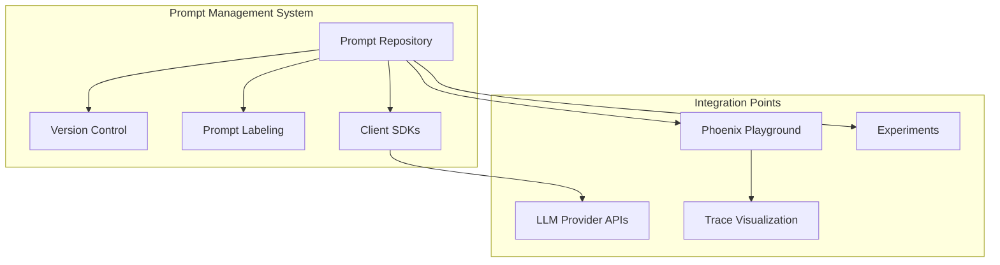
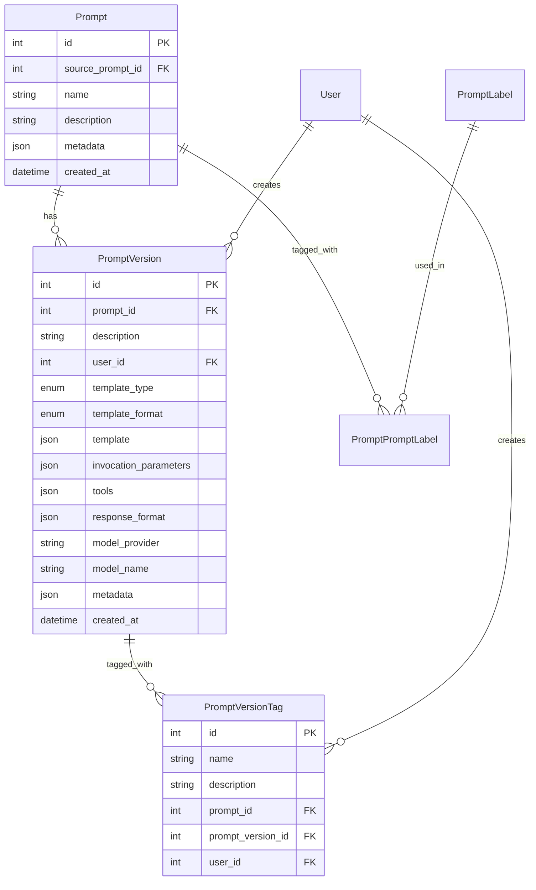
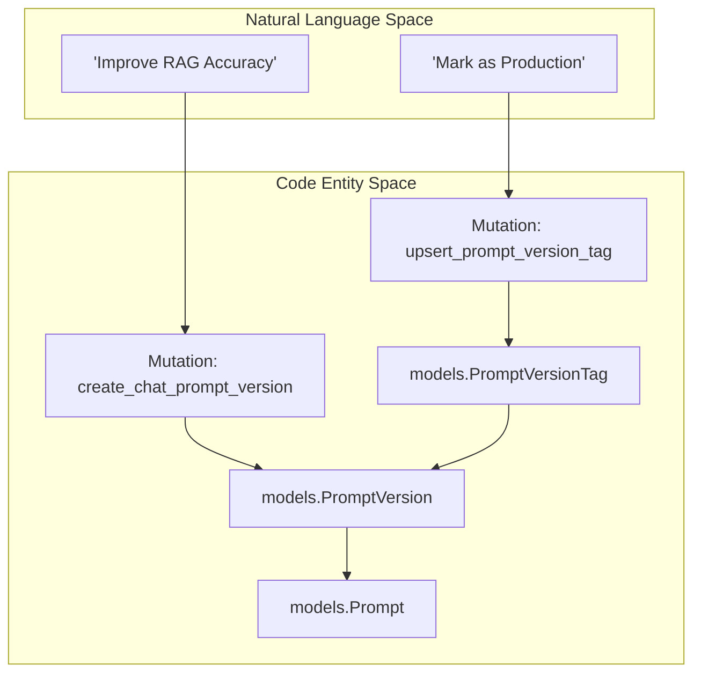
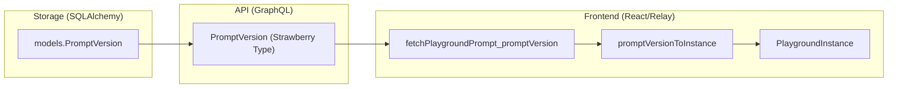

<!-- source: DeepWiki mcp.deepwiki.com · repo arize-ai/phoenix · page 5.4 Prompt Management · fetched 2026-10-27 -->

# Prompt Management

Relevant source files

The following files were used as context for generating this wiki page:

- [app/src/pages/playground/PromptComboBox.tsx](app/src/pages/playground/PromptComboBox.tsx)
- [app/src/pages/playground/SavePromptForm.tsx](app/src/pages/playground/SavePromptForm.tsx)
- [app/src/pages/playground/UpsertPromptFromTemplateDialog.tsx](app/src/pages/playground/UpsertPromptFromTemplateDialog.tsx)
- [app/src/pages/playground/__generated__/PromptComboBoxQuery.graphql.ts](app/src/pages/playground/__generated__/PromptComboBoxQuery.graphql.ts)
- [app/src/pages/playground/__generated__/SavePromptFormQuery.graphql.ts](app/src/pages/playground/__generated__/SavePromptFormQuery.graphql.ts)
- [app/src/pages/playground/__generated__/UpsertPromptFromTemplateDialogCreateMutation.graphql.ts](app/src/pages/playground/__generated__/UpsertPromptFromTemplateDialogCreateMutation.graphql.ts)
- [app/src/pages/playground/__generated__/UpsertPromptFromTemplateDialogUpdateMutation.graphql.ts](app/src/pages/playground/__generated__/UpsertPromptFromTemplateDialogUpdateMutation.graphql.ts)
- [app/src/pages/playground/__generated__/fetchPlaygroundPromptQuery.graphql.ts](app/src/pages/playground/__generated__/fetchPlaygroundPromptQuery.graphql.ts)
- [app/src/pages/playground/fetchPlaygroundPrompt.ts](app/src/pages/playground/fetchPlaygroundPrompt.ts)
- [app/src/pages/prompt/EditPromptButton.tsx](app/src/pages/prompt/EditPromptButton.tsx)
- [app/src/pages/prompt/PromptCodeExportCard.tsx](app/src/pages/prompt/PromptCodeExportCard.tsx)
- [app/src/pages/prompt/PromptIndexPage.tsx](app/src/pages/prompt/PromptIndexPage.tsx)
- [app/src/pages/prompt/PromptInvocationParameters.tsx](app/src/pages/prompt/PromptInvocationParameters.tsx)
- [app/src/pages/prompt/PromptLatestVersionsList.tsx](app/src/pages/prompt/PromptLatestVersionsList.tsx)
- [app/src/pages/prompt/PromptLayout.tsx](app/src/pages/prompt/PromptLayout.tsx)
- [app/src/pages/prompt/PromptVersionDetailsPage.tsx](app/src/pages/prompt/PromptVersionDetailsPage.tsx)
- [app/src/pages/prompt/PromptVersionsList.tsx](app/src/pages/prompt/PromptVersionsList.tsx)
- [app/src/pages/prompt/__generated__/EditPromptButtonPatchPromptMutation.graphql.ts](app/src/pages/prompt/__generated__/EditPromptButtonPatchPromptMutation.graphql.ts)
- [app/src/pages/prompt/__generated__/EditPromptButton_data.graphql.ts](app/src/pages/prompt/__generated__/EditPromptButton_data.graphql.ts)
- [app/src/pages/prompt/__generated__/PromptCodeExportCard__main.graphql.ts](app/src/pages/prompt/__generated__/PromptCodeExportCard__main.graphql.ts)
- [app/src/pages/prompt/__generated__/PromptIndexPage__aside.graphql.ts](app/src/pages/prompt/__generated__/PromptIndexPage__aside.graphql.ts)
- [app/src/pages/prompt/__generated__/PromptIndexPage__main.graphql.ts](app/src/pages/prompt/__generated__/PromptIndexPage__main.graphql.ts)
- [app/src/pages/prompt/__generated__/PromptLatestVersionsListFragment.graphql.ts](app/src/pages/prompt/__generated__/PromptLatestVersionsListFragment.graphql.ts)
- [app/src/pages/prompt/__generated__/PromptVersionsList__main.graphql.ts](app/src/pages/prompt/__generated__/PromptVersionsList__main.graphql.ts)
- [app/src/pages/prompt/__generated__/promptLoaderQuery.graphql.ts](app/src/pages/prompt/__generated__/promptLoaderQuery.graphql.ts)
- [app/src/pages/prompt/__generated__/promptVersionLoaderQuery.graphql.ts](app/src/pages/prompt/__generated__/promptVersionLoaderQuery.graphql.ts)
- [app/src/pages/prompt/__tests__/fixtures.ts](app/src/pages/prompt/__tests__/fixtures.ts)
- [app/src/pages/prompt/__tests__/promptCodeSnippets.anthropic.test.ts](app/src/pages/prompt/__tests__/promptCodeSnippets.anthropic.test.ts)
- [app/src/pages/prompt/__tests__/promptCodeSnippets.openai.test.ts](app/src/pages/prompt/__tests__/promptCodeSnippets.openai.test.ts)
- [app/src/pages/prompt/promptCodeSnippets.tsx](app/src/pages/prompt/promptCodeSnippets.tsx)
- [app/src/pages/prompt/promptVersionLoader.tsx](app/src/pages/prompt/promptVersionLoader.tsx)
- [app/src/pages/prompts/PromptsFilterProvider.tsx](app/src/pages/prompts/PromptsFilterProvider.tsx)
- [app/src/pages/prompts/PromptsPage.tsx](app/src/pages/prompts/PromptsPage.tsx)
- [app/src/pages/prompts/PromptsTable.tsx](app/src/pages/prompts/PromptsTable.tsx)
- [app/src/pages/prompts/__generated__/DeletePromptDialogMutation.graphql.ts](app/src/pages/prompts/__generated__/DeletePromptDialogMutation.graphql.ts)
- [app/src/pages/prompts/__generated__/PromptsTablePromptsQuery.graphql.ts](app/src/pages/prompts/__generated__/PromptsTablePromptsQuery.graphql.ts)
- [app/src/pages/prompts/__generated__/PromptsTable_prompts.graphql.ts](app/src/pages/prompts/__generated__/PromptsTable_prompts.graphql.ts)
- [app/src/pages/prompts/__generated__/promptsLoaderQuery.graphql.ts](app/src/pages/prompts/__generated__/promptsLoaderQuery.graphql.ts)
- [app/src/pages/prompts/promptsLoader.ts](app/src/pages/prompts/promptsLoader.ts)
- [app/src/schemas/messageSchemas.ts](app/src/schemas/messageSchemas.ts)
- [app/src/schemas/toolCallSchemas.ts](app/src/schemas/toolCallSchemas.ts)
- [src/phoenix/db/migrations/versions/bc8fea3c2bc8_add_prompt_tables.py](src/phoenix/db/migrations/versions/bc8fea3c2bc8_add_prompt_tables.py)
- [src/phoenix/server/api/input_types/PromptVersionInput.py](src/phoenix/server/api/input_types/PromptVersionInput.py)
- [src/phoenix/server/api/mutations/prompt_label_mutations.py](src/phoenix/server/api/mutations/prompt_label_mutations.py)
- [src/phoenix/server/api/mutations/prompt_mutations.py](src/phoenix/server/api/mutations/prompt_mutations.py)
- [src/phoenix/server/api/mutations/prompt_version_tag_mutations.py](src/phoenix/server/api/mutations/prompt_version_tag_mutations.py)
- [src/phoenix/server/api/routers/v1/prompts.py](src/phoenix/server/api/routers/v1/prompts.py)
- [src/phoenix/server/api/types/Prompt.py](src/phoenix/server/api/types/Prompt.py)
- [src/phoenix/server/api/types/PromptVersion.py](src/phoenix/server/api/types/PromptVersion.py)
- [src/phoenix/server/api/types/PromptVersionTemplate.py](src/phoenix/server/api/types/PromptVersionTemplate.py)
- [tests/integration/db_migrations/test_autoincrement_primary_keys.py](tests/integration/db_migrations/test_autoincrement_primary_keys.py)
- [tests/unit/server/api/mutations/test_prompt_mutations.py](tests/unit/server/api/mutations/test_prompt_mutations.py)
- [tests/unit/server/api/routers/v1/test_prompts.py](tests/unit/server/api/routers/v1/test_prompts.py)

Phoenix's Prompt Management system enables users to create, version, and test prompts for LLM applications. This page documents the system architecture, data models, and integration patterns used to implement prompt versioning and management in Phoenix.

## Purpose and Components

The Prompt Management system allows you to:

1. Create and maintain reusable prompt templates.
2. Apply version control to prompts with tagging capabilities.
3. Categorize prompts with labels.
4. Standardize prompts across different LLM providers.
5. Integrate prompts with client applications via SDKs.

Sources: [src/phoenix/server/api/routers/v1/prompts.py:117-118](), [app/src/pages/playground/fetchPlaygroundPrompt.ts:55-65]()

## Data Model

The Prompt Management system is built on a relational database model with several core entities that enable versioning, labeling, and tagging of prompts.

Sources: [src/phoenix/db/migrations/versions/bc8fea3c2bc8_add_prompt_tables.py:48-189](), [src/phoenix/server/api/types/Prompt.py:32-34](), [src/phoenix/server/api/types/PromptVersion.py:38-53]()

### Core Entities

#### Prompt

The `Prompt` entity is the main container for a prompt with a unique name. It can have multiple versions and be categorized with multiple labels.

Key attributes:
- `id`: Primary key (GlobalID in API) [src/phoenix/server/api/types/Prompt.py:33]().
- `source_prompt_id`: Self-referential ID for cloned prompts [src/phoenix/server/api/types/Prompt.py:41-53]().
- `name`: Unique identifier [src/phoenix/server/api/types/Prompt.py:56-66]().
- `description`: Optional description [src/phoenix/server/api/types/Prompt.py:69-79]().
- `metadata`: JSON metadata [src/phoenix/server/api/types/Prompt.py:82-92]().

Sources: [src/phoenix/server/api/types/Prompt.py:32-106]()

#### PromptVersion

Each `PromptVersion` represents a specific version of a prompt, containing the actual template and configuration.

Key attributes:
- `prompt_id`: Foreign key to parent Prompt [src/phoenix/server/api/types/PromptVersion.py:40]().
- `template_type`: Enum (`CHAT`, `STRING`) [src/phoenix/db/types/prompts.py:23]().
- `template_format`: Enum (`F_STRING`, `MUSTACHE`, `NONE`) [src/phoenix/db/types/prompts.py:22]().
- `template`: The actual template structure (e.g., `PromptChatTemplate` or `PromptStringTemplate`) [src/phoenix/server/api/types/PromptVersion.py:46]().
- `invocation_parameters`: Model settings like temperature and penalties [src/phoenix/server/api/types/PromptVersion.py:47]().
- `model_provider`: LLM provider (OpenAI, Anthropic, etc.) [src/phoenix/server/api/types/PromptVersion.py:51]().

Sources: [src/phoenix/server/api/types/PromptVersion.py:38-53](), [src/phoenix/db/types/prompts.py:21-23]()

#### PromptVersionTag

Tags allow referencing specific versions by name (e.g., "latest", "prod").

Key attributes:
- `name`: Tag name [src/phoenix/server/api/routers/v1/prompts.py:314]().
- `prompt_version_id`: Target version [src/phoenix/server/api/routers/v1/prompts.py:315]().

Sources: [src/phoenix/server/api/routers/v1/prompts.py:309-322]()

## Template Types and Formats

Phoenix supports different prompt template types and formats:

### Template Types

The `template_type` field defines the structure of the prompt:

1.  **CHAT**: A list of messages with roles (system, user, assistant, tool) [src/phoenix/db/types/prompts.py:23]().
2.  **STRING**: A single raw string template [src/phoenix/db/types/prompts.py:23]().

Sources: [src/phoenix/db/types/prompts.py:23](), [src/phoenix/server/api/routers/v1/prompts.py:73-82]()

### Template Formats

The `template_format` field defines how variables are interpolated:

1.  **F_STRING**: Python-style `{variable}` syntax [src/phoenix/db/types/prompts.py:22]().
2.  **MUSTACHE**: `{{variable}}` syntax [src/phoenix/db/types/prompts.py:22]().
3.  **NONE**: No interpolation [src/phoenix/db/types/prompts.py:22]().

Sources: [src/phoenix/db/types/prompts.py:22]()

## Version Control Workflow

The system allows tracking evolution via sequence numbers and explicit tagging.

Sources: [src/phoenix/server/api/mutations/prompt_mutations.py:110-156](), [src/phoenix/server/api/mutations/prompt_version_tag_mutations.py:24-27]()

### Key Operations

1.  **Create Prompt**: Establishing a new container with an initial version [src/phoenix/server/api/mutations/prompt_mutations.py:78-107]().
2.  **Versioning**: Adding a new version to an existing prompt [src/phoenix/server/api/mutations/prompt_mutations.py:110-156]().
3.  **Tagging**: Mapping a string tag to a specific version ID [src/phoenix/server/api/mutations/prompt_version_tag_mutations.py:24-27]().
4.  **Cloning**: Creating a new prompt based on an existing one [src/phoenix/server/api/mutations/prompt_mutations.py:175-212]().

## Integration with LLM Providers

Standardization occurs by mapping internal `PromptVersion` structures to provider-specific formats.

| Provider | Internal Class | Description |
| :--- | :--- | :--- |
| OpenAI | `PromptOpenAIInvocationParameters` | Standard OpenAI params (temperature, top_p, etc.) [src/phoenix/db/types/prompts.py:29]() |
| DeepSeek | `PromptDeepSeekInvocationParameters` | DeepSeek specific parameters, normalized to OpenAI family [src/phoenix/server/api/routers/v1/prompts.py:67-70]() |

Sources: [src/phoenix/db/types/prompts.py:26-30](), [src/phoenix/server/api/routers/v1/prompts.py:65-70]()

## Playground Integration

The Playground is the primary UI for testing prompt versions. The `promptVersionToInstance` function converts a stored version into an interactive playground state.

Sources: [app/src/pages/playground/fetchPlaygroundPrompt.ts:55-184](), [src/phoenix/server/api/types/PromptVersion.py:129-161]()

## API Access

### REST API (v1)
The REST API provides endpoints for programmatic access to prompts and versions:
- `GET /v1/prompts`: List all prompts [src/phoenix/server/api/routers/v1/prompts.py:126-183]().
- `GET /v1/prompts/{prompt_identifier}/latest`: Get the latest version [src/phoenix/server/api/routers/v1/prompts.py:241-285]().
- `GET /v1/prompts/{prompt_identifier}/tags/{tag_name}`: Get version by tag [src/phoenix/server/api/routers/v1/prompts.py:339-386]().

### GraphQL API
The GraphQL API supports complex relationships and pagination:
- `promptVersions`: Paginated connection for a prompt [src/phoenix/server/api/types/Prompt.py:158-183]().
- `sequenceNumber`: 1-based index of the version [src/phoenix/server/api/types/PromptVersion.py:106-117]().
- `isLatest`: Boolean check for the newest version [src/phoenix/server/api/types/PromptVersion.py:120-126]().

Sources: [src/phoenix/server/api/routers/v1/prompts.py:110-120](), [src/phoenix/server/api/types/Prompt.py:31-33](), [src/phoenix/server/api/types/PromptVersion.py:37-39]()

---

