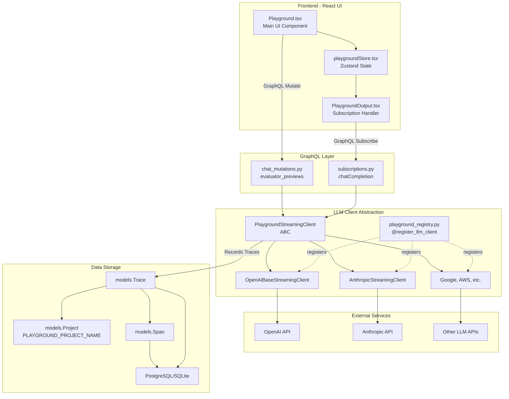
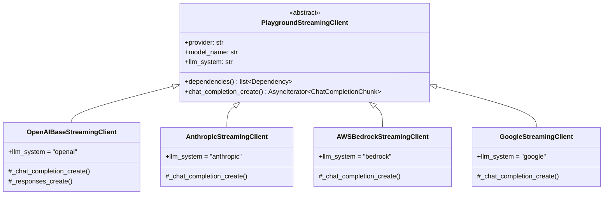
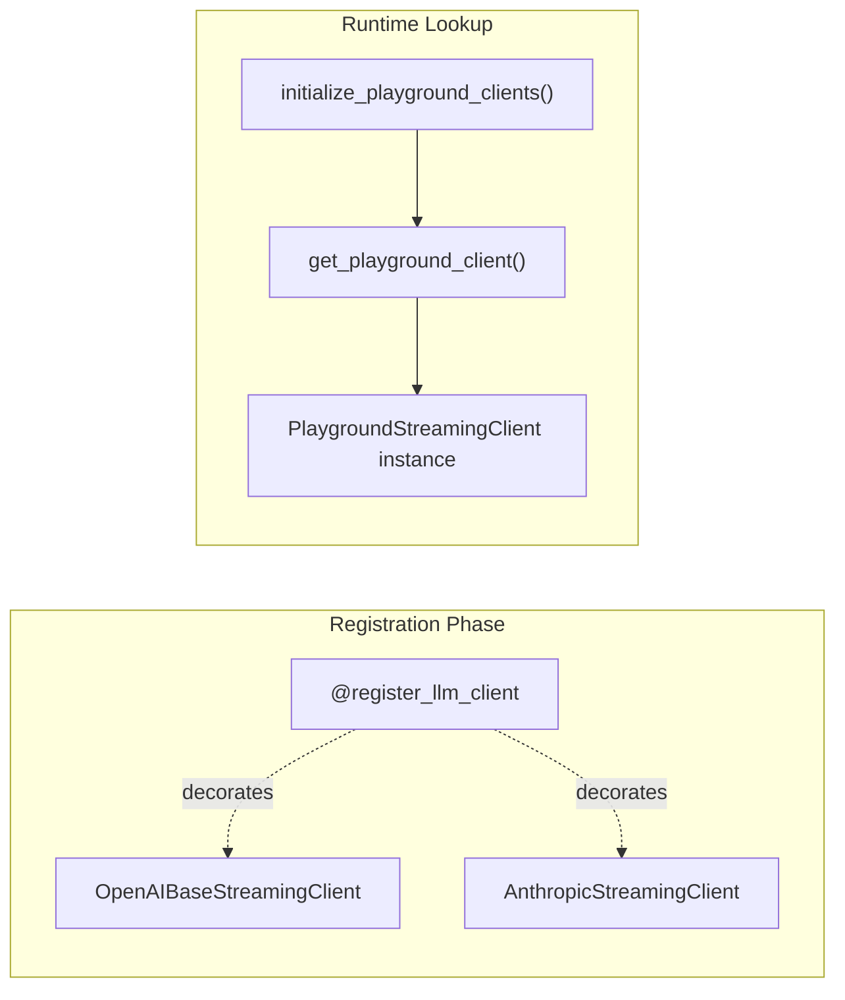
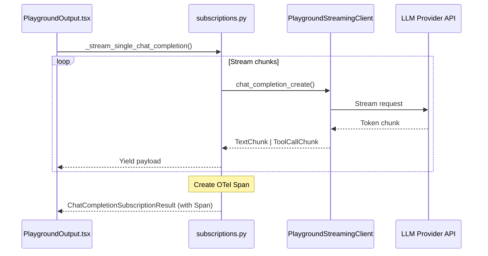
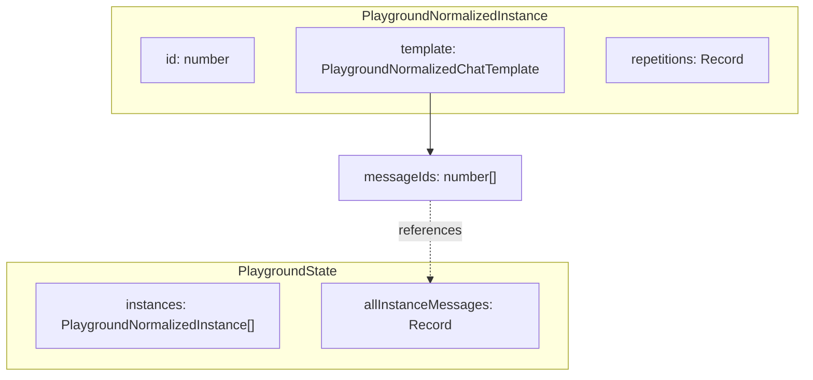

<!-- source: DeepWiki mcp.deepwiki.com · repo arize-ai/phoenix · page 5.5 Playground System · fetched 2026-10-27 -->

# Playground System

Relevant source files

The following files were used as context for generating this wiki page:

- [app/src/components/templateEditor/constants.ts](app/src/components/templateEditor/constants.ts)
- [app/src/components/templateEditor/templateEditorUtils.ts](app/src/components/templateEditor/templateEditorUtils.ts)
- [app/src/pages/playground/Playground.tsx](app/src/pages/playground/Playground.tsx)
- [app/src/pages/playground/PlaygroundChatTemplate.tsx](app/src/pages/playground/PlaygroundChatTemplate.tsx)
- [app/src/pages/playground/PlaygroundDatasetExamplesTable.tsx](app/src/pages/playground/PlaygroundDatasetExamplesTable.tsx)
- [app/src/pages/playground/PlaygroundInput.tsx](app/src/pages/playground/PlaygroundInput.tsx)
- [app/src/pages/playground/PlaygroundOutput.tsx](app/src/pages/playground/PlaygroundOutput.tsx)
- [app/src/pages/playground/PlaygroundTemplate.tsx](app/src/pages/playground/PlaygroundTemplate.tsx)
- [app/src/pages/playground/__generated__/PlaygroundDatasetExamplesTableMutation.graphql.ts](app/src/pages/playground/__generated__/PlaygroundDatasetExamplesTableMutation.graphql.ts)
- [app/src/pages/playground/__generated__/PlaygroundDatasetExamplesTableSubscription.graphql.ts](app/src/pages/playground/__generated__/PlaygroundDatasetExamplesTableSubscription.graphql.ts)
- [app/src/pages/playground/__generated__/PlaygroundOutputSubscription.graphql.ts](app/src/pages/playground/__generated__/PlaygroundOutputSubscription.graphql.ts)
- [app/src/pages/playground/__tests__/playgroundUtils.test.ts](app/src/pages/playground/__tests__/playgroundUtils.test.ts)
- [app/src/pages/playground/constants.tsx](app/src/pages/playground/constants.tsx)
- [app/src/pages/playground/playgroundUtils.ts](app/src/pages/playground/playgroundUtils.ts)
- [app/src/pages/playground/schemas.ts](app/src/pages/playground/schemas.ts)
- [app/src/store/playground/__tests__/playgroundStore.test.ts](app/src/store/playground/__tests__/playgroundStore.test.ts)
- [app/src/store/playground/playgroundStore.tsx](app/src/store/playground/playgroundStore.tsx)
- [app/src/store/playground/types.ts](app/src/store/playground/types.ts)
- [src/phoenix/server/api/evaluators.py](src/phoenix/server/api/evaluators.py)
- [src/phoenix/server/api/helpers/dataset_helpers.py](src/phoenix/server/api/helpers/dataset_helpers.py)
- [src/phoenix/server/api/helpers/experiment_run_filters.py](src/phoenix/server/api/helpers/experiment_run_filters.py)
- [src/phoenix/server/api/helpers/playground_clients.py](src/phoenix/server/api/helpers/playground_clients.py)
- [src/phoenix/server/api/mutations/chat_mutations.py](src/phoenix/server/api/mutations/chat_mutations.py)
- [src/phoenix/server/api/subscriptions.py](src/phoenix/server/api/subscriptions.py)
- [src/phoenix/utilities/template_formatters.py](src/phoenix/utilities/template_formatters.py)
- [tests/integration/_mock_ldap_server.py](tests/integration/_mock_ldap_server.py)
- [tests/integration/_mock_llm_server.py](tests/integration/_mock_llm_server.py)
- [tests/integration/experiments/conftest.py](tests/integration/experiments/conftest.py)
- [tests/integration/experiments/test_playground.py](tests/integration/experiments/test_playground.py)
- [tests/unit/server/api/helpers/test_dataset_helpers.py](tests/unit/server/api/helpers/test_dataset_helpers.py)
- [tests/unit/server/api/helpers/test_evaluators.py](tests/unit/server/api/helpers/test_evaluators.py)
- [tests/unit/server/api/helpers/test_playground_clients.py](tests/unit/server/api/helpers/test_playground_clients.py)
- [tests/unit/server/api/test_subscriptions.py](tests/unit/server/api/test_subscriptions.py)
- [tests/unit/utilities/test_template_formatters.py](tests/unit/utilities/test_template_formatters.py)

The Playground System provides an interactive interface for testing and experimenting with LLM prompts across multiple providers. It enables users to compose multi-turn conversations, configure model parameters, run prompts against individual inputs or entire datasets, and evaluate results—all while automatically capturing execution as OpenTelemetry traces. This system bridges frontend UI components with backend LLM client abstractions through GraphQL subscriptions for real-time streaming.

**Related Systems**: For prompt version management, see [Prompt Management](5.4). For dataset and experiment execution without the interactive UI, see [Datasets & Experiments](5.3). For evaluation configuration, see [Evaluation Framework](5.2).

---

## System Architecture

The Playground operates across three main layers: frontend state management, GraphQL API (subscriptions/mutations), and LLM client abstractions. The frontend maintains instance state for multiple concurrent prompt comparisons, while the backend handles provider-specific API calls through a unified streaming client interface.

### High-Level Data Flow

**Sources**: 
- [app/src/pages/playground/Playground.tsx:136-210]()
- [app/src/pages/playground/PlaygroundOutput.tsx:149-462]()
- [src/phoenix/server/api/subscriptions.py:76-135]()
- [src/phoenix/server/api/helpers/playground_clients.py:161-285]()
- [src/phoenix/server/api/mutations/chat_mutations.py:180-264]()

---

## LLM Client Abstraction Layer

The backend implements a plugin architecture for LLM providers through the `PlaygroundStreamingClient` abstract base class. Each provider implementation handles API-specific details while exposing a uniform streaming interface via `chat_completion_create`.

### Client Class Hierarchy

**Sources**:
- [src/phoenix/server/api/helpers/playground_clients.py:161-285]()
- [src/phoenix/server/api/helpers/playground_clients.py:513-667]()
- [src/phoenix/server/api/helpers/playground_clients.py:869-1035]()
- [src/phoenix/server/api/helpers/playground_clients.py:1199-1380]()

### Provider Registration and Discovery

The system uses a decorator pattern to register provider implementations. At module initialization, all registered clients are collected and made available through `get_playground_client()`.

Key functions:
- `@register_llm_client` decorator at [src/phoenix/server/api/helpers/playground_registry.py:88-95]()
- `get_playground_client()` at [src/phoenix/server/api/helpers/playground_clients.py:1443-1532]()
- `initialize_playground_clients()` at [src/phoenix/server/api/subscriptions.py:70]()

---

## Execution Modes

The Playground supports two primary execution modes: single-instance runs for interactive prompt development, and dataset-based runs for systematic evaluation.

### Single Instance Mode

Used for quick iteration on prompts. Supports multiple repetitions per run and comparison across instances.

**Sources**:
- [src/phoenix/server/api/subscriptions.py:76-135]()
- [app/src/pages/playground/PlaygroundOutput.tsx:230-331]()
- [src/phoenix/server/api/helpers/playground_clients.py:185-285]()

### Dataset Experiment Mode

Runs prompts across all examples in a dataset. This mode creates an `Experiment` record and stores results as `ExperimentRun` objects.

**Batching Strategy**: Dataset runs process examples in batches to balance throughput. The system builds template variables from dataset examples using `templateVariablesPath`.

**Sources**:
- [src/phoenix/server/api/subscriptions.py:369-564]()
- [app/src/pages/playground/PlaygroundDatasetExamplesTable.tsx:1-1261]()
- [src/phoenix/server/api/helpers/message_helpers.py:73-112]()

---

## Streaming Implementation

The Playground uses GraphQL subscriptions to deliver real-time token-by-token responses. The backend converts provider-specific streaming APIs into a uniform `ChatCompletionChunk` union type.

### Chunk Type Hierarchy

The subscription emits different payload types:

| Payload Type | When Emitted | Contains |
|-------------|--------------|----------|
| `TextChunk` | During streaming | Incremental text content [src/phoenix/server/api/helpers/playground_clients.py:95]() |
| `ToolCallChunk` | During streaming | Incremental tool call arguments [src/phoenix/server/api/helpers/playground_clients.py:96]() |
| `ChatCompletionSubscriptionResult` | End of stream | Final `Span` with trace metadata [src/phoenix/server/api/subscriptions.py:129-132]() |
| `ChatCompletionSubscriptionError` | On error | Error message [src/phoenix/server/api/subscriptions.py:118-121]() |

### Concurrency Management

The subscription handler manages concurrent execution with cleanup guarantees. The cleanup sequence (cancel → await → aclose) is critical:

1. **Cancel all tasks**: Schedules `CancelledError` [src/phoenix/server/api/subscriptions.py:165-166]().
2. **Await all tasks**: Ensures tasks process cancellation [src/phoenix/server/api/subscriptions.py:170-174]().
3. **Close generators**: Runs `finally` blocks immediately [src/phoenix/server/api/subscriptions.py:177-187]().

---

## Frontend State Management

The frontend uses Zustand for global state with a normalized message structure to support drag-and-drop reordering.

### State Schema

**Normalization Rationale**: Messages are normalized (stored by ID in `allInstanceMessages`) to enable efficient reordering and shared message editing.

**Key Functions**:
- `normalizeChatTemplate()`: [app/src/store/playground/playgroundStore.tsx:104-118]()
- `createNormalizedPlaygroundInstance()`: [app/src/store/playground/playgroundStore.tsx:153-165]()

**Sources**:
- [app/src/store/playground/types.ts:43-91]()
- [app/src/store/playground/playgroundStore.tsx:1-224]()

---

## Integration with Tracing System

All Playground executions are captured as OpenTelemetry traces. The `Tracer` class manages span creation and cost calculation.

### Trace Recording Flow

1. **Start Span**: The `Tracer` is initialized with a `SpanCostCalculator` [src/phoenix/server/api/subscriptions.py:87]().
2. **Record Attributes**: Client records OpenInference conventions like `llm.model_name` and `llm.input_messages` [src/phoenix/server/api/helpers/playground_clients.py:197-205]().
3. **Persist Trace**: At the end of execution, traces are retrieved from the tracer and added to the DB session [src/phoenix/server/api/subscriptions.py:123-127]().

**Project Association**:
- Traces are associated with the `PLAYGROUND_PROJECT_NAME` project [src/phoenix/server/api/subscriptions.py:23]().

---

## Tool Calling Support

The Playground supports tool calling with provider-specific schema formats. The frontend allows JSON or UI-based tool definition editing.

### Tool Call Execution Flow

1. **Stream Partial Calls**: During streaming, tool call arguments arrive incrementally as `ToolCallChunk` [src/phoenix/server/api/helpers/playground_clients.py:96]().
2. **Accumulate in State**: The frontend state accumulates these partial arguments by ID using `addRepetitionPartialToolCall` [app/src/pages/playground/PlaygroundOutput.tsx:170]().
3. **Finalize**: Once streaming completes, the final tool call object is stored in the repetition [app/src/pages/playground/PlaygroundOutput.tsx:230-331]().

**Sources**:
- [src/phoenix/server/api/helpers/playground_clients.py:143-213]()
- [app/src/pages/playground/PlaygroundToolCall.tsx:110-121]()
- [app/src/pages/playground/playgroundUtils.ts:148-219]()

---

## Performance Optimizations

### Frontend Optimizations

- **Virtualized Rendering**: Dataset experiment tables use `useVirtualizer` to render only visible rows [app/src/pages/playground/PlaygroundDatasetExamplesTable.tsx:8]().
- **Throttled Updates**: Metric aggregation during experiments is throttled to 2 seconds [app/src/pages/playground/PlaygroundDatasetExamplesTable.tsx:128]().

### Backend Optimizations

- **Batched Database Writes**: Traces from concurrent repetitions are written in a single bulk operation [src/phoenix/server/api/subscriptions.py:124-126]().
- **Resource Cleanup**: Explicit `aclose()` on async generators ensures no resource leaks on cancelled subscriptions [src/phoenix/server/api/subscriptions.py:177-187]().

**Sources**:
- [app/src/pages/playground/PlaygroundDatasetExamplesTable.tsx:1-204]()
- [src/phoenix/server/api/subscriptions.py:144-189]()

---

