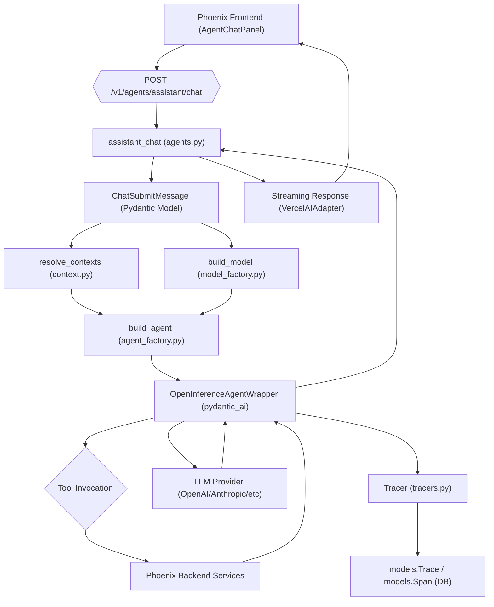
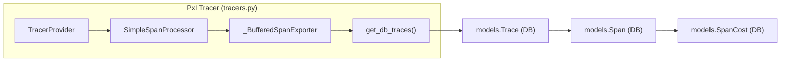

<!-- source: DeepWiki mcp.deepwiki.com · repo arize-ai/phoenix · page 5.6 AI Agent Backend (PxI) · fetched 2026-10-27 -->

# AI Agent Backend (PxI)

<details>
<summary>Relevant source files</summary>

The following files were used as context for generating this wiki page:

- [.agents/skills/phoenix-server/SKILL.md](.agents/skills/phoenix-server/SKILL.md)
- [.agents/skills/phoenix-server/references/database-patterns.md](.agents/skills/phoenix-server/references/database-patterns.md)
- [.agents/skills/phoenix-server/references/graphql-patterns.md](.agents/skills/phoenix-server/references/graphql-patterns.md)
- [.agents/skills/phoenix-server/references/test-patterns.md](.agents/skills/phoenix-server/references/test-patterns.md)
- [.github/workflows/pxi-evals.yml](.github/workflows/pxi-evals.yml)
- [REVIEW.md](REVIEW.md)
- [app/src/agent/chat/__tests__/shouldSendAutomatically.test.ts](app/src/agent/chat/__tests__/shouldSendAutomatically.test.ts)
- [app/src/agent/extensions/__tests__/toolRegistry.test.ts](app/src/agent/extensions/__tests__/toolRegistry.test.ts)
- [app/src/agent/extensions/toolRegistry.ts](app/src/agent/extensions/toolRegistry.ts)
- [app/src/agent/tools/playgroundPrompt/__tests__/playgroundPrompt.test.ts](app/src/agent/tools/playgroundPrompt/__tests__/playgroundPrompt.test.ts)
- [app/src/api/__generated__/v1.ts](app/src/api/__generated__/v1.ts)
- [app/src/components/agent/ToolPart.tsx](app/src/components/agent/ToolPart.tsx)
- [app/src/pages/playground/__tests__/playgroundAgentContextUtils.test.ts](app/src/pages/playground/__tests__/playgroundAgentContextUtils.test.ts)
- [app/src/pages/playground/playgroundAgentContextUtils.ts](app/src/pages/playground/playgroundAgentContextUtils.ts)
- [app/src/pages/settings/__generated__/CustomProviderFormTestCredentialsMutation.graphql.ts](app/src/pages/settings/__generated__/CustomProviderFormTestCredentialsMutation.graphql.ts)
- [app/tests/pxi/fixtures.ts](app/tests/pxi/fixtures.ts)
- [app/tests/pxi/ingest-traces-smoke.spec.ts](app/tests/pxi/ingest-traces-smoke.spec.ts)
- [docs/phoenix/tracing/how-to-tracing/setup-tracing/setup-projects.mdx](docs/phoenix/tracing/how-to-tracing/setup-tracing/setup-projects.mdx)
- [evals/pxi/README.md](evals/pxi/README.md)
- [evals/pxi/datasets/debug_trace_skill_trigger.yaml](evals/pxi/datasets/debug_trace_skill_trigger.yaml)
- [evals/pxi/datasets/in_app_links.yaml](evals/pxi/datasets/in_app_links.yaml)
- [evals/pxi/datasets/set_spans_filter.yaml](evals/pxi/datasets/set_spans_filter.yaml)
- [evals/pxi/datasets/set_time_range.yaml](evals/pxi/datasets/set_time_range.yaml)
- [evals/pxi/evaluators/__init__.py](evals/pxi/evaluators/__init__.py)
- [evals/pxi/evaluators/tools.py](evals/pxi/evaluators/tools.py)
- [evals/pxi/harness/agent_task.py](evals/pxi/harness/agent_task.py)
- [evals/pxi/harness/run_experiment.py](evals/pxi/harness/run_experiment.py)
- [js/packages/phoenix-client/src/__generated__/api/v1.ts](js/packages/phoenix-client/src/__generated__/api/v1.ts)
- [packages/phoenix-client/src/phoenix/client/__generated__/v1/__init__.py](packages/phoenix-client/src/phoenix/client/__generated__/v1/__init__.py)
- [packages/phoenix-client/src/phoenix/client/helpers/sdk/anthropic/messages.py](packages/phoenix-client/src/phoenix/client/helpers/sdk/anthropic/messages.py)
- [packages/phoenix-client/src/phoenix/client/helpers/sdk/openai/chat.py](packages/phoenix-client/src/phoenix/client/helpers/sdk/openai/chat.py)
- [packages/phoenix-client/tests/canary/sdk/anthropic/test_messages.py](packages/phoenix-client/tests/canary/sdk/anthropic/test_messages.py)
- [packages/phoenix-client/tests/canary/sdk/openai/test_chat.py](packages/phoenix-client/tests/canary/sdk/openai/test_chat.py)
- [schemas/openapi.json](schemas/openapi.json)
- [src/phoenix/server/agents/__init__.py](src/phoenix/server/agents/__init__.py)
- [src/phoenix/server/agents/capabilities/tools/external/__init__.py](src/phoenix/server/agents/capabilities/tools/external/__init__.py)
- [src/phoenix/server/agents/context.py](src/phoenix/server/agents/context.py)
- [src/phoenix/server/agents/prompts/__init__.py](src/phoenix/server/agents/prompts/__init__.py)
- [src/phoenix/server/agents/prompts/context/PLAYGROUND_CONTEXT_INSTRUCTIONS.xml.j2](src/phoenix/server/agents/prompts/context/PLAYGROUND_CONTEXT_INSTRUCTIONS.xml.j2)
- [src/phoenix/server/agents/prompts/skills/annotate-spans/SKILL.md](src/phoenix/server/agents/prompts/skills/annotate-spans/SKILL.md)
- [src/phoenix/server/agents/prompts/skills/debug-trace/SKILL.md](src/phoenix/server/agents/prompts/skills/debug-trace/SKILL.md)
- [src/phoenix/server/agents/prompts/skills/playground/SKILL.md](src/phoenix/server/agents/prompts/skills/playground/SKILL.md)
- [src/phoenix/server/agents/skills/__init__.py](src/phoenix/server/agents/skills/__init__.py)
- [src/phoenix/server/agents/skills/annotate_spans.py](src/phoenix/server/agents/skills/annotate_spans.py)
- [src/phoenix/server/agents/skills/debug_trace.py](src/phoenix/server/agents/skills/debug_trace.py)
- [src/phoenix/server/api/routers/agents.py](src/phoenix/server/api/routers/agents.py)
- [src/phoenix/server/api/routers/v1/spans.py](src/phoenix/server/api/routers/v1/spans.py)
- [src/phoenix/server/api/routers/v1/traces.py](src/phoenix/server/api/routers/v1/traces.py)
- [src/phoenix/server/dml_event_handler.py](src/phoenix/server/dml_event_handler.py)
- [src/phoenix/tracers.py](src/phoenix/tracers.py)
- [tests/integration/_helpers.py](tests/integration/_helpers.py)
- [tests/integration/auth/conftest.py](tests/integration/auth/conftest.py)
- [tests/integration/auth/test_auth.py](tests/integration/auth/test_auth.py)
- [tests/unit/pxi/evals/test_agent_task_inputs.py](tests/unit/pxi/evals/test_agent_task_inputs.py)
- [tests/unit/pxi/evals/test_datasets.py](tests/unit/pxi/evals/test_datasets.py)
- [tests/unit/pxi/evals/test_evaluator_matchers.py](tests/unit/pxi/evals/test_evaluator_matchers.py)
- [tests/unit/pxi/evals/test_evaluators.py](tests/unit/pxi/evals/test_evaluators.py)
- [tests/unit/server/agents/capabilities/contexts/test_capabilities.py](tests/unit/server/agents/capabilities/contexts/test_capabilities.py)
- [tests/unit/server/agents/test_agent_factory.py](tests/unit/server/agents/test_agent_factory.py)
- [tests/unit/server/api/routers/v1/test_spans.py](tests/unit/server/api/routers/v1/test_spans.py)
- [tests/unit/server/api/routers/v1/test_traces.py](tests/unit/server/api/routers/v1/test_traces.py)
- [tests/unit/test_tracers.py](tests/unit/test_tracers.py)

</details>


The AI Agent Backend, also known as Phoenix Intelligence (PxI), provides the server-side infrastructure for Phoenix's AI assistant capabilities. This system enables the Phoenix frontend to interact with various Large Language Models (LLMs) through a unified API, leveraging `pydantic-ai` for agent orchestration, tool execution, and context management. It also handles the ingestion and export of OpenTelemetry traces generated by agent interactions.

The primary purpose of the PxI backend is to:
1.  **Orchestrate AI agents**: Manage the lifecycle of AI agent interactions, including message processing, tool invocation, and response generation.
2.  **Provide model selection**: Allow users to choose from a variety of LLMs, including built-in and custom providers, with appropriate credential management.
3.  **Enable tool capabilities**: Expose Phoenix-specific functionalities as tools that agents can use to interact with the Phoenix platform (e.g., querying traces, creating annotations).
4.  **Resolve context**: Incorporate relevant contextual information (e.g., current project, selected spans) into agent prompts to enhance their understanding and response quality.
5.  **Expose a REST endpoint**: Offer a `/agents` REST API for the frontend to communicate with the AI agent system, supporting streaming responses and Vercel AI SDK compatibility.
6.  **Trace agent activity**: Generate and manage OpenTelemetry traces for agent interactions, allowing for observability and cost tracking.

## Architecture Overview

The AI Agent Backend is built around a FastAPI router that exposes the `/agents` endpoint [src/phoenix/server/api/routers/agents.py:7](). This endpoint serves as the communication hub for the frontend AI assistant. Key components include:

*   **`pydantic-ai` Integration**: The core of the agent system relies on the `pydantic-ai` library for defining agents, models, and tools [src/phoenix/server/api/routers/agents.py:16-17]().
*   **Agent Factory (`build_agent`)**: Responsible for constructing the AI agent instance based on requested capabilities and model selection [src/phoenix/server/agents/agent_factory.py:35-42]().
*   **Model Factory (`build_model`)**: Handles the instantiation of LLM clients, resolving credentials and configuring providers [src/phoenix/server/agents/model_factory.py:136-166]().
*   **Context Resolution**: Gathers and formats contextual information from the Phoenix application state to inform the agent [src/phoenix/server/agents/context.py:48-51]().
*   **Tool Capabilities**: Defines the specific actions an agent can take within the Phoenix environment [src/phoenix/server/agents/capabilities/__init__.py]().
*   **OpenTelemetry Tracing**: Integrates with Phoenix's tracing system to record agent interactions, tool calls, and LLM invocations [src/phoenix/tracers.py:127-155]().

### AI Agent Backend Data Flow

The following diagram illustrates the high-level data flow when a user interacts with the AI agent in the Phoenix frontend:

"Natural Language Space" to "Code Entity Space" Mapping:


Sources:
- [src/phoenix/server/api/routers/agents.py:189-200]()
- [src/phoenix/server/agents/agent_factory.py:35-42]()
- [src/phoenix/server/agents/model_factory.py:136-166]()
- [src/phoenix/server/agents/context.py:48-51]()
- [src/phoenix/tracers.py:88-115]()

## `/agents` REST Endpoint

The primary interaction point for the frontend AI assistant is the `/v1/agents/assistant/chat` endpoint [src/phoenix/server/api/routers/agents.py:228](). This endpoint is designed to be compatible with the Vercel AI SDK, allowing for streaming responses and a standardized message format using `VercelAIAdapter` [src/phoenix/server/api/routers/agents.py:17]().

### Request Structure

The request body for the `/v1/agents/assistant/chat` endpoint is a discriminated union of `ChatSubmitMessage` and `ChatRegenerateMessage`, both extending `_ChatMessageMixin` [src/phoenix/server/api/routers/agents.py:189-194]().

```python
class _ChatMessageMixin(_ObservabilityMixin):
    """Phoenix-specific extensions added to Vercel AI request messages."""
    contexts: list[ChatContext] = Field(default_factory=list)
    messages: list[AssistantMetadataUIMessage]
    model: AgentModelSelection
```

The `_ChatMessageMixin` adds Phoenix-specific fields:
*   `contexts`: A list of `ChatContext` objects providing contextual information [src/phoenix/server/agents/context.py:107-122]().
*   `model`: An `AgentModelSelection` object specifying the chosen LLM provider and model [src/phoenix/server/api/routers/agents.py:186]().
*   `ingest_traces`: A boolean indicating whether to store traces locally [src/phoenix/server/api/routers/agents.py:169]().

Sources:
- [src/phoenix/server/api/routers/agents.py:173-187]()
- [src/phoenix/server/api/routers/agents.py:189-194]()
- [src/phoenix/server/agents/context.py:107-122]()

## Agent Factory

The `build_agent` function is responsible for creating the `pydantic-ai` agent instance. It configures tools based on the requested capabilities and model type [src/phoenix/server/agents/agent_factory.py:35-42]().

```python
def build_agent(
    *,
    model: Model,
    instructions: AgentInstructions | None = None,
    docs_mcp_server: MCPServerStreamableHTTP | None = None,
    enable_web_access: bool = False,
    tracer_provider: TracerProvider | None = None,
) -> OpenInferenceAgentWrapper[AgentDependencies, AgentOutput]:
    # ...
```

The agent is wrapped in an `OpenInferenceAgentWrapper` to automatically instrument agent runs with OpenTelemetry, ensuring that all agent activities are traced [src/phoenix/server/agents/pydantic_ai/openinference_agent_wrapper.py:69-76](). It specifically handles backfilling `TOOL` spans for external tools that may have been resolved since the previous turn.

Sources:
- [src/phoenix/server/agents/agent_factory.py:35-42]()
- [src/phoenix/server/agents/pydantic_ai/openinference_agent_wrapper.py:69-76]()

## Model Selection

The `build_model` function handles the instantiation of the appropriate `pydantic-ai` model based on the `AgentModelSelection` [src/phoenix/server/agents/model_factory.py:136-166]().

### Built-in vs Custom Providers

| Provider Type | Resolution Logic |
| :--- | :--- |
| **Built-in** | Resolves credentials from `_resolve_secrets` (DB) first, then `os.getenv` [src/phoenix/server/agents/model_factory.py:107-119](). |
| **Custom** | Retrieves `models.GenerativeModelCustomProvider` from DB using `GlobalID` [src/phoenix/server/agents/model_factory.py:167-177](). |

Custom providers allow users to define their own SDK configurations (OpenAI, Azure, Anthropic, AWS Bedrock, Google GenAI) [src/phoenix/server/agents/model_factory.py:167-177]().

Sources:
- [src/phoenix/server/agents/model_factory.py:136-166]()
- [src/phoenix/server/agents/model_factory.py:107-119]()

## Tool Capabilities

The agent's capabilities are determined by tool implementations. Key capabilities include:

*   **External Tools**: Dynamic capabilities resolved through the frontend tool registry [app/src/agent/extensions/toolRegistry.ts:160-167]().
*   **Documentation (MCP)**: Ability to search Phoenix documentation via an MCP server [src/phoenix/server/agents/agent_factory.py:63-67]().
*   **Web Access**: Optional search and fetch capabilities [src/phoenix/server/api/routers/agents.py:39-40]().
*   **Frontend-Executed Tools**: Tools like `bash` or `ask_user` that run in the client-side sandbox [app/src/agent/extensions/toolRegistry.ts:187-206]().

Sources:
- [src/phoenix/server/agents/agent_factory.py:49-72]()
- [app/src/agent/extensions/toolRegistry.ts:160-167]()

## Context Resolution

Context resolution transforms UI state into structured information for the LLM. `ChatContext` is a discriminated union of several types [src/phoenix/server/agents/context.py:107-122]():

*   **`AppContext`**: Per-turn browser clock and timezone [src/phoenix/client/__generated__/v1/__init__.py:28-32]().
*   **`ProjectContext`**: Active project and current span filters [src/phoenix/server/agents/context.py:31-47]().
*   **`TraceContext` / `AgentSpanContext`**: Details on specific traces or spans selected by the user [src/phoenix/client/__generated__/v1/__init__.py:11-16]().
*   **`DatasetContext`**: Context for datasets and dataset versions [src/phoenix/client/__generated__/v1/__init__.py:115-119]().

Sources:
- [src/phoenix/server/agents/context.py:107-122]()
- [src/phoenix/client/__generated__/v1/__init__.py:11-32]()

## OpenTelemetry Tracing (PxI)

PxI utilizes a specialized `Tracer` class to capture agent interactions in-memory and persist them as standard Phoenix traces [src/phoenix/tracers.py:127-155]().

### Tracer Implementation

The `Tracer` wraps an OTel `TracerProvider` and uses a `_BufferedSpanExporter` to hold spans until they are converted to DB models via `get_db_traces` [src/phoenix/tracers.py:127-155]().



### Key Tracing Features
*   **Detached Context**: `detached_otel_context` is used to ensure agent spans become root spans rather than children of the HTTP request span [src/phoenix/tracers.py:37-47]().
*   **Attribute Limits**: The tracer increases `max_span_attributes` to 100,000 to accommodate large chat histories [src/phoenix/tracers.py:134]().

Sources:
- [src/phoenix/tracers.py:37-47]()
- [src/phoenix/tracers.py:127-155]()

## PXI Evaluation Harness

Phoenix includes an evaluation harness specifically for testing PxI agents located in `evals/pxi/`. This system uses standard Phoenix evaluation patterns to measure agent performance on tool calling and context resolution tasks.

The harness includes:
*   **Agent Task Definition**: Defines tasks for the agent to perform during evaluation [evals/pxi/harness/agent_task.py]().
*   **Experiment Runner**: Logic to execute agent experiments and collect results [evals/pxi/harness/run_experiment.py]().
*   **Evaluators**: Specialized evaluators for checking tool call accuracy and output quality [evals/pxi/evaluators/tools.py]().

Sources:
- [evals/pxi/README.md]()
- [evals/pxi/evaluators/tools.py]()

---

