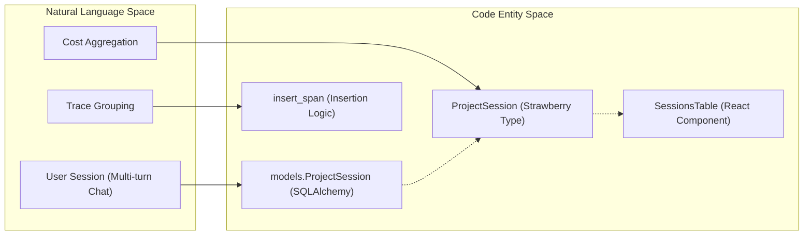
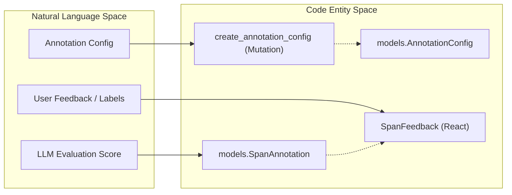
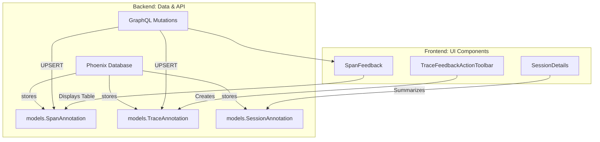

<!-- source: DeepWiki mcp.deepwiki.com · repo arize-ai/phoenix · page 5.7 Sessions & Annotations · fetched 2026-10-27 -->

# Sessions & Annotations

Relevant source files

The following files were used as context for generating this wiki page:

- [app/src/@types/time.d.ts](app/src/@types/time.d.ts)
- [app/src/components/feedback/FeedbackActionToolbar.tsx](app/src/components/feedback/FeedbackActionToolbar.tsx)
- [app/src/components/feedback/index.ts](app/src/components/feedback/index.ts)
- [app/src/constants/feedbackConstants.ts](app/src/constants/feedbackConstants.ts)
- [app/src/constants/index.ts](app/src/constants/index.ts)
- [app/src/pages/project/SessionsTable.tsx](app/src/pages/project/SessionsTable.tsx)
- [app/src/pages/project/__generated__/SessionsTableQuery.graphql.ts](app/src/pages/project/__generated__/SessionsTableQuery.graphql.ts)
- [app/src/pages/project/__generated__/SessionsTable_sessions.graphql.ts](app/src/pages/project/__generated__/SessionsTable_sessions.graphql.ts)
- [app/src/pages/trace/SessionDetails.tsx](app/src/pages/trace/SessionDetails.tsx)
- [app/src/pages/trace/SessionDetailsTraceList.tsx](app/src/pages/trace/SessionDetailsTraceList.tsx)
- [app/src/pages/trace/SessionDetailsTracesView.tsx](app/src/pages/trace/SessionDetailsTracesView.tsx)
- [app/src/pages/trace/TraceFeedbackActionToolbar.tsx](app/src/pages/trace/TraceFeedbackActionToolbar.tsx)
- [app/src/pages/trace/__generated__/SessionDetailsQuery.graphql.ts](app/src/pages/trace/__generated__/SessionDetailsQuery.graphql.ts)
- [app/src/pages/trace/__generated__/SessionDetailsTraceListQuery.graphql.ts](app/src/pages/trace/__generated__/SessionDetailsTraceListQuery.graphql.ts)
- [app/src/pages/trace/__generated__/SessionDetailsTraceListRefetchQuery.graphql.ts](app/src/pages/trace/__generated__/SessionDetailsTraceListRefetchQuery.graphql.ts)
- [app/src/pages/trace/__generated__/SessionDetailsTraceList_traces.graphql.ts](app/src/pages/trace/__generated__/SessionDetailsTraceList_traces.graphql.ts)
- [app/src/pages/trace/__generated__/TraceFeedbackActionToolbarCreateAnnotationMutation.graphql.ts](app/src/pages/trace/__generated__/TraceFeedbackActionToolbarCreateAnnotationMutation.graphql.ts)
- [app/src/pages/trace/__generated__/TraceFeedbackActionToolbarDeleteAnnotationMutation.graphql.ts](app/src/pages/trace/__generated__/TraceFeedbackActionToolbarDeleteAnnotationMutation.graphql.ts)
- [scripts/generate_spans/generate_spans_for_time_series.py](scripts/generate_spans/generate_spans_for_time_series.py)
- [src/phoenix/db/types/annotation_configs.py](src/phoenix/db/types/annotation_configs.py)
- [src/phoenix/server/api/input_types/ProjectSessionSort.py](src/phoenix/server/api/input_types/ProjectSessionSort.py)
- [src/phoenix/server/api/mutations/annotation_config_mutations.py](src/phoenix/server/api/mutations/annotation_config_mutations.py)
- [src/phoenix/server/api/routers/v1/annotation_configs.py](src/phoenix/server/api/routers/v1/annotation_configs.py)
- [src/phoenix/server/api/types/AnnotationConfig.py](src/phoenix/server/api/types/AnnotationConfig.py)
- [src/phoenix/server/api/types/ProjectSession.py](src/phoenix/server/api/types/ProjectSession.py)
- [tests/unit/_helpers.py](tests/unit/_helpers.py)
- [tests/unit/db/types/test_annotation_configs.py](tests/unit/db/types/test_annotation_configs.py)
- [tests/unit/server/api/dataloaders/conftest.py](tests/unit/server/api/dataloaders/conftest.py)
- [tests/unit/server/api/mutations/test_annotation_config_mutations.py](tests/unit/server/api/mutations/test_annotation_config_mutations.py)
- [tests/unit/server/api/routers/v1/test_annotation_configs.py](tests/unit/server/api/routers/v1/test_annotation_configs.py)
- [tests/unit/server/api/types/test_Project.py](tests/unit/server/api/types/test_Project.py)
- [tests/unit/server/api/types/test_ProjectSession.py](tests/unit/server/api/types/test_ProjectSession.py)

This page details Phoenix's implementation of project sessions, session annotations, and the broader annotation system for spans and traces. Project sessions group multi-turn conversations, providing a higher-level view of user interactions. Annotations allow users to add qualitative and quantitative feedback to individual spans, traces, or entire sessions, which is crucial for evaluation and analysis.

## Project Sessions

A project session represents a grouping of related traces, typically forming a multi-turn conversation or a sequence of interactions within a larger task. Sessions are automatically created or updated based on the `session_id` attribute present on spans.

### Data Model and Creation

The core data model for sessions is `models.ProjectSession` [src/phoenix/db/models.py:537-553]().

**Session Creation/Update Logic:**
When a new span is ingested via `insert_span` [src/phoenix/db/insertion/span.py:25-29](), the system checks for a `session_id` attribute [src/phoenix/db/insertion/span.py:62-63]().
1. If a `session_id` is present and a `models.ProjectSession` with that ID already exists, the existing session's `start_time` and `end_time` are updated if the new span's times extend the session's range [src/phoenix/db/insertion/span.py:94-98]().
2. If a `session_id` is present but no corresponding `models.ProjectSession` exists, a new `models.ProjectSession` is created with the provided `session_id`, `start_time`, `end_time`, and `project_id` [src/phoenix/db/insertion/span.py:82-87]().
3. If a trace already has an associated `project_session_rowid`, that session is used, and any `session_id` on the incoming span is ignored for session association [src/phoenix/db/insertion/span.py:67-75]().

This ensures that traces with the same `session_id` are grouped under a single `ProjectSession` and that session time ranges accurately reflect the earliest and latest spans within them.

### Session Attributes

`ProjectSession` objects [src/phoenix/server/api/types/ProjectSession.py:42]() expose several key attributes via the GraphQL API:
*   `id`: The internal database ID.
*   `sessionId`: The user-defined session identifier (from `SpanAttributes.SESSION_ID`) [src/phoenix/server/api/types/ProjectSession.py:51-61]().
*   `numTraces`: The count of traces associated with the session, resolved via `session_num_traces` DataLoader [src/phoenix/server/api/types/ProjectSession.py:105-109]().
*   `startTime`, `endTime`: The earliest and latest timestamps of all spans within the session [src/phoenix/server/api/types/ProjectSession.py:64-87]().
*   `firstInput`, `lastOutput`: The input of the first trace and output of the last trace in the session [src/phoenix/server/api/types/ProjectSession.py:119-142]().
*   `tokenUsage`: Aggregated token counts for the session [src/phoenix/server/api/types/ProjectSession.py:145-153]().
*   `costSummary`: Aggregated cost information for the session [app/src/pages/trace/__generated__/SessionDetailsQuery.graphql.ts:18-31]().

### Frontend Display

Sessions are displayed in the frontend, primarily in the `SessionsTable` [app/src/pages/project/SessionsTable.tsx:125]() within a project view. This table allows users to browse sessions, sort them by various metrics, and filter them.

**Session Details View:**
Clicking on a session in the table navigates to the `SessionDetails` page [app/src/pages/trace/SessionDetails.tsx:161](). This page provides a comprehensive view of a single session, including:
*   Summary statistics like total tokens, cost, and P50 latency [app/src/pages/trace/SessionDetails.tsx:70-126]().
*   Session-level annotation summaries via `SessionAnnotationSummaryGroupStacks` [app/src/pages/trace/SessionDetails.tsx:130-133]().
*   A tabbed interface to view session "turns" (individual traces as conversational exchanges) [app/src/pages/trace/SessionDetailsTraceList.tsx:144-185]() or a list of all traces within the session [app/src/pages/trace/SessionDetailsTracesView.tsx]().

**Session Turns View (`SessionDetailsTraceList`):**
This view presents traces as a sequence of "turns," typically showing the input and output of each root span in a conversational format [app/src/pages/trace/SessionDetailsTraceList.tsx:144-185](). Each turn can display:
*   Input and output content via `RootSpanMessage` [app/src/pages/trace/SessionDetailsTraceList.tsx:144]().
*   Latency, token counts, and costs for the root span [app/src/pages/trace/SessionDetailsTraceList.tsx:40-44]().

### Natural Language to Code Space: Sessions

The following diagram maps session concepts to the implementation classes and database models.

**Diagram: Session Entity Mapping**
Sources: [src/phoenix/db/models.py](), [src/phoenix/server/api/types/ProjectSession.py](), [app/src/pages/project/SessionsTable.tsx](), [src/phoenix/db/insertion/span.py]()

## Annotation System

Phoenix provides a flexible annotation system to attach metadata, labels, scores, and explanations to spans, traces, and sessions.

### Annotation Data Model

The core annotation models share common fields like `name`, `label`, `score`, and `explanation` [src/phoenix/db/models.py:656-670]().
*   `models.SpanAnnotation`: Associated with a specific span [src/phoenix/db/models.py:680-692]().
*   `models.TraceAnnotation`: Associated with an entire trace [src/phoenix/db/models.py:706-718]().
*   `models.SessionAnnotation`: Associated with a project session [src/phoenix/db/models.py:732-744]().

### Annotation Configuration

Phoenix allows defining configurations for annotations, which can be categorical, continuous, or freeform. These are managed via `AnnotationConfig` models [src/phoenix/db/types/annotation_configs.py:100-111]().

**Mutation Example:**
Users can create configurations via `create_annotation_config` [src/phoenix/server/api/mutations/annotation_config_mutations.py:160-199](). This mutation validates that names like `note` are reserved and ensures uniqueness within the database [src/phoenix/server/api/mutations/annotation_config_mutations.py:180-195]().

### Annotation Management

Annotations can be created, updated, and deleted via GraphQL mutations and REST API endpoints.

**GraphQL Mutations:**
*   `create_span_annotations`: Creates new span annotations with UPSERT behavior.
*   `create_trace_annotations`: Similar to span annotations, but for traces.
*   `delete_span_annotations`: Deletes span annotations by ID.

**Feedback UI Components:**
The frontend provides a `TraceFeedbackActionToolbar` [app/src/pages/trace/TraceFeedbackActionToolbar.tsx:32]() for traces, allowing users to quickly add feedback. This interacts with mutations like `TraceFeedbackActionToolbarCreateAnnotationMutation` [app/src/pages/trace/__generated__/TraceFeedbackActionToolbarCreateAnnotationMutation.graphql.ts]().

### Natural Language to Code Space: Annotations

The following diagram maps annotation concepts to the implementation components.

**Diagram: Annotation Entity Mapping**
Sources: [src/phoenix/db/models.py](), [src/phoenix/server/api/mutations/annotation_config_mutations.py](), [app/src/pages/trace/SpanFeedback.tsx]()

### Annotation Data Flow

The following diagram illustrates how annotations move from UI interactions or API calls into the database.

**Diagram: Annotation System Data Flow**
Sources: [src/phoenix/db/models.py](), [app/src/pages/trace/SpanFeedback.tsx](), [app/src/pages/trace/TraceFeedbackActionToolbar.tsx](), [app/src/pages/trace/SessionDetails.tsx]()

Sources:
* [app/src/pages/project/SessionsTable.tsx]()
* [app/src/pages/trace/SessionDetails.tsx]()
* [app/src/pages/trace/SessionDetailsTraceList.tsx]()
* [app/src/pages/trace/TraceFeedbackActionToolbar.tsx]()
* [src/phoenix/db/insertion/span.py]()
* [src/phoenix/db/models.py]()
* [src/phoenix/db/types/annotation_configs.py]()
* [src/phoenix/server/api/mutations/annotation_config_mutations.py]()
* [src/phoenix/server/api/types/ProjectSession.py]()

---

