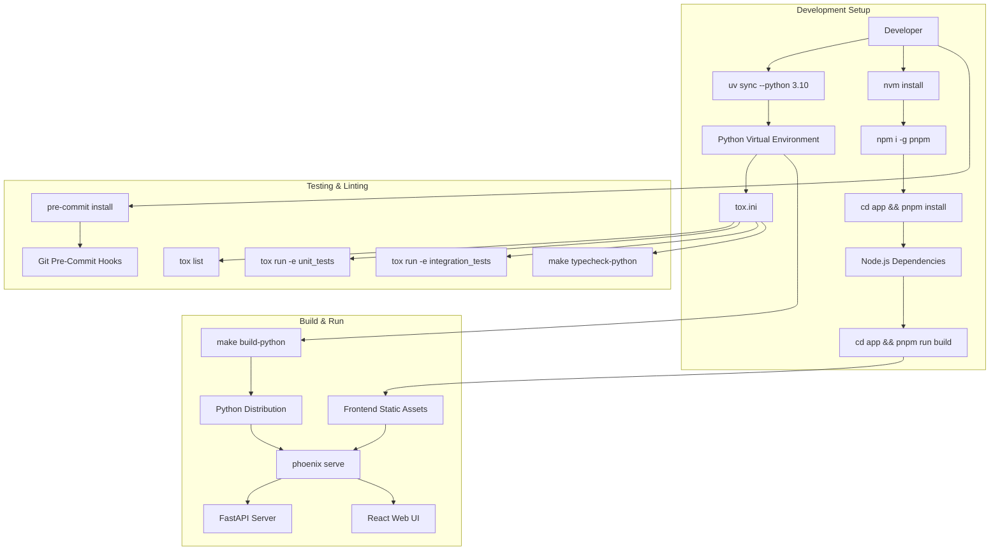
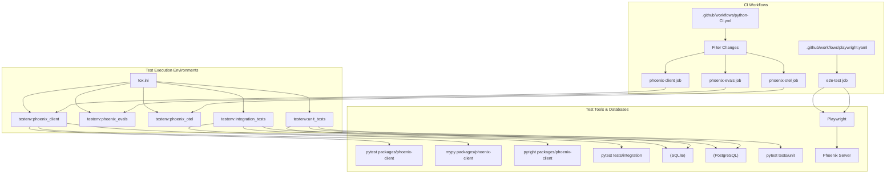
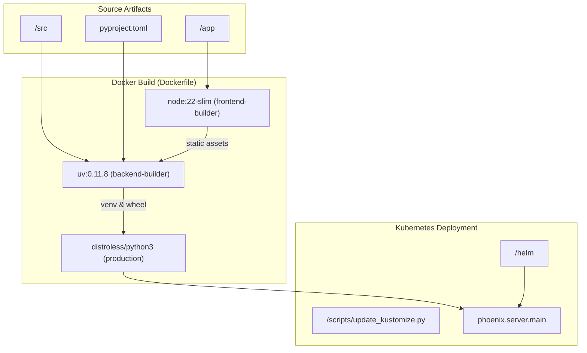

<!-- source: DeepWiki mcp.deepwiki.com · repo arize-ai/phoenix · page 6 Development & Deployment · fetched 2026-10-27 -->

# Development & Deployment

Relevant source files

The following files were used as context for generating this wiki page:

- [.claude/settings.json](.claude/settings.json)
- [.codex/config.toml](.codex/config.toml)
- [.codex/hooks.json](.codex/hooks.json)
- [.codex/hooks/run_changed_file_checks.sh](.codex/hooks/run_changed_file_checks.sh)
- [.cursor/rules/typescript-packages/RULE.md](.cursor/rules/typescript-packages/RULE.md)
- [.dockerignore](.dockerignore)
- [.git-blame-ignore-revs](.git-blame-ignore-revs)
- [.github/workflows/cost-sync.yml](.github/workflows/cost-sync.yml)
- [.github/workflows/docker-build-experimental.yml](.github/workflows/docker-build-experimental.yml)
- [.github/workflows/docker-build-nightly.yml](.github/workflows/docker-build-nightly.yml)
- [.github/workflows/docker-build-release.yml](.github/workflows/docker-build-release.yml)
- [.github/workflows/helm-ci.yml](.github/workflows/helm-ci.yml)
- [.github/workflows/playwright.yaml](.github/workflows/playwright.yaml)
- [.github/workflows/publish.yaml](.github/workflows/publish.yaml)
- [.github/workflows/pull-requests.yaml](.github/workflows/pull-requests.yaml)
- [.github/workflows/python-CI.yml](.github/workflows/python-CI.yml)
- [.github/workflows/python-all-platforms.yml](.github/workflows/python-all-platforms.yml)
- [.github/workflows/release.yml](.github/workflows/release.yml)
- [.github/workflows/sync-lockfile-release-pr.yml](.github/workflows/sync-lockfile-release-pr.yml)
- [.github/workflows/typescript-CI.yml](.github/workflows/typescript-CI.yml)
- [.github/workflows/typescript-packages-CI.yml](.github/workflows/typescript-packages-CI.yml)
- [.github/workflows/typescript-packages-publish.yml](.github/workflows/typescript-packages-publish.yml)
- [.github/workflows/update-phoenix-package-versions.yml](.github/workflows/update-phoenix-package-versions.yml)
- [.gitignore](.gitignore)
- [.oxfmtrc.jsonc](.oxfmtrc.jsonc)
- [.tours/app.tour](.tours/app.tour)
- [.vscode/extensions.json](.vscode/extensions.json)
- [CONTRIBUTING.md](CONTRIBUTING.md)
- [DEVELOPMENT.md](DEVELOPMENT.md)
- [Dockerfile](Dockerfile)
- [app/README.md](app/README.md)
- [app/__tests__/authFetch.test.ts](app/__tests__/authFetch.test.ts)
- [requirements/canary/sdk/anthropic.txt](requirements/canary/sdk/anthropic.txt)
- [requirements/ci.txt](requirements/ci.txt)
- [scripts/update_helm.py](scripts/update_helm.py)
- [scripts/update_kustomize.py](scripts/update_kustomize.py)
- [tox.ini](tox.ini)

This page covers the development environment setup, build processes, testing infrastructure, and deployment strategies for Phoenix. It includes local development workflows, CI/CD pipelines, containerization, and production deployment options using Docker, Kubernetes, and Helm.

For configuration options and environment variables, see [Configuration Options](#9.3). For specific deployment scenarios, see [Deployment Guide](#9.4).

## Development Workflow & Tooling

This section provides an overview of the development environment setup, including essential tools, code formatting, linting, and pre-commit hooks. For details, see [Development Workflow & Tooling](#6.1).

Phoenix supports local development with SQLite or PostgreSQL databases, using `uv` for Python dependency management and `pnpm` for frontend builds.

### Local Development Setup

Phoenix development requires Python 3.10-3.14, Node.js LTS with pnpm, and optionally PostgreSQL for database testing.

**Development Dependencies:**
- Python 3.10-3.14 (matrix tested at [.github/workflows/python-CI.yml:106](), [.github/workflows/python-all-platforms.yml:46]())
- Node.js LTS with pnpm (installation instructions at [DEVELOPMENT.md:41-54]())
- PostgreSQL (optional, used in CI at [.github/workflows/python-all-platforms.yml:127-139]())
- `uv` 0.11.8 (specified at [.github/workflows/python-CI.yml:120]())

**Development Commands:**

| Command | File Reference | Purpose |
|---------|---------------|---------|
| `uv sync --python 3.10` | [DEVELOPMENT.md:34]() | Install Python dependencies in editable mode |
| `pnpm install` (in `app/`) | [DEVELOPMENT.md:67]() | Install Node.js dependencies |
| `pnpm run build` (in `app/`) | [DEVELOPMENT.md:68]() | Build the web application |
| `tox run -e unit_tests` | [DEVELOPMENT.md:103]() | Run unit tests |
| `pre-commit install` | [DEVELOPMENT.md:138]() | Install pre-commit hooks |

The development environment supports SQLite (default) and PostgreSQL backends. Database migrations run automatically on startup.

**Local Development Architecture**

Sources: [DEVELOPMENT.md:25-141](), [tox.ini:1-163]()

## Testing Strategy

This section outlines the testing approach, including unit, integration, and E2E tests, database fixtures, and test organization. For details, see [Testing Strategy](#6.2).

Phoenix testing spans unit tests, integration tests, type checking, and browser-based E2E tests across multiple database backends and platforms.

**Test Categories:**

| Test Type | Entry Point | Fixtures/Tools | Database Support |
|-----------|-------------|----------------|------------------|
| Unit Tests | `tox run -e unit_tests` | `pytest` | SQLite, PostgreSQL [tox.ini:144-155]() |
| Integration | `tox run -e integration_tests` | `pytest` | SQLite, PostgreSQL [tox.ini:127-142]() |
| Type Check | `make typecheck-python` | `mypy`, `pyright` | N/A [DEVELOPMENT.md:122]() |
| E2E Tests | `pnpm test:e2e` (in `app/`) | `playwright` | SQLite in-memory [app/README.md:82]() |
| Package Tests | `tox run -e phoenix_client` | `pytest`, `mypy`, `pyright` | N/A [tox.ini:11-23]() |

The CI pipeline at [.github/workflows/python-CI.yml:1-37]() runs tests with matrix builds across Python versions. PostgreSQL tests use service containers defined at [.github/workflows/python-all-platforms.yml:127-139]().

**Test Infrastructure Architecture**

Sources: [tox.ini:1-166](), [.github/workflows/python-CI.yml:1-168](), [.github/workflows/playwright.yaml:1-132]()

## CI/CD Pipeline

This section documents the GitHub Actions workflows, conditional execution, quality gates, and deployment automation. For details, see [CI/CD Pipeline](#6.3).

Phoenix uses GitHub Actions for CI/CD with automated testing, schema validation, Docker image building, and Helm chart releases.

### Python CI Workflow

The Python CI workflow at [.github/workflows/python-CI.yml:1-37]() triggers on push to `main`/`version-*` branches and pull requests.

**CI Jobs and File References:**

| Job Name | Trigger Condition | Tool | File Reference |
|----------|------------------|---------|----------------|
| changes | Always | `dorny/paths-filter` | [.github/workflows/python-CI.yml:23-74]() |
| phoenix-client | `phoenix_client == 'true'` | `uvx tox run -e phoenix_client` | [.github/workflows/python-CI.yml:99-121]() |
| phoenix-evals | `phoenix_evals == 'true'` | `uvx tox run -e phoenix_evals` | [.github/workflows/python-CI.yml:123-145]() |
| test-json-canonicalization-schema | `json_canonicalization_schema == 'true'` | `make test-jcs` | [.github/workflows/python-CI.yml:170-210]() |

The `changes` job uses path filters defined at [.github/workflows/python-CI.yml:46-74]() to conditionally run downstream jobs.

### TypeScript CI Workflow

The TypeScript CI workflow at [.github/workflows/typescript-CI.yml:1-91]() validates frontend code changes.

**TypeScript CI Steps:**
- **Type Check**: `pnpm run typecheck` [.github/workflows/typescript-CI.yml:63-65]()
- **Formatting**: `pnpm run fmt:check` [.github/workflows/typescript-CI.yml:66-69]()
- **Lint**: `pnpm run lint` [.github/workflows/typescript-CI.yml:70-73]()
- **Relay Codegen**: `pnpm run build:relay` [.github/workflows/typescript-CI.yml:74-78]()
- **OpenAPI Codegen**: `pnpm run generate:openapi` [.github/workflows/typescript-CI.yml:79-83]()

Sources: [.github/workflows/python-CI.yml:1-210](), [.github/workflows/typescript-CI.yml:1-91](), [.github/workflows/playwright.yaml:1-132]()

## Release Management

This section explains the `release-please` configuration, versioning strategy, and package publishing. For details, see [Release Management](#6.4).

Phoenix uses `release-please` for automated release management, which creates release pull requests and manages versioning.

**Release Workflow:**
- The `release` workflow at [.github/workflows/release.yml:1-25]() triggers on push to `main`.
- It uses `googleapis/release-please-action@v4` to manage version bumps and changelogs [.github/workflows/release.yml:16-19]().
- If `releases_created == 'true'`, it triggers the `publish.yaml` workflow [.github/workflows/release.yml:21-22]().

**Docker Build and Release:**
- The `Publish Docker images` workflow at [.github/workflows/docker-build-release.yml:1-137]() triggers on git tags matching `arize-phoenix-v*`.
- It builds multi-architecture Docker images for `root`, `nonroot`, and `debug` variants [.github/workflows/docker-build-release.yml:17]().
- After building, it updates Kustomize and Helm chart versions via scripts [.github/workflows/docker-build-release.yml:113-120]().

Sources: [.github/workflows/release.yml:1-25](), [.github/workflows/docker-build-release.yml:1-137](), [Dockerfile:1-127]()

## Kubernetes Deployment

This section documents Helm charts, Kustomize manifests, and deployment strategies. For details, see [Kubernetes Deployment](#6.5).

Phoenix provides a Helm chart and Kustomize templates for Kubernetes deployment.

**Deployment Components:**
- **Dockerfile**: A multi-stage build that bundles the React frontend and FastAPI backend into a distroless image [Dockerfile:1-127]().
- **Helm Charts**: Managed in `helm/` directory with automated version updates [.github/workflows/docker-build-release.yml:117-120]().
- **Kustomize**: Templates updated automatically during release via `scripts/update_kustomize.py` [.github/workflows/docker-build-release.yml:113-116]().

**Deployment Entity Mapping**

Sources: [Dockerfile:1-127](), [.github/workflows/docker-build-release.yml:1-137]()

## API Reference Documentation

This section explains the Sphinx-based Python API reference and hosting. For details, see [API Reference Documentation](#6.6).

The Phoenix Python API reference documentation is generated using Sphinx. Documentation for sub-packages like `phoenix-client` and `phoenix-evals` is maintained within their respective directories and ignored in version control until built [.gitignore:85-87]().

Sources: [.gitignore:85-87](), [DEVELOPMENT.md:150-176]()

---

