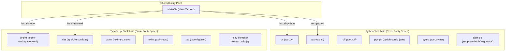
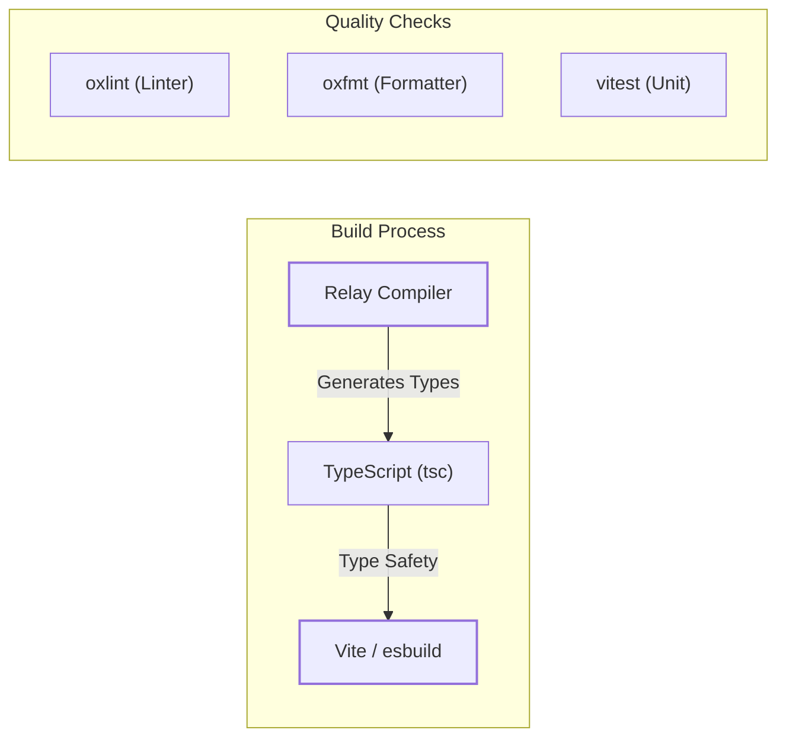

<!-- source: DeepWiki mcp.deepwiki.com · repo arize-ai/phoenix · page 6.1 Development Workflow & Tooling · fetched 2026-10-27 -->

# Development Workflow & Tooling

Relevant source files

The following files were used as context for generating this wiki page:

- [.agents/skills/phoenix-design/SKILL.md](.agents/skills/phoenix-design/SKILL.md)
- [.agents/skills/phoenix-design/rules/bem.md](.agents/skills/phoenix-design/rules/bem.md)
- [.agents/skills/phoenix-design/rules/dialogs.md](.agents/skills/phoenix-design/rules/dialogs.md)
- [.agents/skills/phoenix-design/rules/error-display.md](.agents/skills/phoenix-design/rules/error-display.md)
- [.agents/skills/phoenix-design/rules/tokens.md](.agents/skills/phoenix-design/rules/tokens.md)
- [.claude/settings.json](.claude/settings.json)
- [.codex/config.toml](.codex/config.toml)
- [.codex/hooks.json](.codex/hooks.json)
- [.codex/hooks/run_changed_file_checks.sh](.codex/hooks/run_changed_file_checks.sh)
- [.cursor/rules/python/RULE.md](.cursor/rules/python/RULE.md)
- [.cursor/rules/typescript-packages/RULE.md](.cursor/rules/typescript-packages/RULE.md)
- [.git-blame-ignore-revs](.git-blame-ignore-revs)
- [.gitignore](.gitignore)
- [.oxfmtrc.jsonc](.oxfmtrc.jsonc)
- [.pre-commit-config.yaml](.pre-commit-config.yaml)
- [.tours/app.tour](.tours/app.tour)
- [.vscode/extensions.json](.vscode/extensions.json)
- [AGENTS.md](AGENTS.md)
- [CLAUDE.md](CLAUDE.md)
- [CONTRIBUTING.md](CONTRIBUTING.md)
- [DEVELOPMENT.md](DEVELOPMENT.md)
- [Makefile](Makefile)
- [app/README.md](app/README.md)
- [app/__tests__/authFetch.test.ts](app/__tests__/authFetch.test.ts)
- [scripts/docker/devops/Dockerfile](scripts/docker/devops/Dockerfile)
- [scripts/docker/devops/dev.sh](scripts/docker/devops/dev.sh)
- [scripts/docker/devops/docker-compose.yml](scripts/docker/devops/docker-compose.yml)
- [scripts/docker/devops/oidc-server/Dockerfile](scripts/docker/devops/oidc-server/Dockerfile)
- [scripts/docker/devops/overrides/ldap-no-email.yml](scripts/docker/devops/overrides/ldap-no-email.yml)
- [scripts/docker/devops/overrides/ldap-posix.yml](scripts/docker/devops/overrides/ldap-posix.yml)
- [scripts/docker/devops/smtp-server/Dockerfile](scripts/docker/devops/smtp-server/Dockerfile)
- [scripts/docker/devops/smtp-server/src/server.ts](scripts/docker/devops/smtp-server/src/server.ts)
- [scripts/docker/devops/vite-dev/Dockerfile](scripts/docker/devops/vite-dev/Dockerfile)

This page documents the development environment setup, tooling, and workflows for contributing to Phoenix. It covers package managers, code quality tools, testing frameworks, and common development commands for both Python and TypeScript codebases.

For information about CI/CD pipelines and automation, see [6.3 CI/CD Pipeline](). For testing strategies and fixtures, see [6.2 Testing Strategy]().

---

## Development Environment Overview

Phoenix is a dual-language monorepo requiring separate toolchains for Python and TypeScript development. The repository utilizes a `Makefile` to unify these disparate toolchains into a single entry point for common tasks [Makefile:1-112]().

### Toolchain Mapping

The following diagram bridges the natural language concepts of "Python Development" and "Frontend Development" to the specific code entities and tools used in the Phoenix repository.

**Sources:** [DEVELOPMENT.md:25-125](), [AGENTS.md:3-9](), [Makefile:27-40](), [.pre-commit-config.yaml:1-63]()

---

## Python Development Tools

### Package Management: uv
Phoenix uses `uv` as the primary Python package manager for fast, reliable dependency management [DEVELOPMENT.md:27-29](). The project enforces a specific version via `tool.uv.required-version` in `pyproject.toml` [DEVELOPMENT.md:29]().

The monorepo structure is managed via `uv` workspaces. Sub-packages located in the `packages/` directory are automatically installed in editable mode [DEVELOPMENT.md:36-38]():
- `arize-phoenix-evals`
- `arize-phoenix-otel`
- `arize-phoenix-client`

| Command | Implementation |
|---------|----------------|
| `uv sync --python 3.10` | Installs main package and workspace members in editable mode [DEVELOPMENT.md:31-35](). |
| `uv tool install pre-commit` | Installs the pre-commit runner globally [DEVELOPMENT.md:131-132](). |
| `uv lock --check` | Validates that `uv.lock` is consistent with `pyproject.toml` [pre-commit-config.yaml:56-62](). |

**Sources:** [DEVELOPMENT.md:27-38](), [AGENTS.md:7-12](), [.pre-commit-config.yaml:56-62]()

### Test & Environment Orchestration: tox
`tox` is used to manage isolated virtual environments for standardized execution of tests and quality checks across different Python versions and database backends [DEVELOPMENT.md:92-95]().

Common environments defined in `tox.ini` [DEVELOPMENT.md:94-105]():
- `unit_tests`: Executes `pytest`. Supports `--run-postgres` to test against a PostgreSQL instance [DEVELOPMENT.md:107-111]().
- `ruff`: Runs the `ruff` formatter and linter [DEVELOPMENT.md:147]().
- `clean_jupyter_notebooks`: Uses `nbconvert` to strip metadata and outputs from `.ipynb` files [DEVELOPMENT.md:148]().

**Sources:** [DEVELOPMENT.md:92-117](), [DEVELOPMENT.md:147-149]()

---

## TypeScript Development Tools

### Package Management: pnpm
The frontend application and TypeScript client libraries are managed using `pnpm` (version 9.15.5) [DEVELOPMENT.md:53]().

- **App Directory**: `app/` contains the React SPA [app/README.md:1-3]().
- **JS Directory**: `js/` contains TypeScript packages and shared utilities [Makefile:15]().

### Build and Quality Pipeline
The TypeScript workflow leverages modern, high-performance tooling for static analysis and compilation.

| Tool | Role | File Reference |
|------|------|----------------|
| **Vite** | Build system for the React SPA | [app/README.md:45]() |
| **Relay** | GraphQL client and code generator | [app/README.md:102]() |
| **oxlint** | Rust-based linter for JS/TS | [app/README.md:75](), [.pre-commit-config.yaml:39-50]() |
| **oxfmt** | Rust-based formatter | [app/README.md:75](), [.pre-commit-config.yaml:27-38]() |

**Sources:** [app/README.md:63-107](), [.pre-commit-config.yaml:27-50]()

---

## Pre-commit Hooks

Phoenix enforces strict quality gates via `pre-commit`. Hooks are defined in `.pre-commit-config.yaml` and run locally before every commit [DEVELOPMENT.md:138-141]().

Key hooks include:
1. **Python Formatting**: Calls `make format-python` (wrapping `ruff`) [pre-commit-config.yaml:4-9]().
2. **Python Linting**: Calls `make lint-python` (wrapping `ruff`) [pre-commit-config.yaml:10-15]().
3. **Notebook Cleaning**: Runs `uv run jupyter nbconvert` to clear outputs [pre-commit-config.yaml:16-26]().
4. **JS/TS Quality**: Runs `oxfmt` and `oxlint` on `app/` and `js/` directories [pre-commit-config.yaml:27-50]().
5. **Branch Protection**: Prevents direct commits to the local `main` branch [pre-commit-config.yaml:51-55]().

**Sources:** [.pre-commit-config.yaml:1-63](), [DEVELOPMENT.md:131-141]()

---

## Development Operations (DevOps) Tooling

For complex development scenarios involving external dependencies (PostgreSQL, OIDC, SMTP), Phoenix provides a Docker-based devops environment [scripts/docker/devops/docker-compose.yml:1-5]().

### Core Services
The `docker-compose.yml` in `scripts/docker/devops/` orchestrates:
- **Phoenix Server**: The main application running in a containerized Python environment [scripts/docker/devops/docker-compose.yml:35-97]().
- **PostgreSQL**: A database instance for testing persistence [scripts/docker/devops/docker-compose.yml:169-211]().
- **OIDC Server**: A mock OpenID Connect provider for testing authentication [scripts/docker/devops/docker-compose.yml:128-167]().
- **SMTP Server**: A mock mail server for testing notifications [scripts/docker/devops/docker-compose.yml:98-127]().

### Agent & IDE Integration
The repository contains configurations to assist AI agents (like Claude) and IDEs (like Cursor/VS Code) in maintaining code standards:
- **Claude Settings**: `.claude/settings.json` triggers automatic formatting (`ruff`) and lockfile syncing (`uv sync`) after the agent performs edits [claude/settings.json:1-26]().
- **VS Code Debugging**: A `launch.json` is provided for debugging the Python server within the Docker container [scripts/docker/devops/Dockerfile:114-117]().

**Sources:** [scripts/docker/devops/docker-compose.yml:1-211](), [.claude/settings.json:1-35](), [scripts/docker/devops/Dockerfile:1-124]()

---

