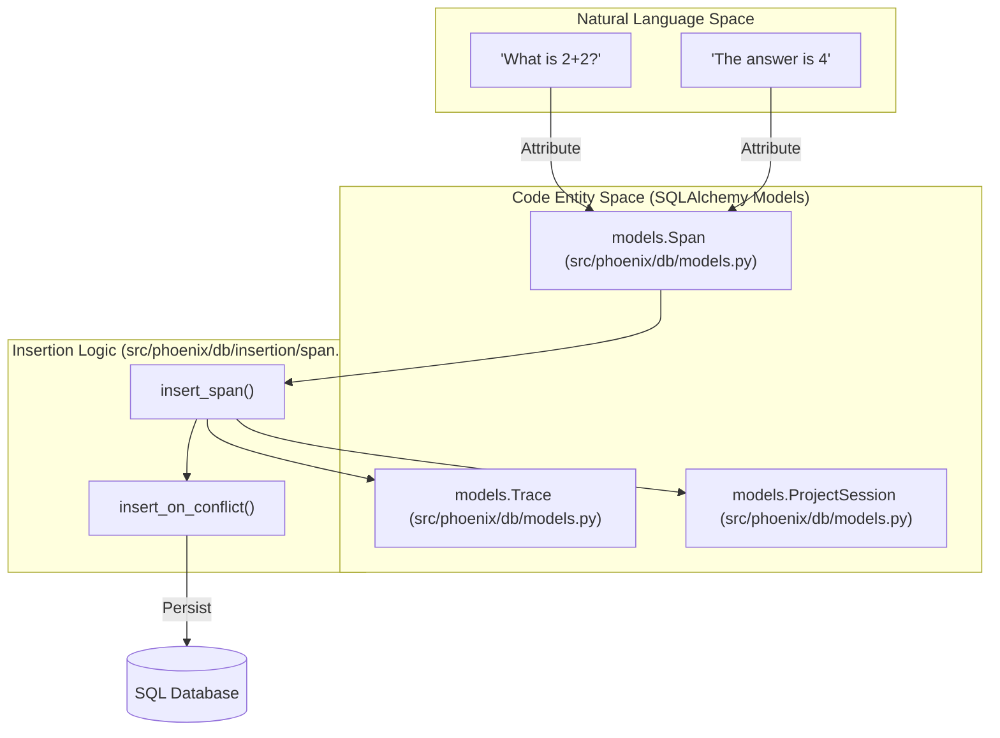
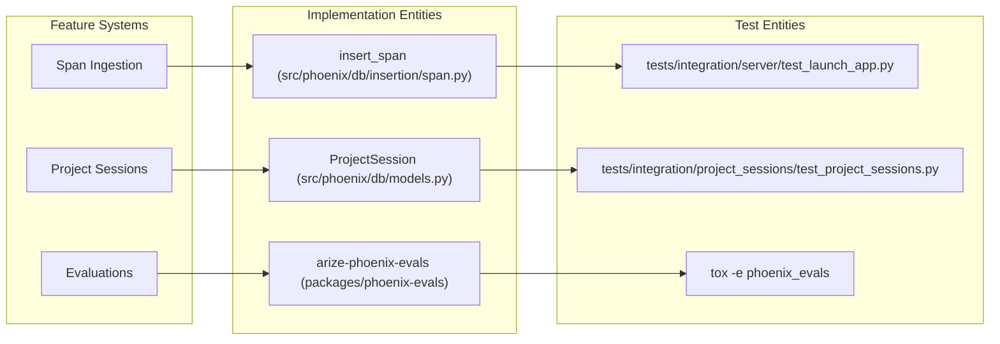

<!-- source: DeepWiki mcp.deepwiki.com · repo arize-ai/phoenix · page 6.2 Testing Strategy · fetched 2026-10-27 -->

# Testing Strategy

<details>
<summary>Relevant source files</summary>

The following files were used as context for generating this wiki page:

- [.dockerignore](.dockerignore)
- [.github/workflows/cost-sync.yml](.github/workflows/cost-sync.yml)
- [.github/workflows/docker-build-experimental.yml](.github/workflows/docker-build-experimental.yml)
- [.github/workflows/docker-build-nightly.yml](.github/workflows/docker-build-nightly.yml)
- [.github/workflows/docker-build-release.yml](.github/workflows/docker-build-release.yml)
- [.github/workflows/helm-ci.yml](.github/workflows/helm-ci.yml)
- [.github/workflows/playwright.yaml](.github/workflows/playwright.yaml)
- [.github/workflows/publish.yaml](.github/workflows/publish.yaml)
- [.github/workflows/pull-requests.yaml](.github/workflows/pull-requests.yaml)
- [.github/workflows/python-CI.yml](.github/workflows/python-CI.yml)
- [.github/workflows/python-all-platforms.yml](.github/workflows/python-all-platforms.yml)
- [.github/workflows/release.yml](.github/workflows/release.yml)
- [.github/workflows/sync-lockfile-release-pr.yml](.github/workflows/sync-lockfile-release-pr.yml)
- [.github/workflows/typescript-CI.yml](.github/workflows/typescript-CI.yml)
- [.github/workflows/typescript-packages-CI.yml](.github/workflows/typescript-packages-CI.yml)
- [.github/workflows/typescript-packages-publish.yml](.github/workflows/typescript-packages-publish.yml)
- [.github/workflows/update-phoenix-package-versions.yml](.github/workflows/update-phoenix-package-versions.yml)
- [Dockerfile](Dockerfile)
- [app/playwright.config.ts](app/playwright.config.ts)
- [app/src/components/code/LazyEditorWrapper.tsx](app/src/components/code/LazyEditorWrapper.tsx)
- [app/src/components/core/card/Card.tsx](app/src/components/core/card/Card.tsx)
- [app/src/components/core/card/types.ts](app/src/components/core/card/types.ts)
- [app/src/components/playground/model/InvocationParametersFormFields.tsx](app/src/components/playground/model/InvocationParametersFormFields.tsx)
- [app/src/components/playground/model/OpenAIApiTypeConfigFormField.tsx](app/src/components/playground/model/OpenAIApiTypeConfigFormField.tsx)
- [app/src/pages/dataset/evaluators/DatasetEvaluatorActionMenu.tsx](app/src/pages/dataset/evaluators/DatasetEvaluatorActionMenu.tsx)
- [app/src/pages/playground/PlaygroundChatTemplateFooter.tsx](app/src/pages/playground/PlaygroundChatTemplateFooter.tsx)
- [app/src/pages/playground/PlaygroundResponseFormat.tsx](app/src/pages/playground/PlaygroundResponseFormat.tsx)
- [app/src/pages/playground/PlaygroundToolType/JSONToolEditor.tsx](app/src/pages/playground/PlaygroundToolType/JSONToolEditor.tsx)
- [app/tests/admin-access.ts](app/tests/admin-access.ts)
- [app/tests/datasets.spec.ts](app/tests/datasets.spec.ts)
- [app/tests/login.rate-limit.spec.ts](app/tests/login.rate-limit.spec.ts)
- [app/tests/member-access.spec.ts](app/tests/member-access.spec.ts)
- [app/tests/playground-prompt-configuration.spec.ts](app/tests/playground-prompt-configuration.spec.ts)
- [app/tests/playground.spec.ts](app/tests/playground.spec.ts)
- [app/tests/projects.spec.ts](app/tests/projects.spec.ts)
- [app/tests/prompt-management.spec.ts](app/tests/prompt-management.spec.ts)
- [app/tests/server-evaluators.spec.ts](app/tests/server-evaluators.spec.ts)
- [app/tests/user-management.spec.ts](app/tests/user-management.spec.ts)
- [app/tests/utils/testServer.mjs](app/tests/utils/testServer.mjs)
- [app/tests/viewer-access.spec.ts](app/tests/viewer-access.spec.ts)
- [requirements/canary/sdk/anthropic.txt](requirements/canary/sdk/anthropic.txt)
- [requirements/ci.txt](requirements/ci.txt)
- [requirements/integration-tests.txt](requirements/integration-tests.txt)
- [scripts/update_helm.py](scripts/update_helm.py)
- [scripts/update_kustomize.py](scripts/update_kustomize.py)
- [src/phoenix/db/insertion/span.py](src/phoenix/db/insertion/span.py)
- [src/phoenix/db/migrations/data_migration_scripts/populate_project_sessions.py](src/phoenix/db/migrations/data_migration_scripts/populate_project_sessions.py)
- [src/phoenix/db/migrations/versions/4ded9e43755f_create_project_sessions_table.py](src/phoenix/db/migrations/versions/4ded9e43755f_create_project_sessions_table.py)
- [tests/integration/conftest.py](tests/integration/conftest.py)
- [tests/integration/db_migrations/__init__.py](tests/integration/db_migrations/__init__.py)
- [tests/integration/db_migrations/conftest.py](tests/integration/db_migrations/conftest.py)
- [tests/integration/db_migrations/test_data_migration_4ded9e43755f_create_project_sessions_table.py](tests/integration/db_migrations/test_data_migration_4ded9e43755f_create_project_sessions_table.py)
- [tests/integration/db_migrations/test_db_schema_6a88424799fe_update_users_with_auth_method.py](tests/integration/db_migrations/test_db_schema_6a88424799fe_update_users_with_auth_method.py)
- [tests/integration/db_migrations/test_db_schema_a20694b15f82_cost.py](tests/integration/db_migrations/test_db_schema_a20694b15f82_cost.py)
- [tests/integration/db_migrations/test_db_schema_for_annotations.py](tests/integration/db_migrations/test_db_schema_for_annotations.py)
- [tests/integration/db_migrations/test_up_and_down_migrations.py](tests/integration/db_migrations/test_up_and_down_migrations.py)
- [tests/integration/project_sessions/conftest.py](tests/integration/project_sessions/conftest.py)
- [tests/integration/project_sessions/test_project_sessions.py](tests/integration/project_sessions/test_project_sessions.py)
- [tests/integration/server/test_launch_app.py](tests/integration/server/test_launch_app.py)
- [tox.ini](tox.ini)

</details>


## Purpose and Scope

This document describes Phoenix's comprehensive testing approach, including test types, organization, database fixtures, CI/CD integration, and quality gates. Phoenix employs a multi-layered testing strategy with unit tests, integration tests, end-to-end tests, type checking, and specialized tests for database migrations and third-party SDK compatibility.

For information about CI/CD pipeline workflows and automation, see [CI/CD Pipeline](6.3). For release processes, see [Release Management](6.4).

## Test Types and Scope

Phoenix implements multiple test layers to ensure reliability across all components:

| Test Type | Scope | Tools | Execution |
|-----------|-------|-------|-----------|
| **Unit Tests** | Individual components in isolation | `pytest`, `pytest-xdist` | Parallel, both SQLite and PostgreSQL |
| **Integration Tests** | Client-server interactions, GraphQL subscriptions, migrations | `pytest`, `httpx`, `tox` | Full stack with database (SQLite/Postgres) |
| **E2E Tests** | Complete user workflows (Playground, Datasets, Prompts) | Playwright | Browser automation (Chromium, Firefox) |
| **Type Checking** | Static type validation | `mypy`, `pyright`, TypeScript compiler | Pre-commit and CI |
| **Package Tests** | Individual package testing | `tox`, `pytest` per package | `phoenix-client`, `phoenix-evals`, `phoenix-otel` |
| **Canary Tests** | Third-party SDK compatibility | `tox`, `pytest` | OpenAI, Anthropic, Google Generative AI |
| **Migration Tests** | Database schema evolution | Alembic | Forward and backward data migrations |

Sources: [tox.ini:11-165](), [.github/workflows/python-CI.yml:99-168](), [.github/workflows/playwright.yaml:42-132](), [app/playwright.config.ts:71-109]()

## Test Organization and Structure

### Directory Layout

```
tests/
├── unit/                # Server-side logic unit tests
├── integration/         # Full stack and migration tests
│   ├── db_migrations/   # Alembic migration validation
│   ├── project_sessions/# Session grouping logic
│   └── server/          # App launch and lifecycle
packages/
├── phoenix-client/tests/# Python client SDK tests
├── phoenix-evals/tests/ # Evaluation framework tests
└── phoenix-otel/tests/  # OpenTelemetry integration tests
app/tests/               # Playwright E2E test suite
```

### E2E Test Configuration (Playwright)

End-to-end tests are configured in `app/playwright.config.ts` [app/playwright.config.ts:1-109](). The suite targets a local server started via `pnpm run dev:server:test` [app/playwright.config.ts:104-104]().

**Project Configuration**:
- **Setup**: Handles authentication via `auth.setup.ts` [app/playwright.config.ts:21-23]().
- **Storage State**: Authenticated sessions are stored in `playwright/.auth/admin.json` [app/playwright.config.ts:28-28]().
- **Sandbox Providers**: E2E tests for code evaluators require Deno (TypeScript) and CPython WASM (Python) to be available in the environment [.github/workflows/playwright.yaml:111-130]().

Sources: [app/playwright.config.ts:19-66](), [.github/workflows/playwright.yaml:111-130]()

## Database Fixture Strategy

Phoenix supports testing against both SQLite and PostgreSQL. The CI environment matrices ensure compatibility across both backends [.github/workflows/python-all-platforms.yml:45-46]().

### Data Insertion and Persistence

When testing span ingestion, the system interacts with `insert_span` in `src/phoenix/db/insertion/span.py` [src/phoenix/db/insertion/span.py:25-30](). This function handles the logic for creating or updating traces, projects, and sessions based on incoming OpenTelemetry data.



Sources: [src/phoenix/db/insertion/span.py:25-161](), [src/phoenix/db/models.py:1-50]()

## Migration Testing

Phoenix rigorously tests database migrations to prevent data loss. Tests in `tests/integration/db_migrations/` verify both schema changes and data migrations [tests/integration/db_migrations/test_up_and_down_migrations.py:1-10]().

- **Up/Down Tests**: Ensures `alembic upgrade` and `alembic downgrade` are reversible [tests/integration/db_migrations/test_up_and_down_migrations.py:7-15]().
- **Data Migrations**: Specific scripts like `populate_project_sessions.py` are tested to ensure existing traces are correctly grouped into new session entities [src/phoenix/db/migrations/data_migration_scripts/populate_project_sessions.py:11-20]().

Sources: [tests/integration/db_migrations/test_up_and_down_migrations.py:1-15](), [src/phoenix/db/migrations/data_migration_scripts/populate_project_sessions.py:11-40]()

## Package and Canary Testing

Phoenix uses `tox` to manage isolated testing environments for its distributed packages [tox.ini:1-11]().

### Canary Tests for LLM SDKs
Canary tests ensure that updates to third-party SDKs (OpenAI, Anthropic, etc.) do not break Phoenix's instrumentation [tox.ini:24-103]().
- **Environment**: Tox installs specific SDK versions and runs tests with socket communication disabled to ensure no real API calls are made [tox.ini:49-49]().
- **Validation**: Uses `pyright` and `mypy` to check type compatibility with SDK helpers [tox.ini:45-48]().

Sources: [tox.ini:24-103](), [tox.ini:45-49]()

## End-to-End Test Scenarios

### Server Evaluators
Validates the creation of datasets and the attachment of LLM or Code-based evaluators [app/tests/server-evaluators.spec.ts:18-23]().
- **Workflow**: Create dataset -> Add Example manually -> Add Prebuilt LLM Evaluator -> Verify scoring [app/tests/server-evaluators.spec.ts:24-171]().

### Prompt Management
Tests the lifecycle of prompts within the Playground [app/tests/prompt-management.spec.ts:11-12]().
- **Workflow**: New Prompt -> Save in Playground -> Create Version -> Verify version history [app/tests/prompt-management.spec.ts:12-100]().

### User & Access Management
Verifies Role-Based Access Control (RBAC) [app/tests/user-management.spec.ts:3-51]().
- **Roles**: Tests for `admin`, `member`, and `viewer` roles across different projects [app/tests/member-access.spec.ts:6-40]().

Sources: [app/tests/server-evaluators.spec.ts:18-171](), [app/tests/prompt-management.spec.ts:11-127](), [app/tests/user-management.spec.ts:3-51]()

## Code Entity Association Diagram

This diagram maps high-level features to the specific code entities and test files that validate them.



Sources: [src/phoenix/db/insertion/span.py:25-30](), [tests/integration/project_sessions/test_project_sessions.py:1-20](), [tox.ini:105-114]()

---

