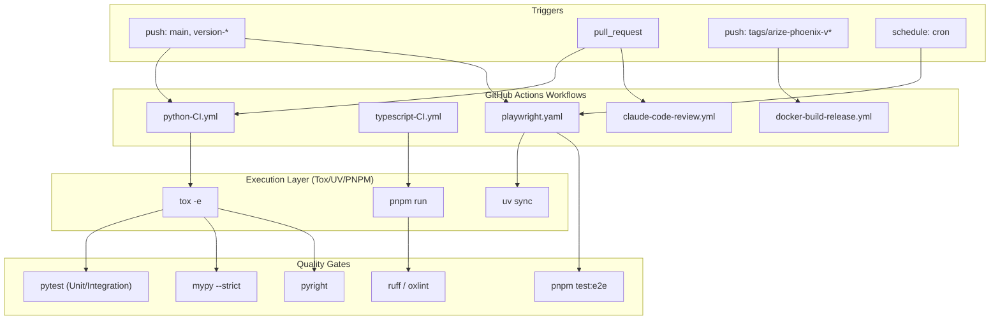
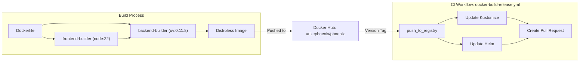

<!-- source: DeepWiki mcp.deepwiki.com · repo arize-ai/phoenix · page 6.3 CI/CD Pipeline · fetched 2026-10-27 -->

# CI/CD Pipeline

Relevant source files

The following files were used as context for generating this wiki page:

- [.agents/skills/phoenix-docs-gap-audit/SKILL.md](.agents/skills/phoenix-docs-gap-audit/SKILL.md)
- [.agents/skills/phoenix-skills-audit/SKILL.md](.agents/skills/phoenix-skills-audit/SKILL.md)
- [.agents/skills/phoenix-skills-audit/evals/evals.json](.agents/skills/phoenix-skills-audit/evals/evals.json)
- [.dockerignore](.dockerignore)
- [.eslintignore](.eslintignore)
- [.github/.scripts/collect-customer-issues.js](.github/.scripts/collect-customer-issues.js)
- [.github/workflows/auto-label-external-issues.yaml](.github/workflows/auto-label-external-issues.yaml)
- [.github/workflows/check-card-links.yml](.github/workflows/check-card-links.yml)
- [.github/workflows/check-dependabot-uv-version.yml](.github/workflows/check-dependabot-uv-version.yml)
- [.github/workflows/cla.yml](.github/workflows/cla.yml)
- [.github/workflows/claude-code-review.yml](.github/workflows/claude-code-review.yml)
- [.github/workflows/claude-docs-gap-audit.yml](.github/workflows/claude-docs-gap-audit.yml)
- [.github/workflows/claude-implement-issue.yml](.github/workflows/claude-implement-issue.yml)
- [.github/workflows/claude-llms-txt.yml](.github/workflows/claude-llms-txt.yml)
- [.github/workflows/claude-release-notes.yml](.github/workflows/claude-release-notes.yml)
- [.github/workflows/claude-skills-audit.yml](.github/workflows/claude-skills-audit.yml)
- [.github/workflows/claude-weekly-deps-upgrade.yml](.github/workflows/claude-weekly-deps-upgrade.yml)
- [.github/workflows/claude.yml](.github/workflows/claude.yml)
- [.github/workflows/collect-customer-issues.yaml](.github/workflows/collect-customer-issues.yaml)
- [.github/workflows/cost-sync.yml](.github/workflows/cost-sync.yml)
- [.github/workflows/docker-build-experimental.yml](.github/workflows/docker-build-experimental.yml)
- [.github/workflows/docker-build-nightly.yml](.github/workflows/docker-build-nightly.yml)
- [.github/workflows/docker-build-release.yml](.github/workflows/docker-build-release.yml)
- [.github/workflows/helm-ci.yml](.github/workflows/helm-ci.yml)
- [.github/workflows/openapi-schema.yaml](.github/workflows/openapi-schema.yaml)
- [.github/workflows/playwright.yaml](.github/workflows/playwright.yaml)
- [.github/workflows/publish.yaml](.github/workflows/publish.yaml)
- [.github/workflows/pull-requests.yaml](.github/workflows/pull-requests.yaml)
- [.github/workflows/python-CI.yml](.github/workflows/python-CI.yml)
- [.github/workflows/python-all-platforms.yml](.github/workflows/python-all-platforms.yml)
- [.github/workflows/release.yml](.github/workflows/release.yml)
- [.github/workflows/sync-lockfile-release-pr.yml](.github/workflows/sync-lockfile-release-pr.yml)
- [.github/workflows/typescript-CI.yml](.github/workflows/typescript-CI.yml)
- [.github/workflows/typescript-packages-CI.yml](.github/workflows/typescript-packages-CI.yml)
- [.github/workflows/typescript-packages-publish-experimental.yml](.github/workflows/typescript-packages-publish-experimental.yml)
- [.github/workflows/typescript-packages-publish.yml](.github/workflows/typescript-packages-publish.yml)
- [.github/workflows/update-phoenix-package-versions.yml](.github/workflows/update-phoenix-package-versions.yml)
- [CLA.md](CLA.md)
- [Dockerfile](Dockerfile)
- [requirements/canary/sdk/anthropic.txt](requirements/canary/sdk/anthropic.txt)
- [requirements/ci.txt](requirements/ci.txt)
- [scripts/update_helm.py](scripts/update_helm.py)
- [scripts/update_kustomize.py](scripts/update_kustomize.py)
- [tox.ini](tox.ini)

This page documents Phoenix's continuous integration and continuous deployment infrastructure. It covers GitHub Actions workflows for testing, code generation validation, Docker image builds, and automated releases. For information about the release process and versioning, see [Release Management](#6.4). For Docker image variants and deployment strategies, see [Kubernetes Deployment](#6.5).

---

## Overview

Phoenix uses GitHub Actions for all CI/CD operations. All workflows use concurrency controls to cancel in-progress runs when new commits are pushed, optimizing resource usage [ .github/workflows/python-CI.yml:14-16 ]().

The pipeline system is organized into several specialized workflows:
- **Python CI**: Core server and package testing.
- **TypeScript CI**: Frontend and JS package validation.
- **Playwright**: End-to-end browser testing.
- **Docker Builds**: Multi-architecture image publishing.
- **Canary Tests**: Third-party SDK compatibility verification.
- **Claude Agentic Workflows**: AI-driven code review and issue implementation.

---

## Pipeline Architecture

The following diagram bridges the high-level workflow triggers to the specific test environments and tools used in the pipeline.

**Sources**: [ .github/workflows/python-CI.yml:5-12 ](), [ .github/workflows/typescript-CI.yml:5-12 ](), [ .github/workflows/playwright.yaml:5-17 ](), [ .github/workflows/docker-build-release.yml:4-7 ](), [ tox.ini:1-11 ]()

---

## Python CI Pipeline

The main Python CI workflow ([.github/workflows/python-CI.yml]()) orchestrates testing for the `arize-phoenix` server and all sub-packages.

### Job Filtering Strategy
The `changes` job uses `dorny/paths-filter` to detect which components were modified, gating subsequent jobs to save compute [ .github/workflows/python-CI.yml:23-46 ]().

| Output Key | Path Pattern |
| :--- | :--- |
| `phoenix` | `src/**`, `tests/**`, `pyproject.toml`, `tox.ini` [ .github/workflows/python-CI.yml:52-58 ]() |
| `phoenix_client` | `packages/phoenix-client/**`, `tox.ini` [ .github/workflows/python-CI.yml:59-61 ]() |
| `phoenix_evals` | `packages/phoenix-evals/**`, `tox.ini` [ .github/workflows/python-CI.yml:62-64 ]() |
| `phoenix_otel` | `packages/phoenix-otel/**`, `tox.ini` [ .github/workflows/python-CI.yml:65-67 ]() |

### Tox Environment Execution
Test execution is standardized via `tox`. Key environments include:
- `phoenix_client`: Runs `pyright`, `mypy --strict`, and `pytest tests/client` [ tox.ini:11-22 ]().
- `phoenix_evals`: Runs tests for the `arize-phoenix-evals` package [ tox.ini:105-114 ]().
- `unit_tests`: Executes server unit tests with `PHOENIX_MASK_INTERNAL_SERVER_ERRORS` disabled [ tox.ini:144-155 ]().
- `integration_tests`: Runs integration tests across supported DB backends [ tox.ini:127-142 ]().

**Sources**: [ .github/workflows/python-CI.yml:23-170 ](), [ tox.ini:1-166 ]()

---

## Agentic Workflows (Claude Code)

Phoenix integrates `anthropics/claude-code-action` for AI-assisted development.

### Claude Code Review
Triggered on pull requests, this workflow uses Claude to perform automated code reviews. It is granted `id-token: write` permissions to request a GitHub OIDC token for secure interaction [ .github/workflows/claude-code-review.yml:1-27 ](). It utilizes the `code-review` plugin and is allowed to use tools like `git diff` and `gh pr view` [ .github/workflows/claude-code-review.yml:57-66 ]().

### Claude Implement Issue
Triggered when the `good-agent-issue` label is added to a GitHub issue [ .github/workflows/claude-implement-issue.yml:3-10 ]().
1. **Guard**: Verifies the sender has write access and the issue isn't already assigned [ .github/workflows/claude-implement-issue.yml:21-49 ]().
2. **Implementation**: Claude explores the codebase, creates a plan, and implements the fix in a new branch `claude/issue-{number}` [ .github/workflows/claude-implement-issue.yml:102-147 ]().
3. **Validation**: The agent is required to run tests and linting via `make` targets before exiting [ .github/workflows/claude-implement-issue.yml:134-138 ]().

**Sources**: [ .github/workflows/claude-code-review.yml:1-69 ](), [ .github/workflows/claude-implement-issue.yml:1-152 ]()

---

## End-to-End Testing (Playwright)

End-to-end tests run against a live server. Because Phoenix supports sandboxed code execution, the CI runner must mirror the production environment's binary dependencies.

### Sandbox Runtime Setup
- **Deno**: Installed via `denoland/setup-deno` at version `v2.1.4` for TypeScript evaluators [ .github/workflows/playwright.yaml:111-114 ]().
- **CPython WASM**: Pre-downloaded and verified with SHA-256 (`e5dc5a39...`) to prevent tampering. The path is exported via `PHOENIX_WASM_BINARY_PATH` for the server's `ensure_wasm_binary()` function [ .github/workflows/playwright.yaml:115-130 ]().

**Sources**: [ .github/workflows/playwright.yaml:42-132 ]()

---

## Docker Build & Deployment Automation

The Docker build process produces multi-architecture images and automates the propagation of version updates to deployment manifests.

### Docker Multi-Stage Build
1. **Frontend**: Builds the React app using `pnpm run build` [ Dockerfile:27-37 ]().
2. **Backend**: Uses `uv sync` with `--extra container` and `--extra pg` for PostgreSQL support [ Dockerfile:40-54 ]().
3. **Final**: A distroless image containing the `.venv`, a statically linked `deno` binary, and the CPython WASM binary [ Dockerfile:98-109 ]().

### Deployment Synchronization
Upon successful image push, the workflow runs:
- `scripts/update_kustomize.py` [ .github/workflows/docker-build-release.yml:116 ]()
- `scripts/update_helm.py` [ .github/workflows/docker-build-release.yml:120 ]()

This results in an automated PR (using `peter-evans/create-pull-request`) to update the production manifests in the repository [ .github/workflows/docker-build-release.yml:125-136 ]().

**Sources**: [ Dockerfile:22-127 ](), [ .github/workflows/docker-build-release.yml:1-136 ]()

---

## Canary Tests

Canary tests ensure compatibility with third-party LLM SDKs. These tests are unique because they verify behavior both with and without the SDKs installed to ensure Phoenix's instrumentation stubs do not break.

| SDK | Module Tested | Tox Environment |
| :--- | :--- | :--- |
| `openai` | `chat` | `phoenix_client_canary_tests_sdk_openai` [ tox.ini:24 ]() |
| `anthropic` | `messages` | `phoenix_client_canary_tests_sdk_anthropic` [ tox.ini:51 ]() |
| `google-generativeai` | `generate_content` | `phoenix_client_canary_tests_sdk_google_generativeai` [ tox.ini:78 ]() |

These environments use `pyright` and `mypy --strict --follow-untyped-imports` to validate type safety against the latest SDK releases [ tox.ini:45-48 ]().

**Sources**: [ tox.ini:24-103 ]()

---

