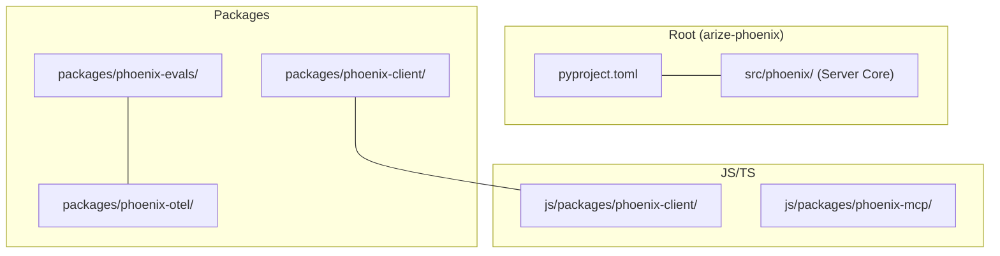
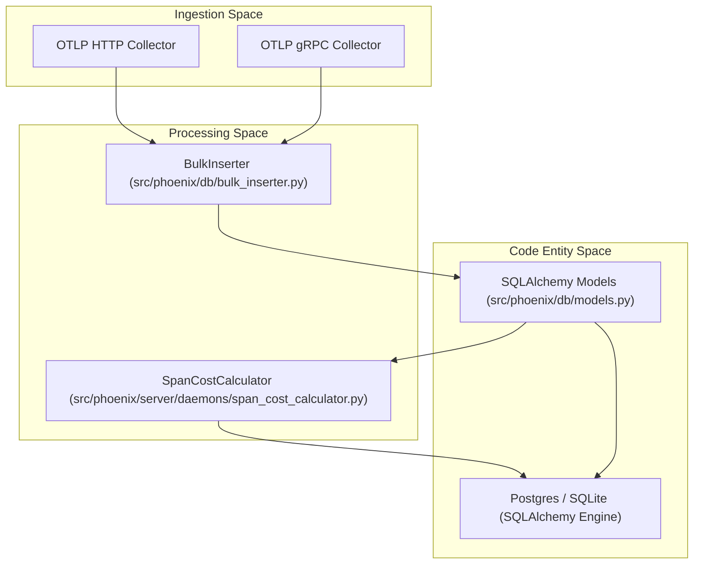
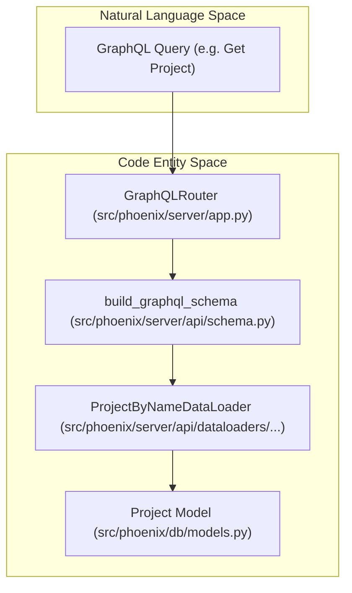

<!-- source: DeepWiki mcp.deepwiki.com · repo arize-ai/phoenix · page 7 Glossary · fetched 2026-10-27 -->

# Glossary

Relevant source files

The following files were used as context for generating this wiki page:

- [.github/workflows/pxi-evals.yml](.github/workflows/pxi-evals.yml)
- [README.md](README.md)
- [app/schema.graphql](app/schema.graphql)
- [app/src/components/trace/SpanKindIcon.tsx](app/src/components/trace/SpanKindIcon.tsx)
- [app/src/pages/auth/AuthLayout.tsx](app/src/pages/auth/AuthLayout.tsx)
- [app/src/pages/playground/Playground.tsx](app/src/pages/playground/Playground.tsx)
- [app/src/pages/playground/PlaygroundChatTemplate.tsx](app/src/pages/playground/PlaygroundChatTemplate.tsx)
- [app/src/pages/playground/PlaygroundDatasetExamplesTable.tsx](app/src/pages/playground/PlaygroundDatasetExamplesTable.tsx)
- [app/src/pages/playground/PlaygroundOutput.tsx](app/src/pages/playground/PlaygroundOutput.tsx)
- [app/src/pages/playground/PlaygroundTemplate.tsx](app/src/pages/playground/PlaygroundTemplate.tsx)
- [app/src/pages/playground/__generated__/PlaygroundDatasetExamplesTableMutation.graphql.ts](app/src/pages/playground/__generated__/PlaygroundDatasetExamplesTableMutation.graphql.ts)
- [app/src/pages/playground/__generated__/PlaygroundDatasetExamplesTableSubscription.graphql.ts](app/src/pages/playground/__generated__/PlaygroundDatasetExamplesTableSubscription.graphql.ts)
- [app/src/pages/playground/__generated__/PlaygroundOutputSubscription.graphql.ts](app/src/pages/playground/__generated__/PlaygroundOutputSubscription.graphql.ts)
- [app/src/pages/playground/__tests__/playgroundUtils.test.ts](app/src/pages/playground/__tests__/playgroundUtils.test.ts)
- [app/src/pages/playground/constants.tsx](app/src/pages/playground/constants.tsx)
- [app/src/pages/playground/playgroundUtils.ts](app/src/pages/playground/playgroundUtils.ts)
- [app/src/pages/playground/schemas.ts](app/src/pages/playground/schemas.ts)
- [app/src/store/playground/__tests__/playgroundStore.test.ts](app/src/store/playground/__tests__/playgroundStore.test.ts)
- [app/src/store/playground/playgroundStore.tsx](app/src/store/playground/playgroundStore.tsx)
- [app/src/store/playground/types.ts](app/src/store/playground/types.ts)
- [app/src/window.d.ts](app/src/window.d.ts)
- [cspell.json](cspell.json)
- [docs/phoenix/integrations/typescript/vercel/vercel-ai-sdk-tracing-js.mdx](docs/phoenix/integrations/typescript/vercel/vercel-ai-sdk-tracing-js.mdx)
- [docs/phoenix/sdk-api-reference/typescript/arizeai-phoenix-otel.mdx](docs/phoenix/sdk-api-reference/typescript/arizeai-phoenix-otel.mdx)
- [docs/phoenix/sdk-api-reference/typescript/overview.mdx](docs/phoenix/sdk-api-reference/typescript/overview.mdx)
- [docs/phoenix/sdk-api-reference/typescript/packages/phoenix-otel/manual-spans.mdx](docs/phoenix/sdk-api-reference/typescript/packages/phoenix-otel/manual-spans.mdx)
- [docs/phoenix/sdk-api-reference/typescript/packages/phoenix-otel/overview.mdx](docs/phoenix/sdk-api-reference/typescript/packages/phoenix-otel/overview.mdx)
- [evals/pxi/README.md](evals/pxi/README.md)
- [evals/pxi/datasets/debug_trace_skill_trigger.yaml](evals/pxi/datasets/debug_trace_skill_trigger.yaml)
- [evals/pxi/datasets/in_app_links.yaml](evals/pxi/datasets/in_app_links.yaml)
- [evals/pxi/datasets/set_spans_filter.yaml](evals/pxi/datasets/set_spans_filter.yaml)
- [evals/pxi/datasets/set_time_range.yaml](evals/pxi/datasets/set_time_range.yaml)
- [evals/pxi/evaluators/__init__.py](evals/pxi/evaluators/__init__.py)
- [evals/pxi/evaluators/tools.py](evals/pxi/evaluators/tools.py)
- [evals/pxi/harness/agent_task.py](evals/pxi/harness/agent_task.py)
- [evals/pxi/harness/run_experiment.py](evals/pxi/harness/run_experiment.py)
- [js/packages/phoenix-client/README.md](js/packages/phoenix-client/README.md)
- [js/packages/phoenix-config/README.md](js/packages/phoenix-config/README.md)
- [js/packages/phoenix-evals/README.md](js/packages/phoenix-evals/README.md)
- [js/packages/phoenix-mcp/README.md](js/packages/phoenix-mcp/README.md)
- [js/packages/phoenix-mcp/src/index.ts](js/packages/phoenix-mcp/src/index.ts)
- [js/packages/phoenix-mcp/src/projectTools.ts](js/packages/phoenix-mcp/src/projectTools.ts)
- [js/packages/phoenix-otel/README.md](js/packages/phoenix-otel/README.md)
- [packages/phoenix-client/README.md](packages/phoenix-client/README.md)
- [packages/phoenix-evals/README.md](packages/phoenix-evals/README.md)
- [packages/phoenix-otel/README.md](packages/phoenix-otel/README.md)
- [scripts/data/generate_traces.py](scripts/data/generate_traces.py)
- [src/phoenix/config.py](src/phoenix/config.py)
- [src/phoenix/db/alembic.ini](src/phoenix/db/alembic.ini)
- [src/phoenix/db/engines.py](src/phoenix/db/engines.py)
- [src/phoenix/db/migrate.py](src/phoenix/db/migrate.py)
- [src/phoenix/db/migrations/__init__.py](src/phoenix/db/migrations/__init__.py)
- [src/phoenix/db/migrations/env.py](src/phoenix/db/migrations/env.py)
- [src/phoenix/db/migrations/versions/10460e46d750_datasets.py](src/phoenix/db/migrations/versions/10460e46d750_datasets.py)
- [src/phoenix/db/migrations/versions/3be8647b87d8_add_token_columns_to_spans_table.py](src/phoenix/db/migrations/versions/3be8647b87d8_add_token_columns_to_spans_table.py)
- [src/phoenix/db/migrations/versions/cf03bd6bae1d_init.py](src/phoenix/db/migrations/versions/cf03bd6bae1d_init.py)
- [src/phoenix/db/models.py](src/phoenix/db/models.py)
- [src/phoenix/server/api/context.py](src/phoenix/server/api/context.py)
- [src/phoenix/server/api/dataloaders/__init__.py](src/phoenix/server/api/dataloaders/__init__.py)
- [src/phoenix/server/api/evaluators.py](src/phoenix/server/api/evaluators.py)
- [src/phoenix/server/api/helpers/playground_clients.py](src/phoenix/server/api/helpers/playground_clients.py)
- [src/phoenix/server/api/input_types/SpanSort.py](src/phoenix/server/api/input_types/SpanSort.py)
- [src/phoenix/server/api/mutations/__init__.py](src/phoenix/server/api/mutations/__init__.py)
- [src/phoenix/server/api/mutations/chat_mutations.py](src/phoenix/server/api/mutations/chat_mutations.py)
- [src/phoenix/server/api/queries.py](src/phoenix/server/api/queries.py)
- [src/phoenix/server/api/routers/v1/experiment_evaluations.py](src/phoenix/server/api/routers/v1/experiment_evaluations.py)
- [src/phoenix/server/api/routers/v1/experiment_runs.py](src/phoenix/server/api/routers/v1/experiment_runs.py)
- [src/phoenix/server/api/routers/v1/experiments.py](src/phoenix/server/api/routers/v1/experiments.py)
- [src/phoenix/server/api/schema.py](src/phoenix/server/api/schema.py)
- [src/phoenix/server/api/subscriptions.py](src/phoenix/server/api/subscriptions.py)
- [src/phoenix/server/api/types/Dataset.py](src/phoenix/server/api/types/Dataset.py)
- [src/phoenix/server/api/types/Project.py](src/phoenix/server/api/types/Project.py)
- [src/phoenix/server/api/types/Span.py](src/phoenix/server/api/types/Span.py)
- [src/phoenix/server/api/types/Trace.py](src/phoenix/server/api/types/Trace.py)
- [src/phoenix/server/app.py](src/phoenix/server/app.py)
- [src/phoenix/server/main.py](src/phoenix/server/main.py)
- [src/phoenix/server/templates/index.html](src/phoenix/server/templates/index.html)
- [src/phoenix/server/thread_server.py](src/phoenix/server/thread_server.py)
- [src/phoenix/services.py](src/phoenix/services.py)
- [src/phoenix/session/session.py](src/phoenix/session/session.py)
- [src/phoenix/settings.py](src/phoenix/settings.py)
- [src/phoenix/trace/schemas.py](src/phoenix/trace/schemas.py)
- [src/phoenix/trace/span_json_decoder.py](src/phoenix/trace/span_json_decoder.py)
- [src/phoenix/trace/span_json_encoder.py](src/phoenix/trace/span_json_encoder.py)
- [tests/unit/pxi/evals/test_agent_task_inputs.py](tests/unit/pxi/evals/test_agent_task_inputs.py)
- [tests/unit/pxi/evals/test_datasets.py](tests/unit/pxi/evals/test_datasets.py)
- [tests/unit/pxi/evals/test_evaluator_matchers.py](tests/unit/pxi/evals/test_evaluator_matchers.py)
- [tests/unit/pxi/evals/test_evaluators.py](tests/unit/pxi/evals/test_evaluators.py)
- [tests/unit/server/api/helpers/test_evaluators.py](tests/unit/server/api/helpers/test_evaluators.py)
- [tests/unit/server/api/helpers/test_playground_clients.py](tests/unit/server/api/helpers/test_playground_clients.py)
- [tests/unit/server/api/routers/v1/test_experiments.py](tests/unit/server/api/routers/v1/test_experiments.py)
- [tests/unit/server/api/test_queries.py](tests/unit/server/api/test_queries.py)
- [tests/unit/server/api/test_subscriptions.py](tests/unit/server/api/test_subscriptions.py)
- [tests/unit/server/api/types/test_Trace.py](tests/unit/server/api/types/test_Trace.py)

This page provides definitions for codebase-specific terms, jargon, abbreviations, and domain concepts used within the Phoenix project. It aims to clarify terminology for new engineers and provide pointers to relevant code for deeper understanding.

## Phoenix Core Concepts

### Phoenix
Phoenix is an open-source AI observability platform designed for experimentation, evaluation, and troubleshooting of LLM applications. It provides features for tracing, evaluation, dataset management, experimentation, prompt management, and a playground interface that supports vendor- and language-agnostic integrations with popular LLMs and tracing libraries. The main Python package is `arize-phoenix`.

- Key features include trace collection with OpenTelemetry, evaluation frameworks, dataset versioning, prompt management, and generative model playground [README.md:44-51]().
- Integrations support OpenAI, Anthropic, Google GenAI, AWS Bedrock, and more, plus SDKs like OpenAI Agents, LangGraph, and Vercel AI SDK [README.md:53-56]().

**Code pointers:**
- Project metadata and dependencies: [pyproject.toml:1-74]()
- Main entry point: `phoenix.server.main:main` [src/phoenix/server/main.py:17-29]()

### Span
A Span represents a single operation or event within a Trace. Spans are core to Phoenix's tracing capabilities and capture discrete LLM interactions like API calls, tool invocations, or retrievals.

- Spans use OpenTelemetry semantic conventions extended for AI-specific operations [src/phoenix/db/models.py:94-103]().
- Each span contains metadata like start/end time, span kind, model name, input prompts, output, and annotations [src/phoenix/server/api/types/Span.py:127-232]().
- Span types (kinds) include `LLM`, `CHAIN`, `TOOL`, `RETRIEVER`, `EMBEDDING`, `RERANKER`, and `AGENT` [src/phoenix/server/api/types/Span.py:57-74]().

**Code pointers:**
- GraphQL `Span` type: [app/schema.graphql:11158-11350]()
- SQLAlchemy Model: `models.Span` [src/phoenix/db/models.py:440-540]() (approximate)

### Trace
A Trace is a group of related Spans forming a causal chain representing an LLM application's complete operation or request.

- Traces enable end-to-end visibility of requests and workflows.
- Phoenix ingests traces via OTLP protocol (gRPC/HTTP).

**Code pointers:**
- GraphQL `Trace` type: [app/schema.graphql:12000-12050]() (approximate)
- Trace data loader: `TraceByTraceIdsDataLoader` [src/phoenix/server/app.py:165-165]()

### Project
A logical grouping of related Traces, Datasets, Experiments, Annotations, and Sessions.

- Serves as the main namespace for organization and access control.
- Each Project has configuration like trace retention policy [src/phoenix/server/api/types/Project.py:61-195]().

**Code pointers:**
- Default project name: `DEFAULT_PROJECT_NAME` [src/phoenix/config.py:59-59]()
- GraphQL `Project` type: [src/phoenix/server/api/types/Project.py:61-61]()

### Dataset
A Dataset is a collection of example inputs and expected outputs used for evaluation, experimentation, and fine-tuning.

- Supports versioning and splitting (e.g., train/test) [src/phoenix/server/app.py:96-104]().
- Datasets link examples with experiment configurations [src/phoenix/server/api/types/Dataset.py:15-80]().

**Code pointers:**
- GraphQL `Dataset` type: [app/schema.graphql:3146-3245]()
- Dataset models: `models.Dataset`, `models.DatasetExample` [src/phoenix/db/models.py:1000-1100]() (approximate)

### Experiment
An Experiment tracks and manages tests of changes against datasets and models.

- Useful for comparing prompt versions, model parameters, or retrieval mechanisms.
- Can aggregate metrics, error rates, and latency quantiles [src/phoenix/server/app.py:111-122]().

**Code pointers:**
- GraphQL `Experiment` type: [app/schema.graphql:5266-5386]()
- Status types: `RUNNING`, `COMPLETED`, `STOPPED`, `ERROR` [src/phoenix/db/models.py:184-184]()

### Evaluator
Evaluators benchmark model performance, quality, and correctness on dataset examples or generated results.

- Types include LLM evaluators, code evaluators, and built-in classification evaluators [src/phoenix/db/models.py:174-174]().
- Evaluators are associated with specific versions and input mappings [src/phoenix/db/models.py:68-68]().

**Code pointers:**
- Python evaluation framework: `arize-phoenix-evals` [packages/phoenix-evals/pyproject.toml:1-35]()
- GraphQL `Evaluator` type: [src/phoenix/server/api/types/Evaluator.py:76-82]()

### Annotation
Annotations are labels or numeric scores attached to spans, traces, or dataset examples.

- Support multiple annotator kinds: `LLM`, `HUMAN`, `CODE` [app/schema.graphql:224-228]().
- Types include `CATEGORICAL`, `CONTINUOUS`, and `FREEFORM` [app/schema.graphql:218-222]().

**Code pointers:**
- GraphQL `Annotation` interface: [app/schema.graphql:121-158]()
- Source types: `API`, `APP` [app/schema.graphql:203-206]()

### Session
A Session represents an interactive user session with Phoenix, grouping related multi-turn interactions.

- Used to track conversational state and group related traces [src/phoenix/session/session.py:70-143]().
- Phoenix Intelligence (PxI) interactions are typically session-bound [src/phoenix/server/app.py:137-142]().

**Code pointers:**
- Python `Session` class: [src/phoenix/session/session.py:70-70]()
- Thread-based session: `ThreadSession` [src/phoenix/session/session.py:185-185]()

---

## Monorepo Structure

Phoenix uses a monorepo approach consolidating multiple Python and TypeScript packages [uv.lock:26-32]().

### Python Packages

| Package | Description | Location |
| :--- | :--- | :--- |
| `arize-phoenix` | Core server and observability logic | `src/phoenix/` [pyproject.toml:1-2]() |
| `arize-phoenix-evals` | LLM Evaluation framework | `packages/phoenix-evals/` [packages/phoenix-evals/pyproject.toml:1-2]() |
| `arize-phoenix-otel` | OpenTelemetry integration helpers | `packages/phoenix-otel/` [packages/phoenix-otel/pyproject.toml:1-2]() |
| `arize-phoenix-client` | Programmatic API client | `packages/phoenix-client/` [packages/phoenix-client/pyproject.toml:1-2]() |

---

## Server Architecture

### FastAPI Application
The server is implemented as a FastAPI application [src/phoenix/server/app.py:33-33]().

- Includes middleware for CORS, authentication, and CSRF protection [src/phoenix/server/app.py:34-47]().
- Uses Starlette's lifespan for startup/shutdown tasks [src/phoenix/server/app.py:53-53]().

### GraphQL API
Phoenix uses `strawberry` for its GraphQL API [src/phoenix/server/app.py:32-32]().

- Employs the DataLoader pattern for efficient batch fetching [src/phoenix/server/app.py:88-173]().
- Schema is built via `build_graphql_schema` [src/phoenix/server/app.py:182-182]().

### OTLP Ingestion
Phoenix ingests telemetry data using OpenTelemetry Protocol (OTLP).

- Uses `opentelemetry-proto` for trace ingestion [pyproject.toml:46-46]().
- Supports both HTTP and gRPC protocols for ingestion [pyproject.toml:41-47]().

### Database Layer
Phoenix supports PostgreSQL and SQLite using SQLAlchemy ORM [pyproject.toml:51-53]().

- Database models are defined using `DeclarativeBase` [src/phoenix/db/models.py:43-43]().
- Alembic is used for schema migrations [pyproject.toml:52-52]().

### Cost Tracking
Phoenix tracks LLM token costs through a dedicated subsystem.

- Uses `SpanCostCalculator` to compute costs [src/phoenix/server/app.py:188-188]().
- Token prices are managed via `GenerativeModelStore` [src/phoenix/server/app.py:187-187]().

---

## Diagrams

### Diagram: Phoenix Monorepo Structure

Sources:
- [uv.lock:26-32]()
- [README.md:37-37]()

### Diagram: Data Flow Ingestion to Storage

Sources:
- [src/phoenix/server/app.py:81-81]()
- [src/phoenix/server/app.py:188-188]()
- [src/phoenix/db/models.py:43-48]()
- [pyproject.toml:51-53]()

### Diagram: GraphQL API Resolution

Sources:
- [src/phoenix/server/app.py:55-55]()
- [src/phoenix/server/app.py:128-128]()
- [src/phoenix/server/api/schema.py:182-182]()
- [src/phoenix/db/models.py:1-50]()