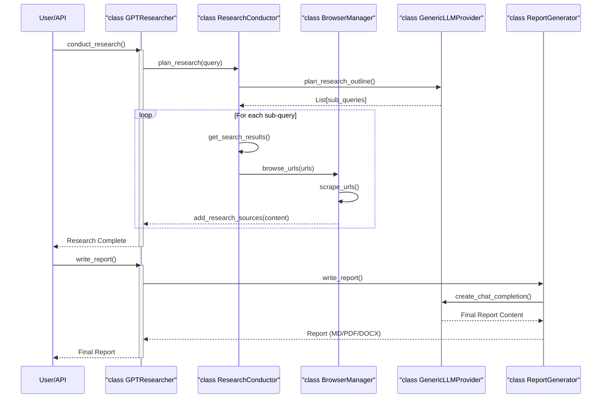

<!-- source: DeepWiki mcp.deepwiki.com · repo assafelovic/gpt-researcher · page 1 Overview · fetched 2026-10-27 -->

# Overview

Relevant source files

The following files were used as context for generating this wiki page:

- [.dockerignore](.dockerignore)
- [Dockerfile](Dockerfile)
- [README-ja_JP.md](README-ja_JP.md)
- [README-ko_KR.md](README-ko_KR.md)
- [README-zh_CN.md](README-zh_CN.md)
- [README.md](README.md)
- [docker-compose.yml](docker-compose.yml)
- [docs/CNAME](docs/CNAME)
- [docs/docs/contribute.md](docs/docs/contribute.md)
- [gpt_researcher/agent.py](gpt_researcher/agent.py)
- [gpt_researcher/skills/browser.py](gpt_researcher/skills/browser.py)
- [gpt_researcher/skills/researcher.py](gpt_researcher/skills/researcher.py)
- [requirements.txt](requirements.txt)

## Purpose and Scope

This document provides a high-level overview of the GPT Researcher system architecture, core components, and capabilities. GPT Researcher is an autonomous research agent designed for both web and local research on any given task, producing detailed, factual, and unbiased research reports with citations [README.md:23-27](). Inspired by the [Plan-and-Solve](https://arxiv.org/abs/2305.04091) and [RAG](https://arxiv.org/abs/2005.11401) papers, it addresses misinformation and speed through parallelized agent work [README.md:27-28]().

This overview covers the fundamental architecture and component relationships. For detailed information about specific subsystems, refer to the subsequent pages in this wiki.

**Sources:** [README.md:23-30](), [gpt_researcher/agent.py:1-5]()

## System Architecture

GPT Researcher utilizes a "planner" and "execution" agent pattern [README.md:54-56](). The system is highly modular, supporting 25+ LLM providers, multiple search retrievers, and various document formats [README.md:76-84]().

### High-Level Component Architecture

The following diagram bridges the high-level system concepts with the specific classes and files found in the codebase.

```mermaid
graph TB
    subgraph "EntryPoints"
        Main["main.py<br/>(FastAPI/Uvicorn)"]
        PIP["gpt_researcher<br/>(PIP Package)"]
        Claude["Claude Skill<br/>(npx skills)"]
    end
    
    subgraph "OrchestrationLayer"
        GPTR["class GPTResearcher<br/>gpt_researcher/agent.py"]
        Config["class Config<br/>gpt_researcher/config.py"]
    end
    
    subgraph "ExecutionSkills"
        RC["class ResearchConductor<br/>gpt_researcher/skills/researcher.py"]
        BM["class BrowserManager<br/>gpt_researcher/skills/browser.py"]
        RG["class ReportGenerator<br/>gpt_researcher/skills/writer.py"]
        CM["class ContextManager<br/>gpt_researcher/skills/context_manager.py"]
        IG["class ImageGenerator<br/>gpt_researcher/skills/image_generator.py"]
        DS["class DeepResearchSkill<br/>gpt_researcher/skills/deep_research.py"]
    end
    
    subgraph "DataRetrieval"
        Retriever["get_retrievers()<br/>gpt_researcher/actions/retrievers.py"]
        DocLoader["class DocumentLoader<br/>gpt_researcher/document/document.py"]
        VS["class VectorStoreWrapper<br/>gpt_researcher/vector_store.py"]
    end
    
    subgraph "Intelligence"
        LLM["class GenericLLMProvider<br/>gpt_researcher/llm_provider.py"]
        Mem["class Memory<br/>gpt_researcher/memory.py"]
        Prompts["get_prompt_family()<br/>gpt_researcher/prompts.py"]
    end

    Main --> GPTR
    PIP --> GPTR
    Claude --> GPTR
    
    GPTR --> Config
    GPTR --> RC
    GPTR --> BM
    GPTR --> RG
    GPTR --> CM
    GPTR --> IG
    GPTR --> DS
    
    RC --> Retriever
    RC --> DocLoader
    CM --> VS
    
    GPTR --> LLM
    GPTR --> Mem
    GPTR --> Prompts
```

**Sources:** [README.md:54-68](), [gpt_researcher/agent.py:36-83](), [gpt_researcher/skills/researcher.py:21-47](), [gpt_researcher/agent.py:24-30]()

## Core Components

The system consists of several key classes and modules that manage the research lifecycle:

| Component | Code Entity | Primary Responsibility |
|-----------|-----------|------------------------|
| **Main Agent** | `GPTResearcher` [gpt_researcher/agent.py:36]() | Orchestrates the entire research process, manages state, and tracks costs [gpt_researcher/agent.py:43-50](). |
| **Research Planner** | `ResearchConductor` [gpt_researcher/skills/researcher.py:21]() | Handles query planning, sub-query generation, and retriever coordination [gpt_researcher/skills/researcher.py:24-32](). |
| **Browser Engine** | `BrowserManager` [gpt_researcher/skills/browser.py:14]() | Manages parallel URL scraping and image selection using a `WorkerPool` [gpt_researcher/skills/browser.py:17-35](). |
| **Context Processor** | `ContextManager` [gpt_researcher/skills/context_manager.py:25]() | Filters and compresses gathered information to fit LLM context windows. |
| **Report Writer** | `ReportGenerator` [gpt_researcher/skills/writer.py:30]() | Synthesizes findings into the final document (Markdown, PDF, or DOCX). |
| **Config System** | `Config` [gpt_researcher/agent.py:140]() | Loads environment variables and settings for LLMs, retrievers, and scrapers. |
| **LLM Interface** | `GenericLLMProvider` [gpt_researcher/agent.py:21]() | Provides a unified interface for multiple LLM providers (OpenAI, Anthropic, etc.). |

### Internal Data Flow Diagram

This diagram traces the flow of a research query through the internal function calls and data structures.

**Sources:** [gpt_researcher/agent.py:138-168](), [gpt_researcher/skills/researcher.py:89-160](), [gpt_researcher/skills/browser.py:37-84](), [gpt_researcher/skills/researcher.py:75-87]()

## Research Workflow

The standard research pipeline follows these steps:

1.  **Task Initialization**: A task-specific agent is created based on the research query [README.md:63]().
2.  **Query Decomposition**: The `ResearchConductor` generates a set of questions that collectively form an objective opinion on the task [README.md:64]().
3.  **Information Gathering**: A crawler agent (via `BrowserManager`) gathers information for each question from online or local resources [README.md:65]().
4.  **Source Tracking**: Each resource is summarized and its source is tracked [README.md:66]().
5.  **Aggregation**: Findings are filtered and aggregated into a final research report exceeding 2,000 words if configured [README.md:67-79]().

**Sources:** [README.md:62-68](), [gpt_researcher/skills/researcher.py:89-160]()

## Key Capabilities

*   **Multi-Source Research**: Aggregates over 20 sources per research task to ensure objective conclusions [README.md:80]().
*   **Hybrid Data Support**: Conducts research using both web search and local documents (PDF, DOCX, CSV, etc.) [README.md:76](), [requirements.txt:31-36]().
*   **Advanced UI Options**: Provides both a lightweight Vanilla JS frontend and a production-ready NextJS + Tailwind interface [README.md:81](), [docker-compose.yml:26-45]().
*   **Visual Enhancements**: Includes smart image scraping and AI-generated inline images using Google Gemini [README.md:77-78](), [docker-compose.yml:13-16]().
*   **Parallel Execution**: Utilizes a `WorkerPool` for parallelized web scraping to increase speed and stability [gpt_researcher/skills/browser.py:32-35]().
*   **MCP Support**: Integrates with the Model Context Protocol (MCP) to access specialized tools and data sources [gpt_researcher/agent.py:113-135]().

**Sources:** [README.md:74-85](), [gpt_researcher/skills/browser.py:32-35](), [gpt_researcher/agent.py:113-136](), [requirements.txt:60-61]()

## Deployment and Operations

GPT Researcher can be deployed in several environments:
*   **Local Python**: Installed via `pip` or by cloning the repository [README.md:94-135]().
*   **Docker**: Multi-stage builds for the backend and NextJS frontend are provided [Dockerfile:1-65](), [docker-compose.yml:1-78]().
*   **Claude Skill**: Can be installed as a tool for Claude to extend its research capabilities [README.md:44-52]().

**Sources:** [README.md:94-135](), [Dockerfile:1-65](), [docker-compose.yml:1-25]()

---

