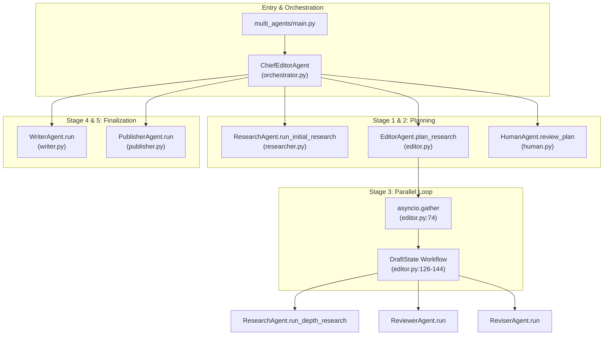
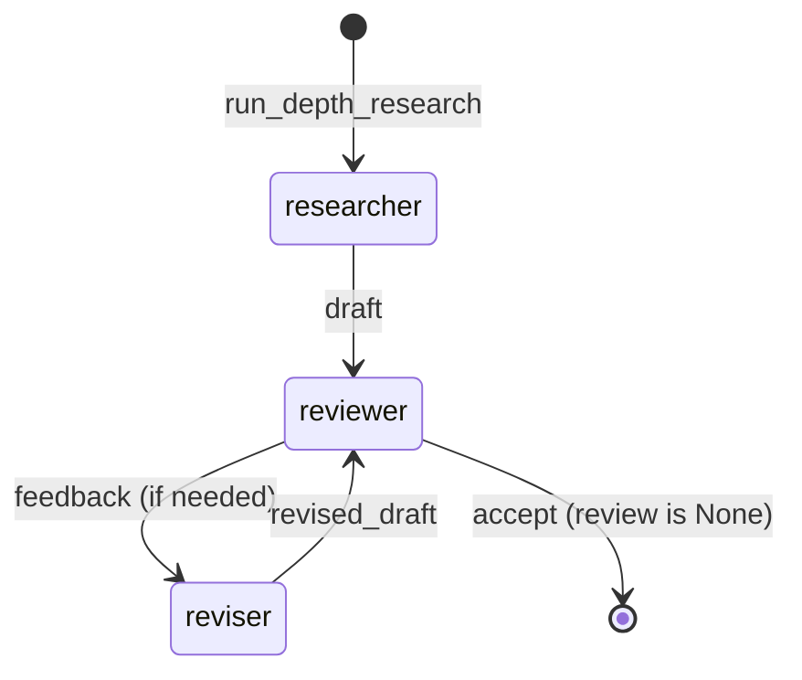

<!-- source: DeepWiki mcp.deepwiki.com · repo assafelovic/gpt-researcher · page 10 Multi-Agent System Deep Dive · fetched 2026-10-27 -->

# Multi-Agent System Deep Dive

Relevant source files

The following files were used as context for generating this wiki page:

- [multi_agents/README.md](multi_agents/README.md)
- [multi_agents/agent.py](multi_agents/agent.py)
- [multi_agents/agents/__init__.py](multi_agents/agents/__init__.py)
- [multi_agents/agents/editor.py](multi_agents/agents/editor.py)
- [multi_agents/agents/human.py](multi_agents/agents/human.py)
- [multi_agents/agents/orchestrator.py](multi_agents/agents/orchestrator.py)
- [multi_agents/agents/plan_review.py](multi_agents/agents/plan_review.py)
- [multi_agents/agents/publisher.py](multi_agents/agents/publisher.py)
- [multi_agents/agents/researcher.py](multi_agents/agents/researcher.py)
- [multi_agents/agents/reviewer.py](multi_agents/agents/reviewer.py)
- [multi_agents/agents/reviser.py](multi_agents/agents/reviser.py)
- [multi_agents/agents/writer.py](multi_agents/agents/writer.py)
- [multi_agents/memory/draft.py](multi_agents/memory/draft.py)
- [multi_agents/memory/research.py](multi_agents/memory/research.py)
- [multi_agents/task.json](multi_agents/task.json)
- [tests/test_multi_agents_plan_revisions.py](tests/test_multi_agents_plan_revisions.py)

## Purpose and Scope

This document provides detailed technical documentation of the LangGraph-based multi-agent research system in GPT Researcher. The multi-agent mode represents an advanced alternative to standard research workflows, employing collaborative specialized agents to produce higher-quality research reports through iterative refinement and quality validation.

This page covers the multi-agent system architecture, workflow stages, agent roles, state management, and configuration. 

For more detailed information, see the following child pages:
- **[ChiefEditorAgent Orchestration](#10.1)** — Master coordinator and five-stage workflow.
- **[Specialized Agents](#10.2)** — Individual roles: Browser, Editor, Researcher, Reviewer, Revisor, Writer, Publisher.
- **[Review-Revision Workflow](#10.3)** — Iterative draft improvement via LangGraph `StateGraph`.
- **[Multi-Agent Configuration](#10.4)** — `task.json` and `STRATEGIC_LLM` settings.
- **[Multi-Agent State Management](#10.5)** — `ResearchState` and `DraftState` flow.
- **[AG2 Multi-Agent Alternative](#10.6)** — The AutoGen2-based orchestration alternative.

**Sources:** [multi_agents/README.md:1-10]()

---

## System Overview

The multi-agent system orchestrates eight specialized agents using LangGraph's state machine framework to conduct research through five distinct stages: planning, initial research, parallel section research with review-revision loops, writing, and publication. This architecture is inspired by the STORM paper and produces comprehensive 5-6 page research reports with validated quality [multi_agents/README.md:7-11]().

### Key Differences from Standard Research

| Aspect | Standard Research | Multi-Agent Research |
|--------|-------------------|---------------------|
| **Orchestration** | `ResearchConductor` linear workflow | `ChiefEditorAgent` with LangGraph state machine |
| **Quality Control** | Single-pass generation | Iterative review-revision loops |
| **Parallelization** | Sub-query parallel processing | Section-level parallel research with per-section workflows |
| **Agent Specialization** | Single `GPTResearcher` instance | Specialized agents (Researcher, Editor, Reviewer, etc.) |
| **LLM Usage** | `SMART_LLM` and `FAST_LLM` | Primarily `SMART_LLM` / `STRATEGIC_LLM` |

**Sources:** [multi_agents/README.md:13-24](), [multi_agents/agents/editor.py:126-144]()

---

## Architecture and Workflow

### High-Level Agent Orchestration

The following diagram maps the high-level flow to specific code entities and files.

**Sources:** [multi_agents/agents/editor.py:126-144](), [multi_agents/agents/orchestrator.py:1-10](), [multi_agents/agents/human.py:10-59]()

### The Five-Stage Workflow

1.  **Planning Stage**: The `EditorAgent` plans the report outline based on initial research [multi_agents/agents/editor.py:22-50](). Optionally involves `HumanAgent` for feedback [multi_agents/agents/human.py:18-45]().
2.  **Data Collection**: Initial broad research is conducted to ground the planning phase via `ResearchAgent.run_initial_research` [multi_agents/agents/researcher.py:34-44]().
3.  **Review and Revision**: For each section, a `ResearchAgent` generates a draft [multi_agents/agents/researcher.py:46-58](), which a `ReviewerAgent` critiques [multi_agents/agents/reviewer.py:63-79](). A `ReviserAgent` then updates the draft [multi_agents/agents/reviser.py:54-74]().
4.  **Writing**: The `WriterAgent` compiles the sections, adding an introduction, conclusion, and references [multi_agents/agents/writer.py:94-142]().
5.  **Publication**: The `PublisherAgent` formats the final report into PDF, Docx, or Markdown [multi_agents/agents/publisher.py:55-61]().

For details, see [ChiefEditorAgent Orchestration](#10.1).

---

## Agent Roles and Implementation

The multi-agent system implements specialized agents located in `multi_agents/agents/` [multi_agents/agents/__init__.py:1-21]().

### Specialized Agent Summary

| Agent | File | Primary Responsibility |
|-------|------|------------------------|
| **Chief Editor** | `orchestrator.py` | Master coordinator managing the LangGraph state [multi_agents/agents/__init__.py:10](). |
| **Researcher** | `researcher.py` | Wraps `GPTResearcher` to perform web or local data retrieval [multi_agents/agents/researcher.py:13-23](). |
| **Editor** | `editor.py` | Plans the research outline and triggers parallel section workflows [multi_agents/agents/editor.py:13-15](). |
| **Reviewer** | `reviewer.py` | Validates section drafts against `task.json` guidelines [multi_agents/agents/reviewer.py:9-13](). |
| **Revisor** | `reviser.py` | Updates drafts based on feedback from the Reviewer [multi_agents/agents/reviser.py:15-19](). |
| **Writer** | `writer.py` | Synthesizes all researched sections into a cohesive report [multi_agents/agents/writer.py:16-20](). |
| **Publisher** | `publisher.py` | Converts the final markdown to PDF, DOCX, and other formats [multi_agents/agents/publisher.py:9-14](). |
| **Human** | `human.py` | Provides human-in-the-loop feedback for research plans [multi_agents/agents/human.py:4-8](). |

For details, see [Specialized Agents](#10.2).

---

## State Management and Flow

The system uses `TypedDict` objects to maintain state across asynchronous steps.

- **`ResearchState`**: The global state tracking the entire project from initial query to final publication [multi_agents/memory/research.py:5-20]().
- **`DraftState`**: A localized state used within the parallel review-revision loop for individual sections [multi_agents/memory/draft.py:5-10]().

### Review-Revision State Machine

**Sources:** [multi_agents/agents/editor.py:135-142](), [multi_agents/agents/reviewer.py:79](), [multi_agents/agents/reviser.py:71-74]()

For details, see [Multi-Agent State Management](#10.5) and [Review-Revision Workflow](#10.3).

---

## Configuration and Customization

The multi-agent system is primarily configured via `multi_agents/task.json` [multi_agents/task.json:1-19]().

### Key Configuration Parameters
- **`model`**: The LLM used by agents (e.g., `gpt-4o`) [multi_agents/task.json:12]().
- **`max_sections`**: Limits the number of subtopics researched [multi_agents/task.json:3]().
- **`include_human_feedback`**: If `true`, the `HumanAgent` is engaged [multi_agents/task.json:10]().
- **`follow_guidelines`**: If `true`, enables the iterative `Reviewer` and `Revisor` loop [multi_agents/task.json:11]().

For details, see [Multi-Agent Configuration](#10.4).

---

## AG2 Alternative

In addition to LangGraph, GPT Researcher supports **AG2 (AutoGen2)** for multi-agent orchestration. This alternative is located in `multi_agents_ag2/` and mirrors the specialized agent flow using the AG2 framework.

For details, see [AG2 Multi-Agent Alternative](#10.6).

---

