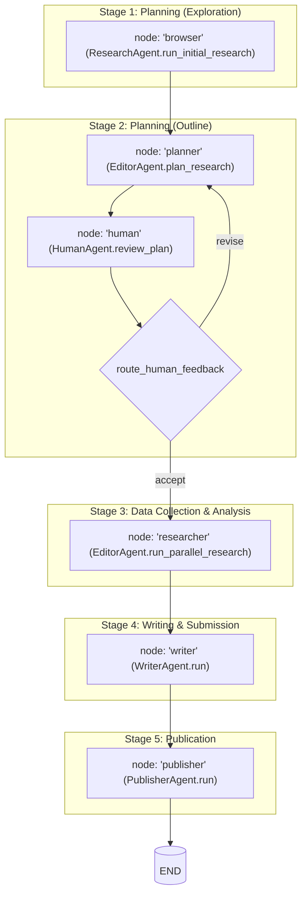
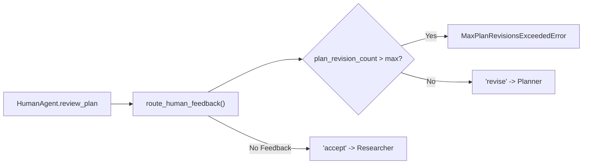

<!-- source: DeepWiki mcp.deepwiki.com · repo assafelovic/gpt-researcher · page 10.1 ChiefEditorAgent Orchestration · fetched 2026-10-27 -->

# ChiefEditorAgent Orchestration

Relevant source files

The following files were used as context for generating this wiki page:

- [backend/utils.py](backend/utils.py)
- [multi_agents/README.md](multi_agents/README.md)
- [multi_agents/agent.py](multi_agents/agent.py)
- [multi_agents/agents/human.py](multi_agents/agents/human.py)
- [multi_agents/agents/orchestrator.py](multi_agents/agents/orchestrator.py)
- [multi_agents/agents/plan_review.py](multi_agents/agents/plan_review.py)
- [multi_agents/agents/utils/file_formats.py](multi_agents/agents/utils/file_formats.py)
- [multi_agents/langgraph.json](multi_agents/langgraph.json)
- [multi_agents/main.py](multi_agents/main.py)
- [multi_agents/memory/research.py](multi_agents/memory/research.py)
- [multi_agents/requirements.txt](multi_agents/requirements.txt)
- [multi_agents/task.json](multi_agents/task.json)
- [tests/test_multi_agents_plan_revisions.py](tests/test_multi_agents_plan_revisions.py)

## Purpose and Scope

The `ChiefEditorAgent` is the master coordinator of the LangGraph-based multi-agent research system. It manages a team of specialized agents—including the Researcher, Editor, Writer, and Publisher—through a structured five-stage workflow: planning, research, review, writing, and publication. Its primary responsibility is to maintain the `ResearchState`, orchestrate the flow of data between agents, and handle human-in-the-loop interactions.

Sources: [multi_agents/agents/orchestrator.py:23-24](), [multi_agents/README.md:15-24](), [multi_agents/main.py:40-50]()

---

## Five-Stage Workflow Architecture

The `ChiefEditorAgent` implements a sequential five-stage research pipeline inspired by the STORM paper. The workflow is built using LangGraph's `StateGraph`, where each node represents an agent's functional entry point.

### Workflow Stages and State Flow

Sources: [multi_agents/agents/orchestrator.py:56-85](), [multi_agents/README.md:26-32]()

---

## Technical Implementation

### The ChiefEditorAgent Class
The class is initialized with a `task` dictionary (typically from `task.json`), optional WebSocket handlers for streaming, and a research `tone`. Upon initialization, it generates a unique `task_id` and creates an output directory for artifacts.

**Key Methods:**
- `init_research_team()`: Initializes the 8 specialized agents and compiles the LangGraph `StateGraph` [multi_agents/agents/orchestrator.py:92-95]().
- `run_research_task()`: Compiles the workflow and executes it using `ainvoke` with the provided task and configuration [multi_agents/agents/orchestrator.py:104-127]().
- `_initialize_agents()`: Instantiates the `WriterAgent`, `EditorAgent`, `ResearchAgent`, `PublisherAgent`, and `HumanAgent` with shared communication channels [multi_agents/agents/orchestrator.py:47-54]().

### ResearchState Management
The `ResearchState` is a `TypedDict` that serves as the "single source of truth" passed between nodes.

| Field | Description | Source |
| :--- | :--- | :--- |
| `task` | The configuration from `task.json` | [multi_agents/memory/research.py:6]() |
| `initial_research` | Summary from the broad internet search | [multi_agents/memory/research.py:7]() |
| `sections` | List of subtopics/outline items | [multi_agents/memory/research.py:8]() |
| `research_data` | List of drafts for each section | [multi_agents/memory/research.py:9]() |
| `report` | The final compiled string of the research paper | [multi_agents/memory/research.py:20]() |

Sources: [multi_agents/memory/research.py:5-22]()

---

## Human-in-the-Loop & Revision Logic

The orchestration includes a critical feedback loop during the planning stage. The `HumanAgent` prompts the user for feedback on the proposed research outline.

### Plan Revision Flow
The system enforces a limit on how many times a human can request plan revisions to prevent infinite loops.

- **Configuration**: The limit is defined by `max_plan_revisions` in `task.json` (defaulting to 3) [multi_agents/agents/plan_review.py:1](), [multi_agents/task.json:4]().
- **Logic**: If `human_feedback` is provided, `plan_revision_count` is incremented. If it exceeds the limit, a `RuntimeError` is raised [multi_agents/agents/plan_review.py:15-23]().

Sources: [multi_agents/agents/plan_review.py:8-23](), [multi_agents/agents/human.py:50-59]()

---

## Data Flow and Publication

Once the `WriterAgent` compiles the final text, the `PublisherAgent` is responsible for multi-format output.

### Publication Orchestration
The `ChiefEditorAgent` passes the `output_dir` (unique to the run) to the `PublisherAgent` [multi_agents/agents/orchestrator.py:52](). The publisher then uses utility functions to write the final `report` from the state into the filesystem.

| Format | Utility Function | Logic |
| :--- | :--- | :--- |
| **Markdown** | `write_text_to_md` | Writes raw UTF-8 text to `.md` |
| **PDF** | `write_md_to_pdf` | Uses `md2pdf` with `pdf_styles.css` |
| **DOCX** | `write_md_to_word` | Converts MD to HTML, then uses `htmldocx` |

Sources: [multi_agents/agents/utils/file_formats.py:24-104](), [backend/utils.py:62-130]()

### Strategic LLM Override
During task initialization in `main.py`, the `ChiefEditorAgent`'s task model can be dynamically overridden by the `STRATEGIC_LLM` environment variable. This ensures the orchestrator and its sub-agents use the most capable model available for coordination tasks.

Sources: [multi_agents/main.py:29-38]()

---

