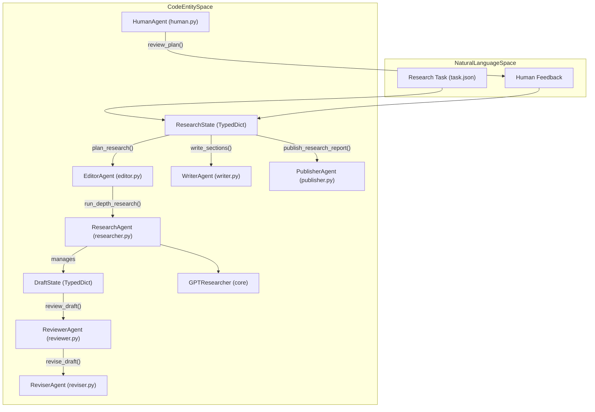
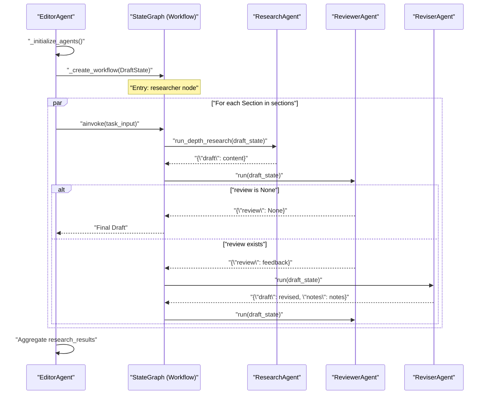

<!-- source: DeepWiki mcp.deepwiki.com · repo assafelovic/gpt-researcher · page 10.2 Specialized Agents · fetched 2026-10-27 -->

# Specialized Agents

Relevant source files

The following files were used as context for generating this wiki page:

- [multi_agents/README.md](multi_agents/README.md)
- [multi_agents/agent.py](multi_agents/agent.py)
- [multi_agents/agents/__init__.py](multi_agents/agents/__init__.py)
- [multi_agents/agents/editor.py](multi_agents/agents/editor.py)
- [multi_agents/agents/human.py](multi_agents/agents/human.py)
- [multi_agents/agents/orchestrator.py](multi_agents/agents/orchestrator.py)
- [multi_agents/agents/plan_review.py](multi_agents/agents/plan_review.py)
- [multi_agents/agents/publisher.py](multi_agents/agents/publisher.py)
- [multi_agents/agents/researcher.py](multi_agents/agents/researcher.py)
- [multi_agents/agents/reviewer.py](multi_agents/agents/reviewer.py)
- [multi_agents/agents/reviser.py](multi_agents/agents/reviser.py)
- [multi_agents/agents/writer.py](multi_agents/agents/writer.py)
- [multi_agents/memory/draft.py](multi_agents/memory/draft.py)
- [multi_agents/memory/research.py](multi_agents/memory/research.py)
- [multi_agents/task.json](multi_agents/task.json)
- [tests/test_multi_agents_plan_revisions.py](tests/test_multi_agents_plan_revisions.py)

This document details the specialized agent classes in the multi-agent research system: `ResearchAgent`, `EditorAgent`, `ReviewerAgent`, `ReviserAgent`, `WriterAgent`, `PublisherAgent`, and the `HumanAgent`. Each agent encapsulates a specific responsibility in the collaborative research workflow, from initial research through to publication.

---

## Agent Architecture Overview

The multi-agent system consists of specialized agents instantiated with common parameters for communication and coordination. All agents share a similar initialization pattern and interact through typed state dictionaries defined in `multi_agents/memory/`.

### Specialized Agent Team
The research team is composed of the following roles:
- **Human**: Oversees the process and provides feedback [multi_agents/README.md:17]().
- **Chief Editor**: Coordinates the team using LangGraph [multi_agents/README.md:18]().
- **Researcher**: Conducts in-depth research using `gpt-researcher` [multi_agents/README.md:19]().
- **Editor**: Plans the research outline and structure [multi_agents/README.md:20]().
- **Reviewer**: Validates research results against criteria [multi_agents/README.md:21]().
- **Revisor**: Revises results based on reviewer feedback [multi_agents/README.md:22]().
- **Writer**: Compiles and writes the final report [multi_agents/README.md:23]().
- **Publisher**: Publishes the report in multiple formats [multi_agents/README.md:24]().

**Sources:** [multi_agents/README.md:15-24](), [multi_agents/agents/__init__.py:1-21]()

### Common Initialization Parameters

Most agents accept standard parameters during initialization to enable real-time communication:

| Parameter | Type | Purpose |
|-----------|------|---------|
| `websocket` | WebSocket | Real-time communication channel for streaming updates [multi_agents/agents/researcher.py:8]() |
| `stream_output` | Callable | Async function to send messages via WebSocket [multi_agents/agents/researcher.py:9]() |
| `tone` | Tone | Research tone (Objective, Formal, etc.) [multi_agents/agents/researcher.py:11]() |
| `headers` | dict | HTTP headers for API requests [multi_agents/agents/researcher.py:10]() |

**Sources:** [multi_agents/agents/researcher.py:7-11](), [multi_agents/agents/editor.py:16-20](), [multi_agents/agents/writer.py:17-20]()

---

## ResearchAgent

The `ResearchAgent` is a wrapper around the core `GPTResearcher` class. It serves as the bridge between the multi-agent system and the standard research engine [multi_agents/agents/researcher.py:1]().

### Core Methods

#### `research()`
Instantiates and executes a `GPTResearcher` instance.
- **Implementation**: Calls `conduct_research()` followed by `write_report()` [multi_agents/agents/researcher.py:19-21]().
- **Parameters**: Supports `query`, `report_type`, `source`, and `tone` [multi_agents/agents/researcher.py:13-14]().

#### `run_initial_research()`
Executes the first research phase to gather context for the `EditorAgent` to plan the outline [multi_agents/agents/researcher.py:34-44]().

#### `run_depth_research()`
Executes in-depth research for a specific section topic within a `DraftState` workflow [multi_agents/agents/researcher.py:46-58]().

**Sources:** [multi_agents/agents/researcher.py:13-58]()

---

## EditorAgent

The `EditorAgent` orchestrates the multi-section research process. It plans the report structure and coordinates parallel execution of section-specific research tasks.

### Planning and Workflow
- **`plan_research()`**: Uses an LLM to generate a JSON outline containing a `title`, `date`, and `sections` (maximum defined by `max_sections`) [multi_agents/agents/editor.py:22-50]().
- **`run_parallel_research()`**: 
  1. Initializes `ResearchAgent`, `ReviewerAgent`, and `ReviserAgent` [multi_agents/agents/editor.py:118-124]().
  2. Creates a `StateGraph` using `DraftState` [multi_agents/agents/editor.py:126-129]().
  3. Defines a node sequence: `researcher` -> `reviewer` -> `reviser` [multi_agents/agents/editor.py:131-133]().
  4. Implements a conditional edge from `reviewer` to either `END` (accept) or `reviser` (revise) [multi_agents/agents/editor.py:138-142]().

**Sources:** [multi_agents/agents/editor.py:22-144]()

---

## ReviewerAgent and ReviserAgent

These agents form the quality control loop for individual report sections.

### ReviewerAgent
- **Role**: Validates drafts against guidelines provided in `task.json` [multi_agents/agents/reviewer.py:21-22]().
- **Logic**: If the draft meets all guidelines, it returns `None` to signal acceptance [multi_agents/agents/reviewer.py:34](). Otherwise, it returns feedback strings [multi_agents/agents/reviewer.py:61]().

### ReviserAgent
- **Role**: Updates drafts based on `ReviewerAgent` notes [multi_agents/agents/reviser.py:33]().
- **Output**: Returns a JSON object containing the revised `draft` and `revision_notes` explaining the changes [multi_agents/agents/reviser.py:5-12]().

**Sources:** [multi_agents/agents/reviewer.py:15-79](), [multi_agents/agents/reviser.py:21-74]()

---

## WriterAgent

The `WriterAgent` synthesizes all section drafts into a cohesive document by generating the "glue" content.

- **`write_sections()`**: Generates an introduction, conclusion, and table of contents in JSON format [multi_agents/agents/writer.py:32-67]().
- **Source Handling**: Must include relevant sources as markdown hyperlinks in the introduction and conclusion [multi_agents/agents/writer.py:54-55]().
- **Header Revision**: Can revise header labels to match specific guidelines (e.g., language requirements) [multi_agents/agents/writer.py:69-92]().

**Sources:** [multi_agents/agents/writer.py:6-142]()

---

## PublisherAgent

The `PublisherAgent` handles final document assembly and file generation.

- **`generate_layout()`**: Combines the title, date, introduction, table of contents, research sections, conclusion, and references into a single markdown string [multi_agents/agents/publisher.py:22-53]().
- **Multi-format Support**: Uses utility functions to convert markdown to PDF, DOCX, and standard Markdown files based on `publish_formats` in the task configuration [multi_agents/agents/publisher.py:55-61]().

**Sources:** [multi_agents/agents/publisher.py:16-71]()

---

## HumanAgent

The `HumanAgent` enables "Human-in-the-loop" (HITL) interactions during the research process.

- **`review_plan()`**: Interrupts the workflow to request feedback on the planned research topics [multi_agents/agents/human.py:10-14]().
- **Communication**: 
  - If a `websocket` is present, it streams a request and waits for a `human_feedback` message type [multi_agents/agents/human.py:20-33]().
  - Otherwise, it falls back to a standard console `input()` prompt [multi_agents/agents/human.py:43-45]().

**Sources:** [multi_agents/agents/human.py:4-52]()

---

## Data Flow and Code Entity Mapping

The following diagrams illustrate how natural language tasks translate into specific code entities and how data flows between specialized agents.

### Entity Relationship Diagram
This diagram bridges the conceptual "Agent" with the specific Python classes and state objects.

**Sources:** [multi_agents/agents/editor.py:13-20](), [multi_agents/memory/research.py:5-19](), [multi_agents/memory/draft.py:5-10](), [multi_agents/agents/human.py:10-14]()

### Parallel Research Execution Flow
This diagram details the `run_parallel_research` implementation in `EditorAgent`.

**Sources:** [multi_agents/agents/editor.py:52-77](), [multi_agents/agents/editor.py:126-144](), [multi_agents/agents/researcher.py:46-58]()

---

