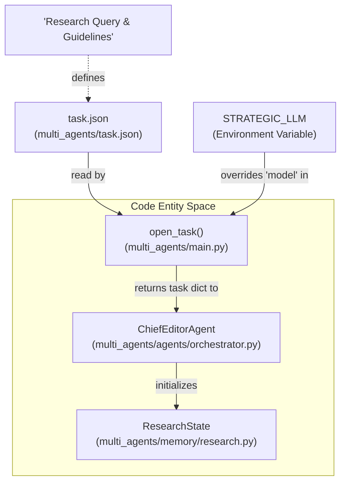
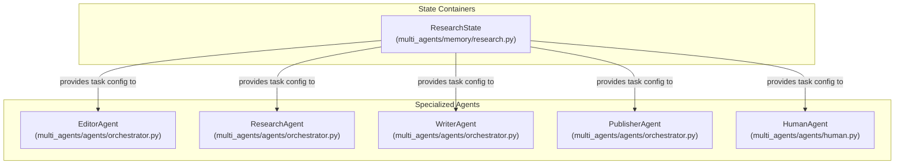

<!-- source: DeepWiki mcp.deepwiki.com · repo assafelovic/gpt-researcher · page 10.4 Multi-Agent Configuration · fetched 2026-10-27 -->

# Multi-Agent Configuration

<details>
<summary>Relevant source files</summary>

The following files were used as context for generating this wiki page:

- [backend/utils.py](backend/utils.py)
- [multi_agents/README.md](multi_agents/README.md)
- [multi_agents/agent.py](multi_agents/agent.py)
- [multi_agents/agents/human.py](multi_agents/agents/human.py)
- [multi_agents/agents/orchestrator.py](multi_agents/agents/orchestrator.py)
- [multi_agents/agents/plan_review.py](multi_agents/agents/plan_review.py)
- [multi_agents/agents/utils/file_formats.py](multi_agents/agents/utils/file_formats.py)
- [multi_agents/langgraph.json](multi_agents/langgraph.json)
- [multi_agents/main.py](multi_agents/main.py)
- [multi_agents/memory/research.py](multi_agents/memory/research.py)
- [multi_agents/requirements.txt](multi_agents/requirements.txt)
- [multi_agents/task.json](multi_agents/task.json)
- [tests/test_multi_agents_plan_revisions.py](tests/test_multi_agents_plan_revisions.py)

</details>


## Purpose and Scope

This page documents the configuration system for the LangGraph-based multi-agent research framework. The multi-agent system uses a dedicated `task.json` file to configure research behavior, agent parameters, and output formats. It also leverages the `STRATEGIC_LLM` environment variable for high-level model orchestration and provides mechanisms for human-in-the-loop feedback. For information about the multi-agent system architecture itself, see [Multi-Agent Framework]() and [Multi-Agent System Deep Dive](). For general GPT Researcher configuration, see [Configuration System]().

---

## Configuration File Overview

The multi-agent system is primarily configured via `task.json`, a JSON file located in the `multi_agents/` directory. This file defines all aspects of the research task including the query, model selection, quality controls, and output formats.

**File Location:** [multi_agents/task.json:1-19]()

**Loading Mechanism:** The configuration is loaded by the `open_task()` function in [multi_agents/main.py:17-38](), which:
1. Reads `task.json` from the `multi_agents/` directory [multi_agents/main.py:19-24]().
2. Validates that a task is present [multi_agents/main.py:26-27]().
3. Optionally overrides the `model` field with the `STRATEGIC_LLM` environment variable if defined [multi_agents/main.py:29-37]().

### Configuration Data Flow
The following diagram bridges the "Natural Language Space" (User Intent) to the "Code Entity Space" (System Implementation).

**Diagram: Configuration Injection Flow**

Sources: [multi_agents/main.py:17-38](), [multi_agents/memory/research.py:5-22]()

---

## Configuration Parameters Reference

The following table documents all available configuration parameters in `task.json`:

| Parameter | Type | Required | Default | Description |
|-----------|------|----------|---------|-------------|
| `query` | `string` | Yes | - | The research query or topic to investigate [multi_agents/README.md:66]() |
| `model` | `string` | No | `"gpt-4o"` | The LLM model to use for all agents. Overridden by `STRATEGIC_LLM` env var [multi_agents/main.py:29-37]() |
| `max_sections` | `integer` | No | `3` | Maximum number of research sections/subtopics to generate [multi_agents/README.md:68]() |
| `max_plan_revisions` | `integer` | No | `3` | Max human-requested plan revisions before workflow exits [multi_agents/README.md:69](), [multi_agents/agents/plan_review.py:1]() |
| `include_human_feedback` | `boolean` | No | `false` | Whether to pause for human feedback after planning phase [multi_agents/README.md:70]() |
| `publish_formats` | `object` | No | All `true` | Specifies output formats: `{"markdown": bool, "pdf": bool, "docx": bool}` [multi_agents/README.md:71]() |
| `source` | `string` | No | `"web"` | Research data source. Options: `"web"` or `"local"` [multi_agents/README.md:72]() |
| `follow_guidelines` | `boolean` | No | `false` | Whether to enforce quality guidelines via agents [multi_agents/README.md:73]() |
| `guidelines` | `array[string]` | No | `[]` | List of guidelines that the report must follow [multi_agents/README.md:74]() |
| `verbose` | `boolean` | No | `true` | Whether to output detailed logging information [multi_agents/README.md:75]() |

Sources: [multi_agents/README.md:63-98](), [multi_agents/task.json:1-19](), [multi_agents/agents/plan_review.py:1-23]()

---

## STRATEGIC_LLM and Model Handling

The system utilizes a specialized logic for determining which LLM to use for the multi-agent workflow. While standard `gpt-researcher` uses `SMART_LLM` and `FAST_LLM`, the multi-agent framework prioritizes the `STRATEGIC_LLM` environment variable for the `ChiefEditorAgent`'s coordination tasks.

**Implementation Details:**
- **Override Logic:** In `open_task()`, if `STRATEGIC_LLM` contains a colon (e.g., `openai:gpt-4o`), the system extracts the model name after the colon [multi_agents/main.py:30-34]().
- **Direct Usage:** If no colon is present, it uses the variable value directly [multi_agents/main.py:35-36]().
- **Default:** If `STRATEGIC_LLM` is not set, the system falls back to the `model` specified in `task.json` [multi_agents/main.py:24]().

Sources: [multi_agents/main.py:29-37]()

---

## Configuration Flow and State Management

The `task` dictionary flows through the system via the `ResearchState` TypedDict. This ensures that every specialized agent has access to the user's requirements (like guidelines or max sections).

**Diagram: State Propagation to Agents**

Sources: [multi_agents/memory/research.py:5-22](), [multi_agents/agents/orchestrator.py:47-54]()

### Agent-Specific Parameter Consumption

1.  **HumanAgent:** Uses `include_human_feedback` to decide whether to prompt the user for feedback via WebSocket or console [multi_agents/agents/human.py:18-45](). It also tracks `plan_revision_count` [multi_agents/agents/human.py:50-53]().
2.  **ChiefEditorAgent (Routing):** Uses `max_plan_revisions` in `_route_human_feedback` to determine if the workflow should continue revising the plan or raise a `MaxPlanRevisionsExceededError` [multi_agents/agents/orchestrator.py:87-90](), [multi_agents/agents/plan_review.py:8-23]().
3.  **PublisherAgent:** Consumes the `output_dir` (generated from the query) and manages the final report generation based on the research results [multi_agents/agents/orchestrator.py:52]().
4.  **Formatters:** The system uses utility functions like `write_md_to_pdf` and `write_md_to_word` which resolve local resources like `pdf_styles.css` to ensure the configuration (like APA format) is reflected in the visual output [multi_agents/agents/utils/file_formats.py:40-104]().

Sources: [multi_agents/agents/human.py:10-59](), [multi_agents/agents/orchestrator.py:87-90](), [multi_agents/agents/plan_review.py:8-23](), [multi_agents/agents/utils/file_formats.py:40-104]()

---

## Programmatic Usage

While `task.json` is the default, the system can be configured programmatically by passing a dictionary to the `ChiefEditorAgent`.

```python
from multi_agents.agents import ChiefEditorAgent
from gpt_researcher.utils.enum import Tone

task = {
    "query": "Is AI in a hype cycle?",
    "model": "gpt-4o",
    "max_sections": 3,
    "max_plan_revisions": 3,
    "publish_formats": {
        "markdown": True,
        "pdf": True,
        "docx": True
    },
    "include_human_feedback": False,
    "source": "web"
}

chief_editor = ChiefEditorAgent(task, tone=Tone.Objective)
report = await chief_editor.run_research_task()
```

Sources: [multi_agents/main.py:40-50](), [multi_agents/agents/orchestrator.py:26-33](), [multi_agents/agent.py:3-17]()

---

