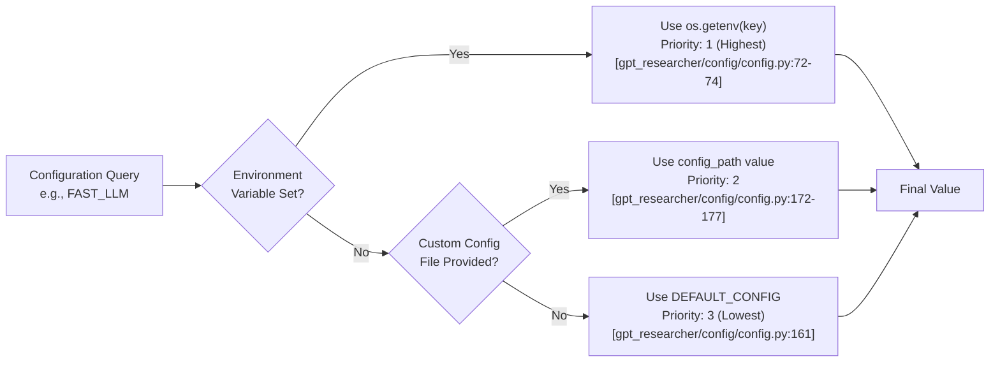

<!-- source: DeepWiki mcp.deepwiki.com · repo assafelovic/gpt-researcher · page 11.3 Environment Management · fetched 2026-10-27 -->

# Environment Management

<details>
<summary>Relevant source files</summary>

The following files were used as context for generating this wiki page:

- [.cursorrules](.cursorrules)
- [.env.example](.env.example)
- [.gitignore](.gitignore)
- [CURSOR_RULES.md](CURSOR_RULES.md)
- [gpt_researcher/actions/retriever.py](gpt_researcher/actions/retriever.py)
- [gpt_researcher/config/config.py](gpt_researcher/config/config.py)
- [gpt_researcher/llm_provider/__init__.py](gpt_researcher/llm_provider/__init__.py)
- [gpt_researcher/retrievers/__init__.py](gpt_researcher/retrievers/__init__.py)
- [gpt_researcher/retrievers/openalex/__init__.py](gpt_researcher/retrievers/openalex/__init__.py)
- [gpt_researcher/retrievers/openalex/openalex.py](gpt_researcher/retrievers/openalex/openalex.py)
- [gpt_researcher/retrievers/utils.py](gpt_researcher/retrievers/utils.py)
- [gpt_researcher/retrievers/xquik/__init__.py](gpt_researcher/retrievers/xquik/__init__.py)
- [gpt_researcher/retrievers/xquik/xquik.py](gpt_researcher/retrievers/xquik/xquik.py)
- [gpt_researcher/utils/llm.py](gpt_researcher/utils/llm.py)

</details>


This document covers best practices for managing environment variables, API keys, and configuration settings in GPT Researcher. It details the environment loading mechanism, configuration priority hierarchy, and common troubleshooting approaches.

For information about the configuration system architecture and available parameters, see [Configuration System](#5). For Docker-specific environment configuration, see [Docker Deployment](#11.1). For server startup and initialization, see [Server Configuration and Entry Points](#11.2).

## Environment Loading Mechanism

GPT Researcher loads environment variables through a multi-stage process that combines `.env` files, system environment variables, and default configurations.

### Loading Sequence

```mermaid
graph TB
    Start["Application Start"] --> LoadDotenv["load_dotenv()"]
    LoadDotenv --> InitConfig["Config.__init__()<br/>[gpt_researcher/config/config.py:34-61]"]
    
    InitConfig --> LoadConfig["Config.load_config()<br/>[gpt_researcher/config/config.py:157-178]"]
    
    LoadConfig --> CheckPath{config_path<br/>provided?}
    CheckPath -->|No| UseDefault["Return DEFAULT_CONFIG<br/>[gpt_researcher/config/config.py:161]"]
    CheckPath -->|Yes| CheckExists{Path<br/>exists?}
    
    CheckExists -->|No| WarnDefault["Print warning<br/>Use DEFAULT_CONFIG<br/>[gpt_researcher/config/config.py:165-170]"]
    CheckExists -->|Yes| LoadJSON["json.load(config_path)<br/>[gpt_researcher/config/config.py:172-173]"]
    
    LoadJSON --> Merge["Merge with DEFAULT_CONFIG<br/>[gpt_researcher/config/config.py:176-177]"]
    
    UseDefault --> SetAttrs
    WarnDefault --> SetAttrs
    Merge --> SetAttrs["_set_attributes()<br/>[gpt_researcher/config/config.py:62-84]"]
    
    SetAttrs --> ForEach["For each config key:<br/>[gpt_researcher/config/config.py:71]"]
    ForEach --> CheckEnv{os.getenv(key)<br/>exists?<br/>[gpt_researcher/config/config.py:72-73]}
    
    CheckEnv -->|Yes| Convert["convert_env_value()<br/>Type conversion<br/>[gpt_researcher/config/config.py:258-289]"]
    CheckEnv -->|No| UseConfig["Use config value"]
    
    Convert --> SetAttr["setattr(self, key.lower(), value)<br/>[gpt_researcher/config/config.py:75]"]
    UseConfig --> SetAttr
    
    SetAttr --> SetEmbed["_set_embedding_attributes()<br/>[gpt_researcher/config/config.py:85-89]"]
    SetEmbed --> SetLLM["_set_llm_attributes()<br/>[gpt_researcher/config/config.py:91-96]"]
    SetLLM --> HandleDeprecated["_handle_deprecated_attributes()<br/>[gpt_researcher/config/config.py:98-146]"]
    HandleDeprecated --> SetDocPath["_set_doc_path()<br/>[gpt_researcher/config/config.py:147-155]"]
    
    SetDocPath --> Ready["Config Ready"]
```

**Diagram: Environment Variable Loading Sequence**

The loading sequence prioritizes environment variables over configuration files, which in turn override defaults. The `convert_env_value` method handles type conversion based on `BaseConfig.__annotations__` type hints [gpt_researcher/config/config.py:74]().

**Sources:** [gpt_researcher/config/config.py:34-178](), [gpt_researcher/config/config.py:258-289]()

### Type Conversion System

GPT Researcher automatically converts environment variable strings to appropriate Python types based on the `BaseConfig` type annotations:

| Type | Conversion Logic | Example |
|------|------------------|---------|
| `bool` | `"true"`, `"1"`, `"yes"`, `"on"` → `True` | `VERBOSE=true` |
| `int` | `int(env_value)` | `MAX_ITERATIONS=5` |
| `float` | `float(env_value)` | `TEMPERATURE=0.7` |
| `str` | Direct assignment | `FAST_LLM=openai:gpt-4o-mini` |
| `list` | `json.loads(env_value)` | `RETRIEVERS=["tavily","google"]` |
| `dict` | `json.loads(env_value)` | `MCP_SERVERS=[{"name":"github"}]` |
| `Union[T, None]` | Checks for `"none"`, `"null"`, `""` | `STRATEGIC_LLM=none` |

**Sources:** [gpt_researcher/config/config.py:258-289]()

## Configuration Priority Hierarchy

GPT Researcher resolves configuration values using a three-tier priority system:



**Diagram: Configuration Priority Hierarchy**

This hierarchy allows for flexible deployment strategies:
- **Development:** Override specific values via environment variables without modifying files.
- **Staging/Production:** Use custom config files with environment-specific API endpoints.
- **Testing:** Rely on defaults with minimal configuration.

**Sources:** [gpt_researcher/config/config.py:62-178]()

## Core Environment Variables Reference

### LLM Provider Configuration

GPT Researcher uses a three-tier LLM strategy. Each tier is configured using the `provider:model` format:

| Variable | Format | Default | Purpose |
|----------|--------|---------|---------|
| `FAST_LLM` | `provider:model` | `openai:gpt-4o-mini` | Quick operations (summaries, metadata) |
| `SMART_LLM` | `provider:model` | `openai:gpt-4o` | Complex analysis, report writing |
| `STRATEGIC_LLM` | `provider:model` | `openai:o3-mini` | Reasoning tasks, planning |
| `REASONING_EFFORT` | `low`\|`medium`\|`high` | `medium` | Effort for reasoning models (o3, o4) |

**Provider-Specific Base URLs:**

| Variable | Purpose | Example |
|----------|---------|---------|
| `OPENAI_BASE_URL` | Custom OpenAI-compatible endpoint | `http://localhost:11434/v1` (Ollama) |
| `OLLAMA_BASE_URL` | Ollama server endpoint | `http://localhost:11434` |

**Sources:** [gpt_researcher/config/config.py:91-96](), [gpt_researcher/utils/llm.py:99-103](), [.env.example:1-65]()

### Scraper and Performance Configuration

The environment allows fine-tuning of scraping behavior to respect rate limits and optimize latency:

| Variable | Type | Default | Purpose |
|----------|------|---------|---------|
| `MAX_SCRAPER_WORKERS` | `int` | `15` | Max concurrent browser instances [ .env.example:18]() |
| `SCRAPER_RATE_LIMIT_DELAY` | `float` | `0.0` | Seconds between requests [ .env.example:30]() |
| `COMPRESSION_THRESHOLD` | `int` | `8000` | Char limit to skip expensive compression [ .env.example:38]() |

**Sources:** [.env.example:8-38]()

### API Keys and Observability

GPT Researcher requires API keys for various services. Each provider has its own environment variable:

| Variable | Provider | Purpose |
|----------|----------|---------|
| `OPENAI_API_KEY` | OpenAI | Primary LLM/Embedding access [ .env.example:1]() |
| `TAVILY_API_KEY` | Tavily Search | Web search retrieval [ .env.example:2]() |
| `XQUIK_API_KEY` | Xquik | X/Twitter search retrieval [ .env.example:3]() |
| `LANGCHAIN_API_KEY` | LangSmith | Enhanced observability [ .env.example:45]() |
| `LANGCHAIN_TRACING_V2` | LangSmith | Enable/Disable tracing [ .env.example:43]() |

**Sources:** [.env.example:1-46]()

## .env File Management

The `.env` file should be placed in the repository root directory. It is explicitly ignored by version control to prevent secret leakage.

### Security and Git Integration

The project includes a robust `.gitignore` to protect sensitive environment files:

| Ignored Pattern | Description |
|-----------------|-------------|
| `.env` | Primary secrets file [ .gitignore:2]() |
| `.venv`, `env/` | Virtual environments [ .gitignore:3-9]() |
| `.envrc` | Direnv configuration [ .gitignore:4]() |
| `env.bak/` | Backup environment files [ .gitignore:13]() |

**Sources:** [ .gitignore:1-15]()

### .env.example Template

The repository provides a template for required and optional variables:

```bash
# [.env.example]
OPENAI_API_KEY=
TAVILY_API_KEY=
DOC_PATH=./my-docs

# Scraper Configuration
# MAX_SCRAPER_WORKERS=15
# SCRAPER_RATE_LIMIT_DELAY=0.0

# Performance Optimization
# COMPRESSION_THRESHOLD=8000

# LangChain Tracing (LangSmith)
# LANGCHAIN_TRACING_V2=true
# LANGCHAIN_API_KEY=
```

**Sources:** [.env.example:1-46]()

## Deprecated Configuration Handling

GPT Researcher maintains backward compatibility with deprecated configuration patterns while warning users to migrate:

```mermaid
graph TB
    CheckDeprecated["_handle_deprecated_attributes()<br/>[gpt_researcher/config/config.py:98]"]
    
    CheckDeprecated --> CheckEmbedProvider{EMBEDDING_PROVIDER<br/>env var set?<br/>[gpt_researcher/config/config.py:100]}
    
    CheckEmbedProvider -->|Yes| WarnEmbed["warnings.warn(FutureWarning)<br/>[gpt_researcher/config/config.py:101-105]"]
    WarnEmbed --> MapProvider{Provider type?<br/>[gpt_researcher/config/config.py:111-126]}
    
    MapProvider -->|ollama| UseOllama["Use OLLAMA_EMBEDDING_MODEL<br/>[gpt_researcher/config/config.py:112]"]
    MapProvider -->|custom| UseCustom["Use OPENAI_EMBEDDING_MODEL<br/>[gpt_researcher/config/config.py:113-114]"]
    MapProvider -->|openai| UseOAIEmbed["text-embedding-3-large<br/>[gpt_researcher/config/config.py:115-116]"]
    
    CheckEmbedProvider -->|No| CheckLLMProvider{LLM_PROVIDER<br/>env var set?<br/>[gpt_researcher/config/config.py:132]}
    
    CheckLLMProvider -->|Yes| WarnLLM["warnings.warn(FutureWarning)<br/>[gpt_researcher/config/config.py:133]"]
    WarnLLM --> SetProviders["Set fast_llm_provider<br/>Set smart_llm_provider<br/>[gpt_researcher/config/config.py:134-139]"]
    
    CheckLLMProvider -->|No| CheckFast{FAST_LLM_MODEL<br/>set?<br/>[gpt_researcher/config/config.py:140]}
    CheckFast -->|Yes| WarnFast["Set fast_llm_model<br/>[gpt_researcher/config/config.py:142]"]
    
    CheckFast -->|No| CheckSmart{SMART_LLM_MODEL<br/>set?<br/>[gpt_researcher/config/config.py:143]}
    CheckSmart -->|Yes| WarnSmart["Set smart_llm_model<br/>[gpt_researcher/config/config.py:145]"]
    
    CheckSmart -->|No| Done["Deprecation handling complete"]
```

**Diagram: Deprecated Configuration Handling Flow**

**Sources:** [gpt_researcher/config/config.py:98-146]()

## Troubleshooting Common Issues

### Issue: Scraper Rate Limiting
If you encounter 429 errors from search providers or scrapers, adjust the concurrency and delay:
- Decrease `MAX_SCRAPER_WORKERS` (e.g., set to 2 for Firecrawl Free) [ .env.example:14-18]().
- Increase `SCRAPER_RATE_LIMIT_DELAY` (e.g., set to 6.0 for 10 req/min limits) [ .env.example:24-30]().

### Issue: High Latency for Small Docs
If research is slow on local documents or small web pages, increase the `COMPRESSION_THRESHOLD`. This skips the embedding-based compression pipeline when content is already concise, potentially reducing latency by 40-50% [ .env.example:34-38]().

### Issue: Frontend API URL
If the Next.js frontend cannot connect to the FastAPI backend, verify `NEXT_PUBLIC_GPTR_API_URL`. It defaults to `http://localhost:8000` but may need to be overridden in certain network environments [ .env.example:6]().

**Sources:** [.env.example:1-46]()

---

