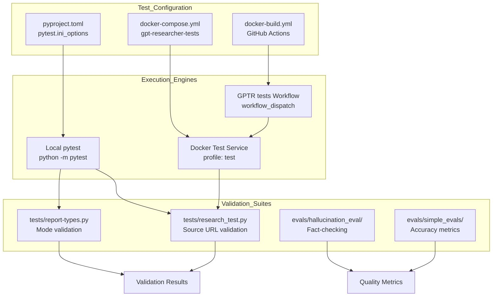
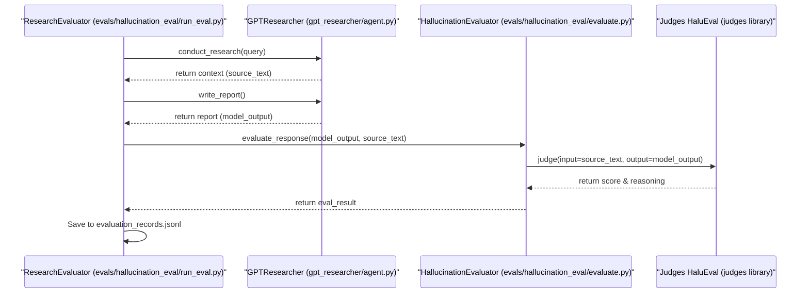

<!-- source: DeepWiki mcp.deepwiki.com · repo assafelovic/gpt-researcher · page 11.4 Testing and Validation · fetched 2026-10-27 -->

# Testing and Validation

Relevant source files

The following files were used as context for generating this wiki page:

- [.github/workflows/docker-build.yml](.github/workflows/docker-build.yml)
- [docs/docs/gpt-researcher/context/tailored-research.md](docs/docs/gpt-researcher/context/tailored-research.md)
- [docs/docs/gpt-researcher/llms/testing-your-llm.md](docs/docs/gpt-researcher/llms/testing-your-llm.md)
- [docs/docs/gpt-researcher/multi_agents/langgraph.md](docs/docs/gpt-researcher/multi_agents/langgraph.md)
- [evals/README.md](evals/README.md)
- [evals/__init__.py](evals/__init__.py)
- [evals/hallucination_eval/evaluate.py](evals/hallucination_eval/evaluate.py)
- [evals/hallucination_eval/inputs/search_queries.jsonl](evals/hallucination_eval/inputs/search_queries.jsonl)
- [evals/hallucination_eval/requirements.txt](evals/hallucination_eval/requirements.txt)
- [evals/hallucination_eval/results/aggregate_results.json](evals/hallucination_eval/results/aggregate_results.json)
- [evals/hallucination_eval/results/evaluation_records.jsonl](evals/hallucination_eval/results/evaluation_records.jsonl)
- [evals/hallucination_eval/run_eval.py](evals/hallucination_eval/run_eval.py)
- [evals/simple_evals/.gitignore](evals/simple_evals/.gitignore)
- [evals/simple_evals/__init__.py](evals/simple_evals/__init__.py)
- [evals/simple_evals/logs/.gitkeep](evals/simple_evals/logs/.gitkeep)
- [evals/simple_evals/logs/README.md](evals/simple_evals/logs/README.md)
- [evals/simple_evals/logs/SimpleQA Eval 100 Problems 2-22-25.txt](evals/simple_evals/logs/SimpleQA Eval 100 Problems 2-22-25.txt)
- [evals/simple_evals/problems/Simple QA Test Set.csv](evals/simple_evals/problems/Simple QA Test Set.csv)
- [evals/simple_evals/requirements.txt](evals/simple_evals/requirements.txt)
- [evals/simple_evals/run_eval.py](evals/simple_evals/run_eval.py)
- [evals/simple_evals/simpleqa_eval.py](evals/simple_evals/simpleqa_eval.py)
- [tests/__init__.py](tests/__init__.py)
- [tests/gptr-logs-handler.py](tests/gptr-logs-handler.py)
- [tests/report-types.py](tests/report-types.py)
- [tests/research_test.py](tests/research_test.py)
- [tests/test-openai-llm.py](tests/test-openai-llm.py)
- [tests/test-your-llm.py](tests/test-your-llm.py)
- [tests/test_logging.py](tests/test_logging.py)
- [tests/test_logs.py](tests/test_logs.py)

This document covers the testing infrastructure, validation workflows, and evaluation frameworks for GPT Researcher. It details the pytest configuration, automated test suites, and specialized evaluation systems for measuring factuality (SimpleQA) and detecting hallucinations.

## Purpose and Scope

This page documents:
- **Test Infrastructure**: Pytest configuration and Docker-based test execution.
- **Integration Testing**: Validating research modes, source handling, and report generation.
- **Evaluation Frameworks**: Quantitative measurement of research quality using SimpleQA and hallucination detection.
- **CI/CD Integration**: Automated testing workflows via GitHub Actions.

## Test Infrastructure Overview

The testing environment is designed to handle asynchronous research workflows, requiring specific configuration for `pytest-asyncio` and environment variable injection for API providers.

Title: Testing and Validation Architecture

**Sources:** [.github/workflows/docker-build.yml:1-45](), [tests/report-types.py:16-47](), [evals/README.md:1-176]()

## Pytest and Environment Configuration

### Pytest Settings
The framework uses `pytest-asyncio` in strict mode to manage the asynchronous nature of the `GPTResearcher` agent.

| Setting | Value | Purpose |
|---------|-------|---------|
| `asyncio_mode` | `"strict"` | Requires `@pytest.mark.asyncio` for async tests. |
| `testpaths` | `["tests"]` | Root directory for test discovery. |
| `python_files` | `"test_*.py"` | Naming convention for test modules. |

### GitHub Actions Workflow
The `GPTR tests` workflow automates testing in a containerized environment using secrets for API authentication.

- **Trigger**: Manual via `workflow_dispatch` [.github/workflows/docker-build.yml:7]().
- **Environment**: Uses the `tests` environment [.github/workflows/docker-build.yml:14]().
- **Secrets**: Injects `OPENAI_API_KEY`, `TAVILY_API_KEY`, and `LANGCHAIN_API_KEY` [.github/workflows/docker-build.yml:17-19]().
- **Execution**: Runs `docker-compose --profile test run --rm gpt-researcher-tests` [.github/workflows/docker-build.yml:45]().

**Sources:** [.github/workflows/docker-build.yml:1-45]()

## Research and Source Validation

The `tests/research_test.py` suite validates specific logic regarding how the agent handles user-provided URLs and web scouring.

### Source URL Logic
Tests verify the `source_urls` and `complement_source_urls` parameters in the `GPTResearcher` class.

1. **Restricted Research**: When `complement_source_urls=False`, the agent must only use provided URLs [tests/research_test.py:25-28]().
2. **Complemented Research**: When `complement_source_urls=True`, the agent gathers additional context from the web even if the provided sources are unrelated to the query [tests/research_test.py:74-77]().

### Report Type Validation
The `tests/report-types.py` script uses `pytest.mark.parametrize` to validate multiple research modes:
- `research_report`
- `subtopic_report`

It asserts that the generated report contains the query keywords and respects domain restrictions via `query_domains` [tests/report-types.py:17-43]().

**Sources:** [tests/research_test.py:1-111](), [tests/report-types.py:9-47](), [docs/docs/gpt-researcher/context/tailored-research.md:5-32]()

## SimpleQA Evaluation Framework

The `simple_evals` system measures short-form factuality based on OpenAI's methodology.

### Components and Metrics
- **Dataset**: `Simple QA Test Set.csv` containing factual questions and gold targets [evals/README.md:19]().
- **Grader**: Uses `gpt-4-turbo` (configurable) to grade responses on a three-point scale [evals/simple_evals/run_eval.py:80-84]().
- **Grades**:
    - `CORRECT`: Answer contains gold target info without contradictions [evals/simple_evals/simpleqa_eval.py:19-32]().
    - `INCORRECT`: Answer contradicts the gold target [evals/simple_evals/simpleqa_eval.py:34-48]().
    - `NOT_ATTEMPTED`: Answer neither confirms nor contradicts [evals/simple_evals/simpleqa_eval.py:50-62]().

### Implementation Flow
1. **Initialization**: `SimpleQAEval` loads random samples from the test set [evals/simple_evals/simpleqa_eval.py:101-117]().
2. **Execution**: `evaluate_single_query` runs `GPTResearcher.conduct_research()` and `write_report()` [evals/simple_evals/run_eval.py:30-44]().
3. **Grading**: The `GRADER_TEMPLATE` provides few-shot examples to the LLM judge to ensure consistent scoring [evals/simple_evals/simpleqa_eval.py:14-93]().

**Sources:** [evals/README.md:5-145](), [evals/simple_evals/simpleqa_eval.py:1-121](), [evals/simple_evals/run_eval.py:1-178]()

## Hallucination Evaluation

The `hallucination_eval` framework detects non-factual content by comparing generated reports against the retrieved source text.

### Evaluation Logic
The system utilizes the `judges` library to perform document summary evaluation.

Title: Hallucination Evaluation Sequence

### Key Classes and Methods
- `ResearchEvaluator.run_research(query)`: Orchestrates the `GPTResearcher` to produce a report and its associated context [evals/hallucination_eval/run_eval.py:68-95]().
- `HallucinationEvaluator.evaluate_response(model_output, source_text)`: Uses `HaluEvalDocumentSummaryNonFactual` to score the output [evals/hallucination_eval/evaluate.py:26-49]().
- `ResearchEvaluator.evaluate_research()`: Appends results to `evaluation_records.jsonl` and calculates aggregate hallucination rates [evals/hallucination_eval/run_eval.py:97-144]().

### Results Management
- **Detailed Records**: `evaluation_records.jsonl` stores per-query results, including reasoning for detected hallucinations [evals/hallucination_eval/results/evaluation_records.jsonl:1]().
- **Aggregates**: `aggregate_results.json` tracks total hallucination rates across a test run [evals/hallucination_eval/results/aggregate_results.json:1-7]().

**Sources:** [evals/hallucination_eval/run_eval.py:34-213](), [evals/hallucination_eval/evaluate.py:18-54](), [evals/hallucination_eval/results/aggregate_results.json:1-208]()

## Summary of Validation Commands

| Task | Command |
|------|---------|
| **Standard Tests** | `python -m pytest tests/report-types.py` |
| **Source Logic** | `python tests/research_test.py` |
| **SimpleQA Eval** | `python evals/simple_evals/run_eval.py --num_examples 5` |
| **Hallucination Eval** | `python evals/hallucination_eval/run_eval.py` |
| **Docker Tests** | `docker-compose --profile test run --rm gpt-researcher-tests` |

**Sources:** [evals/README.md:82, 172](), [.github/workflows/docker-build.yml:45](), [tests/report-types.py:47]()

---

