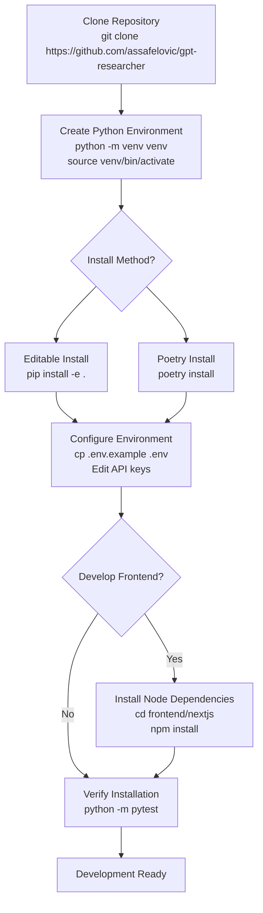
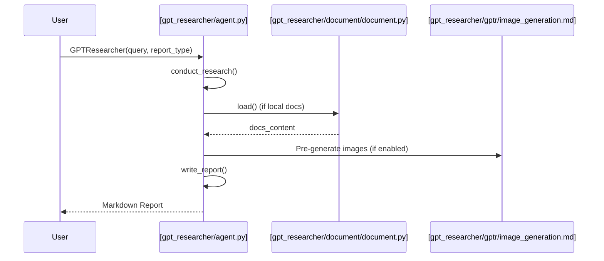

<!-- source: DeepWiki mcp.deepwiki.com · repo assafelovic/gpt-researcher · page 12 Development Guide · fetched 2026-10-27 -->

# Development Guide

<details>
<summary>Relevant source files</summary>

The following files were used as context for generating this wiki page:

- [.cursorrules](.cursorrules)
- [.gitignore](.gitignore)
- [CONTRIBUTING.md](CONTRIBUTING.md)
- [CURSOR_RULES.md](CURSOR_RULES.md)
- [docs/docs/gpt-researcher/gptr/ai-development.md](docs/docs/gpt-researcher/gptr/ai-development.md)
- [docs/docs/gpt-researcher/gptr/image_generation.md](docs/docs/gpt-researcher/gptr/image_generation.md)
- [gpt_researcher/document/document.py](gpt_researcher/document/document.py)
- [pyproject.toml](pyproject.toml)
- [setup.py](setup.py)

</details>


This section provides resources for developers who want to extend, modify, or contribute to GPT Researcher. It covers project structure, dependency management, development environment setup, testing, build processes, and common development patterns.

For specific development tasks:
- Setting up your development environment and understanding the codebase layout → see [Project Structure and Dependencies](#12.1)
- Developing or modifying the Next.js or Vanilla JS frontends → see [Frontend Development](#12.2)
- Adding support for new LLM providers → see [Adding New LLM Providers](#12.3)
- Implementing new search/retrieval providers → see [Adding New Retrievers](#12.4)
- Using Claude or other AI assistants for development → see [AI-Assisted Development](#12.5)

For architecture understanding, refer to [Core Architecture](#3). For configuration details, see [Configuration System](#5).

---

## Repository Structure

The GPT Researcher codebase is organized into distinct layers, each with specific responsibilities. Understanding this structure is essential for effective development.

### Repository Organization Diagram

```mermaid
graph TB
    subgraph "Repository_Root"
        ["/"]
        
        subgraph "Core_Package"
            [gpt_researcher/]
            Agent["gpt_researcher/agent.py<br/>GPTResearcher class"]
            Config["gpt_researcher/config/"]
            Skills["gpt_researcher/skills/"]
            Document["gpt_researcher/document/"]
            Memory["gpt_researcher/memory/"]
            Orchestrator["gpt_researcher/orchestrator/"]
            Prompts["gpt_researcher/prompts.py"]
            Utils["gpt_researcher/utils/"]
        end
        
        subgraph "Multi_Agent_System"
            MultiAgents["multi_agents/"]
            MAMain["multi_agents/main.py"]
            Agents["multi_agents/agents/"]
            MALangGraph["multi_agents/langgraph_*.py"]
        end
        
        subgraph "Backend_Services"
            Backend["backend/"]
            Server["backend/server/"]
            ServerApp["backend/server/app.py<br/>FastAPI app"]
        end
        
        subgraph "Frontend_Applications"
            Frontend["frontend/"]
            NextJS["frontend/nextjs/"]
            VanillaJS["frontend/static/"]
        end
        
        subgraph "Build_System"
            ReqTxt["requirements.txt"]
            SetupPy["setup.py"]
            Pyproject["pyproject.toml"]
            Docker["Dockerfile"]
            Compose["docker-compose.yml"]
        end
        
        subgraph "Tests_Dir"
            Tests["tests/"]
        end
        
        subgraph "AI_Dev_Tools"
            Claude[".claude/skills/"]
            CursorRules["CURSOR_RULES.md"]
        end
    end
    
    ["/"] --> [gpt_researcher/]
    ["/"] --> MultiAgents
    ["/"] --> Backend
    ["/"] --> Frontend
    ["/"] --> SetupPy
    ["/"] --> Pyproject
    ["/"] --> Tests
    ["/"] --> Claude
    
    [gpt_researcher/] --> Agent
    [gpt_researcher/] --> Config
    [gpt_researcher/] --> Skills
    [gpt_researcher/] --> Document
    [gpt_researcher/] --> Memory
    [gpt_researcher/] --> Orchestrator
    [gpt_researcher/] --> Prompts
    [gpt_researcher/] --> Utils
    
    MultiAgents --> MAMain
    MultiAgents --> Agents
    MultiAgents --> MALangGraph
    
    Backend --> Server
    Server --> ServerApp
    
    Frontend --> NextJS
    Frontend --> VanillaJS
```

**Sources:** [setup.py:26-27](), [pyproject.toml:57-58](), [CURSOR_RULES.md:20-55](), [.cursorrules:1-15]()

### Key Directory Purposes

| Directory | Purpose | Key Entities |
|-----------|---------|-----------|
| `gpt_researcher/` | Core research engine package | `GPTResearcher` class [gpt_researcher/agent.py:1-5](), `DocumentLoader` [gpt_researcher/document/document.py:16-17]() |
| `multi_agents/` | LangGraph-based multi-agent system | `ChiefEditorAgent`, `ResearcherAgent` [CURSOR_RULES.md:165-172]() |
| `backend/server/` | FastAPI server and WebSocket handlers | `app` [CURSOR_RULES.md:150-151]() |
| `frontend/nextjs/` | Next.js production frontend | Production UI with enhanced features [CURSOR_RULES.md:21-23]() |
| `frontend/static/` | Vanilla JS lightweight frontend | Static FastAPI version [CURSOR_RULES.md:105-106]() |
| `.claude/skills/` | AI assistant development guides | `SKILL.md`, `REFERENCE.md` [docs/docs/gpt-researcher/gptr/ai-development.md:21-26]() |

**Sources:** [CURSOR_RULES.md:20-55](), [docs/docs/gpt-researcher/gptr/ai-development.md:21-26]()

---

## Development Environment Setup

### Prerequisites

- **Python 3.11+** required for core logic [setup.py:44](), [pyproject.toml:10]()
- **Node.js 18+** for Next.js frontend development [CURSOR_RULES.md:146-147]()
- **Docker** for containerized development [CURSOR_RULES.md:153-154]()

**Sources:** [setup.py:44](), [pyproject.toml:10](), [CURSOR_RULES.md:145-155]()

### Local Setup Workflow



**Sources:** [setup.py:22-48](), [pyproject.toml:1-52](), [CURSOR_RULES.md:145-155]()

---

## Dependency Management

GPT Researcher uses `setup.py` for pip packaging and `pyproject.toml` for Poetry/UV dependency management.

### Core Dependencies

The project relies on several key libraries for its functionality:
- **LLM Orchestration**: `langchain`, `langgraph` [pyproject.toml:21-27]()
- **Web Scraping**: `beautifulsoup4`, `duckduckgo_search`, `arxiv` [pyproject.toml:12-15]()
- **Document Processing**: `PyMuPDF`, `python-docx`, `unstructured` [pyproject.toml:35-43]()
- **Web Server**: `fastapi`, `uvicorn`, `websockets` [pyproject.toml:16-45]()

**Sources:** [pyproject.toml:9-48](), [setup.py:19-20]()

---

## Development Workflow

### Research Execution Flow

The system follows a coordinated flow between the agent, document processing, and report generation.



**Sources:** [gpt_researcher/document/document.py:16-61](), [docs/docs/gpt-researcher/gptr/image_generation.md:64-82](), [CURSOR_RULES.md:44-49]()

### Common Development Patterns

#### Adding a New Feature
When adding features like `IMAGE_GENERATION_ENABLED` [docs/docs/gpt-researcher/gptr/image_generation.md:23](), developers should follow the established pattern:
1. **Config**: Add environment variables to `.env` [docs/docs/gpt-researcher/gptr/image_generation.md:19-36]()
2. **Logic**: Implement in the core `gpt_researcher` package.
3. **Frontend**: Update the Next.js or static frontend to handle new data types.

**Sources:** [docs/docs/gpt-researcher/gptr/image_generation.md:19-36](), [CURSOR_RULES.md:135-144]()

---

## Testing Infrastructure

The project uses `pytest` for automated testing.

### Running Tests
- **Python Tests**: `python -m pytest` [CURSOR_RULES.md:149]()
- **Docker Tests**: `docker-compose run gpt-researcher-tests` [CURSOR_RULES.md:154]()
- **Frontend Tests**: `npm run test` [CURSOR_RULES.md:148]()

**Sources:** [pyproject.toml:54-59](), [CURSOR_RULES.md:145-155]()

---

## AI-Assisted Development

The project includes specific resources to help AI assistants understand the codebase:
- **`.claude/skills/SKILL.md`**: Comprehensive guide for Claude [docs/docs/gpt-researcher/gptr/ai-development.md:28-47]()
- **`CURSOR_RULES.md`**: Rules for the Cursor IDE to maintain code quality and follow project conventions [CURSOR_RULES.md:1-181]()

**Sources:** [docs/docs/gpt-researcher/gptr/ai-development.md:6-26](), [CURSOR_RULES.md:1-5]()

---

## Next Steps

For more detailed information on specific development topics:

- **Project Structure and Dependencies** → [Project Structure and Dependencies](#12.1)
- **Frontend Development** → [Frontend Development](#12.2)
- **Adding New LLM Providers** → [Adding New LLM Providers](#12.3)
- **Adding New Retrievers** → [Adding New Retrievers](#12.4)
- **AI-Assisted Development** → [AI-Assisted Development](#12.5)

---

