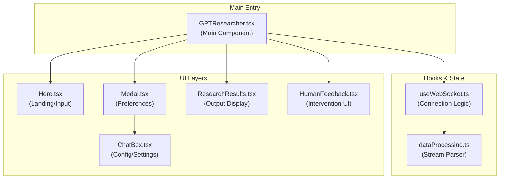
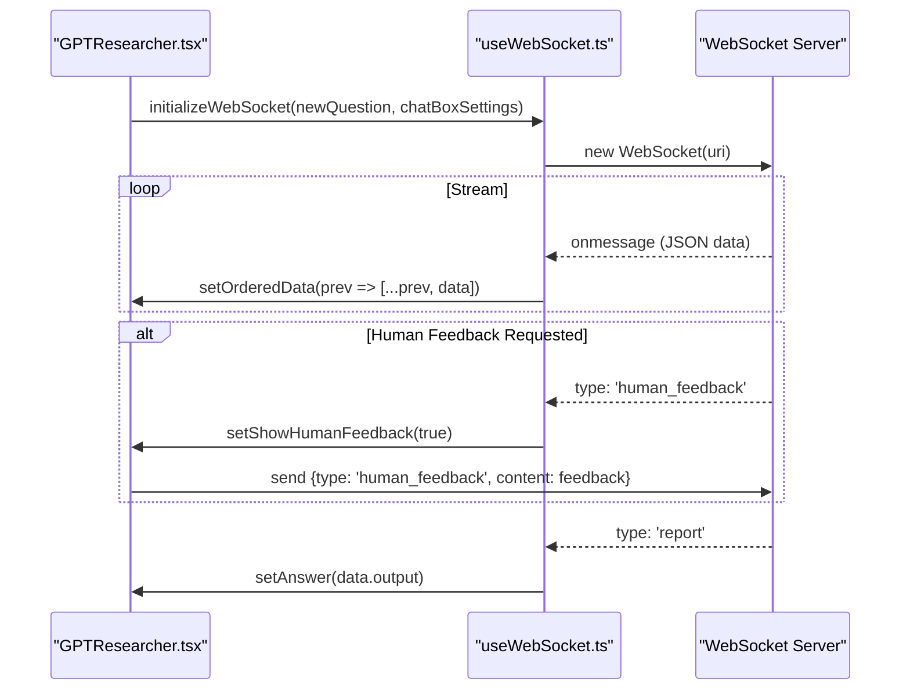

<!-- source: DeepWiki mcp.deepwiki.com · repo assafelovic/gpt-researcher · page 12.2 Frontend Development · fetched 2026-10-27 -->

# Frontend Development

Relevant source files

The following files were used as context for generating this wiki page:

- [frontend/nextjs/.babelrc.build.json](frontend/nextjs/.babelrc.build.json)
- [frontend/nextjs/README.md](frontend/nextjs/README.md)
- [frontend/nextjs/app/globals.css](frontend/nextjs/app/globals.css)
- [frontend/nextjs/app/layout.tsx](frontend/nextjs/app/layout.tsx)
- [frontend/nextjs/components/Settings/Modal.tsx](frontend/nextjs/components/Settings/Modal.tsx)
- [frontend/nextjs/components/Settings/Settings.css](frontend/nextjs/components/Settings/Settings.css)
- [frontend/nextjs/helpers/getHost.ts](frontend/nextjs/helpers/getHost.ts)
- [frontend/nextjs/package.json](frontend/nextjs/package.json)
- [frontend/nextjs/package.lib.json](frontend/nextjs/package.lib.json)
- [frontend/nextjs/rollup.config.js](frontend/nextjs/rollup.config.js)
- [frontend/nextjs/src/GPTResearcher.tsx](frontend/nextjs/src/GPTResearcher.tsx)
- [frontend/nextjs/src/index.css](frontend/nextjs/src/index.css)
- [frontend/nextjs/src/index.ts](frontend/nextjs/src/index.ts)
- [frontend/nextjs/tsconfig.json](frontend/nextjs/tsconfig.json)
- [frontend/nextjs/tsconfig.lib.json](frontend/nextjs/tsconfig.lib.json)

This document provides technical guidance for developers working on the GPT Researcher frontend interfaces. It covers the Next.js production frontend, the Vanilla JS lightweight alternative, and the build processes for distribution.

## Overview

GPT Researcher provides multiple frontend implementations to accommodate different deployment scenarios:

| Frontend Type | Technology Stack | Use Case | Location |
|--------------|------------------|----------|----------|
| Next.js Production Frontend | React 18, Next.js 14, TypeScript, Tailwind CSS | Full-featured production deployments | `frontend/nextjs/` |
| Vanilla JS Frontend | HTML/CSS/JavaScript | Lightweight deployments served by FastAPI | `frontend/` (static files) |
| Next.js Library | Rollup, TypeScript | Embedding GPT Researcher as a React component | `frontend/nextjs/dist/` |

All frontends communicate with the FastAPI backend server using the WebSocket protocol for real-time research streaming.

Sources: [frontend/nextjs/package.json:2-13](), [frontend/nextjs/src/GPTResearcher.tsx:26-32]()

## Next.js Frontend Architecture

### Core Component Structure

The Next.js frontend is built as a modular React application. The central entry point for the UI component is `GPTResearcher.tsx`.

**Diagram: Next.js Component Hierarchy and Data Flow**

Sources: [frontend/nextjs/src/GPTResearcher.tsx:1-32](), [frontend/nextjs/components/Settings/Modal.tsx:1-17]()

### WebSocket Implementation and Data Flow

The frontend maintains a persistent WebSocket connection to the backend to handle streamed research results, logs, and human feedback requests.

**Diagram: WebSocket Communication Lifecycle**

Key functions in the WebSocket flow:
- `initializeWebSocket`: Establishes the connection and sends the initial research request with user settings [frontend/nextjs/src/GPTResearcher.tsx:76-82]().
- `handleFeedbackSubmit`: Sends human intervention data back to the backend via the existing socket [frontend/nextjs/src/GPTResearcher.tsx:84-89]().
- `handleStopResearch`: Closes the socket connection and reloads the page to reset state [frontend/nextjs/src/GPTResearcher.tsx:194-203]().

Sources: [frontend/nextjs/src/GPTResearcher.tsx:76-203](), [frontend/nextjs/helpers/getHost.ts:5-26]()

## Configuration and Settings

The frontend provides a comprehensive settings interface via `Modal.tsx` and `ChatBox.tsx`. These settings are persisted in `localStorage`.

### Persistence Strategy
- `apiVariables`: Stores environment-specific settings like `DOC_PATH` [frontend/nextjs/components/Settings/Modal.tsx:22-24]().
- `chatBoxSettings`: Stores research preferences like `report_type`, `report_source`, and `tone` [frontend/nextjs/src/GPTResearcher.tsx:40-50]().
- `GPTR_API_URL`: The backend host URL, retrieved via the `getHost` helper [frontend/nextjs/helpers/getHost.ts:8-12]().

### Research Parameters
The `ChatBoxSettings` interface allows users to configure the following:
- **Report Type**: Default is `research_report` [frontend/nextjs/src/GPTResearcher.tsx:42]().
- **Report Source**: Options include `web`, `local`, etc. [frontend/nextjs/src/GPTResearcher.tsx:41]().
- **Tone**: Qualitative style of the report [frontend/nextjs/src/GPTResearcher.tsx:43]().
- **MCP**: Model Context Protocol settings including `mcp_enabled` and `mcp_strategy` [frontend/nextjs/src/GPTResearcher.tsx:47-49]().

Sources: [frontend/nextjs/src/GPTResearcher.tsx:40-50](), [frontend/nextjs/components/Settings/Modal.tsx:55-75]()

## Build Processes and NPM Scripts

The Next.js frontend supports two primary build modes: a standard Next.js application and a bundled library for external use.

### NPM Scripts Reference
| Script | Command | Purpose |
|--------|---------|---------|
| `dev` | `next dev` | Local development server [frontend/nextjs/package.json:16]() |
| `build` | `next build` | Production Next.js application build [frontend/nextjs/package.json:17]() |
| `build:lib` | `rollup -c` | Bundles the UI as a library using Rollup [frontend/nextjs/package.json:20]() |
| `build:types`| `cp src/index.d.ts dist/` | Copies TypeScript definitions to the distribution folder [frontend/nextjs/package.json:21]() |

### Library Bundling (Rollup)
The project uses Rollup to package the frontend as a reusable NPM library (`gpt-researcher-ui`).
- **PostCSS/Tailwind**: Injects CSS directly into the JS bundle [frontend/nextjs/rollup.config.js:34-42]().
- **Babel**: Transpiles TypeScript and React code with specific presets [frontend/nextjs/rollup.config.js:57-70]().
- **External Dependencies**: Excludes `react`, `next`, and Node.js built-ins like `fs` or `path` to prevent bundling conflicts [frontend/nextjs/rollup.config.js:73-83]().

Sources: [frontend/nextjs/package.json:1-23](), [frontend/nextjs/rollup.config.js:19-84]()

## Styling and Theming

The application uses Tailwind CSS for layout and styling, with global styles defined in `globals.css`.

### Visual Elements
- **Background Orbs**: Fixed position blurred orbs created using CSS `::before` and `::after` pseudo-elements on the `body` [frontend/nextjs/app/globals.css:57-81]().
- **Animations**: Custom keyframes for `gradientBG`, `float`, and `loader` (loading dots) [frontend/nextjs/app/globals.css:5-24](), [frontend/nextjs/app/globals.css:150-160]().
- **Sidebar**: Custom scrollbar and backdrop blur for history and navigation [frontend/nextjs/app/globals.css:182-221]().

Sources: [frontend/nextjs/app/globals.css:1-221](), [frontend/nextjs/components/Settings/Settings.css:42-49]()

## Data Processing Utilities

Before rendering, streamed data from the WebSocket is processed to ensure a clean UI state.

- **`preprocessOrderedData`**: Groups raw stream chunks into logical blocks like accordions or report sections [frontend/nextjs/src/GPTResearcher.tsx:225-235]().
- **Host Resolution**: The `getHost` helper determines the correct backend URL by checking `localStorage`, URL parameters (`GPTR_API_URL`), and environment variables (`NEXT_PUBLIC_GPTR_API_URL`) [frontend/nextjs/helpers/getHost.ts:5-26]().

Sources: [frontend/nextjs/src/GPTResearcher.tsx:225-240](), [frontend/nextjs/helpers/getHost.ts:1-28]()

---

