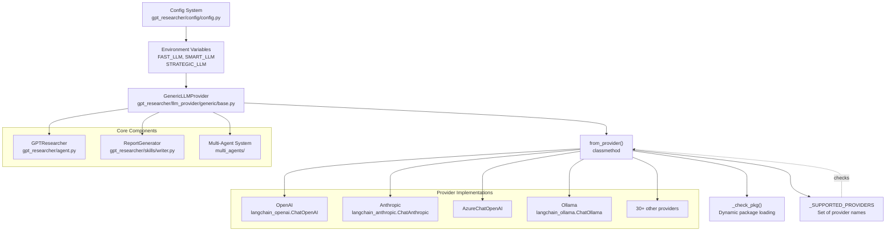
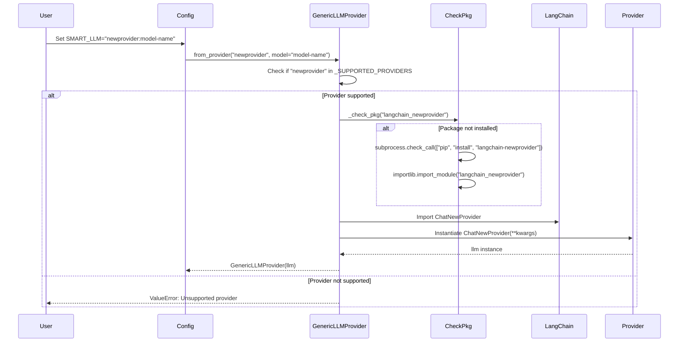
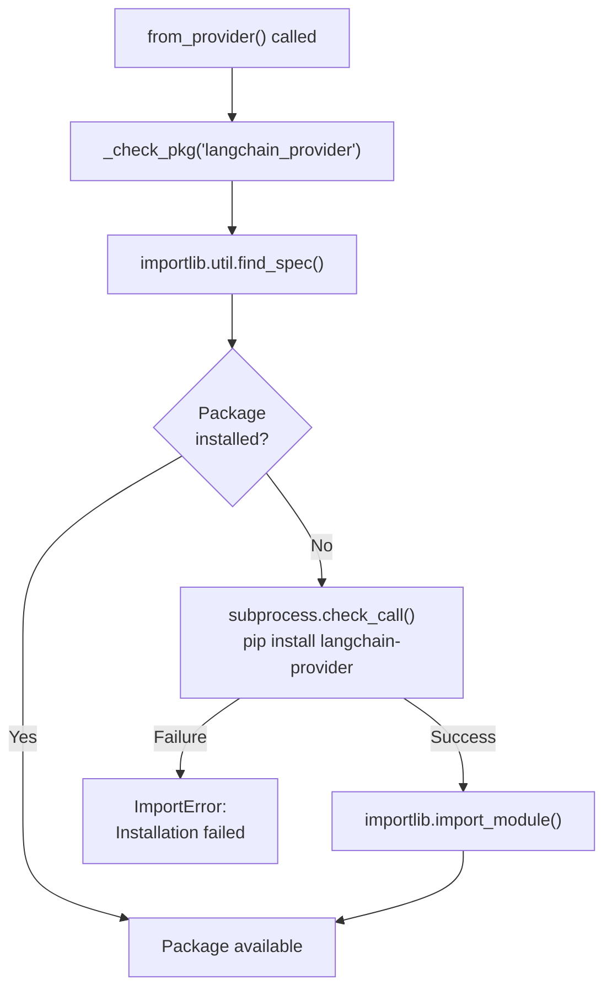

<!-- source: DeepWiki mcp.deepwiki.com · repo assafelovic/gpt-researcher · page 12.3 Adding New LLM Providers · fetched 2026-10-27 -->

# Adding New LLM Providers

Relevant source files

The following files were used as context for generating this wiki page:

- [.claude/SKILL.md](.claude/SKILL.md)
- [.claude/references/adding-features.md](.claude/references/adding-features.md)
- [.claude/references/advanced-patterns.md](.claude/references/advanced-patterns.md)
- [.claude/references/api-reference.md](.claude/references/api-reference.md)
- [.claude/references/architecture.md](.claude/references/architecture.md)
- [.claude/references/components.md](.claude/references/components.md)
- [.claude/references/config-reference.md](.claude/references/config-reference.md)
- [.claude/references/deep-research.md](.claude/references/deep-research.md)
- [.claude/references/flows.md](.claude/references/flows.md)
- [.claude/references/mcp.md](.claude/references/mcp.md)
- [.claude/references/multi-agents.md](.claude/references/multi-agents.md)
- [docs/docs/gpt-researcher/llms/llms.md](docs/docs/gpt-researcher/llms/llms.md)
- [docs/docs/gpt-researcher/llms/supported-llms.md](docs/docs/gpt-researcher/llms/supported-llms.md)
- [gpt_researcher/llm_provider/generic/base.py](gpt_researcher/llm_provider/generic/base.py)
- [gpt_researcher/memory/embeddings.py](gpt_researcher/memory/embeddings.py)

This guide provides step-by-step instructions for extending GPT Researcher to support additional LLM providers. It covers the technical implementation details, required code modifications, and configuration patterns needed to integrate new language model providers into the system.

**Scope**: This page focuses specifically on adding new LLM providers to the `GenericLLMProvider` abstraction layer. For information about configuring existing providers, see [Supported Providers and Models](). For embedding provider integration, see [Embeddings and Memory System](). For overall LLM architecture concepts, see [LLM Provider Architecture]().

---

## LLM Provider Architecture Overview

The `GenericLLMProvider` class serves as the unified abstraction layer for all LLM providers. It provides a consistent interface regardless of which underlying provider is used, handling provider-specific initialization details and parameter transformations.

### LLM Integration Data Flow
Title: LLM Provider Integration Flow

Sources: [gpt_researcher/llm_provider/generic/base.py:13-39](), [gpt_researcher/llm_provider/generic/base.py:92-272](), [gpt_researcher/agent.py:17-50]()

---

## Prerequisites

Before adding a new provider, ensure:

1.  **LangChain Support**: Verify that LangChain has an integration package for your provider (e.g., `langchain-yourprovider`).
2.  **Chat Model Interface**: The provider must support chat-based interactions (not just completions).
3.  **Async Support**: The provider's LangChain integration must support `ainvoke` and `astream` methods [gpt_researcher/llm_provider/generic/base.py:275-307]().
4.  **API Access**: You have access to the provider's API and authentication credentials.

---

## Provider Registration Flow

### Dynamic Loading Sequence
Title: Provider Registration and Loading Sequence

Sources: [gpt_researcher/llm_provider/generic/base.py:122-272](), [gpt_researcher/llm_provider/generic/base.py:316-334]()

---

## Step-by-Step Implementation Guide

### Step 1: Add Provider to Supported Set

Add your provider name to the `_SUPPORTED_PROVIDERS` set in [gpt_researcher/llm_provider/generic/base.py:13-39]().

**Naming Convention**: Use lowercase with underscores for multi-word names (e.g., `azure_openai`, `google_genai`).

### Step 2: Implement Provider Case in `from_provider()`

Add a new `elif` block in the `from_provider` classmethod [gpt_researcher/llm_provider/generic/base.py:122-272]().

#### Pattern Variations:

*   **Standard Pattern**: Used for most native LangChain integrations like Anthropic [gpt_researcher/llm_provider/generic/base.py:132-136]().
*   **OpenAI-Compatible Pattern**: For providers using OpenAI-compatible endpoints like DeepSeek [gpt_researcher/llm_provider/generic/base.py:218-225]() or Dashscope [gpt_researcher/llm_provider/generic/base.py:207-211]().
*   **Parameter Mapping Pattern**: When a provider uses different parameter names (e.g., `model_id` instead of `model`), seen in HuggingFace [gpt_researcher/llm_provider/generic/base.py:186-193]() and Bedrock [gpt_researcher/llm_provider/generic/base.py:199-206]().
*   **Azure Pattern**: Specifically for Azure deployments where `model` maps to `azure_deployment` [gpt_researcher/llm_provider/generic/base.py:137-145]().

### Step 3: Handle Environment Variables

Your provider implementation should read API keys and configuration from environment variables within the `from_provider` logic. Common variables include `OPENAI_BASE_URL` [gpt_researcher/llm_provider/generic/base.py:128-129]() or `OLLAMA_BASE_URL` [gpt_researcher/llm_provider/generic/base.py:171]().

### Step 4: Configure Model-Specific Behavior

#### Temperature Handling
If your provider includes models that don't support the `temperature` parameter (like reasoning models), add them to `NO_SUPPORT_TEMPERATURE_MODELS` [gpt_researcher/llm_provider/generic/base.py:41-57]().

#### Reasoning Effort Parameter
For models that support reasoning effort levels (like o3-mini), add them to `SUPPORT_REASONING_EFFORT_MODELS` [gpt_researcher/llm_provider/generic/base.py:59-66](). The `ReasoningEfforts` enum [gpt_researcher/llm_provider/generic/base.py:68-71]() defines valid values: `high`, `medium`, and `low`.

### Step 5: Update Documentation

Add configuration examples to `docs/docs/gpt-researcher/llms/llms.md` [docs/docs/gpt-researcher/llms/llms.md:1-184]() and update the supported list in `docs/docs/gpt-researcher/llms/supported-llms.md` [docs/docs/gpt-researcher/llms/supported-llms.md:1-26]().

---

## Dynamic Package Loading System

Title: Dynamic Package Installation Logic in _check_pkg

Sources: [gpt_researcher/llm_provider/generic/base.py:316-334]()

The `_check_pkg()` function automatically handles package installation:
1.  Checks if package exists using `importlib.util.find_spec()` [gpt_researcher/llm_provider/generic/base.py:318]().
2.  Auto-installs missing packages via pip using `subprocess.check_call` [gpt_researcher/llm_provider/generic/base.py:326]().
3.  Converts underscore names to kebab-case for the pip command [gpt_researcher/llm_provider/generic/base.py:323]().
4.  Provides colored terminal output using `colorama` [gpt_researcher/llm_provider/generic/base.py:321-322]().

---

## Embedding Provider Extension

For providers that also offer embedding models, follow a parallel pattern in `Memory.__init__` [gpt_researcher/memory/embeddings.py:87-202]().

| Provider | LangChain Class | Key Parameters |
| :--- | :--- | :--- |
| OpenAI | `OpenAIEmbeddings` | `model`, `openai_api_base` [gpt_researcher/memory/embeddings.py:100-107]() |
| Azure | `AzureOpenAIEmbeddings` | `azure_endpoint`, `openai_api_version` [gpt_researcher/memory/embeddings.py:108-120]() |
| Ollama | `OllamaEmbeddings` | `base_url`, `model` [gpt_researcher/memory/embeddings.py:143-150]() |
| Custom | `OpenAIEmbeddings` | `openai_api_base` (e.g. LMStudio) [gpt_researcher/memory/embeddings.py:88-99]() |

Sources: [gpt_researcher/memory/embeddings.py:87-202]()

---

## Troubleshooting Checklist

*   **Unsupported Provider**: Ensure the string is in `_SUPPORTED_PROVIDERS` [gpt_researcher/llm_provider/generic/base.py:13-39]().
*   **Installation Failures**: Verify the kebab-case mapping in `_check_pkg` [gpt_researcher/llm_provider/generic/base.py:316-334]().
*   **Temperature Errors**: Add reasoning-only models to `NO_SUPPORT_TEMPERATURE_MODELS` [gpt_researcher/llm_provider/generic/base.py:41-57]().
*   **Missing API Keys**: Ensure environment variables are correctly accessed via `os.environ` or `os.getenv` [gpt_researcher/llm_provider/generic/base.py:128-129](), [gpt_researcher/memory/embeddings.py:94-95]().

Sources: [gpt_researcher/llm_provider/generic/base.py:1-335](), [gpt_researcher/memory/embeddings.py:1-202]()

---

