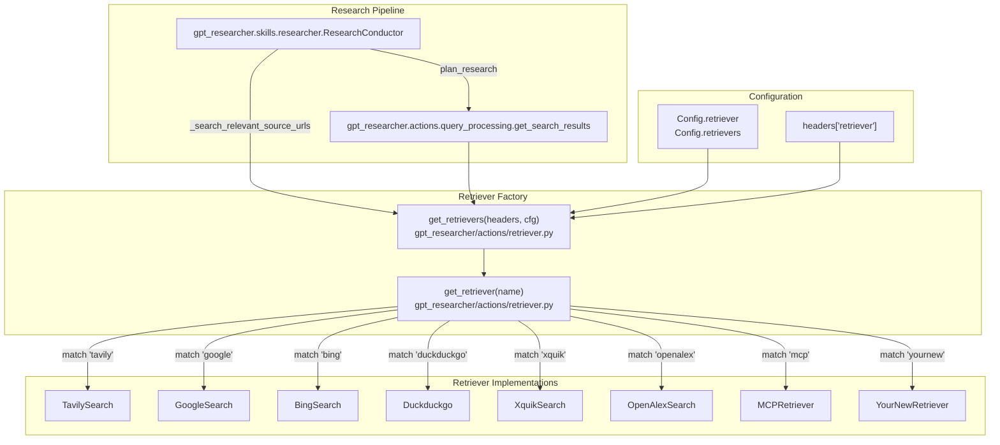
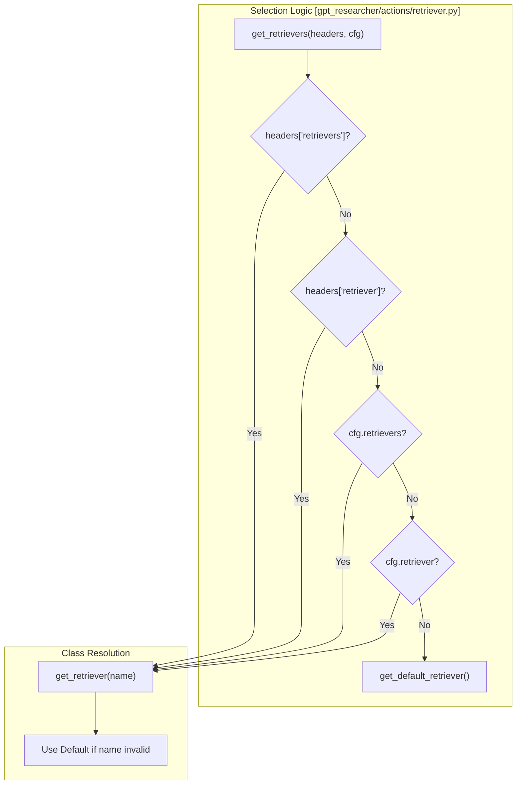
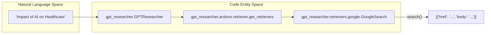

<!-- source: DeepWiki mcp.deepwiki.com · repo assafelovic/gpt-researcher · page 12.4 Adding New Retrievers · fetched 2026-10-27 -->

# Adding New Retrievers

<details>
<summary>Relevant source files</summary>

The following files were used as context for generating this wiki page:

- [.claude/SKILL.md](.claude/SKILL.md)
- [.claude/references/adding-features.md](.claude/references/adding-features.md)
- [.claude/references/advanced-patterns.md](.claude/references/advanced-patterns.md)
- [.claude/references/api-reference.md](.claude/references/api-reference.md)
- [.claude/references/architecture.md](.claude/references/architecture.md)
- [.claude/references/components.md](.claude/references/components.md)
- [.claude/references/config-reference.md](.claude/references/config-reference.md)
- [.claude/references/deep-research.md](.claude/references/deep-research.md)
- [.claude/references/flows.md](.claude/references/flows.md)
- [.claude/references/mcp.md](.claude/references/mcp.md)
- [.claude/references/multi-agents.md](.claude/references/multi-agents.md)
- [.env.example](.env.example)
- [gpt_researcher/actions/retriever.py](gpt_researcher/actions/retriever.py)
- [gpt_researcher/retrievers/__init__.py](gpt_researcher/retrievers/__init__.py)
- [gpt_researcher/retrievers/bing/__init__.py](gpt_researcher/retrievers/bing/__init__.py)
- [gpt_researcher/retrievers/bing/bing.py](gpt_researcher/retrievers/bing/bing.py)
- [gpt_researcher/retrievers/google/google.py](gpt_researcher/retrievers/google/google.py)
- [gpt_researcher/retrievers/openalex/__init__.py](gpt_researcher/retrievers/openalex/__init__.py)
- [gpt_researcher/retrievers/openalex/openalex.py](gpt_researcher/retrievers/openalex/openalex.py)
- [gpt_researcher/retrievers/searchapi/searchapi.py](gpt_researcher/retrievers/searchapi/searchapi.py)
- [gpt_researcher/retrievers/searx/searx.py](gpt_researcher/retrievers/searx/searx.py)
- [gpt_researcher/retrievers/serpapi/serpapi.py](gpt_researcher/retrievers/serpapi/serpapi.py)
- [gpt_researcher/retrievers/serper/serper.py](gpt_researcher/retrievers/serper/serper.py)
- [gpt_researcher/retrievers/tavily/tavily_search.py](gpt_researcher/retrievers/tavily/tavily_search.py)
- [gpt_researcher/retrievers/utils.py](gpt_researcher/retrievers/utils.py)
- [gpt_researcher/retrievers/xquik/__init__.py](gpt_researcher/retrievers/xquik/__init__.py)
- [gpt_researcher/retrievers/xquik/xquik.py](gpt_researcher/retrievers/xquik/xquik.py)

</details>


## Purpose and Scope

This document provides a comprehensive guide for developers who want to add support for new web search retrievers to GPT Researcher. A retriever is responsible for fetching search results from external APIs or services (e.g., Google, Bing, Tavily, arXiv, or OpenAlex).

For information about the overall data source architecture, see [Data Sources and Retrieval](). For details on configuring existing retrievers, see [Configuration Parameters Reference]().

---

## Retriever Architecture Overview

The retriever system in GPT Researcher uses a factory pattern to support multiple search providers. Each retriever is a self-contained class that implements a standard interface for querying search APIs and returning structured results.

### System Context



**Sources:** [gpt_researcher/actions/retriever.py:8-106](), [gpt_researcher/retrievers/__init__.py:1-37]()

---

## Retriever Interface Requirements

All retrievers must implement a consistent interface to work with the GPT Researcher system. The interface consists of a constructor and a `search()` method.

### Required Constructor Signature

While specific implementations vary slightly (e.g., `BingSearch` takes fewer arguments), the standard expected by the factory is:

```python
def __init__(self, query: str, headers: dict = None, topic: str = "general", query_domains: list = None):
```

| Parameter | Type | Required | Description |
|-----------|------|----------|-------------|
| `query` | `str` | Yes | The search query string |
| `headers` | `dict` | No | Additional headers (may contain API keys) |
| `topic` | `str` | No | Topic category (e.g., "general", "news") |
| `query_domains` | `list` | No | List of domains to restrict search to |

### Required Search Method

```python
def search(self, max_results: int = 10) -> list[dict]:
```

**Returns:** A list of dictionaries, each containing:
- `"href"`: URL of the search result (string)
- `"body"`: Content snippet or description (string)
- `"title"`: (Optional) Title of the search result (string)

**Example Return Value:**
```python
[
    {"href": "https://example.com/article1", "body": "This article discusses...", "title": "Article 1"},
    {"href": "https://example.com/article2", "body": "An overview of...", "title": "Article 2"}
]
```

**Sources:** [gpt_researcher/retrievers/tavily/tavily_search.py:19-28](), [gpt_researcher/retrievers/google/google.py:13-21](), [gpt_researcher/retrievers/tavily/tavily_search.py:100-125]()

---

## Implementation Steps

### Step 1: Create Retriever Module

Create a new directory under `gpt_researcher/retrievers/` for your retriever:

```
gpt_researcher/retrievers/
├── your_retriever/
│   ├── __init__.py
│   └── your_retriever.py
```

### Step 2: Implement the Retriever Class

Implement your logic for calling the external API. Refer to `GoogleSearch` or `BingSearch` for examples of `requests`-based implementations.

```python
# Example logic based on gpt_researcher/retrievers/bing/bing.py
class YourNewSearch():
    def __init__(self, query, query_domains=None):
        self.query = query
        self.query_domains = query_domains or None
        self.api_key = self.get_api_key()

    def get_api_key(self):
        return os.environ.get("YOUR_API_KEY")

    def search(self, max_results=7) -> list[dict]:
        # ... API call logic using requests.get ...
        # Normalization to href/body format
        return [{"href": r["url"], "body": r["snippet"], "title": r["name"]} for r in results]
```

**Sources:** [gpt_researcher/retrievers/bing/bing.py:10-95](), [gpt_researcher/retrievers/google/google.py:9-100]()

### Step 3: Create `__init__.py`

Export your retriever class from the module so it can be imported by the central `retrievers` package.

---

## Registration Process

### 1. Update the Main Retrievers Package
Add your new retriever to `gpt_researcher/retrievers/__init__.py` and include it in the `__all__` list.

**Sources:** [gpt_researcher/retrievers/__init__.py:1-37]()

### 2. Add to Retriever Factory
Edit `gpt_researcher/actions/retriever.py` and add a new case to the `match retriever` block in the `get_retriever()` function to map a string name to your class.

```python
# gpt_researcher/actions/retriever.py
case "your_retriever":
    from gpt_researcher.retrievers import YourNewSearch
    return YourNewSearch
```

**Sources:** [gpt_researcher/actions/retriever.py:35-103]()

### 3. Update Valid Retrievers List
Add your retriever name to the `VALID_RETRIEVERS` list in `gpt_researcher/retrievers/utils.py`. This ensures the system recognizes it as a valid option during validation or fallback.

**Sources:** [gpt_researcher/retrievers/utils.py:62-80]()

---

## Configuration and Usage

### Retriever Selection Flow

The system determines which retrievers to use by checking headers, then configuration, and finally falling back to a default (Tavily).



**Sources:** [gpt_researcher/actions/retriever.py:109-146]()

### API Key Management
Retrievers typically fetch their API keys from the `headers` dictionary passed during initialization or from environment variables.

- **Google Example:** Checks `self.headers.get("google_api_key")` then `os.environ["GOOGLE_API_KEY"]`. [gpt_researcher/retrievers/google/google.py:22-37]()
- **Tavily Example:** Checks `self.headers.get("tavily_api_key")` then `os.environ["TAVILY_API_KEY"]`. [gpt_researcher/retrievers/tavily/tavily_search.py:45-54]()
- **OpenAlex Example:** Directly accesses `os.environ.get("OPENALEX_API_KEY")`. [gpt_researcher/retrievers/openalex/openalex.py:41-42]()

---

## Integration Points

### Data Flow from Code to Search

The following diagram bridges the high-level search requirement to the specific code entities involved in the retrieval process.



**Sources:** [gpt_researcher/actions/retriever.py:109-146](), [gpt_researcher/retrievers/google/google.py:53-100]()

---

## Special Considerations

- **Package Dependencies:** Use the `check_pkg(pkg)` utility in `gpt_researcher/retrievers/utils.py` if your retriever requires an external library that isn't a core dependency. [gpt_researcher/retrievers/utils.py:44-59]()
- **Default Retriever:** The system currently defaults to `TavilySearch`. [gpt_researcher/actions/retriever.py:149-156]()
- **Dynamic Discovery:** The `get_all_retriever_names()` function in `utils.py` attempts to list all directories in the `retrievers` folder to dynamically identify available providers. [gpt_researcher/retrievers/utils.py:82-101]()
- **Domain Filtering:** If your search provider supports it, implement `query_domains` handling within the `search` method to restrict results to specific sites. [gpt_researcher/retrievers/google/google.py:59-63](), [gpt_researcher/retrievers/serper/serper.py:83-87]()

---

