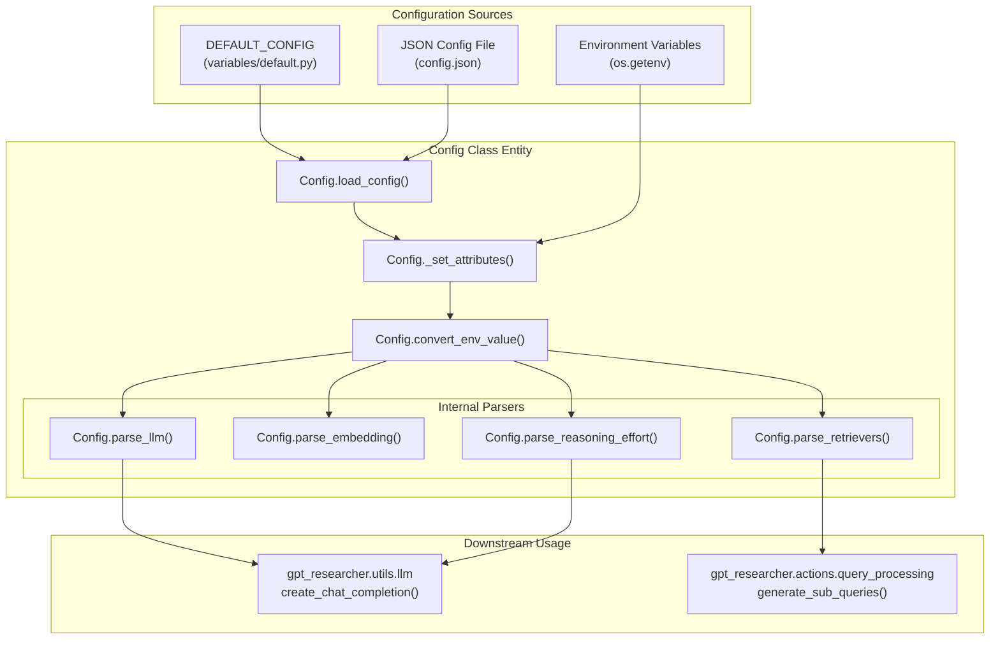
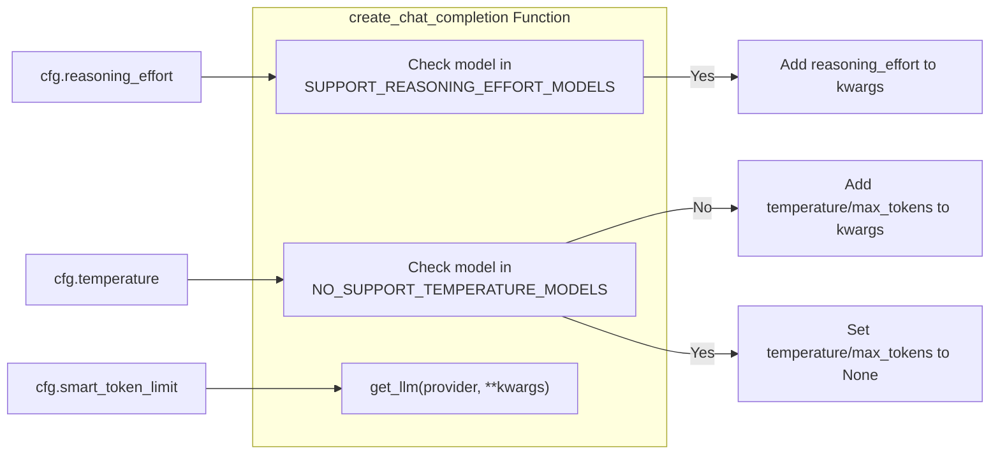

<!-- source: DeepWiki mcp.deepwiki.com · repo assafelovic/gpt-researcher · page 13.3 Configuration Schema · fetched 2026-10-27 -->

# Configuration Schema

Relevant source files

The following files were used as context for generating this wiki page:

- [docs/docs/gpt-researcher/gptr/config.md](docs/docs/gpt-researcher/gptr/config.md)
- [gpt_researcher/actions/query_processing.py](gpt_researcher/actions/query_processing.py)
- [gpt_researcher/config/config.py](gpt_researcher/config/config.py)
- [gpt_researcher/config/variables/base.py](gpt_researcher/config/variables/base.py)
- [gpt_researcher/config/variables/default.py](gpt_researcher/config/variables/default.py)
- [gpt_researcher/llm_provider/__init__.py](gpt_researcher/llm_provider/__init__.py)
- [gpt_researcher/utils/llm.py](gpt_researcher/utils/llm.py)

This page provides the complete configuration schema reference for GPT Researcher. It documents the structure, validation rules, and type constraints for configuration files (`config.json`), environment variables, and the internal `Config` class attributes.

The configuration system is designed to be hierarchical: it loads defaults, merges values from a JSON configuration file if provided, and finally overrides settings with environment variables.

---

## Configuration System Architecture

The configuration system is managed by the `Config` class, which handles loading, parsing, and type conversion.

### Configuration Flow and Data Mapping

This diagram illustrates how configuration data flows from raw sources into the `Config` class and maps to specific code entities.

**Sources:** [gpt_researcher/config/config.py:19-61](), [gpt_researcher/config/config.py:157-167](), [gpt_researcher/utils/llm.py:41-53]()

---

## Configuration Parameter Reference

The following table details the parameters available in `BaseConfig`. Note that while the schema keys are uppercase (e.g., `RETRIEVER`), they are accessed as lowercase attributes on the `Config` instance (e.g., `cfg.retriever`).

### Core Settings

| Parameter | Type | Default | Description |
| :--- | :--- | :--- | :--- |
| `RETRIEVER` | `str` | `"tavily"` | Search engine(s) to use. Can be a comma-separated list. [gpt_researcher/config/config.py:78-83]() |
| `EMBEDDING` | `str` | `"openai:text-embedding-3-small"` | Embedding model in `provider:model` format. [gpt_researcher/config/variables/default.py:5]() |
| `FAST_LLM` | `str` | `"openai:gpt-4o-mini"` | Model for fast tasks like summarization. [gpt_researcher/config/variables/default.py:7]() |
| `SMART_LLM` | `str` | `"openai:gpt-4.1"` | Model for high-quality report generation. [gpt_researcher/config/variables/default.py:8]() |
| `STRATEGIC_LLM` | `str` | `"openai:o4-mini"` | Model for research planning and sub-query generation. [gpt_researcher/config/variables/default.py:9]() |
| `TEMPERATURE` | `float` | `0.4` | LLM sampling temperature. [gpt_researcher/config/variables/default.py:16]() |
| `REASONING_EFFORT` | `str` | `"medium"` | Reasoning effort for supported models (low, medium, high). [gpt_researcher/config/variables/default.py:45]() |

### Research Constraints

| Parameter | Type | Default | Description |
| :--- | :--- | :--- | :--- |
| `FAST_TOKEN_LIMIT` | `int` | `3000` | Max tokens for fast LLM responses. [gpt_researcher/config/variables/default.py:10]() |
| `SMART_TOKEN_LIMIT` | `int` | `6000` | Max tokens for smart LLM responses. [gpt_researcher/config/variables/default.py:11]() |
| `STRATEGIC_TOKEN_LIMIT` | `int` | `4000` | Max tokens for strategic LLM responses. [gpt_researcher/config/variables/default.py:12]() |
| `MAX_ITERATIONS` | `int` | `3` | Max iterations for query expansion. [gpt_researcher/config/variables/default.py:22]() |
| `MAX_SUBTOPICS` | `int` | `3` | Max subtopics for detailed reports. [gpt_researcher/config/variables/default.py:27]() |
| `TOTAL_WORDS` | `int` | `1200` | Target word count for the final report. [gpt_researcher/config/variables/default.py:20]() |

### Scraper and Source Settings

| Parameter | Type | Default | Description |
| :--- | :--- | :--- | :--- |
| `SCRAPER` | `str` | `"bs"` | Web scraper backend (e.g., `bs`, `newspaper`). [gpt_researcher/config/variables/default.py:24]() |
| `MAX_SCRAPER_WORKERS` | `int` | `15` | Max concurrent scraping tasks. [gpt_researcher/config/variables/default.py:25]() |
| `SCRAPER_RATE_LIMIT_DELAY` | `float` | `0.0` | Minimum seconds between scraper requests. [gpt_researcher/config/variables/default.py:26]() |
| `REPORT_SOURCE` | `str` | `"web"` | Source of data: `web`, `local`, `azure`, etc. [gpt_researcher/config/variables/default.py:29]() |
| `DOC_PATH` | `str` | `"./my-docs"` | Directory for local document research. [gpt_researcher/config/variables/default.py:30]() |
| `CURATE_SOURCES` | `bool` | `False` | Use an extra LLM step to rank sources. [gpt_researcher/config/variables/default.py:14]() |

### Image Generation Settings

| Parameter | Type | Default | Description |
| :--- | :--- | :--- | :--- |
| `IMAGE_GENERATION_ENABLED` | `bool` | `False` | Master switch for inline image generation. [gpt_researcher/config/variables/default.py:52]() |
| `IMAGE_GENERATION_MODEL` | `str` | `"models/gemini-2.5-flash-image"` | Model used for generating images. [gpt_researcher/config/variables/default.py:50]() |
| `IMAGE_GENERATION_PROVIDER` | `str` | `"google"` | Image provider: `google` or `modelslab`. [gpt_researcher/config/variables/default.py:54]() |
| `IMAGE_GENERATION_MAX_IMAGES` | `int` | `3` | Maximum images per report. [gpt_researcher/config/variables/default.py:51]() |

**Sources:** [gpt_researcher/config/variables/base.py:5-51](), [gpt_researcher/config/variables/default.py:3-55]()

---

## Deep Research Schema

Parameters specific to the recursive deep research mode introduced in newer versions.

| Parameter | Type | Default | Description |
| :--- | :--- | :--- | :--- |
| `DEEP_RESEARCH_BREADTH` | `int` | `3` | Number of parallel paths to explore. [gpt_researcher/config/variables/default.py:36]() |
| `DEEP_RESEARCH_DEPTH` | `int` | `2` | Depth of the search tree. [gpt_researcher/config/variables/default.py:37]() |
| `DEEP_RESEARCH_CONCURRENCY` | `int` | `4` | Concurrent operations during deep research. [gpt_researcher/config/variables/default.py:38]() |

**Sources:** [gpt_researcher/config/variables/default.py:35-38]()

---

## Model Context Protocol (MCP) Schema

The MCP configuration allows GPT Researcher to connect to external tool servers.

| Parameter | Type | Default | Description |
| :--- | :--- | :--- | :--- |
| `MCP_SERVERS` | `List[Dict]` | `[]` | List of server configs (name, command, args, env). [gpt_researcher/config/variables/default.py:41]() |
| `MCP_STRATEGY` | `str` | `"fast"` | Strategy: `fast`, `deep`, or `disabled`. [gpt_researcher/config/variables/default.py:44]() |
| `MCP_ALLOWED_ROOT_PATHS` | `List[str]` | `[]` | Filesystem paths accessible to MCP. [gpt_researcher/config/variables/default.py:43]() |
| `MCP_AUTO_TOOL_SELECTION` | `bool` | `True` | Automatically select the best tool for a query. [gpt_researcher/config/variables/default.py:42]() |

**Sources:** [gpt_researcher/config/variables/base.py:40-44](), [gpt_researcher/config/variables/default.py:40-44]()

---

## Implementation Details: Parsing and Validation

The `Config` class implements several private methods to transform raw strings into structured data.

### LLM and Embedding Parsing
The system uses a `provider:model` string format. For example, `openai:gpt-4o`.
- `Config.parse_llm(llm_str)`: Splits the string and returns a tuple of `(provider, model)`. [gpt_researcher/config/config.py:93-95]()
- `Config.parse_embedding(embedding_str)`: Similar logic for embedding providers. [gpt_researcher/config/config.py:87-89]()

### Reasoning Effort Validation
For models supporting reasoning effort (like OpenAI o-series), the system validates against the `ReasoningEfforts` enum.
- Supported values: `low`, `medium`, `high`. [gpt_researcher/llm_provider/generic/base.py:19]()
- Implementation: `Config.parse_reasoning_effort(os.getenv("REASONING_EFFORT"))`. [gpt_researcher/config/config.py:96]()

### LLM Configuration Logic
The following diagram shows how the `Config` attributes are used during a chat completion request in `gpt_researcher/utils/llm.py`.

**Sources:** [gpt_researcher/utils/llm.py:83-98](), [gpt_researcher/config/config.py:96]()

---

## Type Conversion Rules

When loading from environment variables, the `Config` class performs automatic type conversion using the `BaseConfig` type hints via `BaseConfig.__annotations__`.

| Target Type | Conversion Logic |
| :--- | :--- |
| `bool` | Returns `True` if value is `"true"`, `"1"`, `"yes"`, or `"on"`. [gpt_researcher/config/config.py:73-74]() |
| `int` | Standard `int()` conversion. [gpt_researcher/config/config.py:74]() |
| `float` | Standard `float()` conversion. [gpt_researcher/config/config.py:74]() |
| `list` / `dict` | Parsed via `json.loads()`. [gpt_researcher/config/config.py:74]() |
| `Union[T, None]` | Handles conversion to `T` or sets to `None`. [gpt_researcher/config/config.py:74]() |

**Sources:** [gpt_researcher/config/config.py:71-75](), [gpt_researcher/config/variables/base.py:5-52]()

---

