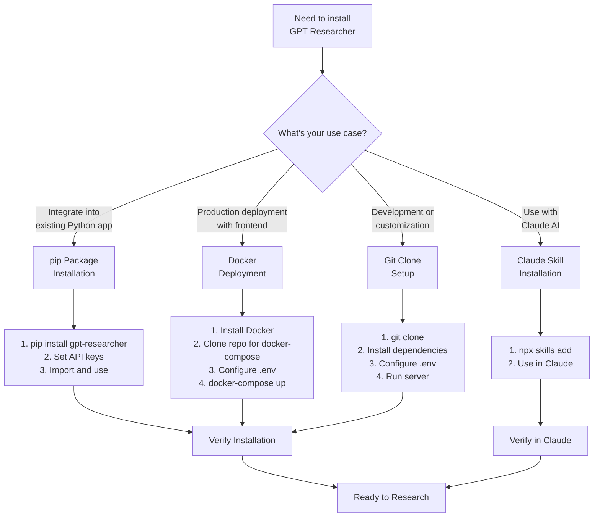
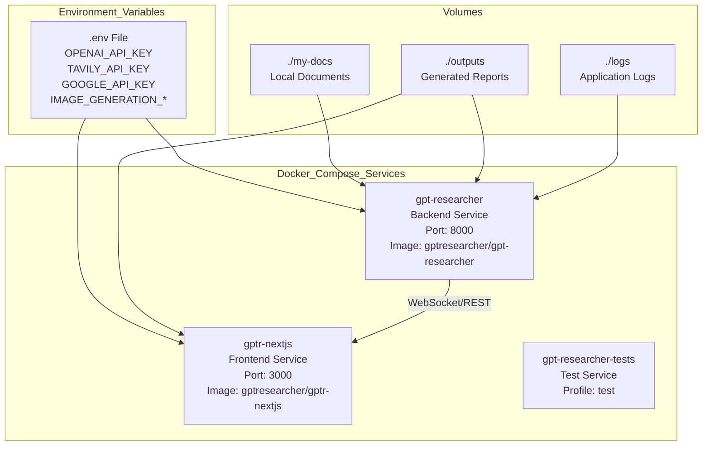
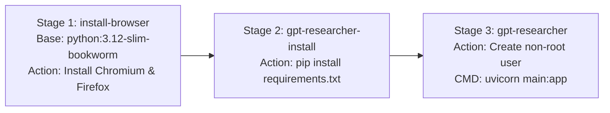
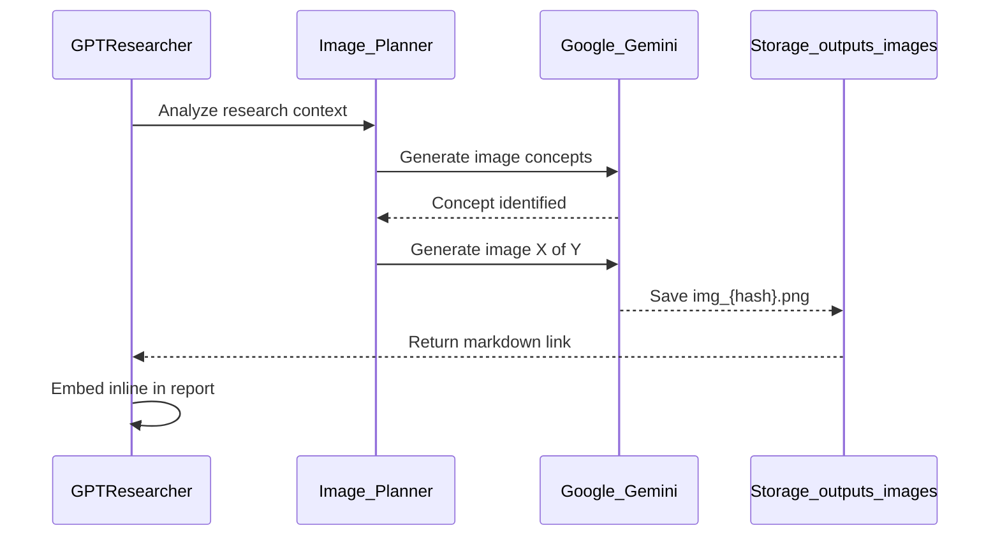

<!-- source: DeepWiki mcp.deepwiki.com · repo assafelovic/gpt-researcher · page 2.1 Installation Methods · fetched 2026-10-27 -->

# Installation Methods

<details>
<summary>Relevant source files</summary>

The following files were used as context for generating this wiki page:

- [.dockerignore](.dockerignore)
- [Dockerfile](Dockerfile)
- [docker-compose.yml](docker-compose.yml)
- [docs/docs/examples/custom_prompt.py](docs/docs/examples/custom_prompt.py)
- [docs/docs/examples/examples.md](docs/docs/examples/examples.md)
- [docs/docs/examples/pip-run.ipynb](docs/docs/examples/pip-run.ipynb)
- [docs/docs/examples/sample_report.py](docs/docs/examples/sample_report.py)
- [docs/docs/examples/sample_sources_only.py](docs/docs/examples/sample_sources_only.py)
- [docs/docs/gpt-researcher/context/azure-storage.md](docs/docs/gpt-researcher/context/azure-storage.md)
- [docs/docs/gpt-researcher/context/local-docs.md](docs/docs/gpt-researcher/context/local-docs.md)
- [docs/docs/gpt-researcher/getting-started/getting-started-with-docker.md](docs/docs/gpt-researcher/getting-started/getting-started-with-docker.md)
- [docs/docs/gpt-researcher/getting-started/introduction.md](docs/docs/gpt-researcher/getting-started/introduction.md)
- [docs/docs/gpt-researcher/gptr/ai-development.md](docs/docs/gpt-researcher/gptr/ai-development.md)
- [docs/docs/gpt-researcher/gptr/claude-skill.md](docs/docs/gpt-researcher/gptr/claude-skill.md)
- [docs/docs/gpt-researcher/gptr/image_generation.md](docs/docs/gpt-researcher/gptr/image_generation.md)
- [docs/docs/gpt-researcher/gptr/pip-package.md](docs/docs/gpt-researcher/gptr/pip-package.md)
- [docs/sidebars.js](docs/sidebars.js)
- [gpt_researcher/document/document.py](gpt_researcher/document/document.py)
- [pyproject.toml](pyproject.toml)
- [requirements.txt](requirements.txt)
- [setup.py](setup.py)

</details>


This page documents the four primary installation methods for GPT Researcher: pip package installation for Python integration, Docker deployment for containerized environments, git clone for development, and Claude skill installation for AI-assisted usage. Each method serves different use cases and comes with specific prerequisites and configuration steps.

For configuration of environment variables and API keys after installation, see [Configuration Setup](). For quick start usage examples, see [Quick Start Examples]().

---

## Prerequisites

All installation methods require the following prerequisites:

| Requirement | Minimum Version | Notes |
|------------|----------------|-------|
| **Python** | 3.11 | Required for LangChain v1 compatibility [requirements.txt:2](), [setup.py:44](), [pyproject.toml:10]() |
| **pip** | Latest | Python package installer |
| **API Keys** | - | At minimum: `OPENAI_API_KEY` and `TAVILY_API_KEY` [docker-compose.yml:7-9]() |

Optional but recommended:

| Tool | Purpose |
|------|---------|
| **Docker** | For containerized deployment [docs/docs/gpt-researcher/getting-started/getting-started-with-docker.md:3]() |
| **Node.js/npm** | For Claude skill installation or frontend development [docs/docs/gpt-researcher/gptr/claude-skill.md:14]() |
| **Poetry** | Alternative Python dependency manager [pyproject.toml:1]() |

**Sources:** [requirements.txt:1-3](), [setup.py:44](), [pyproject.toml:10](), [docs/docs/gpt-researcher/getting-started/getting-started-with-docker.md:3-5](), [docs/docs/gpt-researcher/gptr/claude-skill.md:14-15]()

---

## Installation Decision Flow



**Sources:** [docs/docs/gpt-researcher/getting-started/getting-started-with-docker.md:1-29](), [docs/docs/gpt-researcher/gptr/claude-skill.md:9-17](), [setup.py:22-45]()

---

## Method 1: pip Package Installation

The pip package installation is the simplest method for integrating GPT Researcher into existing Python applications or Jupyter notebooks.

### Installation Steps

**Step 1: Install the package**

```bash
pip install gpt-researcher
```

This installs version `0.14.7` (current latest) and all required dependencies defined in `setup.py` [setup.py:3-45]().

**Step 2: Set environment variables**

```bash
export OPENAI_API_KEY={Your OpenAI API Key}
export TAVILY_API_KEY={Your Tavily API Key}
```

**Step 3: Verify installation**

```python
from gpt_researcher import GPTResearcher
import asyncio

async def test_install():
    # Initialize the researcher agent
    researcher = GPTResearcher(query="test query")
    print(f"GPT Researcher initialized successfully")

asyncio.run(test_install())
```

### Package Contents

The pip package includes the core research engine but excludes certain heavy web dependencies like `fastapi` and `uvicorn` during the standard build to remain lightweight [setup.py:5-14]().

| Component | Description |
|-----------|-------------|
| `gpt_researcher` | Core research engine package [setup.py:26]() |
| `gpt_researcher.agent` | Main `GPTResearcher` orchestrator class |
| `gpt_researcher.document` | `DocumentLoader` for local files (PDF, docx, etc.) [gpt_researcher/document/document.py:16]() |
| `gpt_researcher.config` | `Config` management system |

**Sources:** [setup.py:3-45](), [requirements.txt:1-68](), [pyproject.toml:1-248](), [gpt_researcher/document/document.py:16-19]()

---

## Method 2: Docker Deployment

Docker deployment provides a containerized environment with both backend API and frontend applications pre-configured.

### Docker Architecture



**Sources:** [docker-compose.yml:1-78](), [Dockerfile:1-65]()

### Installation Steps

**Step 1: Clone repository for docker-compose**

```bash
git clone https://github.com/assafelovic/gpt-researcher.git
cd gpt-researcher
```

**Step 2: Configure environment file**

Copy the example environment file and edit it [docs/docs/gpt-researcher/getting-started/getting-started-with-docker.md:10]():

```bash
cp .env.example .env
```

**Step 3: Start services**

```bash
docker-compose up --build
```

This starts two services by default [docker-compose.yml:1-45]():
- **Backend API**: http://localhost:8000 (FastAPI server defined in `main:app` [Dockerfile:64]())
- **Frontend UI**: http://localhost:3000 (Next.js application [docker-compose.yml:45]())

### Multi-Stage Dockerfile Implementation

The `Dockerfile` uses a three-stage build process to optimize image size and security.



**Key configuration in Dockerfile:**

- **Base image**: `python:3.12-slim-bookworm` [Dockerfile:3]()
- **Browser support**: Installs Chromium, Chromedriver, and Firefox-ESR for scraping [Dockerfile:6-21]()
- **Non-root user**: Runs as user `gpt-researcher` for security [Dockerfile:53-59]()
- **Default command**: `uvicorn main:app --host 0.0.0.0 --port 8000` [Dockerfile:64]()

**Sources:** [docker-compose.yml:1-78](), [Dockerfile:1-65](), [docs/docs/gpt-researcher/getting-started/getting-started-with-docker.md:1-29]()

---

## Method 3: Git Clone Setup

Git clone installation provides full repository access for development, customization, or running the complete application stack.

### Installation Steps

**Step 1: Clone the repository**

```bash
git clone https://github.com/assafelovic/gpt-researcher.git
cd gpt-researcher
```

**Step 2: Install dependencies**

The repository supports multiple dependency managers:

#### Option A: pip (Standard)
```bash
pip install -r requirements.txt
```

#### Option B: Poetry (Development)
```bash
poetry install
poetry shell
```

**Step 3: Run the FastAPI server**

```bash
python -m uvicorn main:app --reload
```

The server starts on http://localhost:8000.

### Dependency Management Details

| File | Purpose | Key Package Groups |
|------|---------|-------------------|
| `requirements.txt` | Direct dependencies | FastAPI, LangChain, LLM Providers, Retrievers [requirements.txt:5-30]() |
| `pyproject.toml` | Poetry configuration | Full dependency tree with versions [pyproject.toml:9-214]() |
| `setup.py` | pip package build | Metadata for PyPI distribution [setup.py:22-46]() |

**Sources:** [requirements.txt:1-68](), [pyproject.toml:1-248](), [setup.py:1-48]()

---

## Method 4: Claude Skill Installation

GPT Researcher can be installed as a Claude Skill, enabling Claude AI to leverage deep research capabilities within conversations and development workflows.

### Installation Steps

**Step 1: Install the skill**

```bash
npx skills add assafelovic/gpt-researcher
```

This installs the skill from the [GPT Researcher GitHub repository](https://github.com/assafelovic/gpt-researcher) [docs/docs/gpt-researcher/gptr/claude-skill.md:14-17]().

### Skill Structure

The skill is defined in the `.claude/` directory of the repository and provides Claude with context about the system architecture [docs/docs/gpt-researcher/gptr/claude-skill.md:42-61]().

| Component | Purpose |
|-----------|---------|
| `SKILL.md` | Main skill file providing core context |
| `references/architecture.md` | System architecture details |
| `references/api-reference.md` | REST and WebSocket API documentation |
| `references/config-reference.md` | Configuration reference |

**Sources:** [docs/docs/gpt-researcher/gptr/claude-skill.md:1-67]()

---

## Inline Image Generation Setup

GPT Researcher supports contextually relevant illustrations embedded directly within research reports using Google's Gemini models [docs/docs/gpt-researcher/gptr/image_generation.md:8]().

### Configuration
To enable this feature, set the following environment variables [docs/docs/gpt-researcher/gptr/image_generation.md:23-35]():

```bash
IMAGE_GENERATION_ENABLED=true
GOOGLE_API_KEY=your_google_api_key_here
IMAGE_GENERATION_MODEL=models/gemini-2.5-flash-image
IMAGE_GENERATION_MAX_IMAGES=3
```

### Data Flow for Image Generation



**Sources:** [docs/docs/gpt-researcher/gptr/image_generation.md:6-170](), [docker-compose.yml:12-16]()

---

## Installation Comparison

| Aspect | pip Package | Docker | Git Clone | Claude Skill |
|--------|-------------|--------|-----------|--------------|
| **Setup Time** | < 1 minute | 5-10 minutes | 5 minutes | < 1 minute |
| **Use Case** | Python integration | Production deployment | Development | AI assistance |
| **Frontend** | ❌ | ✅ | ✅ | N/A |
| **Multi-Agent** | ❌ | ✅ | ✅ | N/A |
| **Customization** | Limited | Limited | Full | N/A |

**Sources:** [setup.py:5-14](), [docker-compose.yml:1-78](), [docs/docs/gpt-researcher/gptr/claude-skill.md:1-67]()

---

