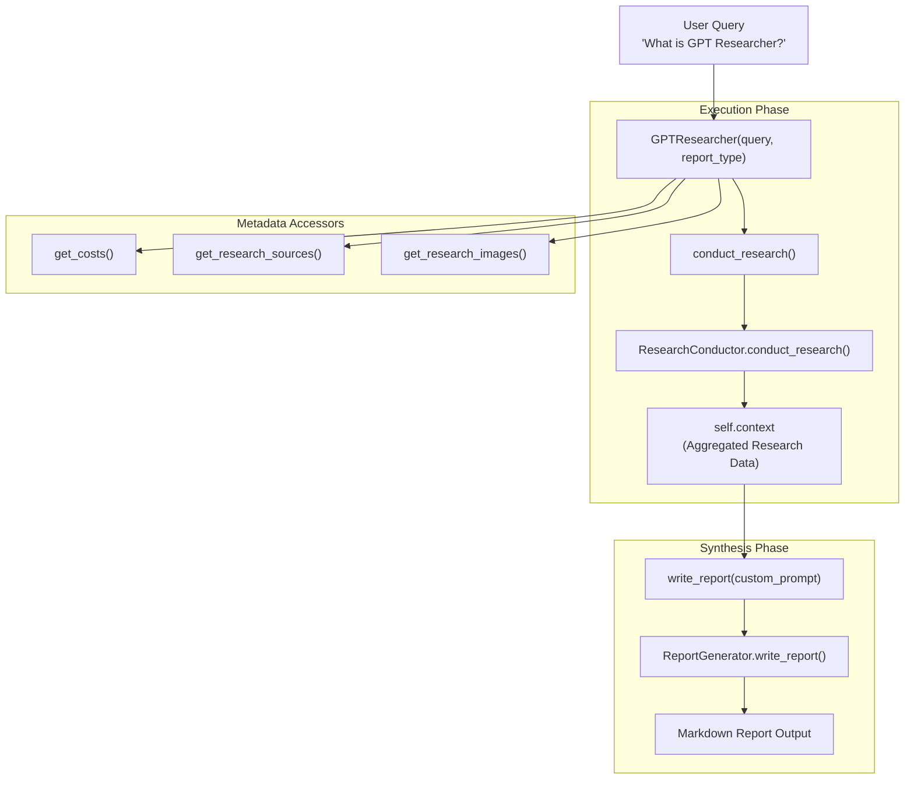
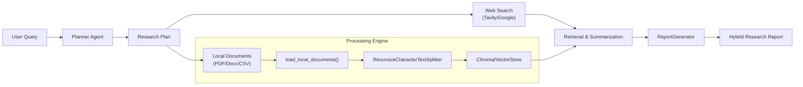

<!-- source: DeepWiki mcp.deepwiki.com · repo assafelovic/gpt-researcher · page 2.2 Quick Start Examples · fetched 2026-10-27 -->

# Quick Start Examples

<details>
<summary>Relevant source files</summary>

The following files were used as context for generating this wiki page:

- [.cursorignore](.cursorignore)
- [cli.py](cli.py)
- [docs/blog/2024-09-7-hybrid-research/gptr-hybrid.png](docs/blog/2024-09-7-hybrid-research/gptr-hybrid.png)
- [docs/blog/2024-09-7-hybrid-research/index.md](docs/blog/2024-09-7-hybrid-research/index.md)
- [docs/docs/examples/custom_prompt.py](docs/docs/examples/custom_prompt.py)
- [docs/docs/examples/detailed_report.md](docs/docs/examples/detailed_report.md)
- [docs/docs/examples/examples.md](docs/docs/examples/examples.md)
- [docs/docs/examples/hybrid_research.md](docs/docs/examples/hybrid_research.md)
- [docs/docs/examples/pip-run.ipynb](docs/docs/examples/pip-run.ipynb)
- [docs/docs/examples/sample_report.py](docs/docs/examples/sample_report.py)
- [docs/docs/examples/sample_sources_only.py](docs/docs/examples/sample_sources_only.py)
- [docs/docs/gpt-researcher/getting-started/cli.md](docs/docs/gpt-researcher/getting-started/cli.md)
- [docs/docs/gpt-researcher/getting-started/getting-started.md](docs/docs/gpt-researcher/getting-started/getting-started.md)
- [docs/docs/gpt-researcher/getting-started/introduction.md](docs/docs/gpt-researcher/getting-started/introduction.md)
- [docs/docs/gpt-researcher/gptr/pip-package.md](docs/docs/gpt-researcher/gptr/pip-package.md)

</details>


## Purpose and Scope

This page provides practical, executable code examples for using GPT Researcher after installation. Examples progress from basic pip package usage to advanced configurations including FastAPI server deployment, CLI usage, and hybrid research modes. For installation instructions, see [Installation Methods](#2.1). For detailed configuration of API keys and environment variables, see [Configuration Setup](#2.3).

---

## Basic PIP Package Usage

### Minimal Research Example

The simplest way to use GPT Researcher is via the pip package with a basic query:

```python
from gpt_researcher import GPTResearcher
import asyncio

async def main():
    # Query
    query = "What happened in the latest burning man floods?"

    # Report Type
    report_type = "research_report"

    # Initialize the researcher
    researcher = GPTResearcher(query=query, report_type=report_type)
    
    # Conduct research on the given query
    await researcher.conduct_research()
    
    # Write the report
    report = await researcher.write_report()
    
    return report

if __name__ == "__main__":
    asyncio.run(main())
```

This example instantiates the `GPTResearcher` class [gpt_researcher/researcher.py]() and executes the core two-phase research workflow: `conduct_research()` for information gathering and `write_report()` for synthesis.

**Sources:** [docs/docs/examples/examples.md:4-30](), [docs/docs/gpt-researcher/gptr/pip-package.md:32-63]()

---

### Research Flow: Natural Language to Code Entities

The following diagram maps the high-level research intent to the specific classes and methods executed within the `gpt-researcher` package.



**Sources:** [docs/docs/gpt-researcher/gptr/pip-package.md:36-47](), [docs/docs/examples/sample_report.py:9-22](), [docs/docs/gpt-researcher/getting-started/introduction.md:23-38]()

---

### Customizing Report Formatting

You can use `custom_prompt` to override the default generation logic and enforce specific formatting or constraints.

```python
from gpt_researcher import GPTResearcher
import asyncio

async def main():
    query = "What are the latest advancements in renewable energy?"
    researcher = GPTResearcher(query=query, report_type="research_report")
    
    await researcher.conduct_research()
    
    # Generate a short, concise report using custom_prompt
    custom_prompt = "Provide a concise summary in 2 paragraphs without citations."
    short_report = await researcher.write_report(custom_prompt=custom_prompt)
    
    # Generate a bullet-point format report
    bullet_prompt = "List the top 5 advancements as bullet points with brief explanations."
    bullet_report = await researcher.write_report(custom_prompt=bullet_prompt)
    
    return short_report, bullet_report

if __name__ == "__main__":
    asyncio.run(main())
```

**Sources:** [docs/docs/examples/examples.md:40-74](), [docs/docs/examples/sample_report.py:35-40](), [docs/docs/examples/custom_prompt.py:42-54]()

---

## Command Line Interface (CLI)

GPT Researcher includes a CLI tool (`cli.py`) for running research directly from the terminal. It handles argument parsing, asynchronous execution, and automatic file naming using an LLM-generated title.

### Basic CLI Syntax
```bash
python cli.py "What are the main causes of climate change?" --report_type research_report
```

### Advanced CLI Example
Generate a detailed, analytical report and restrict the search to specific domains:
```bash
python cli.py "Impact of AI on job markets" \
  --report_type detailed_report \
  --tone analytical \
  --query_domains "techcrunch.com,nytimes.com"
```

**CLI Arguments:**

| Argument | Description | Default |
|----------|-------------|---------|
| `query` | The research question (positional). | Required |
| `--report_type` | `research_report`, `detailed_report`, `resource_report`, etc. | Required |
| `--tone` | `objective`, `formal`, `analytical`, `persuasive`, etc. | `objective` |
| `--query_domains` | Comma-separated list of domains to search. | `""` |
| `--report_source` | `web`, `local`, `hybrid`, `azure`, `static`. | `web` |
| `--no-pdf` | Skip PDF generation. | `False` |

**Sources:** [cli.py:31-135](), [docs/docs/gpt-researcher/getting-started/cli.md:21-54]()

---

## Hybrid Research (Web + Local Docs)

Hybrid research allows the agent to combine real-time web data with your own local documents (PDF, Text, Docx, etc.) to ground findings in internal context. The system uses `load_local_documents` to process files and `RecursiveCharacterTextSplitter` for chunking.

```python
from gpt_researcher import GPTResearcher
import asyncio

async def run_hybrid_research():
    query = "How does our product roadmap compare to industry trends?"
    
    # report_source="hybrid" triggers the combination logic
    researcher = GPTResearcher(
        query=query, 
        report_type="research_report", 
        report_source="hybrid"
    )
    
    await researcher.conduct_research()
    report = await researcher.write_report()
    print(report)

if __name__ == "__main__":
    asyncio.run(run_hybrid_research())
```

**Hybrid Architecture:**



**Sources:** [docs/docs/examples/hybrid_research.md:62-78](), [docs/blog/2024-09-7-hybrid-research/index.md:48-52](), [docs/blog/2024-09-7-hybrid-research/index.md:72-105]()

---

## Web Integration Examples

### FastAPI Server Implementation

GPT Researcher can be wrapped in a FastAPI endpoint to serve as a backend for web or mobile applications. The server is typically started using `uvicorn main:app`.

```python
from fastapi import FastAPI
from gpt_researcher import GPTResearcher
import asyncio

app = FastAPI()

@app.get("/report/{report_type}")
async def get_report(query: str, report_type: str) -> dict:
    researcher = GPTResearcher(query, report_type)
    await researcher.conduct_research()
    report = await researcher.write_report()
    
    return {
        "report": report,
        "costs": researcher.get_costs(),
        "sources": researcher.get_source_urls()
    }

# Run with: uvicorn main:app --reload
```

**Sources:** [docs/docs/gpt-researcher/gptr/pip-package.md:92-120](), [docs/docs/gpt-researcher/getting-started/getting-started.md:42-46](), [docs/docs/gpt-researcher/getting-started/getting-started.md:103-106]()

---

## Detailed Reports (STORM-inspired)

For complex topics requiring 2000+ words, use the `DetailedReport` class. It breaks the query into subtopics and researches each iteratively to avoid redundancy.

```python
import asyncio
from backend.report_type import DetailedReport
from gpt_researcher.utils.enum import Tone

async def run_detailed():
    detailed_report = DetailedReport(
        query="The future of artificial intelligence in healthcare",
        report_type="research_report",
        report_source="web_search",
        tone=Tone.FORMAL
    )

    report = await detailed_report.run()
    print(report)

if __name__ == "__main__":
    asyncio.run(run_detailed())
```

**Sources:** [docs/docs/examples/detailed_report.md:17-42](), [docs/docs/examples/detailed_report.md:48-78]()

---

## Summary of Research Outputs

When running a research task, the following metadata is accessible via the `GPTResearcher` instance:

| Method | Output Description |
|--------|--------------------|
| `get_costs()` | The total cost of the research task in USD based on token consumption. |
| `get_source_urls()` | A list of all unique URLs visited during research. |
| `get_research_context()` | The raw aggregated text chunks used to write the report. |
| `get_research_images()` | A list of image URLs found or generated during the process. |
| `get_research_sources()` | A list of source objects containing titles, content, and metadata. |

**Sources:** [docs/docs/gpt-researcher/gptr/pip-package.md:172-203](), [docs/docs/examples/sample_report.py:16-20](), [docs/docs/examples/pip-run.ipynb:55-61]()

---

