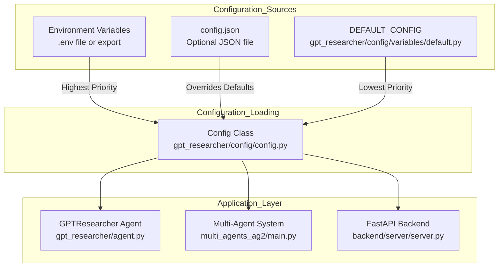
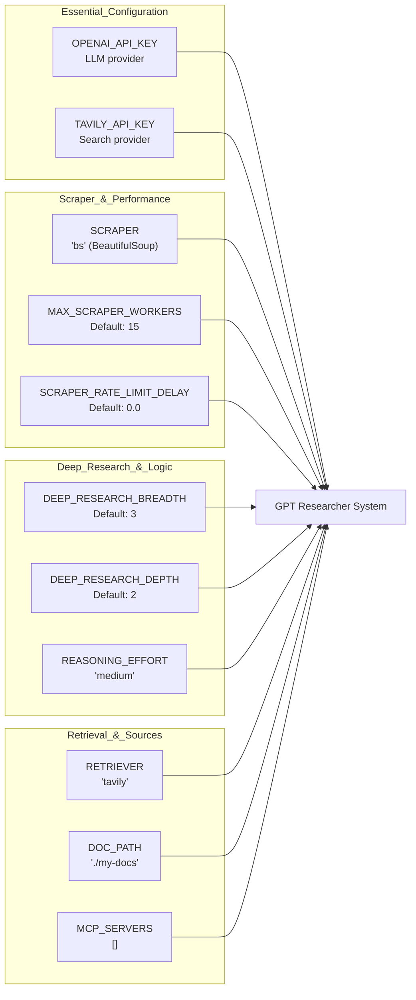
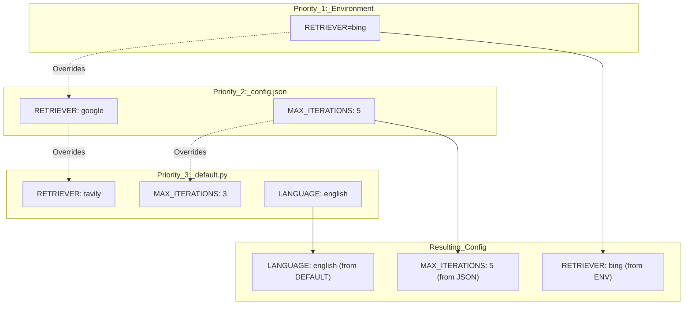

<!-- source: DeepWiki mcp.deepwiki.com · repo assafelovic/gpt-researcher · page 2.3 Configuration Setup · fetched 2026-10-27 -->

# Configuration Setup

<details>
<summary>Relevant source files</summary>

The following files were used as context for generating this wiki page:

- [.env.example](.env.example)
- [docs/docs/gpt-researcher/getting-started/how-to-choose.md](docs/docs/gpt-researcher/getting-started/how-to-choose.md)
- [docs/docs/gpt-researcher/gptr/config.md](docs/docs/gpt-researcher/gptr/config.md)
- [gpt_researcher/actions/query_processing.py](gpt_researcher/actions/query_processing.py)
- [gpt_researcher/actions/retriever.py](gpt_researcher/actions/retriever.py)
- [gpt_researcher/config/variables/base.py](gpt_researcher/config/variables/base.py)
- [gpt_researcher/config/variables/default.py](gpt_researcher/config/variables/default.py)
- [gpt_researcher/retrievers/__init__.py](gpt_researcher/retrievers/__init__.py)
- [gpt_researcher/retrievers/openalex/__init__.py](gpt_researcher/retrievers/openalex/__init__.py)
- [gpt_researcher/retrievers/openalex/openalex.py](gpt_researcher/retrievers/openalex/openalex.py)
- [gpt_researcher/retrievers/utils.py](gpt_researcher/retrievers/utils.py)
- [gpt_researcher/retrievers/xquik/__init__.py](gpt_researcher/retrievers/xquik/__init__.py)
- [gpt_researcher/retrievers/xquik/xquik.py](gpt_researcher/retrievers/xquik/xquik.py)
- [multi_agents_ag2/README.md](multi_agents_ag2/README.md)
- [multi_agents_ag2/__init__.py](multi_agents_ag2/__init__.py)
- [multi_agents_ag2/agents/__init__.py](multi_agents_ag2/agents/__init__.py)
- [multi_agents_ag2/agents/editor.py](multi_agents_ag2/agents/editor.py)
- [multi_agents_ag2/agents/orchestrator.py](multi_agents_ag2/agents/orchestrator.py)
- [multi_agents_ag2/main.py](multi_agents_ag2/main.py)

</details>


This page covers the initial configuration steps required to get GPT Researcher operational after installation. For comprehensive configuration parameter documentation, see [Configuration Parameters Reference](#5.2). For the underlying configuration architecture, see [Config Class Architecture](#5.1). For a complete list of environment variables, see [Environment Variables Reference](#5.3).

---

## Purpose and Scope

Configuration setup involves three essential tasks:

1.  **Setting required API keys** for LLM and search providers.
2.  **Configuring environment variables** for basic operational parameters.
3.  **Understanding configuration precedence** between environment variables, JSON files, and defaults.

This is a prerequisite for running GPT Researcher in any deployment mode (CLI, Docker, or web interface).

---

## Configuration Architecture Overview

GPT Researcher uses a three-tier configuration hierarchy where settings cascade from environment variables through JSON configuration files to hard-coded defaults.

### Configuration Loading Flow



**Sources:** [gpt_researcher/config/variables/default.py:3-54](), [.env.example:1-45](), [docs/docs/gpt-researcher/gptr/config.md:16-38](), [multi_agents_ag2/main.py:12-34]()

---

## Required API Keys

GPT Researcher requires two API keys for basic operation:

| API Key | Provider | Purpose | Acquisition |
| :--- | :--- | :--- | :--- |
| `OPENAI_API_KEY` | OpenAI | LLM operations (`FAST_LLM`, `SMART_LLM`, `STRATEGIC_LLM`) | [platform.openai.com](https://platform.openai.com) |
| `TAVILY_API_KEY` | Tavily | Web search and retrieval (Default) | [app.tavily.com](https://app.tavily.com) |

### Setting API Keys via Environment Variables

**Option 1: .env File (Recommended)**
Create a `.env` file in the project root based on the example provided in the codebase.
```bash
# .env
OPENAI_API_KEY=sk-...
TAVILY_API_KEY=tvly-...
```

**Option 2: Direct Export (Linux/macOS)**
```bash
export OPENAI_API_KEY=sk-...
export TAVILY_API_KEY=tvly-...
```

**Sources:** [.env.example:1-2](), [docs/docs/gpt-researcher/gptr/config.md:8-11](), [gpt_researcher/config/variables/default.py:4-9]()

---

## Essential vs Optional Configuration

The system maps natural language configuration needs to specific code entities within the `BaseConfig` typed dictionary.

### Configuration Categories and Code Entities



**Sources:** [gpt_researcher/config/variables/base.py:5-51](), [gpt_researcher/config/variables/default.py:3-54](), [.env.example:7-37]()

---

## Environment Variables Reference

### Core & LLM Configuration
| Variable | Default | Description |
| :--- | :--- | :--- |
| `RETRIEVER` | `tavily` | Web search engine. Options: `duckduckgo`, `bing`, `google`, `serper`, `arxiv`, `mcp`, etc. |
| `FAST_LLM` | `openai:gpt-4o-mini` | Model for fast tasks like summaries. |
| `SMART_LLM` | `openai:gpt-4.1` | Model for report generation. |
| `STRATEGIC_LLM` | `openai:o4-mini` | Model for research planning. |
| `TEMPERATURE` | `0.4` | LLM sampling temperature. |

### Scraper & Performance
| Variable | Default | Description |
| :--- | :--- | :--- |
| `MAX_SCRAPER_WORKERS` | `15` | Max concurrent browser instances. |
| `SCRAPER_RATE_LIMIT_DELAY` | `0.0` | Seconds between requests (0 = no limit). |
| `COMPRESSION_THRESHOLD` | `8000` | Skip embedding-based compression for content smaller than this (in chars). |

### Deep Research & Advanced Settings
| Variable | Default | Description |
| :--- | :--- | :--- |
| `DEEP_RESEARCH_BREADTH` | `3` | Parallel paths to explore in deep research. |
| `DEEP_RESEARCH_DEPTH` | `2` | Sequential search iterations in deep research. |
| `REASONING_EFFORT` | `medium` | Effort level for strategic models (o1/o3). |
| `IMAGE_GENERATION_ENABLED` | `False` | Master switch for inline image generation. |

**Sources:** [gpt_researcher/config/variables/default.py:3-54](), [.env.example:7-37](), [docs/docs/gpt-researcher/gptr/config.md:53-103](), [gpt_researcher/actions/retriever.py:35-103]()

---

## Configuration File Setup (Optional)

For complex setups or version-controlled configurations, use a `config.json` file.

### Creating a config.json
The JSON keys must match the attributes in `BaseConfig` defined in `gpt_researcher/config/variables/base.py`.

```json
{
  "RETRIEVER": "tavily",
  "EMBEDDING": "openai:text-embedding-3-small",
  "FAST_LLM": "openai:gpt-4o-mini",
  "SMART_LLM": "openai:gpt-4.1",
  "STRATEGIC_LLM": "openai:o4-mini",
  "MAX_ITERATIONS": 3,
  "DOC_PATH": "./my-docs",
  "IMAGE_GENERATION_ENABLED": true
}
```

### Applying the Configuration
**Via CLI:**
```bash
python gpt_researcher/main.py --config_path my_config.json
```

**Via Python API:**
```python
from gpt_researcher import GPTResearcher

researcher = GPTResearcher(
    query="How does quantum computing affect cybersecurity?",
    config_path="./my_config.json"
)
```

**Sources:** [docs/docs/gpt-researcher/gptr/config.md:16-44](), [gpt_researcher/config/variables/base.py:5-51]()

---

## Configuration Hierarchy and Precedence

The configuration system resolves parameters using the following priority (highest to lowest):

1.  **Environment Variables**: Set via shell `export` or `.env` file.
2.  **JSON Configuration**: Passed via the `config_path` parameter.
3.  **Default Configuration**: Defined in `gpt_researcher/config/variables/default.py`.

### Precedence Resolution Logic



**Sources:** [gpt_researcher/config/variables/default.py:3-54](), [docs/docs/gpt-researcher/gptr/config.md:1-49]()

---

## Multi-Agent Configuration

When using the multi-agent system (e.g., via `ChiefEditorAgent`), the configuration can also be influenced by a `task.json` file.

*   The `ChiefEditorAgent` reads `task.json` to define the research query and model.
*   It specifically looks for the `STRATEGIC_LLM` environment variable to override the model specified in `task.json`.

**Sources:** [multi_agents_ag2/main.py:15-34](), [multi_agents_ag2/agents/orchestrator.py:43-53]()

---

## Observability & Debugging

For production deployments, it is recommended to enable LangSmith tracing for enhanced observability of agent workflows.

### LangChain Tracing Setup
Add these to your `.env` file:
```bash
LANGCHAIN_TRACING_V2=true
LANGCHAIN_ENDPOINT="https://api.smith.langchain.com"
LANGCHAIN_API_KEY=your_langsmith_api_key
LANGCHAIN_PROJECT="gpt-researcher"
```

**Sources:** [.env.example:39-45]()

---

## Verification Steps

After setting up your configuration, verify the implementation:

1.  **Check Scraper Workers**: Ensure `MAX_SCRAPER_WORKERS` aligns with your provider's limits (e.g., Firecrawl Free allows 2 concurrent browsers) [.env.example:11-17]().
2.  **Validate Doc Path**: If `REPORT_SOURCE` is set to `doc`, ensure the directory at `DOC_PATH` exists and contains supported files [.env.example:3-4](), [gpt_researcher/config/variables/default.py:30]().
3.  **Strategic Model Check**: If using `o1` or `o3` for `STRATEGIC_LLM`, the system automatically handles `reasoning_effort` and retries if token limits cause failures [gpt_researcher/actions/query_processing.py:72-108](), [gpt_researcher/config/variables/default.py:9]().

**Sources:** [.env.example:1-45](), [gpt_researcher/config/variables/default.py:3-54](), [gpt_researcher/actions/query_processing.py:72-108]()

---

