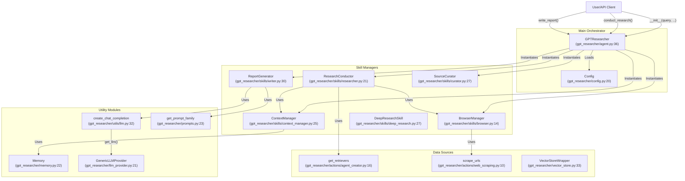
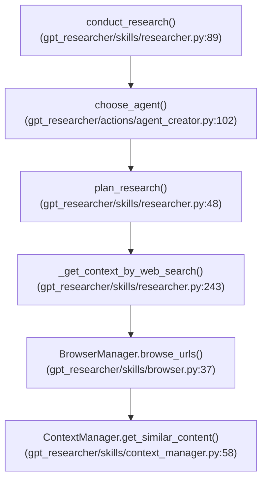
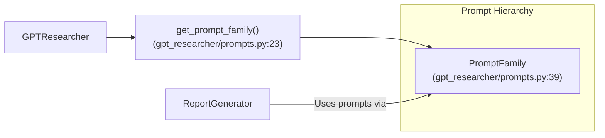

<!-- source: DeepWiki mcp.deepwiki.com · repo assafelovic/gpt-researcher · page 3 Core Architecture · fetched 2026-10-27 -->

# Core Architecture

<details>
<summary>Relevant source files</summary>

The following files were used as context for generating this wiki page:

- [README-ja_JP.md](README-ja_JP.md)
- [README-ko_KR.md](README-ko_KR.md)
- [README-zh_CN.md](README-zh_CN.md)
- [README.md](README.md)
- [docs/CNAME](docs/CNAME)
- [docs/docs/contribute.md](docs/docs/contribute.md)
- [gpt_researcher/agent.py](gpt_researcher/agent.py)
- [gpt_researcher/skills/browser.py](gpt_researcher/skills/browser.py)
- [gpt_researcher/skills/researcher.py](gpt_researcher/skills/researcher.py)

</details>


## Purpose and Scope

This document describes the core architectural components of GPT Researcher and how they interact to orchestrate research workflows. It covers the central classes (`GPTResearcher`, `ResearchConductor`, `Config`), the skill-based architecture, and the data flow through the research pipeline.

For detailed information about specific components:
- Individual GPTResearcher class methods: see [GPTResearcher Agent Class](#3.1)
- Research workflow details: see [ResearchConductor and Workflow](#3.2)
- Skill manager implementations: see [Skill Managers and Components](#3.3)
- Prompt generation and model support: see [Prompt Management System](#3.4)

---

## System Component Overview

The GPT Researcher architecture consists of a central orchestrator (`GPTResearcher` class) that delegates specialized tasks to skill managers. Each skill manager is responsible for a specific aspect of the research process.

### Core Component Hierarchy



**Purpose**: This diagram shows the class-level architecture. `GPTResearcher` acts as a facade, instantiating and coordinating specialized skill managers that handle everything from web browsing to final report writing.

**Sources**: [gpt_researcher/agent.py:36-83](), [gpt_researcher/skills/researcher.py:21-47](), [gpt_researcher/skills/browser.py:14-35]()

---

## GPTResearcher: The Central Orchestrator

The `GPTResearcher` class serves as the main entry point for all research operations. It maintains research state, coordinates skill managers, and exposes the primary API.

### Initialization and State

The `GPTResearcher.__init__()` method [gpt_researcher/agent.py:52-136]() accepts extensive configuration parameters including the research query, report type (defined in `ReportType` enum [gpt_researcher/utils/enum.py:17]()), and source preferences (defined in `ReportSource` enum [gpt_researcher/utils/enum.py:17]()).

### State Management

The class maintains several critical state variables to track research progress:

```python
# Core state (gpt_researcher/agent.py:138-167)
self.query: str                    # Research query
self.context: list                 # Accumulated research context
self.visited_urls: set             # Deduplicate sources
self.research_sources: list        # Scraped content with metadata
self.research_images: list         # Selected images
self.research_costs: float         # Accumulated API costs
self.agent: str                    # Agent type (e.g., "Business Analyst")
self.role: str                     # Agent role prompt
```

### Skill Manager Instantiation

During initialization, `GPTResearcher` instantiates its skill managers [gpt_researcher/agent.py:24-30]():

```python
self.research_conductor = ResearchConductor(self)
self.report_generator = ReportGenerator(self)
self.context_manager = ContextManager(self)
self.scraper_manager = BrowserManager(self)
self.source_curator = SourceCurator(self)
self.image_generator = ImageGenerator(self)
self.deep_research_skill = DeepResearchSkill(self)
```

Each manager receives a reference to the parent `GPTResearcher` instance, allowing them to access configuration, shared state, and other managers.

**Sources**: [gpt_researcher/agent.py:24-30](), [gpt_researcher/agent.py:138-167](), [gpt_researcher/utils/enum.py:17-17]()

---

## Configuration System

The `Config` class [gpt_researcher/config.py:20]() manages settings with a hierarchy: environment variables override file-based configurations, which override defaults.

### LLM Tier Strategy

GPT Researcher utilizes a three-tier LLM strategy to balance cost and performance:

*   **FAST_LLM**: Used for quick summarization and extraction tasks.
*   **SMART_LLM**: Used for complex analysis and final report generation.
*   **STRATEGIC_LLM**: Used for high-level research planning and query decomposition.

The system supports specialized parameters like `mcp_strategy` to handle Model Context Protocol integration during research [gpt_researcher/agent.py:132-135]().

**Sources**: [gpt_researcher/agent.py:140-142](), [gpt_researcher/agent.py:132-135]()

---

## Research Workflow and Data Flow

The research process follows a structured pipeline managed by the `ResearchConductor` [gpt_researcher/skills/researcher.py:89]().

### Research Execution Pipeline



**Purpose**: This diagram bridges the Natural Language task to Code Entities by showing the sequence of method calls across different skill managers during a standard research run.

### Parallel Sub-Query Processing

To ensure comprehensive coverage, the `ResearchConductor` decomposes the main query into multiple sub-queries using `plan_research_outline` [gpt_researcher/skills/researcher.py:75-85](). These queries are then processed to gather context from various sources including web search, local documents, or hybrid sources [gpt_researcher/skills/researcher.py:135-161]().

**Sources**: [gpt_researcher/skills/researcher.py:48-87](), [gpt_researcher/skills/researcher.py:135-161]()

---

## Skill Manager Components

The architecture delegates logic to specialized "Skills":

*   **ResearchConductor**: Manages query planning, retriever selection, and the overall research loop [gpt_researcher/skills/researcher.py:21]().
*   **BrowserManager**: Handles parallel web scraping using a `WorkerPool` and selects relevant images from scraped pages [gpt_researcher/skills/browser.py:14-35]().
*   **ContextManager**: Performs context management and retrieval from accumulated research data [gpt_researcher/skills/context_manager.py:25]().
*   **ReportGenerator**: Orchestrates the writing of the final report [gpt_researcher/skills/writer.py:30]().
*   **SourceCurator**: Handles the curation and validation of research sources [gpt_researcher/skills/curator.py:27]().
*   **DeepResearchSkill**: Manages recursive deep research tasks [gpt_researcher/skills/deep_research.py:27]().

**Sources**: [gpt_researcher/agent.py:24-30](), [gpt_researcher/skills/browser.py:32-35]()

---

## Prompt Management System

The system uses a prompt family hierarchy to support different model families and task-specific requirements.

### Prompt Generation Flow



The `get_prompt_family` function [gpt_researcher/prompts.py:23]() determines the appropriate prompt set based on the configured model or family name, ensuring compatibility across different LLM providers.

**Sources**: [gpt_researcher/prompts.py:23-36](), [gpt_researcher/agent.py:168-169]()

---

