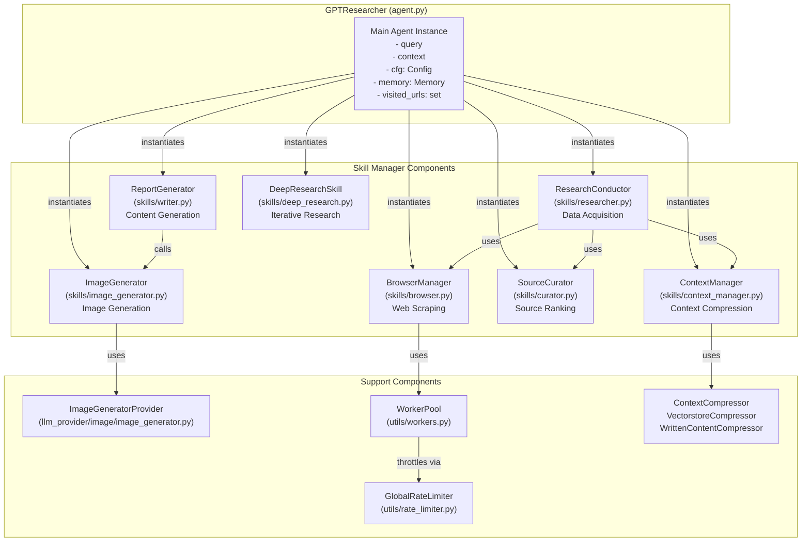
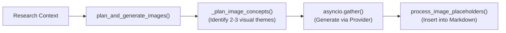

<!-- source: DeepWiki mcp.deepwiki.com · repo assafelovic/gpt-researcher · page 3.3 Skill Managers and Components · fetched 2026-10-27 -->

# Skill Managers and Components

<details>
<summary>Relevant source files</summary>

The following files were used as context for generating this wiki page:

- [backend/report_type/deep_research/example.py](backend/report_type/deep_research/example.py)
- [frontend/nextjs/styles/markdown.css](frontend/nextjs/styles/markdown.css)
- [gpt_researcher/actions/report_generation.py](gpt_researcher/actions/report_generation.py)
- [gpt_researcher/llm_provider/image/__init__.py](gpt_researcher/llm_provider/image/__init__.py)
- [gpt_researcher/llm_provider/image/image_generator.py](gpt_researcher/llm_provider/image/image_generator.py)
- [gpt_researcher/llm_provider/image/modelslab_image_generator.py](gpt_researcher/llm_provider/image/modelslab_image_generator.py)
- [gpt_researcher/skills/__init__.py](gpt_researcher/skills/__init__.py)
- [gpt_researcher/skills/context_manager.py](gpt_researcher/skills/context_manager.py)
- [gpt_researcher/skills/deep_research.py](gpt_researcher/skills/deep_research.py)
- [gpt_researcher/skills/image_generator.py](gpt_researcher/skills/image_generator.py)
- [gpt_researcher/skills/writer.py](gpt_researcher/skills/writer.py)
- [gpt_researcher/utils/rate_limiter.py](gpt_researcher/utils/rate_limiter.py)
- [gpt_researcher/utils/workers.py](gpt_researcher/utils/workers.py)
- [tests/test_deep_research_parsing.py](tests/test_deep_research_parsing.py)

</details>


This document describes the specialized skill manager components that `GPTResearcher` orchestrates to conduct research operations. Each skill manager encapsulates specific functionality—data acquisition, content generation, context management, web scraping, source evaluation, and image generation. For the main orchestration workflow, see [ResearchConductor and Workflow]().

## Skill Manager Architecture

GPTResearcher implements a **component-based architecture** where specialized skill managers handle distinct aspects of the research pipeline. All skill managers are instantiated during `GPTResearcher.__init__` and maintain a reference to their parent researcher instance.

### Component Initialization Pattern

[gpt_researcher/agent.py:182-193]()

```python
# All managers receive the researcher instance for shared state access
self.research_conductor: ResearchConductor = ResearchConductor(self)
self.report_generator: ReportGenerator = ReportGenerator(self)
self.context_manager: ContextManager = ContextManager(self)
self.scraper_manager: BrowserManager = BrowserManager(self)
self.source_curator: SourceCurator = SourceCurator(self)
self.deep_researcher: Optional[DeepResearchSkill] = None
if report_type == ReportType.DeepResearch.value:
    self.deep_researcher = DeepResearchSkill(self)
self.image_generator: Optional[ImageGenerator] = ImageGenerator(self)
```

Each skill manager follows the **strategy pattern**, encapsulating complex operations while maintaining access to shared researcher state (config, memory, websocket, costs).

**Sources:** [gpt_researcher/agent.py:182-193](), [gpt_researcher/agent.py:27-30]()

---

## Skill Manager Component Diagram



**Sources:** [gpt_researcher/agent.py:182-193](), [gpt_researcher/skills/context_manager.py:18-35](), [gpt_researcher/utils/workers.py:9-34](), [gpt_researcher/utils/rate_limiter.py:13-37](), [gpt_researcher/skills/image_generator.py:33-46]()

---

## ResearchConductor

**Purpose:** Orchestrates the data acquisition phase including query planning, retrieval execution, MCP integration, and context gathering.

**Location:** [gpt_researcher/skills/researcher.py:21-46]()

### Core Responsibilities

| Responsibility | Methods | Description |
|---------------|---------|-------------|
| Query Planning | `plan_research()` | Generates sub-queries from main query using `plan_research_outline` [gpt_researcher/skills/researcher.py:48-87]() |
| Research Execution | `conduct_research()` | Main entry point coordinating all research operations [gpt_researcher/skills/researcher.py:89-211]() |
| URL Scraping | `_get_context_by_urls()` | Processes specific source URLs via `scraper_manager` [gpt_researcher/skills/researcher.py:213-241]() |
| Web Search | `_get_context_by_web_search()` | Executes multi-retriever web search with MCP integration [gpt_researcher/skills/researcher.py:243-264]() |
| MCP Optimization | `_execute_mcp_research()` | Handles Model Context Protocol retriever strategy [gpt_researcher/skills/researcher.py:367-447]() |
| Sub-Query Processing | `_process_sub_query()` | Parallel processing of decomposed queries [gpt_researcher/skills/researcher.py:449-578]() |

**Sources:** [gpt_researcher/skills/researcher.py:89-211](), [gpt_researcher/skills/researcher.py:243-264]()

---

## DeepResearchSkill

**Purpose:** Implements the recursive, tree-like research mode which explores topics with configurable depth and breadth.

**Location:** [gpt_researcher/skills/deep_research.py:7-35]()

### Implementation Details
The `DeepResearchSkill` uses specialized parsing logic to handle JSON responses from reasoning models (like `o3-mini`). It manages its own `visited_urls` and `learnings` state to avoid redundancy during deep exploration.

| Function | Role |
|----------|------|
| `parse_search_queries_response` | Extracts `query` and `researchGoal` from LLM JSON or text blocks [gpt_researcher/skills/deep_research.py:77-116]() |
| `parse_research_results_response` | Extracts `learnings`, `followUpQuestions`, and `citations` from search results [gpt_researcher/skills/deep_research.py:143-201]() |
| `_extract_json_payloads` | Utility to find JSON blocks within messy LLM output using regex [gpt_researcher/skills/deep_research.py:48-60]() |

**Sources:** [gpt_researcher/skills/deep_research.py:7-116](), [backend/report_type/deep_research/example.py:32-53]()

---

## ReportGenerator

**Purpose:** Handles all report writing operations including introductions, conclusions, and final report compilation.

**Location:** [gpt_researcher/skills/writer.py:20-48]()

### Core Responsibilities

| Responsibility | Methods | Description |
|---------------|---------|-------------|
| Report Writing | `write_report()` | Main report generation with image embedding [gpt_researcher/skills/writer.py:49-123]() |
| Introduction | `write_introduction()` | Generate introduction section via `write_report_introduction` [gpt_researcher/skills/writer.py:164-193]() |
| Conclusion | `write_report_conclusion()` | Generate conclusion section via `write_conclusion` [gpt_researcher/skills/writer.py:125-162]() |
| Subtopic Generation | `get_subtopics()` | Extract subtopics for detailed reports [gpt_researcher/skills/writer.py:195-212]() |

**Sources:** [gpt_researcher/skills/writer.py:49-123](), [gpt_researcher/actions/report_generation.py:12-60]()

---

## ContextManager

**Purpose:** Manages context retrieval, compression, and similarity matching for research queries using embeddings and vector operations.

**Location:** [gpt_researcher/skills/context_manager.py:18-35]()

### Core Responsibilities

| Responsibility | Methods | Description |
|---------------|---------|-------------|
| Query-Based Retrieval | `get_similar_content_by_query()` | Find similar content from scraped pages using `ContextCompressor` [gpt_researcher/skills/context_manager.py:37-63]() |
| Vectorstore Retrieval | `get_similar_content_by_query_with_vectorstore()` | Query vector stores using `VectorstoreCompressor` [gpt_researcher/skills/context_manager.py:65-86]() |
| Written Content Matching | `get_similar_written_contents_by_draft_section_titles()` | Find relevant previously written content via `WrittenContentCompressor` [gpt_researcher/skills/context_manager.py:88-118]() |

**Sources:** [gpt_researcher/skills/context_manager.py:37-118](), [gpt_researcher/context/compression.py:11-15]()

---

## BrowserManager and WorkerPool

**Purpose:** Handles web scraping and content extraction from URLs using a throttled parallel worker pool.

### BrowserManager
**Location:** [gpt_researcher/skills/browser.py:14-35]()
- **`browse_urls()`**: Initiates parallel scraping of multiple URLs [gpt_researcher/skills/browser.py:37-84]().
- **`select_top_images()`**: Deduplicates and ranks images found during scraping [gpt_researcher/skills/browser.py:86-115]().

### WorkerPool and Rate Limiting
**Location:** [gpt_researcher/utils/workers.py:8-28]()
The `WorkerPool` uses an `asyncio.Semaphore` to limit concurrency and a `GlobalRateLimiter` to enforce delays across all instances.
- **`throttle()`**: An async context manager that waits for both a semaphore slot and the global rate limiter [gpt_researcher/utils/workers.py:35-50]().
- **`GlobalRateLimiter`**: A singleton that ensures `rate_limit_delay` is respected globally (e.g., for Firecrawl limits) [gpt_researcher/utils/rate_limiter.py:13-37]().

**Sources:** [gpt_researcher/utils/workers.py:35-50](), [gpt_researcher/utils/rate_limiter.py:60-80](), [gpt_researcher/skills/browser.py:37-84]()

---

## ImageGenerator

**Purpose:** Generates contextually relevant AI images for research reports.

**Location:** [gpt_researcher/skills/image_generator.py:20-46]()

### Image Generation Workflow



- **`plan_and_generate_images()`**: Analyzes context to identify visualization opportunities before report writing [gpt_researcher/skills/image_generator.py:77-180]().
- **`process_image_placeholders()`**: Scans the final report for `[IMAGE: ...]` tags and replaces them with actual image Markdown [gpt_researcher/skills/image_generator.py:104-176]().

**Sources:** [gpt_researcher/skills/image_generator.py:77-180](), [gpt_researcher/skills/image_generator.py:104-176]()

---

## SourceCurator

**Purpose:** Evaluates and ranks research sources based on relevance and credibility using LLM-based assessment.

**Location:** [gpt_researcher/skills/curator.py:15-31]()

- **`curate_sources()`**: Filters and ranks scraped data to ensure only high-quality information enters the final context [gpt_researcher/skills/curator.py:33-96]().

**Sources:** [gpt_researcher/skills/curator.py:33-96]()

---

