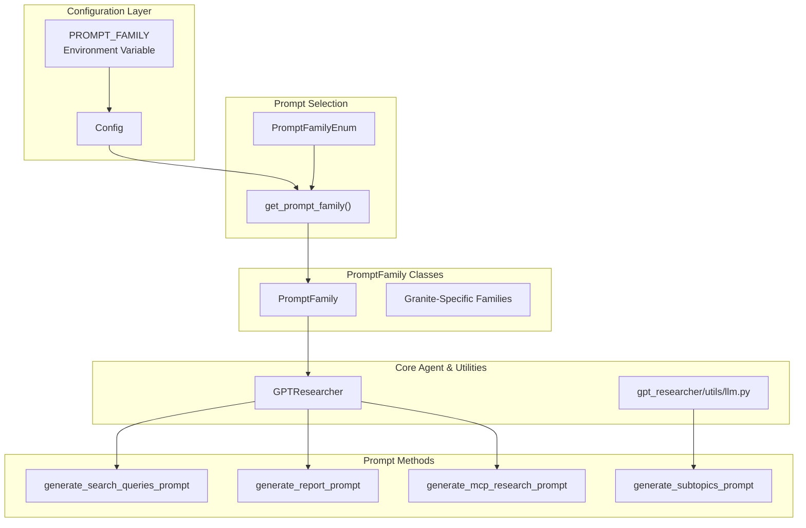
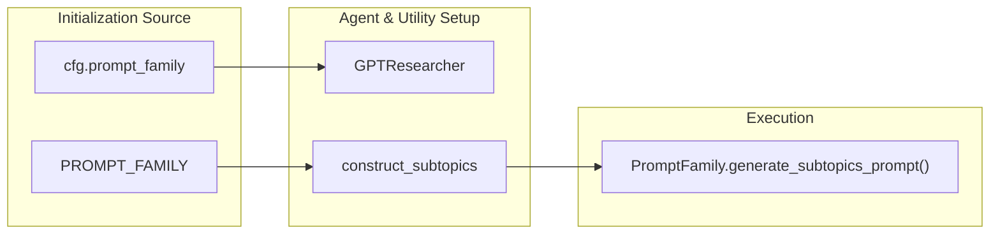

<!-- source: DeepWiki mcp.deepwiki.com · repo assafelovic/gpt-researcher · page 3.4 Prompt Management System · fetched 2026-10-27 -->

# Prompt Management System

Relevant source files

The following files were used as context for generating this wiki page:

- [.python-version](.python-version)
- [gpt_researcher/config/config.py](gpt_researcher/config/config.py)
- [gpt_researcher/llm_provider/__init__.py](gpt_researcher/llm_provider/__init__.py)
- [gpt_researcher/prompts.py](gpt_researcher/prompts.py)
- [gpt_researcher/utils/enum.py](gpt_researcher/utils/enum.py)
- [gpt_researcher/utils/llm.py](gpt_researcher/utils/llm.py)
- [tests/test_quick_search.py](tests/test_quick_search.py)

The Prompt Management System provides a flexible, extensible architecture for generating and managing prompts used throughout the research pipeline. This system abstracts prompt formatting away from business logic, enabling model-specific customizations (such as Granite support) while maintaining a consistent interface across all research operations.

---

## System Architecture

The prompt management system uses a class-based hierarchy where a base `PromptFamily` class defines the standard interface, and derived classes can override specific prompt generation methods to accommodate model-specific requirements.

### PromptFamily Class Hierarchy

The following diagram illustrates how `PromptFamily` is integrated into the core agent and its skills.

**Prompt Management Integration**

**Sources:** [gpt_researcher/prompts.py:14-23](), [gpt_researcher/utils/enum.py:94-101](), [gpt_researcher/config/config.py:19-75](), [gpt_researcher/utils/llm.py:152-178]()

---

## PromptFamily Base Class

The `PromptFamily` class serves as the foundation for all prompt generation. It is initialized with a `Config` instance and provides methods broken down into two functional groups.

### Initialization and Flow

The prompt family is instantiated and used to drive research logic. The system parses the desired prompt family from the configuration or environment variables.

**Initialization Data Flow**

**Sources:** [gpt_researcher/prompts.py:14-36](), [gpt_researcher/utils/llm.py:152-178](), [gpt_researcher/config/config.py:71-75]()

### Method Categories

The `PromptFamily` class [gpt_researcher/prompts.py:14-29]() organizes methods into:

1.  **Prompt Generators**: Standardized formats correlated with the `ReportType` enum (e.g., `generate_report_prompt`).
2.  **Prompt Methods**: Situation-specific methods with unique signatures (e.g., `generate_mcp_tool_selection_prompt`).

---

## Prompt Generation Categories

### Research Planning & MCP Prompts

These prompts orchestrate query decomposition and the Model Context Protocol (MCP) integration.

*   **`generate_mcp_tool_selection_prompt`**: Generates a prompt for LLM-based tool selection, returning JSON with relevance scores [gpt_researcher/prompts.py:40-83]().
*   **`generate_mcp_research_prompt`**: Instructs the LLM on how to execute research using the selected tools [gpt_researcher/prompts.py:86-118]().
*   **`construct_subtopics` utility**: Uses `prompt_family.generate_subtopics_prompt()` to create a research plan based on the task and available data [gpt_researcher/utils/llm.py:152-178]().

**Sources:** [gpt_researcher/prompts.py:40-118](), [gpt_researcher/utils/llm.py:152-178]()

### Image Generation Prompts

The prompt family includes logic to identify and describe visual needs for reports:

1.  **`generate_image_analysis_prompt`**: Analyzes report sections to determine which benefit most from visuals (diagrams, flowcharts, etc.) [gpt_researcher/prompts.py:122-175]().
2.  **`generate_image_prompt_enhancement`**: Refines a base prompt with report context to ensure high-quality, professional illustrations [gpt_researcher/prompts.py:178-192]().

**Sources:** [gpt_researcher/prompts.py:122-192]()

---

## Model-Specific Support (Granite, etc.)

The system identifies model-specific needs through the `PromptFamily` enum and the `prompt_family` configuration string.

### Granite Support
The system includes specific support for the IBM Granite model family:
*   `Granite` (General)
*   `Granite3`, `Granite3.1`, `Granite3.2`, `Granite3.3`

These are defined in the `PromptFamily` enum [gpt_researcher/utils/enum.py:94-101](). When a Granite family is selected, the system can override base prompts to match the specific instruction-following nuances of these models.

### Integration with LLM Utilities
The `create_chat_completion` utility [gpt_researcher/utils/llm.py:41-146]() and `construct_subtopics` [gpt_researcher/utils/llm.py:152-178]() utilize these prompts. `construct_subtopics` specifically takes a `prompt_family` argument (defaulting to the base `PromptFamily` class) to structure the hierarchical research plan [gpt_researcher/utils/llm.py:157]().

**Sources:** [gpt_researcher/utils/enum.py:94-101](), [gpt_researcher/utils/llm.py:41-178]()

---

## Extension Guide

To add a new prompt family (e.g., for a new model provider):

1.  **Define the Enum**: Add the new family name to `PromptFamily` in `gpt_researcher/utils/enum.py` [gpt_researcher/utils/enum.py:94-101]().
2.  **Subclass PromptFamily**: Create a new class in `gpt_researcher/prompts.py` inheriting from `PromptFamily` [gpt_researcher/prompts.py:14-29]().
3.  **Override Methods**: Implement specific logic for prompts that require model-specific formatting (e.g., custom delimiters or instruction styles).
4.  **Configuration**: Set the `PROMPT_FAMILY` environment variable to your new enum value to trigger the logic in the `Config` class [gpt_researcher/config/config.py:71-75]().

**Sources:** [gpt_researcher/prompts.py:14-29](), [gpt_researcher/utils/enum.py:94-101](), [gpt_researcher/config/config.py:71-75]()

---

