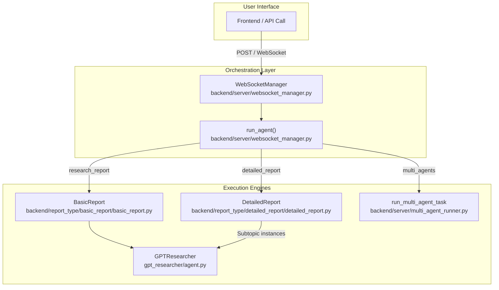
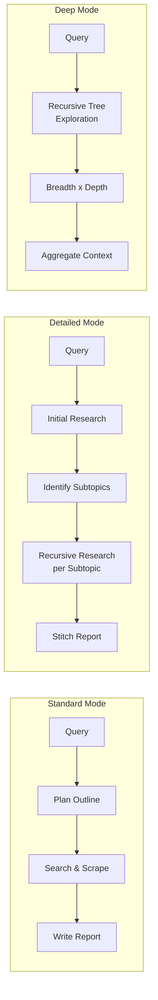

<!-- source: DeepWiki mcp.deepwiki.com · repo assafelovic/gpt-researcher · page 4 Research Modes · fetched 2026-10-27 -->

# Research Modes

<details>
<summary>Relevant source files</summary>

The following files were used as context for generating this wiki page:

- [README-ja_JP.md](README-ja_JP.md)
- [README-ko_KR.md](README-ko_KR.md)
- [README-zh_CN.md](README-zh_CN.md)
- [README.md](README.md)
- [backend/report_type/basic_report/basic_report.py](backend/report_type/basic_report/basic_report.py)
- [backend/report_type/detailed_report/detailed_report.py](backend/report_type/detailed_report/detailed_report.py)
- [backend/server/multi_agent_runner.py](backend/server/multi_agent_runner.py)
- [backend/server/server_utils.py](backend/server/server_utils.py)
- [backend/server/websocket_manager.py](backend/server/websocket_manager.py)
- [docs/CNAME](docs/CNAME)
- [docs/docs/contribute.md](docs/docs/contribute.md)
- [docs/docs/gpt-researcher/getting-started/how-to-choose.md](docs/docs/gpt-researcher/getting-started/how-to-choose.md)
- [frontend/index.html](frontend/index.html)
- [frontend/scripts.js](frontend/scripts.js)
- [frontend/styles.css](frontend/styles.css)
- [multi_agents_ag2/README.md](multi_agents_ag2/README.md)
- [multi_agents_ag2/__init__.py](multi_agents_ag2/__init__.py)
- [multi_agents_ag2/agents/__init__.py](multi_agents_ag2/agents/__init__.py)
- [multi_agents_ag2/agents/editor.py](multi_agents_ag2/agents/editor.py)
- [multi_agents_ag2/agents/orchestrator.py](multi_agents_ag2/agents/orchestrator.py)
- [multi_agents_ag2/main.py](multi_agents_ag2/main.py)
- [tests/test_websocket_manager.py](tests/test_websocket_manager.py)

</details>


GPT Researcher provides several distinct research modes, each optimized for different use cases, depth requirements, and output formats. This page provides a high-level overview of the available modes, their characteristics, and guidance on when to use each.

## Overview of Research Modes

The system supports four primary research approaches, ranging from fast summaries to hierarchical deep dives and multi-agent collaborative workflows.

| Mode | Report Type | Primary Use Case | Execution Time | Output Length |
|------|-------------|------------------|----------------|---------------|
| **Standard** | `research_report` | General-purpose research on focused topics | ~2 min | ~1,200 words |
| **Detailed** | `detailed_report` | Hierarchical exploration of subtopics | ~5 min | ~3,000+ words |
| **Deep** | `deep` | Tree-like recursive exploration with reasoning | ~5-10 min | 4,000+ words |
| **Multi-Agent** | `multi_agents` | High-quality reports with peer review | ~10-15 min | 5-10 pages |

Sources: [frontend/index.html:171-174](), [backend/report_type/detailed_report/detailed_report.py:50-51](), [backend/server/websocket_manager.py:134-164]()

## Research Mode Architecture

The following diagram illustrates how the system routes a user query to different execution engines based on the selected `report_type`.

### System Routing Logic

Sources: [backend/server/websocket_manager.py:106-180](), [backend/report_type/detailed_report/detailed_report.py:67-124](), [backend/report_type/basic_report/basic_report.py:41-60](), [backend/server/server_utils.py:126-173]()

## Research Workflow Comparison

The internal logic of each mode differs in how it handles query decomposition and context gathering.

### Logic Flow by Mode

Sources: [backend/report_type/detailed_report/detailed_report.py:84-91](), [backend/report_type/basic_report/basic_report.py:72-75](), [README.md:62-67]()

---

## Mode Details

### 4.1 Standard Research Mode
The default mode for quick and focused research. It performs a single pass of parallel web searching based on generated sub-queries to provide a concise yet comprehensive summary.
* **Core Entity:** `BasicReport` in [backend/report_type/basic_report/basic_report.py:9-25]()
* **Workflow:** Calls `conduct_research` and `write_report` on a single `GPTResearcher` instance [backend/report_type/basic_report/basic_report.py:72-75]().
* For details, see [Standard Research Mode](#4.1).

### 4.2 Detailed Report Mode
A hierarchical approach that first performs broad research to identify key subtopics, then initializes separate `GPTResearcher` instances for each subtopic to ensure maximum depth.
* **Core Entity:** `DetailedReport` in [backend/report_type/detailed_report/detailed_report.py:10-28]()
* **Workflow:** Executes `_initial_research`, calls `_get_all_subtopics`, and then runs `_generate_subtopic_reports` to process each section [backend/report_type/detailed_report/detailed_report.py:84-91]().
* For details, see [Detailed Report Mode](#4.2).

### 4.3 Deep Research Mode
Designed for complex topics requiring tree-like recursive exploration. It is inspired by "Plan-and-Solve" methodologies to address speed and reliability through parallelized work.
* **Core Entity:** `GPTResearcher` (with deep configuration) in [gpt_researcher/agent.py]()
* **Workflow:** Utilizes parallel execution agents to gather information for objective conclusions [README.md:54-60]().
* For details, see [Deep Research Mode](#4.3).

### 4.4 Multi-Agent Framework
A sophisticated framework where specialized agents collaborate. It leverages LangGraph or AG2 to manage stateful interactions between planning, execution, and publishing agents.
* **Core Entity:** `run_multi_agent_task` in [backend/server/multi_agent_runner.py]() (referenced in [backend/server/websocket_manager.py:135-141]())
* **Workflow:** A state-machine driven process that includes planning, research, review, and publication stages [README.md:54-60]().
* For details, see [Multi-Agent Framework](#4.4).

---

## Configuration & Routing

Modes are programmatically selected in the backend based on the `report_type` string received via the API or WebSocket.

```python
# Routing logic in backend/server/websocket_manager.py:134-176
if report_type == "multi_agents":
    report = await run_multi_agent_task(...)
elif report_type == ReportType.DetailedReport.value:
    researcher = DetailedReport(...)
    report = await researcher.run()
else:
    researcher = BasicReport(...)
    report = await researcher.run()
```

Sources: [backend/server/websocket_manager.py:134-176](), [backend/report_type/detailed_report/detailed_report.py:47-67](), [backend/report_type/basic_report/basic_report.py:41-60]()

---

