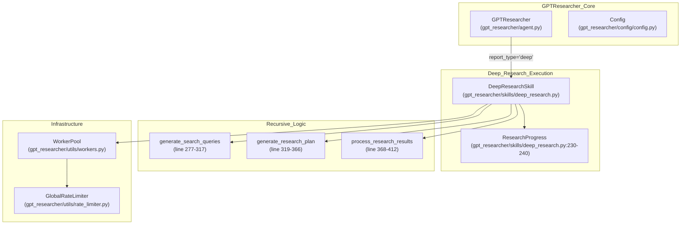
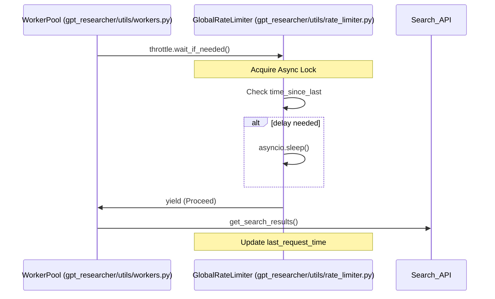

<!-- source: DeepWiki mcp.deepwiki.com · repo assafelovic/gpt-researcher · page 4.3 Deep Research Mode · fetched 2026-10-27 -->

# Deep Research Mode

<details>
<summary>Relevant source files</summary>

The following files were used as context for generating this wiki page:

- [backend/report_type/deep_research/README.md](backend/report_type/deep_research/README.md)
- [backend/report_type/deep_research/__init__.py](backend/report_type/deep_research/__init__.py)
- [backend/report_type/deep_research/example.py](backend/report_type/deep_research/example.py)
- [backend/report_type/deep_research/main.py](backend/report_type/deep_research/main.py)
- [docs/blog/2025-02-26-deep-research/index.md](docs/blog/2025-02-26-deep-research/index.md)
- [docs/docs/gpt-researcher/gptr/deep_research.md](docs/docs/gpt-researcher/gptr/deep_research.md)
- [gpt_researcher/skills/deep_research.py](gpt_researcher/skills/deep_research.py)
- [gpt_researcher/utils/rate_limiter.py](gpt_researcher/utils/rate_limiter.py)
- [gpt_researcher/utils/workers.py](gpt_researcher/utils/workers.py)
- [tests/test_deep_research_parsing.py](tests/test_deep_research_parsing.py)

</details>


## Purpose and Scope

Deep Research Mode in GPT Researcher is an advanced recursive research workflow that explores topics with hierarchical depth. It employs a tree-like exploration pattern to investigate subtopics systematically while maintaining comprehensive context across research branches. This mode is specifically optimized for complex research tasks that require uncovering hidden connections and following citation trails across multiple levels of depth.

For standard single-pass research, see [Standard Research Mode](#4.1). For structured multi-subtopic reports, see [Detailed Report Mode](#4.2). For collaborative agent-based research, see [Multi-Agent Framework](#4.4).

## Overview

Deep Research Mode is designed for tasks requiring more than a surface-level summary. Unlike standard research that performs a single pass of query generation and web search, Deep Research recursively branches into subtopics, creating a tree of research that builds from foundational to advanced insights.

**Key Characteristics:**
- **Report Type Identifier**: `"deep"` [gpt_researcher/skills/deep_research.py:214]()
- **Execution Time**: Approximately 5 minutes per research task [docs/docs/gpt-researcher/gptr/deep_research.md:5]()
- **Estimated Cost**: ~$0.40 per research using strategic reasoning models like `o3-mini` [docs/docs/gpt-researcher/gptr/deep_research.md:5]()
- **Output**: Comprehensive reports with hierarchical synthesis of findings, recommended for ~2000 words [docs/docs/gpt-researcher/gptr/deep_research.md:55]()

Sources: [gpt_researcher/skills/deep_research.py:214](), [docs/docs/gpt-researcher/gptr/deep_research.md:1-17](), [backend/report_type/deep_research/README.md:1-15]()

## Architecture and Components

### Component Overview



Sources: [gpt_researcher/skills/deep_research.py:214-260](), [gpt_researcher/utils/workers.py:8-34](), [gpt_researcher/utils/rate_limiter.py:13-28]()

### Initialization and Invocation

Deep Research Mode is activated when the `report_type` parameter is set to `"deep"`. The `DeepResearchSkill` class is initialized with parameters from the researcher's configuration.

```python
# Initialization in gpt_researcher/skills/deep_research.py:214-228
class DeepResearchSkill:
    def __init__(self, researcher):
        self.researcher = researcher
        self.breadth = getattr(researcher.cfg, "deep_research_breadth", 4)
        self.depth = getattr(researcher.cfg, "deep_research_depth", 2)
        self.concurrency_limit = getattr(researcher.cfg, "deep_research_concurrency", 2)
```

The system uses `DeepResearchSkill` to manage the recursive state, including `visited_urls`, `learnings`, and `research_sources`.

Sources: [gpt_researcher/skills/deep_research.py:214-228](), [docs/docs/gpt-researcher/gptr/deep_research.md:34]()

## Configuration Parameters

Deep Research behavior is governed by breadth, depth, and concurrency settings.

| Parameter | Default | Description |
|-----------|---------|-------------|
| `deep_research_breadth` | 4 | Number of parallel search queries generated at each level to explore different aspects. |
| `deep_research_depth` | 2 | How many levels deep the recursion follows leads and uncovering connections. |
| `deep_research_concurrency` | 2 | Maximum number of concurrent research operations to prevent API exhaustion. |

Sources: [gpt_researcher/skills/deep_research.py:218-220](), [docs/docs/gpt-researcher/gptr/deep_research.md:50-54]()

## Tree-Like Exploration Mechanism

### Recursive Research Strategy

Deep Research employs a tree-like exploration pattern where each node generates new questions that become branches for further investigation.

1.  **Initial Plan**: The system calls `generate_research_plan` to create targeted questions based on the original query and initial web results [gpt_researcher/skills/deep_research.py:319-366]().
2.  **Query Generation**: For each question, `generate_search_queries` produces specific SERP queries [gpt_researcher/skills/deep_research.py:277-317]().
3.  **Recursive Deepening**: The `run_deep_research` method follows these branches, extracting "learnings" and citations at each step [gpt_researcher/skills/deep_research.py:414-500]().
4.  **Context Management**: To prevent context window overflow, the system maintains a safety margin of approximately 25,000 words [gpt_researcher/skills/deep_research.py:18]().

### Progress Tracking

The `ResearchProgress` class tracks the state of the tree across both dimensions.

```python
class ResearchProgress:
    def __init__(self, total_depth: int, total_breadth: int):
        self.current_depth = total_depth
        self.total_depth = total_depth
        self.current_breadth = total_breadth
        self.total_breadth = total_breadth
        self.current_query: Optional[str] = None
        self.total_queries = 0
        self.completed_queries = 0
```

Sources: [gpt_researcher/skills/deep_research.py:230-240](), [backend/report_type/deep_research/example.py:22-30]()

## Resource Management and Rate Limiting

Because Deep Research initiates many parallel requests, it uses a sophisticated throttling system.

### Global Rate Limiter

The `GlobalRateLimiter` is a singleton that ensures `rate_limit_delay` is enforced across the entire application, even if multiple `GPTResearcher` instances are running in Deep Research Mode.



Sources: [gpt_researcher/utils/rate_limiter.py:13-80](), [gpt_researcher/utils/workers.py:8-51]()

## Integration with Reasoning Models

Deep Research is designed to work with high-reasoning models (e.g., `o3-mini`). The system explicitly sets `reasoning_effort` to `High` for critical planning and analysis tasks:

- **Plan Generation**: Uses `ReasoningEfforts.High.value` to analyze initial search results and generate targeted questions [gpt_researcher/skills/deep_research.py:359]().
- **Result Processing**: Uses `ReasoningEfforts.High.value` to extract key learnings and citations from raw context [gpt_researcher/skills/deep_research.py:405]().

Sources: [gpt_researcher/skills/deep_research.py:359, 405](), [backend/report_type/deep_research/example.py:82, 148]()

## Usage Example

To trigger Deep Research Mode, set the `report_type` to `"deep"` during initialization.

```python
from gpt_researcher import GPTResearcher
import asyncio

async def main():
    researcher = GPTResearcher(
        query="Latest developments in quantum computing",
        report_type="deep",
    )

    # Conducts the recursive tree search
    research_data = await researcher.conduct_research()

    # Synthesizes findings from all branches into a report
    report = await researcher.write_report()
    print(report)

if __name__ == "__main__":
    asyncio.run(main())
```

Sources: [docs/docs/gpt-researcher/gptr/deep_research.md:25-45](), [backend/report_type/deep_research/main.py:6-33]()

---

**Related Pages:**
- For standard configuration, see [Configuration Setup](#2.3)
- For details on the orchestrator, see [GPTResearcher Agent Class](#3.1)
- For the underlying scraping logic, see [Web Scraping System](#7.2)

---

