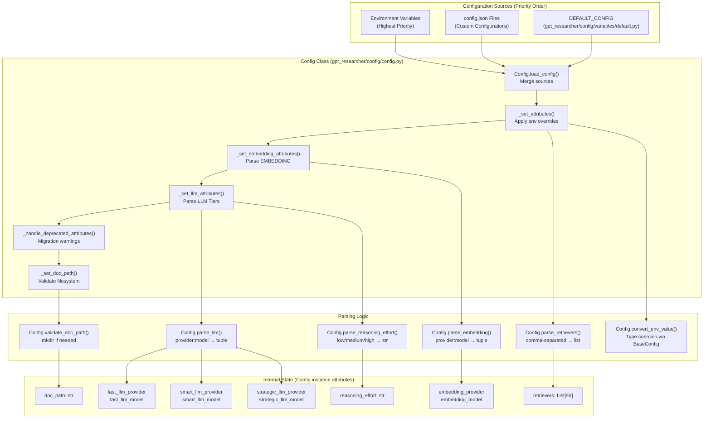
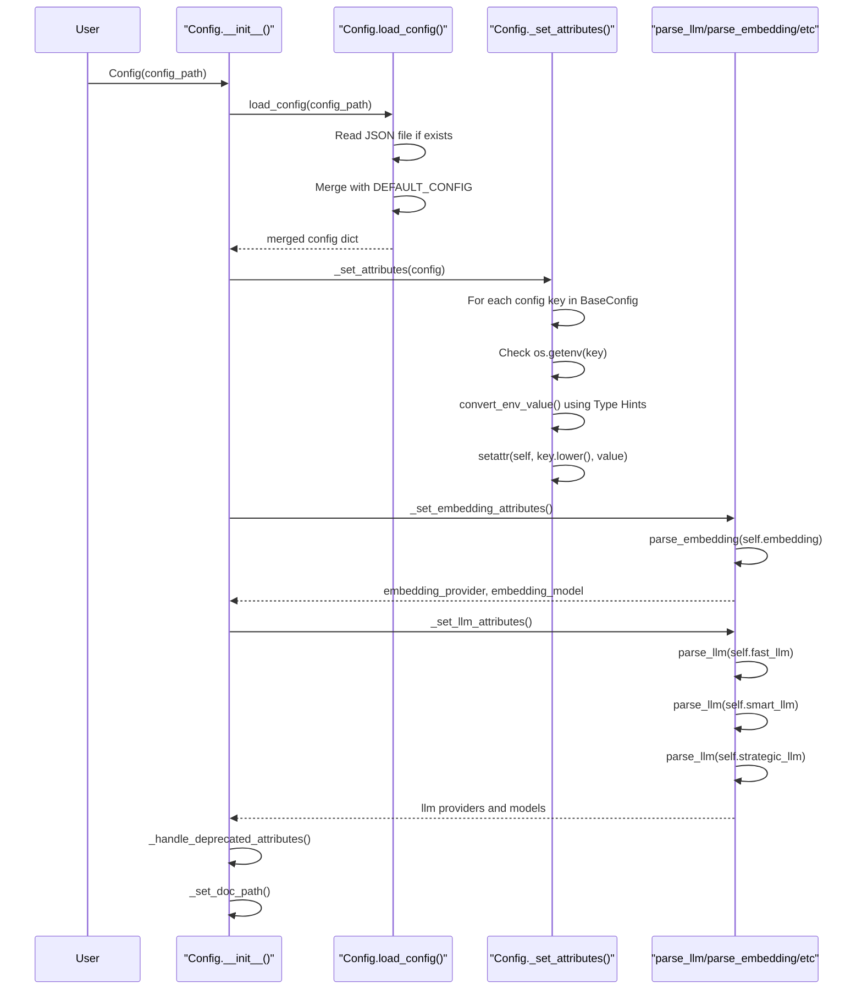

<!-- source: DeepWiki mcp.deepwiki.com · repo assafelovic/gpt-researcher · page 5 Configuration System · fetched 2026-10-27 -->

# Configuration System

<details>
<summary>Relevant source files</summary>

The following files were used as context for generating this wiki page:

- [docs/docs/gpt-researcher/gptr/config.md](docs/docs/gpt-researcher/gptr/config.md)
- [gpt_researcher/actions/query_processing.py](gpt_researcher/actions/query_processing.py)
- [gpt_researcher/config/config.py](gpt_researcher/config/config.py)
- [gpt_researcher/config/variables/base.py](gpt_researcher/config/variables/base.py)
- [gpt_researcher/config/variables/default.py](gpt_researcher/config/variables/default.py)
- [gpt_researcher/llm_provider/__init__.py](gpt_researcher/llm_provider/__init__.py)
- [gpt_researcher/utils/llm.py](gpt_researcher/utils/llm.py)

</details>


## Purpose and Scope

The Configuration System provides centralized management of all settings for GPT Researcher. This includes LLM providers and models, embedding configurations, retriever settings, document paths, and operational parameters. The system implements a three-tier configuration hierarchy that merges defaults, JSON configuration files, and environment variables to provide flexible deployment options.

For information about specific LLM provider integration and the three-tier LLM strategy (FAST_LLM, SMART_LLM, STRATEGIC_LLM), see [LLM Integration](#6). For details on embedding providers and the Memory system, see [Embeddings and Memory System](#6.5). For a complete reference of all configuration parameters and environment variables, see [Configuration Parameters Reference](#5.2) and [Environment Variables Reference](#5.3).

## Configuration Architecture Overview

The configuration system uses a hierarchical priority system where environment variables override JSON configuration files, which in turn override default values.

### Configuration Entity Mapping
The following diagram bridges the natural language configuration concepts to the specific code entities that implement them.



Sources: [gpt_researcher/config/config.py:19-155](), [gpt_researcher/config/variables/default.py:3-55](), [gpt_researcher/config/variables/base.py:5-52]()

## The Config Class

The `Config` class ([gpt_researcher/config/config.py:19-155]()) serves as the central configuration manager. It is initialized with an optional `config_path` parameter and performs the following initialization sequence:

1. **Load configuration** - Merges defaults, JSON files, and environment variables [gpt_researcher/config/config.py:44]().
2. **Set base attributes** - Applies environment variable overrides [gpt_researcher/config/config.py:45]().
3. **Parse embedding configuration** - Extracts provider and model from `EMBEDDING` string [gpt_researcher/config/config.py:46]().
4. **Parse LLM configurations** - Extracts provider and model for all three LLM tiers [gpt_researcher/config/config.py:47]().
5. **Handle deprecated attributes** - Issues warnings and performs migrations [gpt_researcher/config/config.py:48]().
6. **Validate document paths** - Ensures filesystem directories exist [gpt_researcher/config/config.py:49-50]().

### Key Initialization Flow



Sources: [gpt_researcher/config/config.py:34-61](), [gpt_researcher/config/config.py:62-84]()

### Key Attributes

The `Config` class exposes the following key attributes after initialization:

| Attribute | Type | Description |
|-----------|------|-------------|
| `config_path` | `str \| None` | Path to the JSON configuration file [gpt_researcher/config/config.py:40]() |
| `llm_kwargs` | `Dict[str, Any]` | Additional keyword arguments for LLM calls [gpt_researcher/config/config.py:41]() |
| `embedding_kwargs` | `Dict[str, Any]` | Additional keyword arguments for embeddings [gpt_researcher/config/config.py:42]() |
| `fast_llm_provider` | `str` | Provider for fast/cheap LLM operations [gpt_researcher/config/config.py:93]() |
| `fast_llm_model` | `str` | Model name for fast operations [gpt_researcher/config/config.py:93]() |
| `smart_llm_provider` | `str` | Provider for complex reasoning tasks [gpt_researcher/config/config.py:94]() |
| `smart_llm_model` | `str` | Model name for main research [gpt_researcher/config/config.py:94]() |
| `strategic_llm_provider` | `str` | Provider for high-level coordination [gpt_researcher/config/config.py:95]() |
| `strategic_llm_model` | `str` | Model name for multi-agent orchestration [gpt_researcher/config/config.py:95]() |
| `embedding_provider` | `str` | Provider for embeddings [gpt_researcher/config/config.py:87]() |
| `embedding_model` | `str` | Model name for embeddings [gpt_researcher/config/config.py:87]() |
| `retrievers` | `List[str]` | List of enabled retriever names [gpt_researcher/config/config.py:80]() |
| `doc_path` | `str` | Path to local documents directory [gpt_researcher/config/config.py:148]() |
| `mcp_servers` | `List[dict]` | MCP server configurations [gpt_researcher/config/config.py:53]() |
| `reasoning_effort` | `str` | Reasoning effort level (low/medium/high) [gpt_researcher/config/config.py:96]() |

Sources: [gpt_researcher/config/config.py:25-61](), [gpt_researcher/config/config.py:85-96]()

## Configuration Sources and Priority

### Three-Tier Priority System

The system follows a strict hierarchy for resolving configuration values:
1. **Environment Variables**: Highest priority. Checked in `_set_attributes` [gpt_researcher/config/config.py:72-75]().
2. **JSON Config Files**: Loaded via `load_config` [gpt_researcher/config/config.py:157-177]().
3. **DEFAULT_CONFIG**: Fallback values defined in `gpt_researcher/config/variables/default.py` [gpt_researcher/config/variables/default.py:3-55]().

### Loading Configuration Files

The `load_config()` class method ([gpt_researcher/config/config.py:157-177]()) implements the configuration loading logic:

1. Checks for `config_path` parameter or `CONFIG_PATH` environment variable [gpt_researcher/config/config.py:159]().
2. If no path specified, returns `DEFAULT_CONFIG` [gpt_researcher/config/config.py:161]().
3. If path specified but file doesn't exist, warns and returns `DEFAULT_CONFIG` [gpt_researcher/config/config.py:164-171]().
4. If file exists, loads JSON and merges with `DEFAULT_CONFIG` [gpt_researcher/config/config.py:173-177]().

Sources: [gpt_researcher/config/config.py:157-177]()

## Parsing and Validation Methods

### LLM Configuration Parsing

The `parse_llm()` static method ([gpt_researcher/config/config.py:203-221]()) parses LLM configuration strings in the format `provider:model`. It validates the provider against `_SUPPORTED_PROVIDERS` [gpt_researcher/config/config.py:214]().

**Example configurations:**
- `FAST_LLM=openai:gpt-4o-mini`
- `SMART_LLM=anthropic:claude-3-5-sonnet-20241022`

### Retriever Parsing and Validation

The `parse_retrievers()` method ([gpt_researcher/config/config.py:188-201]()) validates retriever names against available implementations retrieved via `get_all_retriever_names()` [gpt_researcher/config/config.py:193]().

### Environment Variable Type Conversion

The `convert_env_value()` static method ([gpt_researcher/config/config.py:256-288]()) handles type coercion from environment variable strings to the appropriate Python types based on `BaseConfig` type hints [gpt_researcher/config/config.py:74]().

| Type Hint | Conversion Logic |
|-----------|-----------------|
| `bool` | `"true"/"1"/"yes"/"on"` → `True` [gpt_researcher/config/config.py:263-264]() |
| `int` | `int(env_value)` [gpt_researcher/config/config.py:274-275]() |
| `float` | `float(env_value)` [gpt_researcher/config/config.py:277-278]() |
| `List` / `dict` | `json.loads(env_value)` [gpt_researcher/config/config.py:280-281]() |

Sources: [gpt_researcher/config/config.py:256-288]()

## LLM and Embedding Configuration

### Three-Tier LLM Configuration

The configuration system separates LLM usage into three tiers: `fast_llm`, `smart_llm`, and `strategic_llm`. These are used by `create_chat_completion` in `gpt_researcher/utils/llm.py` to determine which model to invoke for specific tasks like sub-query generation [gpt_researcher/actions/query_processing.py:72-81]().

### Usage in LLM Creation

The parsed configuration attributes are used to initialize LLM providers. For example, when constructing subtopics:

```python
# gpt_researcher/utils/llm.py:184-194
provider_kwargs = {'model': config.smart_llm_model}

if config.llm_kwargs:
    provider_kwargs.update(config.llm_kwargs)

if config.smart_llm_model in SUPPORT_REASONING_EFFORT_MODELS:
    provider_kwargs['reasoning_effort'] = ReasoningEfforts.High.value
else:
    provider_kwargs['temperature'] = config.temperature
    provider_kwargs['max_tokens'] = config.smart_token_limit

provider = get_llm(config.smart_llm_provider, **provider_kwargs)
```

Sources: [gpt_researcher/utils/llm.py:184-194](), [gpt_researcher/actions/query_processing.py:72-81]()

## MCP (Model Context Protocol) Configuration

MCP configuration is handled through `mcp_servers` and `mcp_allowed_root_paths` [gpt_researcher/config/config.py:53-54](). The system uses `get_mcp_server_config()` to retrieve specific server settings by name [gpt_researcher/config/config.py:295-312]().

## Deprecated Attributes and Migration

The system maintains backward compatibility for legacy variables like `LLM_PROVIDER`, `FAST_LLM_MODEL`, and `EMBEDDING_PROVIDER` in `_handle_deprecated_attributes()` [gpt_researcher/config/config.py:98-145](). It issues a `FutureWarning` when these are detected [gpt_researcher/config/config.py:101-105]().

Sources: [gpt_researcher/config/config.py:98-145]()

---

