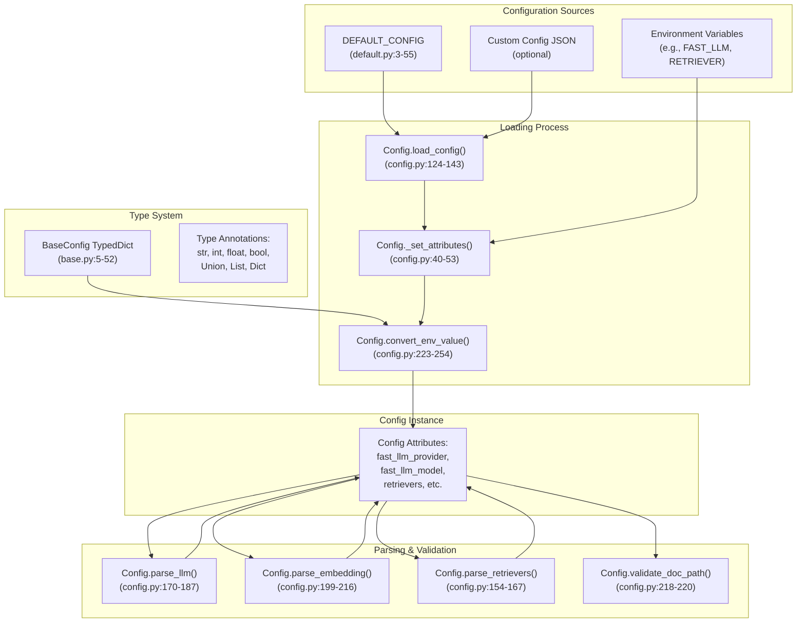
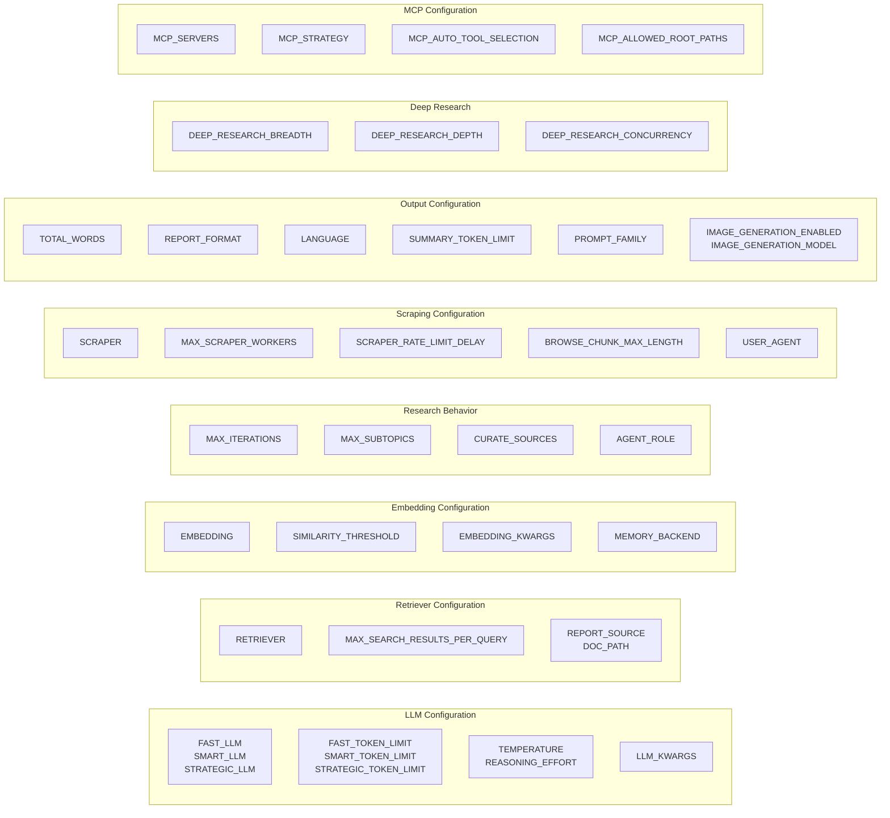
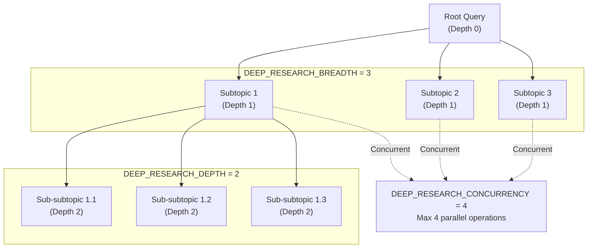

<!-- source: DeepWiki mcp.deepwiki.com · repo assafelovic/gpt-researcher · page 5.2 Configuration Parameters Reference · fetched 2026-10-27 -->

# Configuration Parameters Reference

Relevant source files

The following files were used as context for generating this wiki page:

- [docs/docs/gpt-researcher/gptr/config.md](docs/docs/gpt-researcher/gptr/config.md)
- [gpt_researcher/actions/query_processing.py](gpt_researcher/actions/query_processing.py)
- [gpt_researcher/config/variables/base.py](gpt_researcher/config/variables/base.py)
- [gpt_researcher/config/variables/default.py](gpt_researcher/config/variables/default.py)

## Purpose and Scope

This document provides a complete reference of all configuration parameters defined in `DEFAULT_CONFIG`. Each parameter is documented with its type, default value, valid options, and purpose. For information about how configuration is loaded and processed, see [Config Class Architecture](#5.1). For environment variable names and formats, see [Environment Variables Reference](#5.3).

The configuration system is defined in three key files:
- [gpt_researcher/config/variables/default.py:3-55]() - Default values
- [gpt_researcher/config/variables/base.py:5-52]() - Type definitions
- [gpt_researcher/config/config.py:11-278]() - Loading and validation logic

## Configuration Architecture Overview

The configuration system aggregates defaults, environment variables, and optional JSON files into a unified `Config` object used by the `GPTResearcher` agent.

**Sources:** [gpt_researcher/config/config.py:11-278](), [gpt_researcher/config/variables/default.py:3-55](), [gpt_researcher/config/variables/base.py:5-52]()

## Configuration Parameter Categories

The parameters are logically grouped to control different stages of the research pipeline.

**Sources:** [gpt_researcher/config/variables/default.py:3-55](), [gpt_researcher/config/variables/base.py:5-52]()

## LLM Configuration Parameters

### FAST_LLM
**Type:** `str` | **Default:** `"openai:gpt-4o-mini"` | **Format:** `"<provider>:<model>"`
Model used for fast operations like summaries and quick analyses. Optimized for speed and cost-efficiency.
**Sources:** [gpt_researcher/config/variables/default.py:7]()

### SMART_LLM
**Type:** `str` | **Default:** `"openai:gpt-4.1"` | **Format:** `"<provider>:<model>"`
Model used for complex analysis, generating research reports, and reasoning tasks. Should support long responses (2000+ words).
**Sources:** [gpt_researcher/config/variables/default.py:8]()

### STRATEGIC_LLM
**Type:** `str` | **Default:** `"openai:o4-mini"` | **Format:** `"<provider>:<model>"`
Model used for strategic operations like research planning and query decomposition. The `generate_sub_queries` function uses this model to plan the research outline [gpt_researcher/actions/query_processing.py:73-81]().
**Sources:** [gpt_researcher/config/variables/default.py:9](), [gpt_researcher/actions/query_processing.py:72-81]()

### FAST_TOKEN_LIMIT
**Type:** `int` | **Default:** `3000`
Maximum token limit for `FAST_LLM` responses.
**Sources:** [gpt_researcher/config/variables/default.py:10]()

### SMART_TOKEN_LIMIT
**Type:** `int` | **Default:** `6000`
Maximum token limit for `SMART_LLM` responses. Used as a fallback in `generate_sub_queries` if the strategic LLM fails [gpt_researcher/actions/query_processing.py:103]().
**Sources:** [gpt_researcher/config/variables/default.py:11](), [gpt_researcher/actions/query_processing.py:99-108]()

### STRATEGIC_TOKEN_LIMIT
**Type:** `int` | **Default:** `4000`
Maximum token limit for `STRATEGIC_LLM` responses. Used during retry logic in `generate_sub_queries` [gpt_researcher/actions/query_processing.py:89]().
**Sources:** [gpt_researcher/config/variables/default.py:12](), [gpt_researcher/actions/query_processing.py:83-97]()

### TEMPERATURE
**Type:** `float` | **Default:** `0.4` | **Range:** `0.0 - 1.0`
Sampling temperature for LLM responses. Higher values increase randomness.
**Sources:** [gpt_researcher/config/variables/default.py:16]()

### REASONING_EFFORT
**Type:** `str` | **Default:** `"medium"` | **Valid Values:** `"low"`, `"medium"`, `"high"`
Reasoning effort level for models supporting it. Used in `create_chat_completion` calls [gpt_researcher/actions/query_processing.py:78]().
**Sources:** [gpt_researcher/config/variables/default.py:45](), [gpt_researcher/actions/query_processing.py:72-81]()

### LLM_KWARGS
**Type:** `dict` | **Default:** `{}`
Additional keyword arguments passed to the LLM provider class.
**Sources:** [gpt_researcher/config/variables/default.py:32]()

## Retriever Configuration Parameters

### RETRIEVER
**Type:** `str` | **Default:** `"tavily"`
Web search engine(s) used for retrieving sources. Options: `tavily`, `duckduckgo`, `google`, `bing`, `searchapi`, `serper`, `searx`, `arxiv`.
**Sources:** [gpt_researcher/config/variables/default.py:4](), [docs/docs/gpt-researcher/gptr/config.md:53]()

### MAX_SEARCH_RESULTS_PER_QUERY
**Type:** `int` | **Default:** `5`
Maximum number of search results to retrieve per query.
**Sources:** [gpt_researcher/config/variables/default.py:18]()

### REPORT_SOURCE
**Type:** `str` | **Default:** `"web"`
Source mode for research data. Options: `web`, `local`, `hybrid`, `azure`, `langchain_documents`, `langchain_vectorstore`.
**Sources:** [gpt_researcher/config/variables/default.py:29]()

### DOC_PATH
**Type:** `str` | **Default:** `"./my-docs"`
Path to read and research local documents.
**Sources:** [gpt_researcher/config/variables/default.py:30]()

## Embedding Configuration Parameters

### EMBEDDING
**Type:** `str` | **Default:** `"openai:text-embedding-3-small"`
Embedding model used for similarity search.
**Sources:** [gpt_researcher/config/variables/default.py:5]()

### SIMILARITY_THRESHOLD
**Type:** `float` | **Default:** `0.42`
Threshold for similarity comparison when processing documents.
**Sources:** [gpt_researcher/config/variables/default.py:6]()

### MEMORY_BACKEND
**Type:** `str` | **Default:** `"local"`
Backend used for memory operations.
**Sources:** [gpt_researcher/config/variables/default.py:19]()

### EMBEDDING_KWARGS
**Type:** `dict` | **Default:** `{}`
Additional keyword arguments for the embedding provider.
**Sources:** [gpt_researcher/config/variables/default.py:33]()

## Scraping Configuration Parameters

### SCRAPER
**Type:** `str` | **Default:** `"bs"`
Web scraper to use (e.g., `bs` for BeautifulSoup, `newspaper`).
**Sources:** [gpt_researcher/config/variables/default.py:24]()

### MAX_SCRAPER_WORKERS
**Type:** `int` | **Default:** `15`
Maximum concurrent scraper workers per research.
**Sources:** [gpt_researcher/config/variables/default.py:25]()

### SCRAPER_RATE_LIMIT_DELAY
**Type:** `float` | **Default:** `0.0`
Minimum seconds between scraper requests to handle rate limiting.
**Sources:** [gpt_researcher/config/variables/default.py:26]()

### BROWSE_CHUNK_MAX_LENGTH
**Type:** `int` | **Default:** `8192`
Maximum length of text chunks to browse in web sources.
**Sources:** [gpt_researcher/config/variables/default.py:13]()

## Deep Research Configuration Parameters

Deep research mode performs recursive, tree-like exploration of topics.

### DEEP_RESEARCH_BREADTH
**Type:** `int` | **Default:** `3`
Number of parallel paths to explore.
**Sources:** [gpt_researcher/config/variables/default.py:36]()

### DEEP_RESEARCH_DEPTH
**Type:** `int` | **Default:** `2`
Number of sequential searches to perform.
**Sources:** [gpt_researcher/config/variables/default.py:37]()

### DEEP_RESEARCH_CONCURRENCY
**Type:** `int` | **Default:** `4`
Maximum concurrent operations in deep research mode.
**Sources:** [gpt_researcher/config/variables/default.py:38]()

## MCP Configuration Parameters

Model Context Protocol (MCP) enables access to specialized data sources.

### MCP_SERVERS
**Type:** `List[Dict[str, Any]]` | **Default:** `[]`
Predefined MCP server configurations.
**Sources:** [gpt_researcher/config/variables/default.py:41]()

### MCP_STRATEGY
**Type:** `str` | **Default:** `"fast"` | **Valid Values:** `"fast"`, `"deep"`, `"disabled"`
Strategy for MCP execution.
**Sources:** [gpt_researcher/config/variables/default.py:44]()

### MCP_AUTO_TOOL_SELECTION
**Type:** `bool` | **Default:** `True`
Automatic selection of the best tool for a query.
**Sources:** [gpt_researcher/config/variables/default.py:42]()

### MCP_ALLOWED_ROOT_PATHS
**Type:** `List[str]` | **Default:** `[]`
Allowed root paths for local file access.
**Sources:** [gpt_researcher/config/variables/default.py:43]()

## Image Generation Parameters

GPT Researcher can generate inline images for reports.

### IMAGE_GENERATION_ENABLED
**Type:** `bool` | **Default:** `False`
Master switch for inline image generation.
**Sources:** [gpt_researcher/config/variables/default.py:52]()

### IMAGE_GENERATION_MODEL
**Type:** `str` | **Default:** `"models/gemini-2.5-flash-image"`
Model used for image generation.
**Sources:** [gpt_researcher/config/variables/default.py:50]()

### IMAGE_GENERATION_MAX_IMAGES
**Type:** `int` | **Default:** `3`
Maximum images to generate per report.
**Sources:** [gpt_researcher/config/variables/default.py:51]()

### IMAGE_GENERATION_STYLE
**Type:** `str` | **Default:** `"dark"` | **Valid Values:** `"dark"`, `"light"`, `"auto"`
Image style preference.
**Sources:** [gpt_researcher/config/variables/default.py:53]()

## Miscellaneous Parameters

| Parameter | Type | Default | Description |
|-----------|------|---------|-------------|
| `MAX_ITERATIONS` | `int` | `3` | Max iterations for query expansion. [default.py:22]() |
| `MAX_SUBTOPICS` | `int` | `3` | Max subtopics to consider. [default.py:27]() |
| `CURATE_SOURCES` | `bool` | `False` | Whether to curate sources via LLM. [default.py:14]() |
| `LANGUAGE` | `str` | `"english"` | Target language for the report. [default.py:28]() |
| `REPORT_FORMAT` | `str` | `"APA"` | Preferred report format (APA, MLA, etc.). [default.py:21]() |
| `TOTAL_WORDS` | `int` | `1200` | Target word count for processing. [default.py:20]() |
| `PROMPT_FAMILY` | `str` | `"default"` | The family of prompts to use. [default.py:31]() |
| `VERBOSE` | `bool` | `False` | Enable detailed logging. [default.py:34]() |

**Sources:** [gpt_researcher/config/variables/default.py:14-34]()

---

