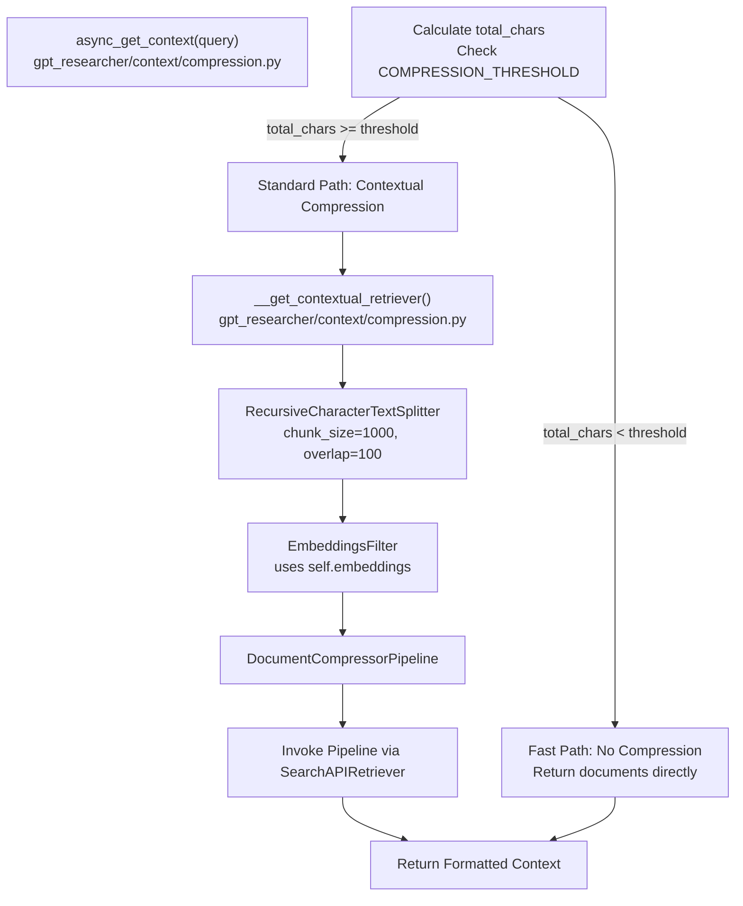
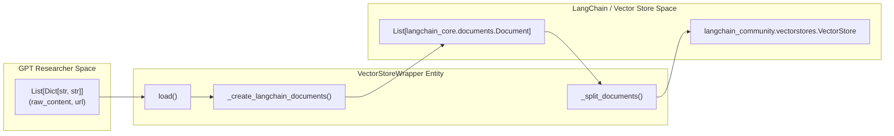

<!-- source: DeepWiki mcp.deepwiki.com · repo assafelovic/gpt-researcher · page 6.5 Embeddings and Memory System · fetched 2026-10-27 -->

# Embeddings and Memory System

<details>
<summary>Relevant source files</summary>

The following files were used as context for generating this wiki page:

- [docs/docs/gpt-researcher/llms/llms.md](docs/docs/gpt-researcher/llms/llms.md)
- [docs/docs/gpt-researcher/llms/supported-llms.md](docs/docs/gpt-researcher/llms/supported-llms.md)
- [gpt_researcher/__init__.py](gpt_researcher/__init__.py)
- [gpt_researcher/actions/__init__.py](gpt_researcher/actions/__init__.py)
- [gpt_researcher/context/__init__.py](gpt_researcher/context/__init__.py)
- [gpt_researcher/context/compression.py](gpt_researcher/context/compression.py)
- [gpt_researcher/context/retriever.py](gpt_researcher/context/retriever.py)
- [gpt_researcher/llm_provider/generic/base.py](gpt_researcher/llm_provider/generic/base.py)
- [gpt_researcher/memory/embeddings.py](gpt_researcher/memory/embeddings.py)
- [gpt_researcher/vector_store/__init__.py](gpt_researcher/vector_store/__init__.py)
- [gpt_researcher/vector_store/vector_store.py](gpt_researcher/vector_store/vector_store.py)

</details>


This document covers the embedding generation infrastructure in GPT Researcher, including the `Memory` class, supported embedding providers, configuration mechanisms, and integration with context compression. For LLM provider architecture, see [6.1](). For context compression implementation details, see [9.3](). For vector store integration, see [7.6]().

## Purpose and Scope

The embeddings and memory system provides a unified interface for generating document embeddings across 19+ providers, enabling semantic similarity search, context compression, and retrieval-augmented generation (RAG). The system abstracts provider-specific implementations while maintaining consistent configuration patterns and lazy dependency loading.

---

## Memory Class Architecture

The `Memory` class [gpt_researcher/memory/embeddings.py:56-202]() serves as the central factory for embedding generation, implementing a match-case pattern to instantiate provider-specific LangChain embedding classes.

### Class Structure

```
Memory.__init__(embedding_provider: str, model: str, **embedding_kwargs)
├── Match embedding_provider
│   ├── case "openai" → OpenAIEmbeddings
│   ├── case "azure_openai" → AzureOpenAIEmbeddings
│   ├── case "cohere" → CohereEmbeddings
│   ├── case "google_vertexai" → VertexAIEmbeddings
│   ├── case "google_genai" → GoogleGenerativeAIEmbeddings
│   ├── case "ollama" → OllamaEmbeddings
│   └── ... (19+ total providers)
└── self._embeddings ← Configured embedding instance
```

The class provides a public method `get_embeddings()` [gpt_researcher/memory/embeddings.py:196-202]() that returns the configured LangChain embeddings instance for downstream use.

**Diagram: Memory Class Provider Instantiation**

```mermaid
graph TB
    subgraph "Memory Class Factory"
        MemoryInit["Memory.__init__()<br/>gpt_researcher/memory/embeddings.py"]
        MatchCase["match embedding_provider"]
        EmbeddingsAttr["self._embeddings"]
        GetMethod["get_embeddings()"]
    end
    
    subgraph "Provider Cases"
        OpenAI["case 'openai'<br/>langchain_openai.OpenAIEmbeddings"]
        AzureOpenAI["case 'azure_openai'<br/>langchain_openai.AzureOpenAIEmbeddings"]
        Cohere["case 'cohere'<br/>langchain_cohere.CohereEmbeddings"]
        GoogleVertex["case 'google_vertexai'<br/>langchain_google_vertexai.VertexAIEmbeddings"]
        GoogleGenAI["case 'google_genai'<br/>langchain_google_genai.GoogleGenerativeAIEmbeddings"]
        Ollama["case 'ollama'<br/>langchain_ollama.OllamaEmbeddings"]
        Huggingface["case 'huggingface'<br/>langchain_huggingface.HuggingFaceEmbeddings"]
        Nomic["case 'nomic'<br/>langchain_nomic.NomicEmbeddings"]
        Voyageai["case 'voyageai'<br/>langchain_voyageai.VoyageAIEmbeddings"]
        Dashscope["case 'dashscope'<br/>langchain_community.embeddings.DashScopeEmbeddings"]
        Bedrock["case 'bedrock'<br/>langchain_aws.embeddings.BedrockEmbeddings"]
        Custom["case 'custom'<br/>OpenAIEmbeddings<br/>custom base_url"]
        Other["... 7 more providers"]
    end
    
    subgraph "Downstream Usage"
        ContextCompressor["ContextCompressor<br/>gpt_researcher/context/compression.py"]
        VectorStore["VectorStoreWrapper<br/>gpt_researcher/vector_store/vector_store.py"]
        EmbeddingsFilter["langchain.EmbeddingsFilter"]
    end
    
    MemoryInit --> MatchCase
    MatchCase --> OpenAI
    MatchCase --> AzureOpenAI
    MatchCase --> Cohere
    MatchCase --> GoogleVertex
    MatchCase --> GoogleGenAI
    MatchCase --> Ollama
    MatchCase --> Huggingface
    MatchCase --> Nomic
    MatchCase --> Voyageai
    MatchCase --> Dashscope
    MatchCase --> Bedrock
    MatchCase --> Custom
    MatchCase --> Other
    
    OpenAI --> EmbeddingsAttr
    AzureOpenAI --> EmbeddingsAttr
    Cohere --> EmbeddingsAttr
    GoogleVertex --> EmbeddingsAttr
    GoogleGenAI --> EmbeddingsAttr
    Ollama --> EmbeddingsAttr
    Huggingface --> EmbeddingsAttr
    Nomic --> EmbeddingsAttr
    Voyageai --> EmbeddingsAttr
    Dashscope --> EmbeddingsAttr
    Bedrock --> EmbeddingsAttr
    Custom --> EmbeddingsAttr
    Other --> EmbeddingsAttr
    
    EmbeddingsAttr --> GetMethod
    GetMethod --> ContextCompressor
    GetMethod --> VectorStore
    GetMethod --> EmbeddingsFilter
```



Sources: [gpt_researcher/memory/embeddings.py:56-202](), [gpt_researcher/context/compression.py:98-120](), [gpt_researcher/vector_store/vector_store.py:10-15]()

---

## Supported Embedding Providers

The system supports 20+ embedding providers defined in `_SUPPORTED_PROVIDERS` [gpt_researcher/memory/embeddings.py:32-53]():

| Provider | Case Name | LangChain Class | Environment Variables |
|----------|-----------|-----------------|----------------------|
| OpenAI | `openai` | `OpenAIEmbeddings` | `OPENAI_API_KEY`, `OPENAI_BASE_URL` (optional) |
| Azure OpenAI | `azure_openai` | `AzureOpenAIEmbeddings` | `AZURE_OPENAI_API_KEY`, `AZURE_OPENAI_ENDPOINT`, `AZURE_OPENAI_API_VERSION` |
| Cohere | `cohere` | `CohereEmbeddings` | `COHERE_API_KEY` |
| GigaChat | `gigachat` | `GigaChatEmbeddings` | `GIGACHAT_API_KEY` |
| Google Vertex AI | `google_vertexai` | `VertexAIEmbeddings` | GCP credentials |
| Google Generative AI | `google_genai` | `GoogleGenerativeAIEmbeddings` | `GOOGLE_API_KEY` |
| Fireworks | `fireworks` | `FireworksEmbeddings` | `FIREWORKS_API_KEY` |
| Ollama | `ollama` | `OllamaEmbeddings` | `OLLAMA_BASE_URL` |
| Together AI | `together` | `TogetherEmbeddings` | `TOGETHER_API_KEY` |
| NetMind | `netmind` | `NetmindEmbeddings` | `NETMIND_API_KEY` |
| Mistral AI | `mistralai` | `MistralAIEmbeddings` | `MISTRAL_API_KEY` |
| HuggingFace | `huggingface` | `HuggingFaceEmbeddings` | `HUGGINGFACE_API_KEY` |
| Nomic | `nomic` | `NomicEmbeddings` | `NOMIC_API_KEY` |
| Voyage AI | `voyageai` | `VoyageAIEmbeddings` | `VOYAGE_API_KEY` |
| DashScope | `dashscope` | `DashScopeEmbeddings` | `DASHSCOPE_API_KEY` |
| AWS Bedrock | `bedrock` | `BedrockEmbeddings` | AWS credentials |
| AIML API | `aimlapi` | `OpenAIEmbeddings` | `AIMLAPI_API_KEY`, `AIMLAPI_BASE_URL` |
| OpenRouter | `openrouter` | `OpenAIEmbeddings` | `OPENROUTER_API_KEY` |
| Custom | `custom` | `OpenAIEmbeddings` | `OPENAI_API_KEY`, `OPENAI_BASE_URL` |
| MiniMax | `minimax` | `OpenAIEmbeddings` | `MINIMAX_API_KEY`, `MINIMAX_BASE_URL` |

### Provider-Specific Implementation Examples

**OpenAI** [gpt_researcher/memory/embeddings.py:100-107]():
```python
case "openai":
    from langchain_openai import OpenAIEmbeddings

    # Support custom OpenAI-compatible APIs via OPENAI_BASE_URL
    if "openai_api_base" not in embedding_kwargs and os.environ.get("OPENAI_BASE_URL"):
        embedding_kwargs["openai_api_base"] = os.environ["OPENAI_BASE_URL"]

    _embeddings = OpenAIEmbeddings(model=model, **embedding_kwargs)
```

**Azure OpenAI** [gpt_researcher/memory/embeddings.py:108-120]():
```python
case "azure_openai":
    from langchain_openai import AzureOpenAIEmbeddings

    _embeddings = AzureOpenAIEmbeddings(
        model=model,
        azure_endpoint=os.environ["AZURE_OPENAI_ENDPOINT"],
        openai_api_key=os.environ["AZURE_OPENAI_API_KEY"],
        openai_api_version=os.environ.get(
            "AZURE_OPENAI_API_VERSION",
            os.environ.get("OPENAI_API_VERSION"),
        ),
        **embedding_kwargs,
    )
```

Sources: [gpt_researcher/memory/embeddings.py:32-53](), [gpt_researcher/memory/embeddings.py:86-192]()

---

## Integration with Context Compression

The embedding system is central to the context compression pipeline, which reduces the token count of retrieved web pages to fit LLM context windows while preserving relevance.

### ContextCompressor Class

The `ContextCompressor` [gpt_researcher/context/compression.py:85-179]() uses embeddings to filter document chunks based on their semantic similarity to the research query.

**Optimization Strategy**: To improve performance, the compressor calculates the total character count of the input documents. If the total size is below the `COMPRESSION_THRESHOLD` (default: 8000 characters) and the document count is low, it skips the expensive embedding-based pipeline and returns the documents directly [gpt_researcher/context/compression.py:158-171]().

**Diagram: Context Compression Logic Flow**



### WrittenContentCompressor Class

The `WrittenContentCompressor` [gpt_researcher/context/compression.py:181-235]() is specialized for multi-agent workflows where the system needs to retrieve relevant sections from previously written report content. It uses the `SectionRetriever` [gpt_researcher/context/retriever.py:37-67]() as its base retriever.

Sources: [gpt_researcher/context/compression.py:85-235](), [gpt_researcher/context/retriever.py:13-67]()

---

## Vector Store Integration

### VectorStoreWrapper Class

The `VectorStoreWrapper` [gpt_researcher/vector_store/vector_store.py:10-43]() provides a bridge between GPT Researcher's internal document formats and LangChain's vector store interfaces.

| Function | Code Entity | Description |
|----------|-------------|-------------|
| Loading | `load(documents)` | Converts researcher dicts to LangChain `Document` objects and adds them to the store. |
| Conversion | `_create_langchain_documents()` | Maps `raw_content` and `url` from researcher data to LangChain metadata. |
| Splitting | `_split_documents()` | Uses `RecursiveCharacterTextSplitter` with 1000 chunk size and 200 overlap. |
| Search | `asimilarity_search()` | Asynchronous similarity search against the underlying vector store. |

**Diagram: Code Entity Data Flow (Documents to Vector Store)**



Sources: [gpt_researcher/vector_store/vector_store.py:10-43]()

---

## Configuration and Environment Variables

The embedding system is configured primarily via the `EMBEDDING` environment variable.

| Variable | Example | Description |
|----------|---------|-------------|
| `EMBEDDING` | `openai:text-embedding-3-small` | Primary config in `<provider>:<model>` format. |
| `SIMILARITY_THRESHOLD` | `0.35` | Minimum similarity score for context compression [gpt_researcher/context/compression.py:119](). |
| `COMPRESSION_THRESHOLD` | `8000` | Character count below which compression is skipped [gpt_researcher/context/compression.py:159](). |
| `OPENAI_EMBEDDING_MODEL` | `text-embedding-3-small` | Default model if provider is OpenAI [gpt_researcher/memory/embeddings.py:28-30](). |
| `MAX_CONTENT_CHARS` | `50000` | Maximum characters of raw content to embed per document [gpt_researcher/context/retriever.py:13](). |

### Usage Examples

**Azure OpenAI Setup** [docs/docs/gpt-researcher/llms/llms.md:92-103]():
```env
AZURE_OPENAI_API_KEY=[Your Key]
AZURE_OPENAI_ENDPOINT=https://{your-endpoint}.openai.azure.com/
OPENAI_API_VERSION=2024-05-01-preview
EMBEDDING=azure_openai:text-embedding-3-large
```

**Ollama Local Setup** [docs/docs/gpt-researcher/llms/llms.md:113-118]():
```env
OLLAMA_BASE_URL=http://localhost:11434
EMBEDDING=ollama:nomic-embed-text
```

Sources: [gpt_researcher/memory/embeddings.py:28-30](), [gpt_researcher/context/compression.py:119-159](), [docs/docs/gpt-researcher/llms/llms.md:1-120](), [gpt_researcher/context/retriever.py:13]()

---

