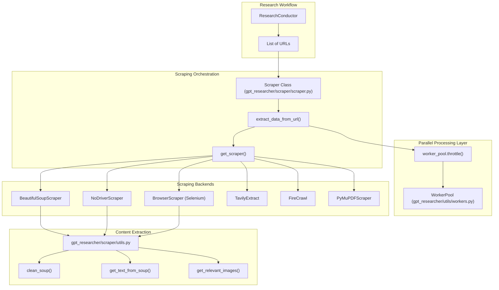
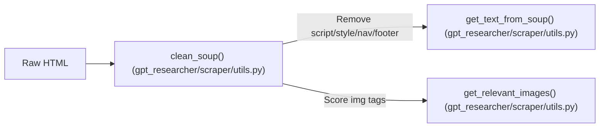

<!-- source: DeepWiki mcp.deepwiki.com · repo assafelovic/gpt-researcher · page 7.2 Web Scraping System · fetched 2026-10-27 -->

# Web Scraping System

Relevant source files

The following files were used as context for generating this wiki page:

- [docs/docs/gpt-researcher/getting-started/linux-deployment.md](docs/docs/gpt-researcher/getting-started/linux-deployment.md)
- [docs/docs/gpt-researcher/gptr/automated-tests.md](docs/docs/gpt-researcher/gptr/automated-tests.md)
- [docs/docs/gpt-researcher/gptr/example.md](docs/docs/gpt-researcher/gptr/example.md)
- [docs/docs/gpt-researcher/gptr/scraping.md](docs/docs/gpt-researcher/gptr/scraping.md)
- [docs/docs/gpt-researcher/gptr/troubleshooting.md](docs/docs/gpt-researcher/gptr/troubleshooting.md)
- [gpt_researcher/actions/web_scraping.py](gpt_researcher/actions/web_scraping.py)
- [gpt_researcher/scraper/__init__.py](gpt_researcher/scraper/__init__.py)
- [gpt_researcher/scraper/beautiful_soup/beautiful_soup.py](gpt_researcher/scraper/beautiful_soup/beautiful_soup.py)
- [gpt_researcher/scraper/browser/__init__.py](gpt_researcher/scraper/browser/__init__.py)
- [gpt_researcher/scraper/browser/browser.py](gpt_researcher/scraper/browser/browser.py)
- [gpt_researcher/scraper/browser/js/overlay.js](gpt_researcher/scraper/browser/js/overlay.js)
- [gpt_researcher/scraper/browser/nodriver_scraper.py](gpt_researcher/scraper/browser/nodriver_scraper.py)
- [gpt_researcher/scraper/browser/processing/__init__.py](gpt_researcher/scraper/browser/processing/__init__.py)
- [gpt_researcher/scraper/browser/processing/html.py](gpt_researcher/scraper/browser/processing/html.py)
- [gpt_researcher/scraper/browser/processing/scrape_skills.py](gpt_researcher/scraper/browser/processing/scrape_skills.py)
- [gpt_researcher/scraper/scraper.py](gpt_researcher/scraper/scraper.py)
- [gpt_researcher/scraper/tavily_extract/__init__.py](gpt_researcher/scraper/tavily_extract/__init__.py)
- [gpt_researcher/scraper/tavily_extract/tavily_extract.py](gpt_researcher/scraper/tavily_extract/tavily_extract.py)
- [gpt_researcher/scraper/utils.py](gpt_researcher/scraper/utils.py)
- [gpt_researcher/scraper/web_base_loader/web_base_loader.py](gpt_researcher/scraper/web_base_loader/web_base_loader.py)
- [gpt_researcher/utils/logger.py](gpt_researcher/utils/logger.py)

## Purpose and Scope

The Web Scraping System is responsible for fetching and extracting content from URLs during the research process. This system supports multiple scraping backends, ranging from static HTML parsing to dynamic browser rendering and professional-grade extraction APIs. It utilizes a `WorkerPool` for parallel URL processing and includes intelligent image extraction and deduplication mechanisms.

## Architecture Overview

The web scraping system is built around three core components that work together to efficiently scrape content from multiple URLs in parallel:

**Sources:** [gpt_researcher/scraper/scraper.py:30-195](), [gpt_researcher/scraper/utils.py:1-133](), [gpt_researcher/actions/web_scraping.py:12-42]()

## Scraper Implementation

The `Scraper` class [gpt_researcher/scraper/scraper.py:30]() is the central coordinator for individual URL extraction. It is typically invoked via the `scrape_urls` action [gpt_researcher/actions/web_scraping.py:12-42]().

### URL Deduplication and Throttling
Upon initialization, the `Scraper` removes duplicate URLs to avoid redundant network requests by creating a dictionary from keys to preserve order while ensuring uniqueness [gpt_researcher/scraper/scraper.py:42](). During execution, it uses `self.worker_pool.throttle()` to ensure that concurrent requests stay within the configured limits of the `WorkerPool` [gpt_researcher/scraper/scraper.py:112]().

### Scraper Selection Logic
The `get_scraper` method [gpt_researcher/scraper/scraper.py:171]() determines the appropriate backend based on the URL suffix or domain:
- **PDFs**: `PyMuPDFScraper` [gpt_researcher/scraper/scraper.py:189]()
- **Arxiv**: `ArxivScraper` [gpt_researcher/scraper/scraper.py:190]()
- **Default**: Selected via the `self.scraper` attribute, which is passed from the configuration (defaults to `bs` for BeautifulSoup) [gpt_researcher/scraper/scraper.py:191]().

**Sources:** [gpt_researcher/scraper/scraper.py:41-195](), [gpt_researcher/actions/web_scraping.py:34-35]()

## Scraping Backends

The system provides a modular set of scrapers that all follow a similar interface, returning a tuple of `(content, image_urls, title)`.

### BeautifulSoup (Static)
The `BeautifulSoupScraper` [gpt_researcher/scraper/beautiful_soup/beautiful_soup.py:6]() is the lightweight default. It fetches the page via `self.session.get`, parses it with `lxml`, cleans the HTML using `clean_soup`, and extracts text and images [gpt_researcher/scraper/beautiful_soup/beautiful_soup.py:24-38]().

### NoDriver (Dynamic)
The `NoDriverScraper` [gpt_researcher/scraper/browser/nodriver_scraper.py:16]() provides high-performance dynamic scraping using the `zendriver` package [gpt_researcher/scraper/browser/nodriver_scraper.py:141]().
- **Load Balancing**: It manages a pool of browser instances (`max_browsers = 5`), routing requests to the browser with the lowest `processing_count` [gpt_researcher/scraper/browser/nodriver_scraper.py:18-21](), [gpt_researcher/scraper/browser/nodriver_scraper.py:163]().
- **Rate Limiting**: Implements `rate_limit_for_domain` using `asyncio.Semaphore` per domain to prevent aggressive hitting of single hosts [gpt_researcher/scraper/browser/nodriver_scraper.py:108-122]().
- **Interaction**: Automatically scrolls pages using `scroll_page_to_bottom` to trigger lazy-loading of content [gpt_researcher/scraper/browser/nodriver_scraper.py:59-80]().

### BrowserScraper (Selenium)
The `BrowserScraper` [gpt_researcher/scraper/browser/browser.py:24]() uses Selenium for full browser emulation. It supports Chrome, Firefox, and Safari [gpt_researcher/scraper/browser/browser.py:86-90](), handles cookie persistence via pickle files [gpt_researcher/scraper/browser/browser.py:121-130](), and can run in headless mode [gpt_researcher/scraper/browser/browser.py:94]().

### Production APIs (Tavily & FireCrawl)
For high-scale use cases, the system supports `TavilyExtract` and `FireCrawl` [gpt_researcher/scraper/scraper.py:49-52](). These require external API keys and handle anti-bot measures automatically [docs/docs/gpt-researcher/gptr/scraping.md:84-134]().

**Sources:** [gpt_researcher/scraper/browser/nodriver_scraper.py:16-173](), [gpt_researcher/scraper/browser/browser.py:24-119](), [gpt_researcher/scraper/beautiful_soup/beautiful_soup.py:6-42](), [docs/docs/gpt-researcher/gptr/scraping.md:7-35]()

## Content Extraction and Cleaning

Extraction utilities are centralized in `gpt_researcher/scraper/utils.py` to ensure consistency across different scraping backends.

- **Cleaning**: `clean_soup` removes `script`, `style`, `footer`, `header`, `nav`, `menu`, `sidebar`, and `svg` tags [gpt_researcher/scraper/utils.py:95-109](). It also decomposes elements with disallowed classes [gpt_researcher/scraper/utils.py:111-123]().
- **Text Extraction**: `get_text_from_soup` uses `soup.get_text`, strips whitespace, and normalizes multiple spaces into a single space [gpt_researcher/scraper/utils.py:128-133]().
- **Image Scoring**: `get_relevant_images` scores images based on class names (e.g., "header", "featured", "hero" get 4 points) and dimensions parsed via `parse_dimension` [gpt_researcher/scraper/utils.py:16-52]().

**Sources:** [gpt_researcher/scraper/utils.py:16-133]()

## Image Selection and Deduplication

Images are processed to ensure only high-quality, unique visual content is returned to the researcher.

1. **Deduplication**: The system uses `get_image_hash` [gpt_researcher/scraper/utils.py:73]() which calculates an MD5 hash based on the image filename and essential query parameters [gpt_researcher/scraper/utils.py:89]().
2. **Ranking**: Images are extracted and stored with their calculated scores [gpt_researcher/scraper/utils.py:47](). The `get_relevant_images` function sorts them and returns the top 10 candidates per page [gpt_researcher/scraper/utils.py:49-52]().

**Sources:** [gpt_researcher/scraper/utils.py:16-52](), [gpt_researcher/scraper/utils.py:73-92]()

## Configuration Parameters

The behavior of the scraping system is controlled via the `Config` class and environment variables.

| Parameter | Environment Variable | Default | Description |
|-----------|---------------------|---------|-------------|
| `scraper` | `SCRAPER` | `"bs"` | Backend selection: `bs`, `browser`, `nodriver`, `tavily_extract`, `firecrawl` |
| `max_scraper_workers` | `MAX_SCRAPER_WORKERS` | `8` | Maximum concurrent scraping tasks in the `WorkerPool` |
| `scraper_rate_limit_delay` | `SCRAPER_RATE_LIMIT_DELAY` | `0.1` | Throttle delay between worker tasks |

**Sources:** [docs/docs/gpt-researcher/gptr/scraping.md:7-35](), [gpt_researcher/scraper/browser/nodriver_scraper.py:18-19](), [gpt_researcher/actions/web_scraping.py:12-35]()

---

