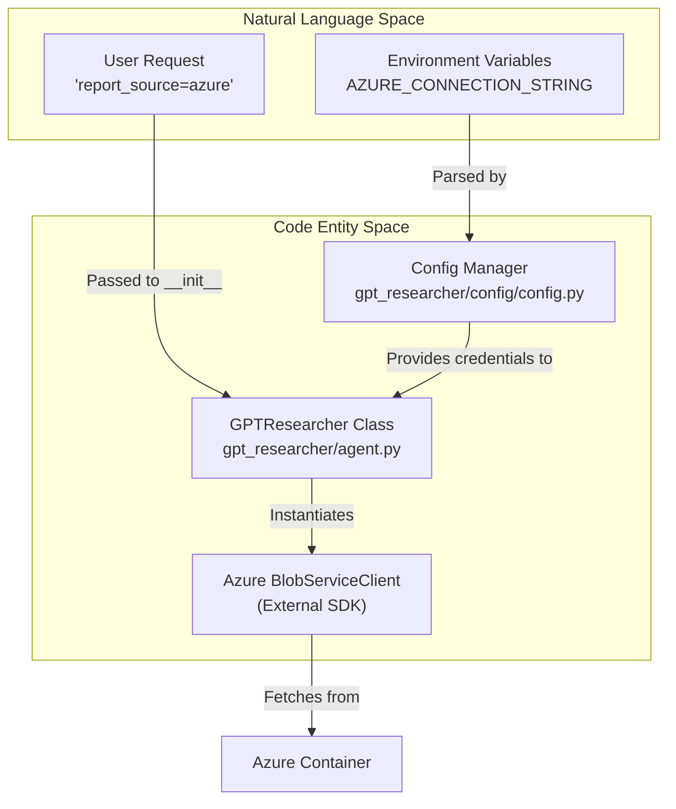
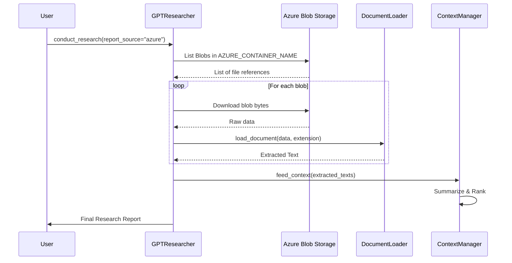

<!-- source: DeepWiki mcp.deepwiki.com · repo assafelovic/gpt-researcher · page 7.4 Cloud Storage Integration · fetched 2026-10-27 -->

# Cloud Storage Integration

<details>
<summary>Relevant source files</summary>

The following files were used as context for generating this wiki page:

- [.env.example](.env.example)
- [docs/docs/gpt-researcher/context/azure-storage.md](docs/docs/gpt-researcher/context/azure-storage.md)
- [docs/docs/gpt-researcher/context/local-docs.md](docs/docs/gpt-researcher/context/local-docs.md)
- [docs/docs/gpt-researcher/getting-started/getting-started-with-docker.md](docs/docs/gpt-researcher/getting-started/getting-started-with-docker.md)
- [docs/docs/gpt-researcher/gptr/claude-skill.md](docs/docs/gpt-researcher/gptr/claude-skill.md)
- [docs/sidebars.js](docs/sidebars.js)
- [gpt_researcher/actions/retriever.py](gpt_researcher/actions/retriever.py)
- [gpt_researcher/retrievers/__init__.py](gpt_researcher/retrievers/__init__.py)
- [gpt_researcher/retrievers/openalex/__init__.py](gpt_researcher/retrievers/openalex/__init__.py)
- [gpt_researcher/retrievers/openalex/openalex.py](gpt_researcher/retrievers/openalex/openalex.py)
- [gpt_researcher/retrievers/utils.py](gpt_researcher/retrievers/utils.py)
- [gpt_researcher/retrievers/xquik/__init__.py](gpt_researcher/retrievers/xquik/__init__.py)
- [gpt_researcher/retrievers/xquik/xquik.py](gpt_researcher/retrievers/xquik/xquik.py)

</details>


## Purpose and Scope

This document describes the Azure Blob Storage integration as a cloud-based document source for GPT Researcher. Azure storage provides an alternative to local file storage when documents need to be accessed from cloud infrastructure, enabling distributed deployments and centralized document management. This integration allows the research agent to treat a cloud container as its primary knowledge base for report generation.

Sources: [docs/docs/gpt-researcher/context/azure-storage.md:1-4]()

---

## Configuration Requirements

Azure Blob Storage integration requires specific environment variables and an additional Python dependency to interact with the Azure SDK.

### Environment Variables

To enable the connection, the following variables must be defined in the `.env` file at the repository root:

| Variable | Purpose | Example |
|----------|---------|---------|
| `AZURE_CONNECTION_STRING` | The full connection string for the Azure Storage account. | `DefaultEndpointsProtocol=https;AccountName=...` |
| `AZURE_CONTAINER_NAME` | The specific blob container where research documents are stored. | `research-docs` |

Sources: [docs/docs/gpt-researcher/context/azure-storage.md:5-10](), [.env.example:1-4]()

### Dependency Installation

The `azure-storage-blob` package is required and should be added to your environment:

```bash
pip install azure-storage-blob
```

Sources: [docs/docs/gpt-researcher/context/azure-storage.md:12-16]()

---

## Code Entity Space: Integration Architecture

The following diagram bridges the natural language concept of "Cloud Storage" to the specific code entities and parameters used in the `gpt-researcher` codebase.

### Entity Mapping: Request to Storage Client


**Implementation Detail**: When `report_source` is set to `"azure"`, the system bypasses standard web retrievers (like `TavilySearch` or `GoogleSearch`) and instead routes the data acquisition logic to the Azure storage account defined in the configuration.

Sources: [docs/docs/gpt-researcher/context/azure-storage.md:18-26](), [gpt_researcher/actions/retriever.py:149-156](), [gpt_researcher/retrievers/__init__.py:1-17]()

---

## Data Flow and Retrieval Workflow

The retrieval process transforms raw blobs into structured context for the LLM.

### Document Processing Pipeline


**Key Functions**:
- **`GPTResearcher.__init__`**: Captures the `report_source="azure"` parameter which determines the data retrieval strategy.
- **`DocumentLoader`**: Processes the downloaded bytes. It supports PDF, plain text, CSV, Excel, Markdown, PowerPoint, and Word documents.

Sources: [docs/docs/gpt-researcher/context/azure-storage.md:18-26](), [docs/docs/gpt-researcher/context/local-docs.md:5-6]()

---

## Usage Patterns

### Python API Integration
To trigger the cloud storage workflow programmatically, instantiate the researcher with the `azure` source:

```python
from gpt_researcher import GPTResearcher

# Initialize with azure source
researcher = GPTResearcher(
    query="Analysis of internal project documents",
    report_type="research_report",
    report_source="azure"
)

# Conduct research (downloads from Azure)
await researcher.conduct_research()
# Write report based on cloud context
report = await researcher.write_report()
```

Sources: [docs/docs/gpt-researcher/context/azure-storage.md:20-26]()

### Frontend Configuration
In the NextJS or Vanilla JS frontends, the Azure integration is exposed via the "Report Source" dropdown.

1. **NextJS**: Users select "Azure" in the Settings Modal, which sends a WebSocket payload with `report_source: "azure"`.
2. **Vanilla JS**: The relevant input field or dropdown updates the JSON payload sent to the `/ws` endpoint.

Sources: [docs/docs/gpt-researcher/context/local-docs.md:14-15]()

---

## Comparison of Document Sources

The system distinguishes between local, vector, and cloud sources through the `report_source` parameter.

| Parameter Value | Data Source | Key Config | Primary Use Case |
|-----------------|-------------|------------|------------------|
| `local` | Local Filesystem | `DOC_PATH` | Researching local PDFs/Docs |
| `azure` | Azure Blob Storage | `AZURE_CONNECTION_STRING` | Enterprise cloud document silos |
| `langchain_vectorstore` | Vector Database | `vector_store` object | Querying existing embeddings |
| `web` | Search Engines | `RETRIEVER` | Public internet research |

**Note**: When using `report_source="azure"`, the system specifically targets the container documents. This differs from `langchain_vectorstore` which expects a pre-populated database that implements similarity searches.

Sources: [docs/docs/gpt-researcher/context/azure-storage.md:18-26](), [docs/docs/gpt-researcher/context/local-docs.md:7-15](), [.env.example:4-4]()

---

## Supported File Formats

The Azure integration leverages the same `DocumentLoader` logic as local documents, supporting:
- **PDF**: Portable Document Format
- **Text**: `.txt`, `.md`
- **Structured**: `.csv`, `.xlsx` (Excel)
- **Office**: `.docx` (Word), `.pptx` (PowerPoint)

Sources: [docs/docs/gpt-researcher/context/local-docs.md:5-6]()

---

