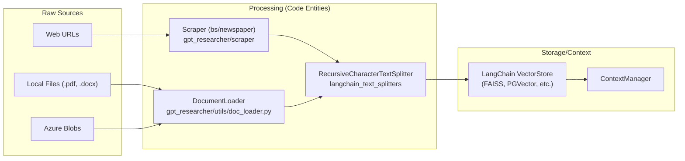

<!-- source: DeepWiki mcp.deepwiki.com · repo assafelovic/gpt-researcher · page 7.7 Report Source Modes · fetched 2026-10-27 -->

# Report Source Modes

<details>
<summary>Relevant source files</summary>

The following files were used as context for generating this wiki page:

- [backend/requirements.txt](backend/requirements.txt)
- [docs/docs/examples/examples.ipynb](docs/docs/examples/examples.ipynb)
- [docs/docs/gpt-researcher/context/azure-storage.md](docs/docs/gpt-researcher/context/azure-storage.md)
- [docs/docs/gpt-researcher/context/data-ingestion.md](docs/docs/gpt-researcher/context/data-ingestion.md)
- [docs/docs/gpt-researcher/context/local-docs.md](docs/docs/gpt-researcher/context/local-docs.md)
- [docs/docs/gpt-researcher/context/vector-stores.md](docs/docs/gpt-researcher/context/vector-stores.md)
- [docs/docs/gpt-researcher/getting-started/getting-started-with-docker.md](docs/docs/gpt-researcher/getting-started/getting-started-with-docker.md)
- [docs/docs/gpt-researcher/gptr/claude-skill.md](docs/docs/gpt-researcher/gptr/claude-skill.md)
- [docs/docs/gpt-researcher/gptr/config.md](docs/docs/gpt-researcher/gptr/config.md)
- [docs/sidebars.js](docs/sidebars.js)
- [gpt_researcher/actions/query_processing.py](gpt_researcher/actions/query_processing.py)
- [gpt_researcher/config/variables/base.py](gpt_researcher/config/variables/base.py)
- [gpt_researcher/config/variables/default.py](gpt_researcher/config/variables/default.py)
- [tests/docs/doc.pdf](tests/docs/doc.pdf)
- [tests/vector-store.py](tests/vector-store.py)

</details>


## Purpose and Scope

This document describes the `REPORT_SOURCE` configuration parameter in GPT Researcher, which determines the data origin for the research agent. The system supports six distinct source modes: web search, local documents, hybrid (web + local), Azure Blob Storage, LangChain documents, and LangChain vector stores. This parameter dictates how the `ResearchConductor` gathers context and whether it triggers external search queries or internal document processing.

## Available Report Source Modes

The system defaults to `web` research, but can be configured to use local or cloud-based document stores.

| Mode | Configuration Value | Data Source | Use Case |
|------|---------------------|-------------|----------|
| **Web** | `"web"` | Web search APIs (Tavily, Google, etc.) | Default mode for real-time online research. |
| **Local** | `"local"` | Local file system documents | Research from private/proprietary documents in `DOC_PATH`. |
| **Hybrid** | `"hybrid"` | Local documents + Web search | Combine internal knowledge with real-time external data. |
| **Azure** | `"azure"` | Azure Blob Storage containers | Enterprise document storage integration. |
| **LangChain Documents** | `"langchain_documents"` | Pre-loaded LangChain `Document` objects | Custom document preprocessing or external ingestion pipelines. |
| **LangChain VectorStore** | `"langchain_vectorstore"` | Existing LangChain vector store | Research directly from pre-indexed document collections. |

Sources: [gpt_researcher/config/variables/default.py:29-30](), [gpt_researcher/config/variables/base.py:31-32](), [docs/docs/gpt-researcher/gptr/config.md:96-97]()

## Report Source Flow Architecture

The following diagram bridges the **Natural Language Space** (User Intent) to the **Code Entity Space** (Classes and Variables).

```mermaid
graph TB
    subgraph "Natural Language Space"
        UserIntent["User wants to research 'Local Documents'"]
    end

    subgraph "Code Entity Space"
        direction TB
        ConfigClass["Config Class<br/>gpt_researcher/config/config.py"]
        AgentClass["GPTResearcher Class<br/>gpt_researcher/agent.py"]
        DefaultVars["DEFAULT_CONFIG<br/>gpt_researcher/config/variables/default.py"]
        
        DocLoader["DocumentLoader<br/>gpt_researcher/utils/doc_loader.py"]
        VectorStore["VectorStoreWrapper<br/>gpt_researcher/utils/vector_store.py"]
        QueryProc["query_processing.py<br/>gpt_researcher/actions/query_processing.py"]
    end

    UserIntent -->|Sets report_source='local'| AgentClass
    AgentClass -->|Initializes| ConfigClass
    ConfigClass -->|Loads Defaults| DefaultVars
    
    AgentClass -->|Calls conduct_research()| SourceSwitch{"REPORT_SOURCE?"}
    
    SourceSwitch -->|'web'| QueryProc
    SourceSwitch -->|'local'| DocLoader
    SourceSwitch -->|'langchain_vectorstore'| VectorStore
    
    QueryProc -->|get_search_results| WebAPI["Search Retrievers"]
```

Sources: [gpt_researcher/config/variables/default.py:29-30](), [gpt_researcher/config/variables/base.py:31-32](), [gpt_researcher/actions/query_processing.py:12-35]()

## Configuration Methods

### Constructor Parameter
When instantiating the `GPTResearcher` class, the `report_source` argument explicitly defines the research origin.

```python
from gpt_researcher import GPTResearcher

researcher = GPTResearcher(
    query="How does the stubbornness of the Collison brothers differ from mere obstinacy?",
    report_source="langchain_vectorstore",
    vector_store=my_faiss_index  # Required for vectorstore mode
)
```

Sources: [docs/docs/gpt-researcher/context/vector-stores.md:75-81](), [docs/docs/gpt-researcher/context/local-docs.md:13-15]()

### Configuration Files and Environment
The `REPORT_SOURCE` can be set globally in a `config.json` file or via environment variables.

```json
{
  "REPORT_SOURCE": "local",
  "DOC_PATH": "./my-docs"
}
```

Sources: [gpt_researcher/config/variables/default.py:29-30](), [docs/docs/gpt-researcher/gptr/config.md:19-37]()

## Detailed Mode Implementations

### Web Mode (`"web"`)
The default mode. It uses the `RETRIEVER` (e.g., `tavily`, `duckduckgo`) to find information online.
- **Sub-query Generation**: Generates multiple search queries via `generate_sub_queries` to ensure breadth [gpt_researcher/actions/query_processing.py:37-62]().
- **Data Flow**: `get_search_results` calls the retriever's `.search()` method [gpt_researcher/actions/query_processing.py:12-35]().

### Local Mode (`"local"`)
Uses documents stored on the local filesystem.
- **Path**: Configured via `DOC_PATH` (defaults to `./my-docs`) [gpt_researcher/config/variables/default.py:30]().
- **Formats**: Supports PDF, TXT, CSV, Excel, MD, PPTX, and DOCX [docs/docs/gpt-researcher/context/local-docs.md:5-6]().

### LangChain VectorStore Mode (`"langchain_vectorstore"`)
Integrates with pre-populated vector databases.
- **Requirement**: Must provide a `vector_store` object that implements `asimilarity_search` [docs/docs/gpt-researcher/context/vector-stores.md:6-7]().
- **Optimization**: Setting `report_source="langchain_vectorstore"` prevents the agent from attempting to scrape additional web data, which avoids "contaminating" the existing vector database [docs/docs/gpt-researcher/context/vector-stores.md:9-10]().

## Data Ingestion Flow

The following diagram illustrates the transformation of raw sources into the research context used by the LLM.



Sources: [docs/docs/gpt-researcher/context/data-ingestion.md:15-28](), [docs/docs/gpt-researcher/context/vector-stores.md:61-65](), [gpt_researcher/config/variables/default.py:24-25]()

## Precedence and Defaults
The configuration system follows a strict hierarchy to resolve the active `REPORT_SOURCE`:
1. **Direct Argument**: Passed to `GPTResearcher(report_source=...)`.
2. **Custom Config**: Values in `config.json` provided via `--config_path` [docs/docs/gpt-researcher/gptr/config.md:41-44]().
3. **Environment Variables**: System-level `REPORT_SOURCE` [docs/docs/gpt-researcher/context/local-docs.md:9-11]().
4. **Hardcoded Default**: `"web"` as defined in `default.py` [gpt_researcher/config/variables/default.py:29]().

Sources: [gpt_researcher/config/variables/default.py:29-30](), [docs/docs/gpt-researcher/gptr/config.md:16-18]()

---

