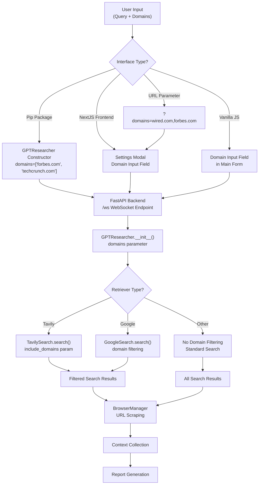
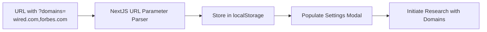
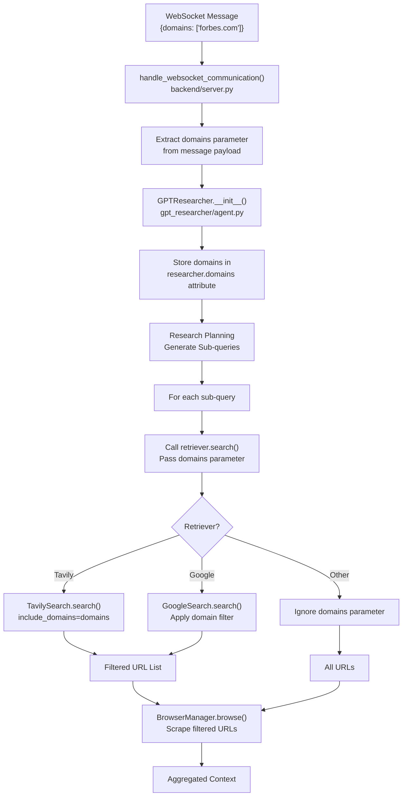

<!-- source: DeepWiki mcp.deepwiki.com · repo assafelovic/gpt-researcher · page 7.8 Domain Filtering · fetched 2026-10-27 -->

# Domain Filtering

<details>
<summary>Relevant source files</summary>

The following files were used as context for generating this wiki page:

- [docs/docs/gpt-researcher/context/filtering-by-domain.md](docs/docs/gpt-researcher/context/filtering-by-domain.md)
- [docs/docs/gpt-researcher/frontend/embed-script.md](docs/docs/gpt-researcher/frontend/embed-script.md)
- [docs/docs/gpt-researcher/gptr/querying-the-backend.md](docs/docs/gpt-researcher/gptr/querying-the-backend.md)
- [frontend/nextjs/public/embed.js](frontend/nextjs/public/embed.js)
- [frontend/nextjs/src/utils/imageTransformPlugin.js](frontend/nextjs/src/utils/imageTransformPlugin.js)

</details>


## Purpose and Scope

This document explains the domain filtering feature in GPT Researcher, which allows users to restrict web search results to specific domains. Domain filtering helps focus research on trusted or specialized sources, improving result quality and relevance.

For information about configuring search retrievers generally, see [Retriever System](#7.1). For details on report source modes, see [Report Source Modes](#7.7). For web scraping implementation details, see [Web Scraping System](#7.2).

---

## Overview

Domain filtering restricts web search results to user-specified domains during the research process. This feature is currently supported for **Tavily** and **Google Search** retrievers. When enabled, the research system will only retrieve and scrape content from the specified domains, ensuring focused and domain-specific research outcomes.

**Key Characteristics:**
- Supported retrievers: Tavily, Google Search [docs/docs/gpt-researcher/context/filtering-by-domain.md:3-5]()
- Available across all interfaces: pip package, NextJS frontend, Vanilla JS frontend, URL parameters [docs/docs/gpt-researcher/context/filtering-by-domain.md:22-62]()
- Accepts single or multiple domains
- Filters applied before web scraping begins

Sources: [docs/docs/gpt-researcher/context/filtering-by-domain.md:1-5]()

---

## Retriever Configuration Requirements

Domain filtering requires proper retriever configuration. The system supports two primary retrievers with domain filtering capabilities.

### Tavily Retriever Setup

To use domain filtering with Tavily, configure the following environment variables:

```bash
RETRIEVER=tavily
TAVILY_API_KEY=your_tavily_api_key
```

### Google Search Retriever Setup

To use domain filtering with Google Search, configure these environment variables:

```bash
RETRIEVER=google
GOOGLE_API_KEY=your_google_api_key
GOOGLE_CX_KEY=your_google_custom_search_engine_id
```

**Note:** The `RETRIEVER` environment variable determines which search provider handles domain filtering. The domains parameter is passed through to the configured retriever during search operations.

Sources: [docs/docs/gpt-researcher/context/filtering-by-domain.md:7-20]()

---

## Domain Filtering Across Interfaces

The domain filtering feature is accessible through multiple interfaces, each with its own syntax and configuration method.

### Domain Filtering Flow Diagram



Sources: [docs/docs/gpt-researcher/context/filtering-by-domain.md:22-62]()

---

## Pip Package Implementation

When using GPT Researcher as a pip package, domain filtering is configured through the `domains` parameter in the `GPTResearcher` constructor.

### Basic Usage

```python
from gpt_researcher import GPTResearcher

report = GPTResearcher(
    query="Latest AI Startups",
    report_type="research_report",
    report_source="web",
    domains=["forbes.com", "techcrunch.com"]
)
```

### Parameter Specification

| Parameter | Type | Required | Description |
|-----------|------|----------|-------------|
| `query` | `str` | Yes | Research query |
| `report_type` | `str` | Yes | Type of report to generate |
| `report_source` | `str` | Yes | Must be `"web"` for domain filtering [docs/docs/gpt-researcher/context/filtering-by-domain.md:30-31]() |
| `domains` | `List[str]` | No | List of domains to filter by [docs/docs/gpt-researcher/context/filtering-by-domain.md:31-32]() |

**Important:** The `report_source` must be set to `"web"` for domain filtering to apply. Other report sources (local, azure, hybrid) retrieve content from non-web sources where domain filtering is not applicable. [docs/docs/gpt-researcher/context/filtering-by-domain.md:30-31]()

Sources: [docs/docs/gpt-researcher/context/filtering-by-domain.md:22-33]()

---

## NextJS Frontend Implementation

The NextJS frontend provides a graphical interface for domain filtering through the Settings Modal.

### Settings Modal Configuration

Users access domain filtering through the Settings Modal UI component:

1. Open the Settings Modal
2. Locate the "Domain Filtering" section
3. Enter comma-separated domain names (e.g., `forbes.com, techcrunch.com`) [docs/docs/gpt-researcher/context/filtering-by-domain.md:37-39]()
4. Settings persist in localStorage for subsequent research sessions

### Frontend State Management

The NextJS frontend stores domain configuration in the browser's localStorage, ensuring persistence across sessions. When initiating research, the frontend passes the domains array to the backend via WebSocket message.

**WebSocket Message Structure:**
```javascript
{
  task: "research query",
  report_type: "research_report",
  report_source: "web",
  domains: ["forbes.com", "techcrunch.com"],
  // ... other parameters
}
```

Sources: [docs/docs/gpt-researcher/context/filtering-by-domain.md:35-39](), [docs/docs/gpt-researcher/gptr/querying-the-backend.md:64-71]()

---

## Vanilla JS Frontend Implementation

The Vanilla JS frontend provides domain filtering through a dedicated input field in the main research form.

### Input Field Configuration

Users enter domains directly in the research form:
- Input field accepts comma-separated domain list [docs/docs/gpt-researcher/context/filtering-by-domain.md:43-45]()
- Domains are included in the WebSocket payload when research starts
- No persistence between sessions (unlike NextJS frontend)

### Form Submission Flow

When the user submits the research form, the Vanilla JS frontend constructs a WebSocket message containing the domains array and sends it to the FastAPI backend at `ws://localhost:8000/ws`. [docs/docs/gpt-researcher/gptr/querying-the-backend.md:22-25]()

Sources: [docs/docs/gpt-researcher/context/filtering-by-domain.md:41-45](), [docs/docs/gpt-researcher/gptr/querying-the-backend.md:58-89]()

---

## URL Parameter Filtering

Domain filtering can be pre-configured via URL query parameters, enabling shareable research configurations and proof-of-concept demonstrations.

### URL Parameter Syntax

**Single Domain:**
```
https://app.gptr.dev/?domains=wikipedia.org
```

**Multiple Domains (comma-separated):**
```
https://app.gptr.dev/?domains=wired.com,forbes.com,wikipedia.org
```

### Use Cases

1. **Proof of Concept Demonstrations:** Share URLs with stakeholders showcasing domain-specific research [docs/docs/gpt-researcher/context/filtering-by-domain.md:49-51]()
2. **Bookmarked Configurations:** Create bookmarks for frequently-used domain sets
3. **Embedded Applications:** Configure domain filters in embedded instances

### URL Processing Flow



**Note:** The URL parameter feature is implemented in the NextJS frontend. When the application loads with a `domains` query parameter, it automatically populates the domain filter settings. [docs/docs/gpt-researcher/context/filtering-by-domain.md:55-61]()

Sources: [docs/docs/gpt-researcher/context/filtering-by-domain.md:47-62]()

---

## Technical Implementation Details

### Backend Processing Architecture



Sources: [docs/docs/gpt-researcher/context/filtering-by-domain.md:1-62](), [docs/docs/gpt-researcher/gptr/querying-the-backend.md:31-45]()

### Data Flow Through Interfaces

The following table summarizes how domains flow from each interface to the backend:

| Interface | Input Method | Storage | Transport | Backend Receiver |
|-----------|--------------|---------|-----------|------------------|
| Pip Package | Constructor parameter | Python variable | Direct method call | `GPTResearcher.__init__()` |
| NextJS Frontend | Settings Modal | localStorage | WebSocket JSON | `handle_websocket_communication()` |
| Vanilla JS Frontend | Input field | None | WebSocket JSON | `handle_websocket_communication()` |
| URL Parameter | Query string | Parsed to localStorage | WebSocket JSON (via NextJS) | `handle_websocket_communication()` |

Sources: [docs/docs/gpt-researcher/context/filtering-by-domain.md:22-62]()

---

## Embed Script Compatibility

The embed script (`embed.js`) supports domain filtering through the host application's URL parameters. When embedding GPT Researcher in external applications, domains can be passed via query parameters.

### Embed Script URL Construction

The embed script constructs an iframe URL that can include domain parameters by checking `GPTR_API_URL` in `localStorage`. [frontend/nextjs/public/embed.js:4-15]()

```javascript
// From frontend/nextjs/public/embed.js
const iframe = document.createElement("iframe");
iframe.src = "https://gptr.app" + (parentApiUrl ? "?GPTR_API_URL=" + parentApiUrl : "");
```

The iframe loads the NextJS frontend with the specified domains, which are then processed through the standard URL parameter flow. [docs/docs/gpt-researcher/frontend/embed-script.md:8-9]()

Sources: [frontend/nextjs/public/embed.js:1-15](), [docs/docs/gpt-researcher/frontend/embed-script.md:1-28]()

---

## Domain Format Specifications

### Domain String Format

Domains must be specified as bare hostnames without protocol or path:

**Valid Formats:**
- `forbes.com`
- `techcrunch.com`
- `en.wikipedia.org`

**Invalid Formats:**
- `https://forbes.com` (includes protocol)
- `forbes.com/tech` (includes path)
- `www.forbes.com` (www prefix may work but is unnecessary)

### Multiple Domain Separator

When passing multiple domains:
- **Array format (Python):** `["forbes.com", "techcrunch.com"]` [docs/docs/gpt-researcher/context/filtering-by-domain.md:31-32]()
- **Comma-separated (URL/Frontend):** `forbes.com,techcrunch.com` [docs/docs/gpt-researcher/context/filtering-by-domain.md:59-60]()

Sources: [docs/docs/gpt-researcher/context/filtering-by-domain.md:22-62]()

---

## Limitations and Extensibility

### Current Limitations

1. **Retriever Support:** Domain filtering only works with Tavily and Google Search retrievers [docs/docs/gpt-researcher/context/filtering-by-domain.md:3-5]()
2. **Report Source Restriction:** Only applicable when `report_source="web"` [docs/docs/gpt-researcher/context/filtering-by-domain.md:30-31]()
3. **No Wildcard Support:** Subdomain wildcards (e.g., `*.wikipedia.org`) are not supported

### Future Extensibility

The documentation explicitly welcomes contributions to add domain filtering support to additional retrievers. [docs/docs/gpt-researcher/context/filtering-by-domain.md:5-6]() To add domain filtering to a new retriever:

1. Implement domain parameter handling in the retriever's `search()` method
2. Apply domain filter to search API calls or post-process results
3. Document the new capability in retriever configuration

Sources: [docs/docs/gpt-researcher/context/filtering-by-domain.md:5-6]()

---

## Configuration Summary

### Environment Variables Required

| Variable | Required For | Description |
|----------|--------------|-------------|
| `RETRIEVER` | All | Set to `tavily` or `google` [docs/docs/gpt-researcher/context/filtering-by-domain.md:9-17]() |
| `TAVILY_API_KEY` | Tavily | API key for Tavily search [docs/docs/gpt-researcher/context/filtering-by-domain.md:11-12]() |
| `GOOGLE_API_KEY` | Google | API key for Google Custom Search [docs/docs/gpt-researcher/context/filtering-by-domain.md:18-19]() |
| `GOOGLE_CX_KEY` | Google | Google Custom Search Engine ID [docs/docs/gpt-researcher/context/filtering-by-domain.md:19-20]() |

### Interface-Specific Configuration

**Pip Package:**
- Pass `domains` list to `GPTResearcher()` constructor [docs/docs/gpt-researcher/context/filtering-by-domain.md:27-32]()
- Requires `report_source="web"`

**NextJS Frontend:**
- Configure via Settings Modal [docs/docs/gpt-researcher/context/filtering-by-domain.md:37-39]()
- Persists in browser localStorage
- Can be pre-set via URL parameters [docs/docs/gpt-researcher/context/filtering-by-domain.md:55-61]()

**Vanilla JS Frontend:**
- Enter domains in input field [docs/docs/gpt-researcher/context/filtering-by-domain.md:43-45]()
- No persistence between sessions

**Embedded Applications:**
- Pass domains via iframe URL parameters
- Inherits NextJS frontend behavior [frontend/nextjs/public/embed.js:15-16]()

Sources: [docs/docs/gpt-researcher/context/filtering-by-domain.md:7-62]()

---

