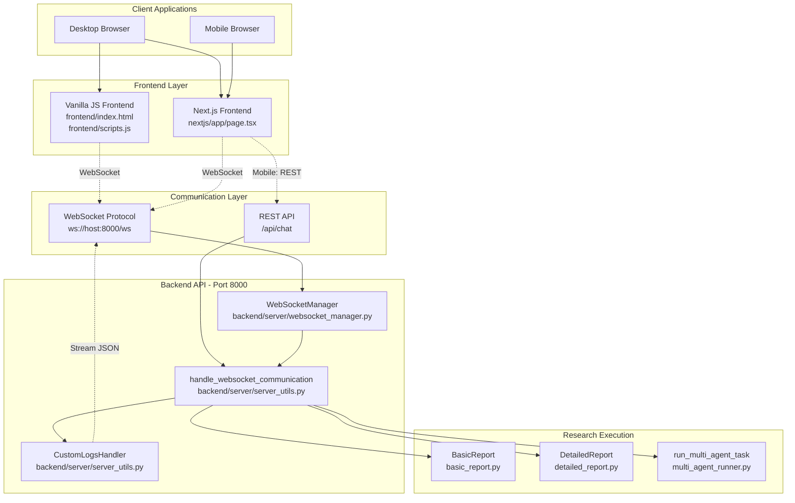
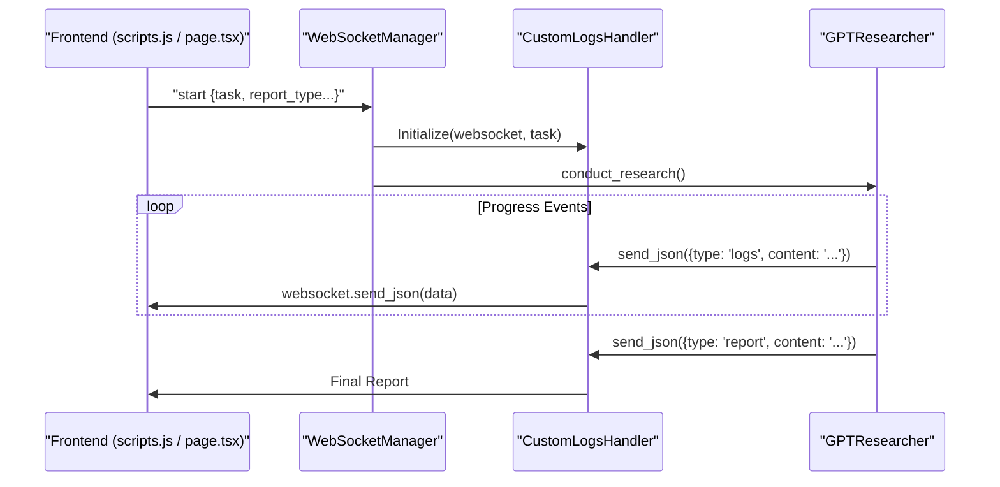
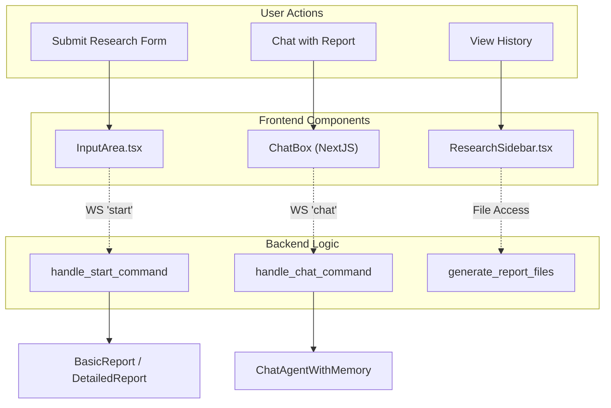

<!-- source: DeepWiki mcp.deepwiki.com · repo assafelovic/gpt-researcher · page 8 User Interfaces · fetched 2026-10-27 -->

# User Interfaces

Relevant source files

The following files were used as context for generating this wiki page:

- [backend/report_type/basic_report/basic_report.py](backend/report_type/basic_report/basic_report.py)
- [backend/report_type/detailed_report/detailed_report.py](backend/report_type/detailed_report/detailed_report.py)
- [backend/server/multi_agent_runner.py](backend/server/multi_agent_runner.py)
- [backend/server/server_utils.py](backend/server/server_utils.py)
- [backend/server/websocket_manager.py](backend/server/websocket_manager.py)
- [frontend/index.html](frontend/index.html)
- [frontend/nextjs/app/page.tsx](frontend/nextjs/app/page.tsx)
- [frontend/nextjs/components/Footer.tsx](frontend/nextjs/components/Footer.tsx)
- [frontend/nextjs/components/Header.tsx](frontend/nextjs/components/Header.tsx)
- [frontend/nextjs/components/Hero.tsx](frontend/nextjs/components/Hero.tsx)
- [frontend/nextjs/components/ResearchBlocks/elements/InputArea.tsx](frontend/nextjs/components/ResearchBlocks/elements/InputArea.tsx)
- [frontend/nextjs/components/ResearchSidebar.tsx](frontend/nextjs/components/ResearchSidebar.tsx)
- [frontend/scripts.js](frontend/scripts.js)
- [frontend/styles.css](frontend/styles.css)
- [tests/test_websocket_manager.py](tests/test_websocket_manager.py)

This page provides an overview of all user interface options available for interacting with GPT Researcher. It covers the backend API layer that serves these interfaces, the communication protocols used, and the relationship between different interface types.

For detailed documentation on specific interfaces, see:
- FastAPI backend and WebSocket protocol: [FastAPI Backend and WebSocket API](#8.1)
- Production web interface: [NextJS Production Frontend](#8.2)
- Lightweight web interface: [Vanilla JS Lightweight Frontend](#8.3)
- Integration into other applications: [Embed Script Integration](#8.4)
- Frontend state persistence: [Frontend State and History Management](#8.5)
- Streaming data processing: [Frontend Data Processing](#8.6)

## Available Interface Options

GPT Researcher provides four primary user interface options, all powered by a common FastAPI backend:

| Interface Type | Port | Technology Stack | Use Case |
|---------------|------|------------------|----------|
| **Vanilla JS Frontend** | 8000 | HTML/CSS/JS | Lightweight deployment, simple integration, minimal dependencies |
| **NextJS Frontend** | 3000 | React/NextJS/Tailwind | Production deployments, advanced features (drag-n-drop docs, GUI config) |
| **Embed Script** | N/A | JS Widget | Integration into existing web applications via iframe |
| **Direct API Access** | 8000 | WebSocket/REST | Programmatic access, custom frontends, mobile apps |

All interfaces communicate with the same FastAPI backend server running on port 8000, which orchestrates research tasks and streams results in real-time.

Sources: [frontend/index.html:1-13](), [frontend/nextjs/app/page.tsx:28-66]()

## System Architecture Overview

The following diagram illustrates the complete user interface architecture and how different interfaces connect to the backend:

### Interface Connectivity Diagram

Sources: [backend/server/websocket_manager.py:21-60](), [backend/server/server_utils.py:33-80](), [frontend/nextjs/app/page.tsx:109-118]()

## Backend API Layer

The FastAPI backend serves as the unified entry point for all user interfaces. It provides two main interaction patterns:

### WebSocket Communication

WebSocket connections enable real-time bidirectional communication for streaming research progress. The `WebSocketManager` class manages connection lifecycle:

- **Connection Management**: The `connect()` and `disconnect()` methods in [backend/server/websocket_manager.py:53-100]() handle lifecycle.
- **Message Queuing**: Each connection has an associated `asyncio.Queue` for reliable message delivery [backend/server/websocket_manager.py:28]().
- **Sender Tasks**: Background tasks continuously send queued messages to clients [backend/server/websocket_manager.py:30-51]().

### REST Endpoints

REST endpoints provide stateless request-response interactions, particularly for mobile clients or chat functionality:
- **Chat API**: The NextJS frontend utilizes `/api/chat` for mobile interactions when WebSocket is unavailable [frontend/nextjs/app/page.tsx:167-176]().
- **File Uploads**: Handled via `DocumentLoader` for processing local research materials [backend/server/server_utils.py:10]().

Sources: [backend/server/websocket_manager.py:21-114](), [frontend/nextjs/app/page.tsx:164-180]()

## Real-Time Data Streaming

The `CustomLogsHandler` class in [backend/server/server_utils.py:33-80]() serves dual purposes:
1. **Real-time streaming**: Sends JSON messages to the WebSocket client via `send_json` [backend/server/server_utils.py:56-60]().
2. **Persistent logging**: Writes structured logs to `outputs/task_*.json` files [backend/server/server_utils.py:38-44]().

### Research Streaming Sequence

Sources: [backend/server/server_utils.py:56-80](), [backend/server/websocket_manager.py:116-160]()

## Frontend Message Processing

Frontends consume streaming messages through several processing stages:

### State and History Management
The NextJS frontend uses a `ResearchHistoryContext` to manage local persistence [frontend/nextjs/app/page.tsx:6](). It stores research IDs and associated data to allow users to revisit previous reports via the `ResearchSidebar` [frontend/nextjs/components/ResearchSidebar.tsx:7-23]().

The Vanilla JS frontend tracks history in `conversationHistory` and persists it via cookies or `localStorage` [frontend/scripts.js:4-6]().

### Platform Differentiation
The NextJS frontend implements platform-specific strategies:
- **Desktop**: Primarily uses `useWebSocket` for interactive research [frontend/nextjs/app/page.tsx:109-118]().
- **Mobile**: Detects mobile state via `window.innerWidth < 768` and falls back to RESTful chat calls for better reliability [frontend/nextjs/app/page.tsx:83-96]().

Sources: [frontend/nextjs/app/page.tsx:109-118](), [frontend/nextjs/components/ResearchSidebar.tsx:16-23](), [frontend/scripts.js:82-104]()

## Component Communication Patterns

The following diagram maps user interactions to backend processes:

### User Interaction Flow

Sources: [backend/server/server_utils.py:126-141](), [backend/server/server_utils.py:187-210](), [frontend/nextjs/components/ResearchBlocks/elements/InputArea.tsx:100-108]()

## Configuration UI

The frontends expose key configuration options that map directly to the `GPTResearcher` and `Config` classes:

| Configuration | UI Element | Maps to Parameter |
|--------------|-----------|-------------------|
| **Report Type** | `<select id="report_type">` | `report_type` in `DetailedReport` [backend/report_type/detailed_report/detailed_report.py:30]() |
| **Tone** | `<select name="tone">` | `tone` in `BasicReport` [backend/report_type/basic_report/basic_report.py:18]() |
| **Report Source** | `chatBoxSettings.report_source` | `report_source` [frontend/nextjs/app/page.tsx:40]() |
| **Max Search Results** | `max_search_results` | `cfg.max_search_results_per_query` [backend/report_type/basic_report/basic_report.py:64]() |

Sources: [frontend/nextjs/app/page.tsx:36-48](), [backend/report_type/basic_report/basic_report.py:10-25](), [backend/report_type/detailed_report/detailed_report.py:10-41]()

## Error Handling and Recovery

The frontend implements automatic reconnection with exponential backoff to handle network instability. In `scripts.js`, `reconnectAttempts` and `maxReconnectAttempts` manage this process [frontend/scripts.js:21-23]().

On the backend, `WebSocketManager` ensures that if a connection is lost, sender tasks are cancelled and queues are cleaned up to prevent memory leaks [backend/server/websocket_manager.py:66-99]().

Sources: [frontend/scripts.js:21-23](), [backend/server/websocket_manager.py:66-99]()

---

