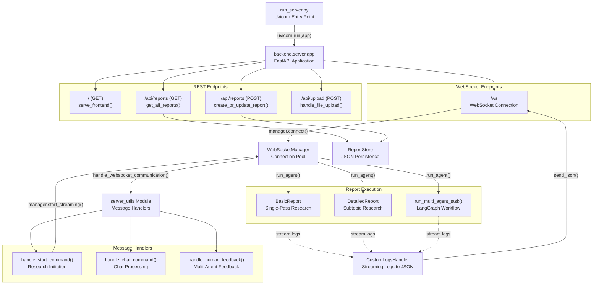
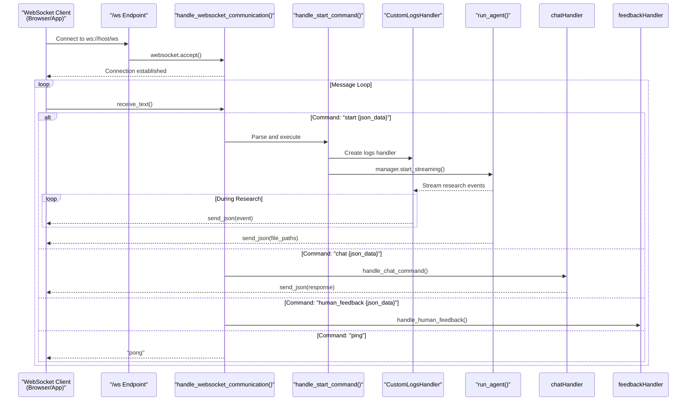
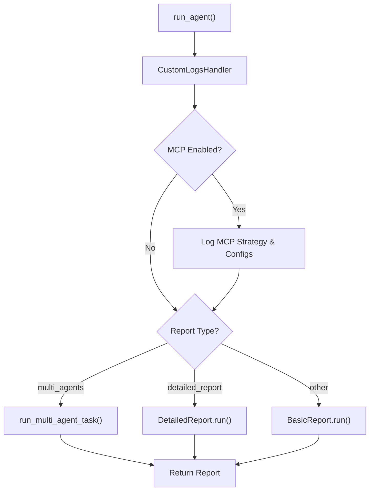

<!-- source: DeepWiki mcp.deepwiki.com · repo assafelovic/gpt-researcher · page 8.1 FastAPI Backend and WebSocket API · fetched 2026-10-27 -->

# FastAPI Backend and WebSocket API

<details>
<summary>Relevant source files</summary>

The following files were used as context for generating this wiki page:

- [backend/chat/chat.py](backend/chat/chat.py)
- [backend/report_type/basic_report/basic_report.py](backend/report_type/basic_report/basic_report.py)
- [backend/report_type/detailed_report/detailed_report.py](backend/report_type/detailed_report/detailed_report.py)
- [backend/run_server.py](backend/run_server.py)
- [backend/server/agent_discovery.py](backend/server/agent_discovery.py)
- [backend/server/app.py](backend/server/app.py)
- [backend/server/multi_agent_runner.py](backend/server/multi_agent_runner.py)
- [backend/server/report_store.py](backend/server/report_store.py)
- [backend/server/server_utils.py](backend/server/server_utils.py)
- [backend/server/websocket_manager.py](backend/server/websocket_manager.py)
- [frontend/index.html](frontend/index.html)
- [frontend/scripts.js](frontend/scripts.js)
- [frontend/styles.css](frontend/styles.css)
- [main.py](main.py)
- [tests/test_agent_discovery.py](tests/test_agent_discovery.py)
- [tests/test_websocket_manager.py](tests/test_websocket_manager.py)

</details>


## Purpose and Scope

This document covers the FastAPI backend server that powers GPT Researcher, including its WebSocket-based real-time communication protocol, REST API endpoints, and streaming log infrastructure. The backend serves as the primary interface between frontend clients and the core research engine.

For information about the core research orchestration logic, see [GPTResearcher Agent Class](#3.1). For frontend-specific data processing and state management, see [Frontend State and History Management](#8.5) and [Frontend Data Processing](#8.6). For deployment configurations, see [Server Configuration and Entry Points](#11.2).

## Server Architecture Overview

The backend is structured around a central FastAPI application that manages both synchronous REST endpoints and asynchronous WebSocket connections for long-running research tasks.

Title: GPT Researcher Backend Architecture

Sources: [backend/run_server.py:1-27](), [backend/server/app.py:97-210](), [backend/server/websocket_manager.py:21-114](), [backend/server/server_utils.py:126-252]()

## FastAPI Server Startup

The server is initialized and started through [backend/run_server.py:1-27](). The entry point performs the following setup:

| Component | Configuration | Location |
|-----------|--------------|----------|
| **ASGI Server** | Uvicorn | [backend/run_server.py:21-27]() |
| **App Instance** | `server.app:app` | [backend/run_server.py:22]() |
| **Host/Port** | `0.0.0.0:8000` | [backend/run_server.py:23-24]() |
| **Static Files** | `/site` (frontend), `/static` (assets), `/outputs` (reports) | [backend/server/app.py:74-87]() |
| **CORS** | Configurable via `CORS_ALLOW_ORIGINS` | [backend/server/app.py:99-120]() |

The application uses a `lifespan` context manager to ensure the `outputs` directory exists and to log startup/shutdown events [backend/server/app.py:71-92]().

Sources: [backend/run_server.py:1-27](), [backend/server/app.py:71-133]()

## WebSocket Manager

The `WebSocketManager` class [backend/server/websocket_manager.py:21-114]() manages WebSocket connection lifecycle and message queuing.

### Connection Management

```python
# Key attributes initialized in __init__
self.active_connections: List[WebSocket] = []
self.sender_tasks: Dict[WebSocket, asyncio.Task] = {}
self.message_queues: Dict[WebSocket, asyncio.Queue] = {}
```

| Method | Purpose | Key Operations |
|--------|---------|----------------|
| `connect(websocket)` | Establish WebSocket connection | Accept connection, create message queue, start sender task [backend/server/websocket_manager.py:53-61]() |
| `disconnect(websocket)` | Clean up connection | Cancel sender task, close websocket, remove from active connections [backend/server/websocket_manager.py:66-100]() |
| `start_sender(websocket)` | Background message sender | Continuously read from queue and send to client [backend/server/websocket_manager.py:30-51]() |
| `start_streaming(...)` | Initiate research workflow | Call `run_agent()` with research parameters [backend/server/websocket_manager.py:101-114]() |

Sources: [backend/server/websocket_manager.py:21-114]()

## WebSocket Communication Protocol

Communication follows a command-based protocol where the client sends string-prefixed JSON payloads, and the server responds with typed JSON messages.

Title: WebSocket Communication Sequence

Sources: [backend/server/server_utils.py:126-180](), [backend/server/server_utils.py:325-395]()

## Message Handling Pipeline

The core message routing logic is implemented in `handle_websocket_communication()` [backend/server/server_utils.py:325-395]().

### Command Detection and Routing

Commands are identified by their string prefix:

| Command Prefix | Handler Function | Purpose |
|----------------|------------------|---------|
| `"start"` | `handle_start_command()` | Initiate research task [backend/server/server_utils.py:126]() |
| `"chat"` | `handle_chat_command()` | Process chat messages [backend/server/server_utils.py:187]() |
| `"human_feedback"` | `handle_human_feedback()` | Handle multi-agent feedback [backend/server/server_utils.py:181]() |
| `"ping"` | Inline handler | Health check response [backend/server/websocket_manager.py:43-44]() |

Sources: [backend/server/server_utils.py:126-252](), [backend/server/server_utils.py:325-395]()

## CustomLogsHandler - Streaming Research Progress

The `CustomLogsHandler` class [backend/server/server_utils.py:33-80]() captures and streams research events in real-time to both WebSocket clients and JSON log files.

### Initialization

```python
def __init__(self, websocket, task: str):
    self.logs = []
    self.websocket = websocket
    sanitized_filename = sanitize_filename(f"task_{int(time.time())}_{task}")
    self.log_file = os.path.join("outputs", f"{sanitized_filename}.json")
    # ...
```
Each handler creates a unique log file in the `outputs/` directory to store events and final research content [backend/server/server_utils.py:38-54]().

### Streaming Events

The `send_json()` method [backend/server/server_utils.py:56-79]() performs dual-writing:
1. **WebSocket Stream**: Immediately sends data to connected client via `websocket.send_json(data)` [backend/server/server_utils.py:60]().
2. **JSON File**: Updates the local log file with events or content updates [backend/server/server_utils.py:63-79]().

Sources: [backend/server/server_utils.py:33-80]()

## WebSocket Message Types

Messages sent from server to client during research execution use a standardized JSON format:

| Type | Content | Metadata/Output | Purpose |
|------|---------|-----------------|---------|
| `logs` | Event name | Event description | Research progress updates [backend/server/websocket_manager.py:127-131]() |
| `path` | N/A | `{pdf, docx, md, json}` | Generated report file locations [backend/server/server_utils.py:175-178]() |
| `report` | N/A | Markdown chunks | Streaming report content |
| `chat` | Response text | `{role: "assistant"}` | Chat interaction responses [backend/server/server_utils.py:203-207]() |

Sources: [backend/server/server_utils.py:126-179](), [backend/server/websocket_manager.py:127-131]()

## Start Command Handler

The `handle_start_command()` function [backend/server/server_utils.py:126-179]() processes research initiation requests.

### Execution Flow

1. **Extraction**: Parses JSON payload using `extract_command_data()` [backend/server/server_utils.py:141]().
2. **Log Initialization**: Creates a `CustomLogsHandler` and sends the initial query [backend/server/server_utils.py:148-155]().
3. **Research Execution**: Calls `manager.start_streaming()` which triggers the underlying research agent [backend/server/server_utils.py:159-173]().
4. **File Generation**: Converts the final report to PDF and DOCX formats [backend/server/server_utils.py:175]().
5. **Completion**: Sends the relative file paths back to the client [backend/server/server_utils.py:178]().

Sources: [backend/server/server_utils.py:126-179]()

## Chat Command Handler

The `handle_chat_command()` function [backend/server/server_utils.py:187-252]() processes conversational queries about completed research reports.

### Chat Flow

1. **Context Loading**: Extracts the existing report and conversation history from the payload [backend/server/server_utils.py:194-196]().
2. **Agent Initialization**: Instantiates `ChatAgentWithMemory` with the report context [backend/chat/chat.py:55-80]().
3. **Processing**: Calls `chat_agent.chat(messages, websocket)` which supports tool calling for web searches [backend/chat/chat.py:187-210]().
4. **Streaming**: The agent streams the response and search metadata directly to the WebSocket [backend/chat/chat.py:204-210]().

Sources: [backend/server/server_utils.py:187-252](), [backend/chat/chat.py:55-210]()

## run_agent() - Research Orchestration

The `run_agent()` function [backend/server/websocket_manager.py:116-184]() serves as the bridge between the WebSocket interface and the core research logic.

Title: Agent Execution Logic

Sources: [backend/server/websocket_manager.py:116-184]()

## REST API Endpoints

The FastAPI backend exposes several REST endpoints for history management and file operations:

| Endpoint | Method | Purpose | Handler |
|----------|--------|---------|---------|
| `/api/reports` | GET | Retrieve list of past research tasks | `get_all_reports()` [backend/server/app.py:183-187]() |
| `/api/reports` | POST | Save or update a research report | `create_or_update_report()` [backend/server/app.py:198-207]() |
| `/api/upload` | POST | Upload documents for local research | `handle_file_upload()` [backend/server/server_utils.py:293-302]() |
| `/report/{id}` | GET | Serve generated DOCX report | `read_report()` [backend/server/app.py:174-179]() |

Sources: [backend/server/app.py:174-207](), [backend/server/server_utils.py:293-302]()

## Client Integration Example (Vanilla JS)

The Vanilla JS frontend [frontend/index.html:1-152]() demonstrates how to interact with the WebSocket API.

### Connection and Command Dispatch
```javascript
// From frontend/scripts.js
const socket = new WebSocket(`ws://${window.location.host}/ws`);

const startResearch = () => {
  const data = {
    task: document.getElementById('task').value,
    report_type: document.getElementById('report_type').value,
    report_source: "web",
    tone: "Objective"
  };
  socket.send("start " + JSON.stringify(data));
};

socket.onmessage = (event) => {
  const data = JSON.parse(event.data);
  if (data.type === 'logs') {
    // Update UI with data.output
  }
};
```
Sources: [frontend/index.html:154-179](), [frontend/scripts.js:25-79]()

---

