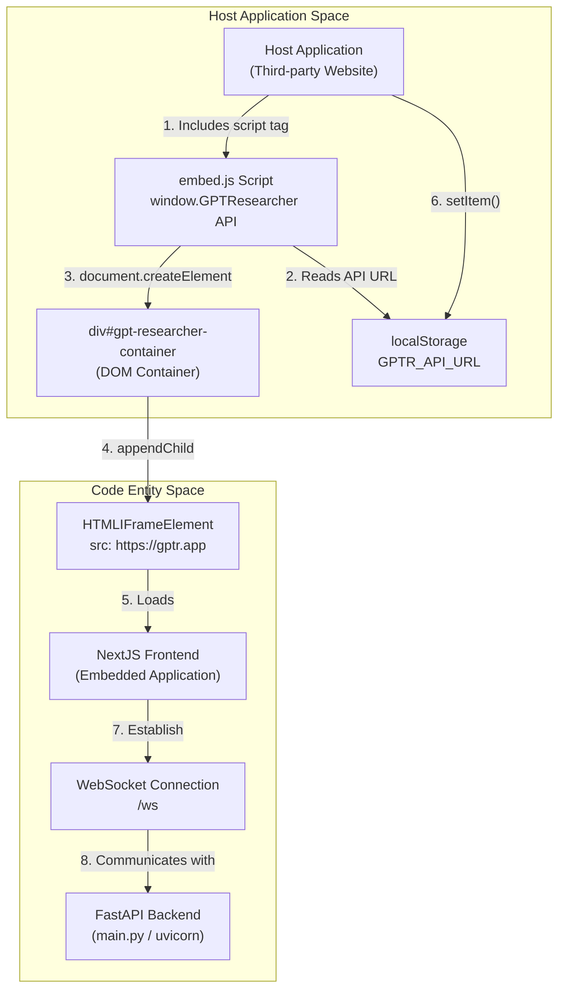
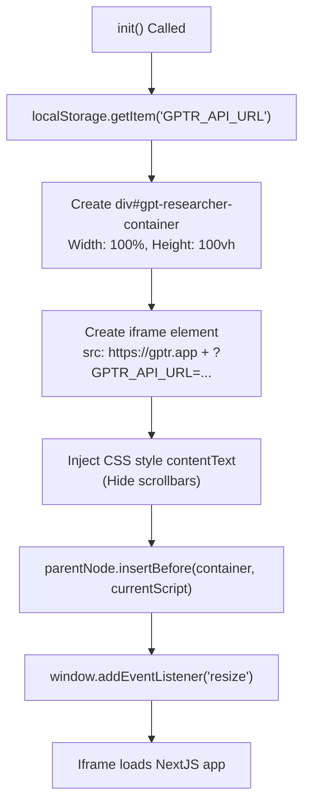
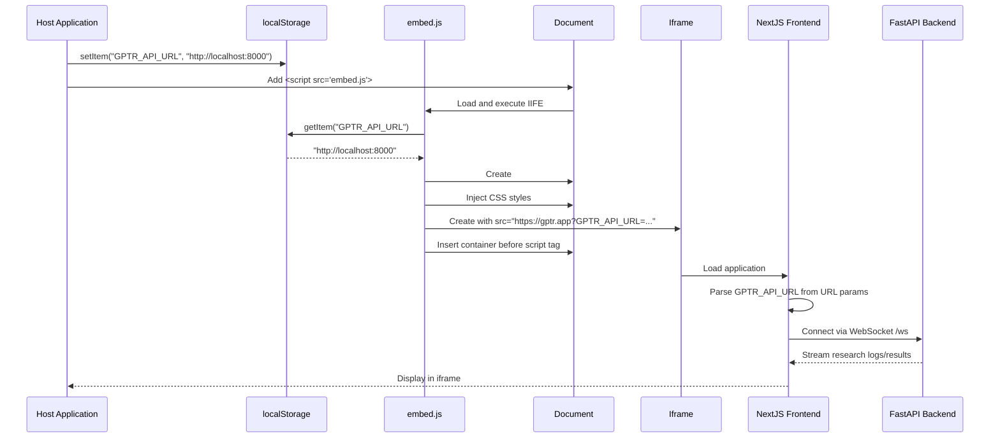

<!-- source: DeepWiki mcp.deepwiki.com · repo assafelovic/gpt-researcher · page 8.4 Embed Script Integration · fetched 2026-10-27 -->

# Embed Script Integration

<details>
<summary>Relevant source files</summary>

The following files were used as context for generating this wiki page:

- [docs/docs/gpt-researcher/context/filtering-by-domain.md](docs/docs/gpt-researcher/context/filtering-by-domain.md)
- [docs/docs/gpt-researcher/frontend/embed-script.md](docs/docs/gpt-researcher/frontend/embed-script.md)
- [docs/docs/gpt-researcher/gptr/querying-the-backend.md](docs/docs/gpt-researcher/gptr/querying-the-backend.md)
- [docs/npm/Readme.md](docs/npm/Readme.md)
- [docs/npm/index.js](docs/npm/index.js)
- [docs/npm/package.json](docs/npm/package.json)
- [frontend/nextjs/public/embed.js](frontend/nextjs/public/embed.js)
- [frontend/nextjs/src/utils/imageTransformPlugin.js](frontend/nextjs/src/utils/imageTransformPlugin.js)

</details>


## Purpose and Scope

This document describes the `embed.js` script that enables integration of the GPT Researcher NextJS frontend into external web applications. The script provides a simple JavaScript API for embedding the full-featured research interface via an iframe, allowing third-party applications to leverage GPT Researcher's capabilities without implementing their own UI.

For information about the embedded NextJS frontend itself, see [NextJS Production Frontend](#8.2). For details on backend communication protocols, see [FastAPI Backend and WebSocket API](#8.1). For frontend state management within the embedded application, see [Frontend State and History Management](#8.5).

---

## Architecture Overview

The embed script uses an **iframe-based embedding strategy** to isolate the GPT Researcher frontend while providing a clean integration API for host applications.

**System Entity Mapping: Embed Architecture**



**Sources:** [frontend/nextjs/public/embed.js:1-68](), [docs/docs/gpt-researcher/frontend/embed-script.md:1-28]()

The architecture separates concerns:
- **Host Application**: The third-party website integrating GPT Researcher.
- **Embed Script**: The integration layer providing the JavaScript API.
- **Iframe Isolation**: Sandboxed environment for the NextJS frontend.
- **Backend Configuration**: Flexible API endpoint selection via `localStorage` or URL parameters.

---

## Global API Object

The embed script exposes a global `window.GPTResearcher` object with two primary methods.

### GPTResearcher.init()

Creates the embedding infrastructure automatically when the script loads.

**Execution Logic: init() Method**



**Sources:** [frontend/nextjs/public/embed.js:3-54]()

**Implementation Details:**

| Step | Action | Code Reference |
|------|--------|----------------|
| 1 | Read API URL from `localStorage` | [frontend/nextjs/public/embed.js:4]() |
| 2 | Create container div with ID `gpt-researcher-container` | [frontend/nextjs/public/embed.js:7-11]() |
| 3 | Create iframe with source `https://gptr.app` | [frontend/nextjs/public/embed.js:14-19]() |
| 4 | Append query parameter if `parentApiUrl` exists | [frontend/nextjs/public/embed.js:15]() |
| 5 | Inject CSS to hide scrollbars via `document.head.appendChild` | [frontend/nextjs/public/embed.js:22-39]() |
| 6 | Insert container into DOM before the script tag | [frontend/nextjs/public/embed.js:42-43]() |
| 7 | Attach `resize` and `load` event handlers to maintain height | [frontend/nextjs/public/embed.js:45-53]() |

### GPTResearcher.configure()

Allows runtime configuration of the embedded interface dimensions.

```javascript
GPTResearcher.configure({ height: 600 })
```

**Current Configuration Options:**

| Option | Type | Description | Default |
|--------|------|-------------|---------|
| `height` | number | Height of iframe in pixels | `100vh` (full viewport) |

**Sources:** [frontend/nextjs/public/embed.js:56-64]()

The `configure()` method queries the DOM for the iframe within `#gpt-researcher-container` and applies the specified height. This allows host applications to dynamically adjust the embedded interface dimensions after initialization.

---

## Integration Workflow

The following sequence diagram illustrates the initialization and data flow from the host application to the research backend.



**Sources:** [frontend/nextjs/public/embed.js:1-68](), [docs/docs/gpt-researcher/frontend/embed-script.md:1-28]()

---

## Backend Configuration

The embed script supports two methods for specifying the FastAPI backend URL.

### Method 1: localStorage (Recommended)

Set the `GPTR_API_URL` key before loading the embed script. This is the standard way to point the embedded frontend at a custom GPTR API Server.

```html
<script>localStorage.setItem("GPTR_API_URL", "http://localhost:8000");</script>
<script src="https://app.gptr.dev/embed.js"></script>
```

**Sources:** [docs/docs/gpt-researcher/frontend/embed-script.md:8-10]()

### Method 2: Default Hosted Backend

If `GPTR_API_URL` is not set in `localStorage`, the script defaults to the hosted environment at `https://gptr.app`.

**Sources:** [frontend/nextjs/public/embed.js:4-15]()

The API URL is passed to the embedded NextJS application as a query parameter: `?GPTR_API_URL=<url>`. The NextJS frontend reads this parameter to establish its communication channels.

---

## Domain Filtering Integration

When embedding GPT Researcher, users can also pass domain filters via URL parameters. This allows for tailored research agents restricted to specific sources.

| Parameter | Example | Effect |
|-----------|---------|--------|
| `domains` | `wikipedia.org` | Filters search results to a single domain |
| `domains` | `wired.com,forbes.com` | Filters search results to multiple domains |

**Sources:** [docs/docs/gpt-researcher/context/filtering-by-domain.md:47-62]()

---

## DOM Structure and Styling

The embed script creates a specific hierarchy to ensure the research interface occupies the intended space without interfering with the host's layout.

### Container and Iframe Properties

| Element | Property | Value | Purpose |
|---------|----------|-------|---------|
| **Container** | `id` | `gpt-researcher-container` | Target for CSS and JS manipulation |
| | `width` | `100%` | Occupy full width of parent |
| | `height` | `100vh` | Default to full viewport height |
| | `overflow` | `hidden` | Prevent container scrollbars |
| **Iframe** | `src` | `https://gptr.app...` | Target application URL |
| | `border` | `none` | Seamless integration |
| | `height` | `100%` | Fill the container |

**Sources:** [frontend/nextjs/public/embed.js:7-20]()

### Scrollbar Suppression

The script injects a `<style>` block into the `document.head` to ensure that scrollbars are hidden across all major browsers (Chrome, Safari, Firefox, IE, Edge) for both the container and the iframe.

**Sources:** [frontend/nextjs/public/embed.js:22-39]()

---

## Minimal Integration Example

A complete, valid HTML document demonstrating the integration:

```html
<!DOCTYPE html>
<html lang="en">
<head>
    <meta charset="UTF-8">
    <meta name="viewport" content="width=device-width, initial-scale=1.0">
    <title>GPT Researcher Embed Demo</title>
</head>
<body style="margin: 0; padding: 0;">
    <!-- Set backend URL and load the script -->
    <script>localStorage.setItem("GPTR_API_URL", "http://localhost:8000");</script>
    <script src="https://app.gptr.dev/embed.js"></script>
</body>
</html>
```

**Sources:** [docs/docs/gpt-researcher/frontend/embed-script.md:14-28]()

---

## Responsive Behavior

The script includes lifecycle event listeners to maintain the iframe's responsiveness:

1.  **Resize Listener**: Listens for `window.addEventListener("resize")` to reset `iframe.style.height` to `100%`. [frontend/nextjs/public/embed.js:46-48]()
2.  **Load Listener**: Ensures height is set correctly immediately after the iframe content finishes loading. [frontend/nextjs/public/embed.js:51-53]()

---

## Asset Management

When embedding the application, internal image paths are automatically transformed to point to the hosted domain (`https://gptr.app`) using a dedicated plugin `imageTransformPlugin` to ensure assets resolve correctly regardless of where the app is embedded.

**Sources:** [frontend/nextjs/src/utils/imageTransformPlugin.js:2-16]()

---

