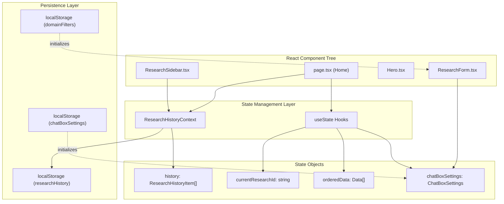
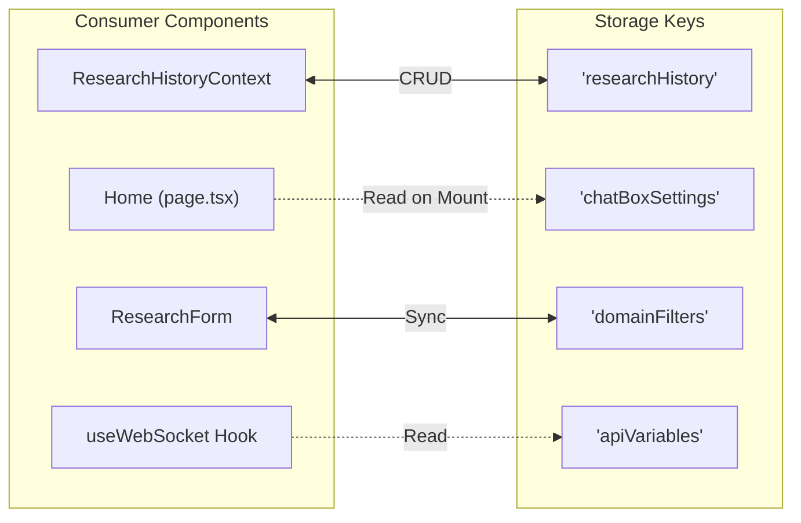

<!-- source: DeepWiki mcp.deepwiki.com · repo assafelovic/gpt-researcher · page 8.5 Frontend State and History Management · fetched 2026-10-27 -->

# Frontend State and History Management

<details>
<summary>Relevant source files</summary>

The following files were used as context for generating this wiki page:

- [frontend/nextjs/app/page.tsx](frontend/nextjs/app/page.tsx)
- [frontend/nextjs/components/Footer.tsx](frontend/nextjs/components/Footer.tsx)
- [frontend/nextjs/components/Header.tsx](frontend/nextjs/components/Header.tsx)
- [frontend/nextjs/components/Hero.tsx](frontend/nextjs/components/Hero.tsx)
- [frontend/nextjs/components/ResearchBlocks/AccessReport.tsx](frontend/nextjs/components/ResearchBlocks/AccessReport.tsx)
- [frontend/nextjs/components/ResearchBlocks/elements/InputArea.tsx](frontend/nextjs/components/ResearchBlocks/elements/InputArea.tsx)
- [frontend/nextjs/components/ResearchSidebar.tsx](frontend/nextjs/components/ResearchSidebar.tsx)
- [frontend/nextjs/components/Settings/ChatBox.tsx](frontend/nextjs/components/Settings/ChatBox.tsx)
- [frontend/nextjs/components/Settings/MCPSelector.tsx](frontend/nextjs/components/Settings/MCPSelector.tsx)
- [frontend/nextjs/components/Task/DomainFilter.tsx](frontend/nextjs/components/Task/DomainFilter.tsx)
- [frontend/nextjs/components/Task/ResearchForm.tsx](frontend/nextjs/components/Task/ResearchForm.tsx)
- [frontend/nextjs/hooks/useWebSocket.ts](frontend/nextjs/hooks/useWebSocket.ts)
- [frontend/nextjs/types/data.ts](frontend/nextjs/types/data.ts)

</details>


## Purpose and Scope

This document explains how the GPT Researcher frontends (primarily the Next.js production interface) manage research state and history persistence. It covers the state management architecture, storage mechanisms (`localStorage`), CRUD operations on research history, and the UI components that interact with saved research.

For information about how research data is processed and streamed from the backend, see [Frontend Data Processing](#8.6). For details about the backend WebSocket communication protocol, see [FastAPI Backend and WebSocket API](#8.1).

---

## State Management Architecture

The Next.js frontend utilizes a combination of React's `useState` hooks for ephemeral session state and a specialized `ResearchHistoryContext` for persistent history management [frontend/nextjs/app/page.tsx:28-106]().

### Next.js State Management Architecture

The architecture centralizes history logic in a context provider, allowing components like the `ResearchSidebar` and the main `Home` page to stay synchronized.



**Sources:** [frontend/nextjs/app/page.tsx:28-106](), [frontend/nextjs/components/ResearchSidebar.tsx:7-23](), [frontend/nextjs/components/Task/ResearchForm.tsx:33-47]()

---

## Research History Data Structures

### ResearchHistoryItem Interface

The frontend uses TypeScript interfaces to define the structure of research history items. This structure includes the original question, the generated report, and the full sequence of logs and sources received during the session.

```typescript
// Defined in types/data.ts
export interface ResearchHistoryItem {
  id: string;              // Unique identifier (UUID or timestamp)
  question: string;        // User's research query
  answer: string;          // Generated research report
  timestamp: number;       // Creation/update timestamp
  orderedData: Data[];     // Structured research data (logs, sources, etc.)
  chatMessages?: ChatMessage[];  // Associated chat history
}
```

The `orderedData` array stores objects of type `Data`, which are processed via `preprocessOrderedData` [frontend/nextjs/utils/dataProcessing.ts:11-129]() to group related information like sources and images.

**Sources:** [frontend/nextjs/types/data.ts:64-71](), [frontend/nextjs/app/page.tsx:10-11]()

---

## Storage Mechanisms

### localStorage Usage

The Next.js frontend uses `localStorage` for persisting research history, user configuration settings, and API variables.

1.  **Research History**: Managed via `useResearchHistoryContext`, which provides methods to `saveResearch`, `updateResearch`, and `deleteResearch` [frontend/nextjs/app/page.tsx:98-106]().
2.  **Settings Persistence**: The `chatBoxSettings` state (report type, source, tone, MCP settings) is initialized by reading `chatBoxSettings` from `localStorage` [frontend/nextjs/app/page.tsx:36-66]().
3.  **Domain Filtering**: Selected domains are stored in `domainFilters` and synced between the `ResearchForm` and `localStorage` [frontend/nextjs/components/Task/ResearchForm.tsx:33-47]().
4.  **API Configuration**: The `useWebSocket` hook retrieves `apiVariables` from `localStorage` to configure the connection [frontend/nextjs/hooks/useWebSocket.ts:55-56]().



**Sources:** [frontend/nextjs/app/page.tsx:52-64](), [frontend/nextjs/components/Task/ResearchForm.tsx:33-47](), [frontend/nextjs/hooks/useWebSocket.ts:55-56]()

---

## CRUD Operations on Research History

### Context-Based CRUD

The `Home` component interacts with history through hooks provided by the `ResearchHistoryContext` [frontend/nextjs/app/page.tsx:98-106]().

| Operation | Trigger | Code Reference |
| :--- | :--- | :--- |
| **Create** | Starting a new research task via `handleDisplayResult` | [frontend/nextjs/app/page.tsx:100]() |
| **Read** | `ResearchSidebar` mapping over `history` array | [frontend/nextjs/components/ResearchSidebar.tsx:17-23]() |
| **Update** | Adding chat messages or receiving new research data | [frontend/nextjs/app/page.tsx:101-106]() |
| **Delete** | Clicking the delete icon in `ResearchSidebar` | [frontend/nextjs/components/ResearchSidebar.tsx:11-20]() |

**Sources:** [frontend/nextjs/app/page.tsx:98-106](), [frontend/nextjs/components/ResearchSidebar.tsx:7-23]()

---

## History UI Components

### ResearchSidebar Component

The `ResearchSidebar` component is the primary interface for history management. It provides a sliding panel (managed by `framer-motion`) that lists previous research items [frontend/nextjs/components/ResearchSidebar.tsx:90-100]().

*   **Selection**: Clicking a history item triggers `onSelectResearch`, which loads the research data into the main view [frontend/nextjs/components/ResearchSidebar.tsx:18-19]().
*   **Deletion**: Each item has a delete action that calls `onDeleteResearch` [frontend/nextjs/components/ResearchSidebar.tsx:20-21]().
*   **Formatting**: Timestamps are formatted using `formatDistanceToNow` for human-readability [frontend/nextjs/components/ResearchSidebar.tsx:44-54]().
*   **Interactivity**: It handles "click outside" events to automatically close the sidebar [frontend/nextjs/components/ResearchSidebar.tsx:28-41]().

**Sources:** [frontend/nextjs/components/ResearchSidebar.tsx:1-155]()

---

## Chat and Settings State

### Settings Management

User preferences for research (e.g., `report_type`, `tone`, `mcp_enabled`) are stored in a `chatBoxSettings` object [frontend/nextjs/app/page.tsx:36-48](). 

*   **URL Parameter Integration**: The `Footer` component checks for `domains` in the URL query parameters and syncs them to `localStorage` as `domainFilters` [frontend/nextjs/components/Footer.tsx:14-24]().
*   **Form Control**: The `ResearchForm` component updates settings via `onFormChange`, `onToneChange`, and `onMCPChange` [frontend/nextjs/components/Task/ResearchForm.tsx:61-91]().
*   **MCP Configuration**: The `MCPSelector` manages complex JSON configurations for Model Context Protocol servers, validating them before updating state [frontend/nextjs/components/Settings/MCPSelector.tsx:52-92]().

### Chat History Persistence

Chat messages are treated as a sub-resource of a research session.
*   **User Messages**: Immediately added to `orderedData` for UI feedback and persisted via `addChatMessage` [frontend/nextjs/app/page.tsx:146-161]().
*   **AI Responses**: On mobile, responses are fetched via `/api/chat` and subsequently saved to history using `addChatMessage` [frontend/nextjs/app/page.tsx:164-190]().

**Sources:** [frontend/nextjs/app/page.tsx:36-66](), [frontend/nextjs/components/Task/ResearchForm.tsx:61-91](), [frontend/nextjs/components/Settings/MCPSelector.tsx:52-92]()

---

## State Reset and Cleanup

To start a "New Research" session, the frontend provides a mechanism to clear current session state without deleting history.

*   **Header Actions**: The `Header` component provides a "New Research" button that triggers `onNewResearch` [frontend/nextjs/components/Header.tsx:9-52]().
*   **State Clearing**: This typically resets `orderedData`, `answer`, `currentResearchId`, and `promptValue` to their default empty states in `page.tsx` [frontend/nextjs/app/page.tsx:28-75]().
*   **WebSocket Cleanup**: The `useWebSocket` hook includes a cleanup effect to close the socket and clear heartbeat intervals on unmount [frontend/nextjs/hooks/useWebSocket.ts:16-29]().

**Sources:** [frontend/nextjs/app/page.tsx:28-75](), [frontend/nextjs/components/Header.tsx:1-61](), [frontend/nextjs/hooks/useWebSocket.ts:16-29]()

---

