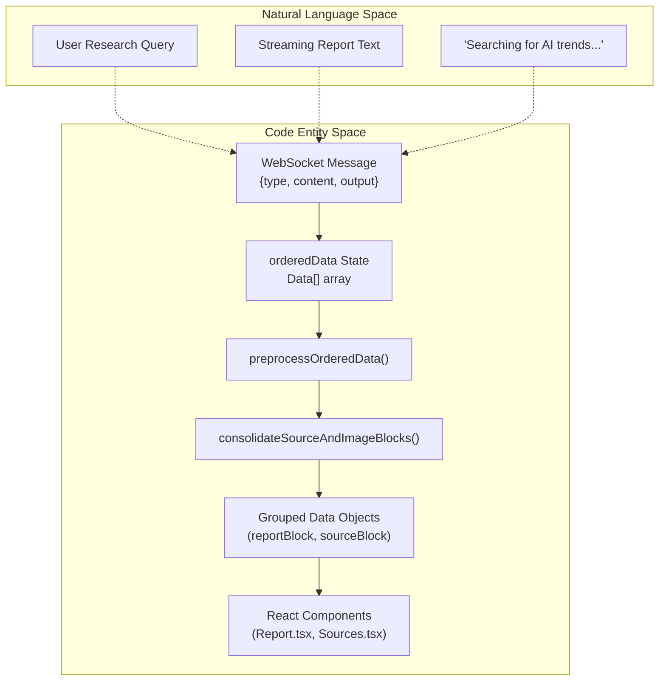
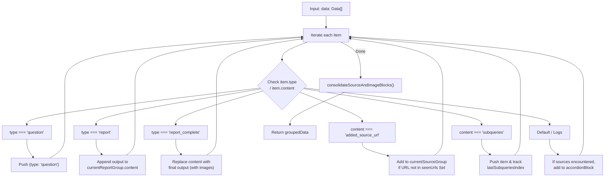

<!-- source: DeepWiki mcp.deepwiki.com · repo assafelovic/gpt-researcher · page 8.6 Frontend Data Processing · fetched 2026-10-27 -->

# Frontend Data Processing

Relevant source files

The following files were used as context for generating this wiki page:

- [docs/docs/gpt-researcher/frontend/nextjs-frontend.md](docs/docs/gpt-researcher/frontend/nextjs-frontend.md)
- [docs/docs/gpt-researcher/frontend/vanilla-js-frontend.md](docs/docs/gpt-researcher/frontend/vanilla-js-frontend.md)
- [frontend/nextjs/components/Images/ImageModal.tsx](frontend/nextjs/components/Images/ImageModal.tsx)
- [frontend/nextjs/components/Images/ImagesAlbum.tsx](frontend/nextjs/components/Images/ImagesAlbum.tsx)
- [frontend/nextjs/components/ResearchBlocks/AccessReport.tsx](frontend/nextjs/components/ResearchBlocks/AccessReport.tsx)
- [frontend/nextjs/components/ResearchBlocks/ImageSection.tsx](frontend/nextjs/components/ResearchBlocks/ImageSection.tsx)
- [frontend/nextjs/components/ResearchBlocks/LogsSection.tsx](frontend/nextjs/components/ResearchBlocks/LogsSection.tsx)
- [frontend/nextjs/components/ResearchBlocks/Question.tsx](frontend/nextjs/components/ResearchBlocks/Question.tsx)
- [frontend/nextjs/components/ResearchBlocks/Sources.tsx](frontend/nextjs/components/ResearchBlocks/Sources.tsx)
- [frontend/nextjs/components/ResearchBlocks/elements/SourceCard.tsx](frontend/nextjs/components/ResearchBlocks/elements/SourceCard.tsx)
- [frontend/nextjs/components/ResearchBlocks/elements/SubQuestions.tsx](frontend/nextjs/components/ResearchBlocks/elements/SubQuestions.tsx)
- [frontend/nextjs/components/ResearchResults.tsx](frontend/nextjs/components/ResearchResults.tsx)
- [frontend/nextjs/components/Settings/ChatBox.tsx](frontend/nextjs/components/Settings/ChatBox.tsx)
- [frontend/nextjs/components/Settings/MCPSelector.tsx](frontend/nextjs/components/Settings/MCPSelector.tsx)
- [frontend/nextjs/components/Task/DomainFilter.tsx](frontend/nextjs/components/Task/DomainFilter.tsx)
- [frontend/nextjs/components/Task/ResearchForm.tsx](frontend/nextjs/components/Task/ResearchForm.tsx)
- [frontend/nextjs/hooks/useWebSocket.ts](frontend/nextjs/hooks/useWebSocket.ts)
- [frontend/nextjs/types/data.ts](frontend/nextjs/types/data.ts)
- [frontend/nextjs/utils/consolidateBlocks.ts](frontend/nextjs/utils/consolidateBlocks.ts)
- [frontend/nextjs/utils/dataProcessing.ts](frontend/nextjs/utils/dataProcessing.ts)

This document covers the frontend data processing utilities that transform raw WebSocket stream data from the backend into structured, displayable content. These utilities handle grouping related data items, deduplicating sources and images, and organizing content into logical blocks for rendering.

## Purpose and Scope

The frontend receives a continuous stream of JSON objects from the backend via WebSocket connections. Each message has a `type` and `content` field, along with optional `output` and `metadata` fields [frontend/nextjs/hooks/useWebSocket.ts:109-118](). These raw messages must be:

1.  **Grouped** into logical blocks (e.g., all report chunks into a single report block).
2.  **Deduplicated** to prevent showing the same source URL or image multiple times.
3.  **Ordered** correctly to maintain the research narrative flow.
4.  **Consolidated** to present a clean, organized UI.

The primary processing functions are:
*   `preprocessOrderedData` - Main orchestrator that groups and orders data [frontend/nextjs/utils/dataProcessing.ts:4-129]().
*   `consolidateSourceAndImageBlocks` - Deduplicates and consolidates sources/images [frontend/nextjs/utils/consolidateBlocks.ts:1-35]().

Sources: [frontend/nextjs/utils/dataProcessing.ts:4-129](), [frontend/nextjs/utils/consolidateBlocks.ts:1-35](), [frontend/nextjs/hooks/useWebSocket.ts:102-133]()

## Data Flow Architecture

The following diagram illustrates how raw WebSocket data is transformed into UI components.

### Data Processing Pipeline

Sources: [frontend/nextjs/utils/dataProcessing.ts:4-129](), [frontend/nextjs/components/ResearchResults.tsx:33-85](), [frontend/nextjs/hooks/useWebSocket.ts:102-133]()

## preprocessOrderedData Function

The `preprocessOrderedData` function is the primary utility that transforms a flat array of data items into a structured representation [frontend/nextjs/utils/dataProcessing.ts:4-129]().

### Processing Logic Flow

### Key Implementation Details

*   **Report Aggregation**: Streaming chunks of type `report` are concatenated into a `reportBlock` [frontend/nextjs/utils/dataProcessing.ts:21-26](). When `report_complete` is received, the entire content is replaced to ensure the final version (often containing embedded images) is displayed [frontend/nextjs/utils/dataProcessing.ts:27-34]().
*   **Source Handling**: Individual URLs received via `added_source_url` are parsed to extract hostnames (e.g., removing `www.`) and stored in a `sourceBlock` [frontend/nextjs/utils/dataProcessing.ts:72-88]().
*   **Subquery Ordering**: The function tracks `lastSubqueriesIndex` to ensure that `sourceBlock` elements are inserted immediately after the research subqueries in the UI flow [frontend/nextjs/utils/dataProcessing.ts:64-69]().
*   **Human Feedback**: While not part of the grouping logic, the frontend handles feedback requests by monitoring `data.type === 'human_feedback'`, which triggers UI state changes for user input [frontend/nextjs/hooks/useWebSocket.ts:113-116]().

Sources: [frontend/nextjs/utils/dataProcessing.ts:15-125](), [frontend/nextjs/hooks/useWebSocket.ts:111-129]()

## consolidateSourceAndImageBlocks

After initial grouping, `consolidateSourceAndImageBlocks` performs a final pass to merge multiple disparate blocks of the same type into single, unified UI elements [frontend/nextjs/utils/consolidateBlocks.ts:1-35]().

### Consolidation Rules
1.  **Source Consolidation**: Extracts all `sourceBlock` items, flattens them, and performs a final deduplication by URL [frontend/nextjs/utils/consolidateBlocks.ts:3-11]().
2.  **Image Consolidation**: Collects all `imagesBlock` metadata (image URLs) into a single array for the gallery view [frontend/nextjs/utils/consolidateBlocks.ts:14-19]().
3.  **Re-assembly**: Removes all original small blocks and appends the unified `consolidatedSourceBlock` and `consolidatedImageBlock` to the end of the data array [frontend/nextjs/utils/consolidateBlocks.ts:21-34]().

Sources: [frontend/nextjs/utils/consolidateBlocks.ts:1-35]()

## Component Rendering

The processed data is rendered by the `ResearchResults` component, which maps the internal block types to specific React components [frontend/nextjs/components/ResearchResults.tsx:23-87]().

| Block Type | Component | Description |
| :--- | :--- | :--- |
| `question` | `Question` | Displays the original research task [frontend/nextjs/components/ResearchBlocks/Question.tsx:8-28](). |
| `sourceBlock` | `Sources` | Renders a grid of `SourceCard` elements with hostnames and links [frontend/nextjs/components/ResearchBlocks/Sources.tsx:5-79](). |
| `reportBlock` | `Report` | Renders the Markdown report using `markdown.css` styles [frontend/nextjs/components/ResearchBlocks/Report.tsx:3-4](). |
| `imagesBlock` | `ImageSection` | Displays the `ImagesAlbum` of generated or retrieved images [frontend/nextjs/components/ResearchBlocks/ImageSection.tsx:9-23](). |
| `path` | `AccessReport` | Provides download links for PDF, DocX, and JSON logs [frontend/nextjs/components/ResearchBlocks/AccessReport.tsx:17-107](). |

### Report Path Sanitization
The `AccessReport` component includes logic to sanitize paths received from the backend, ensuring they are correctly prefixed with `outputs/` and formatted as valid URLs relative to the host [frontend/nextjs/components/ResearchBlocks/AccessReport.tsx:20-40]().

### Styling and Markdown
The frontend uses a specialized `markdown.css` file to style the generated reports. It includes specific styling for:
*   **Tables**: Dark background with teal borders.
*   **Images**: Auto-scaled with shadow and border radius [frontend/nextjs/components/ResearchBlocks/ImageSection.tsx:11-21]().
*   **Logs**: A dedicated `LogsSection` provides a real-time view of agent activity, automatically scrolling to the bottom as new logs arrive [frontend/nextjs/components/ResearchBlocks/LogsSection.tsx:16-42]().

Sources: [frontend/nextjs/components/ResearchResults.tsx:33-85](), [frontend/nextjs/components/ResearchBlocks/AccessReport.tsx:20-40](), [frontend/nextjs/components/ResearchBlocks/LogsSection.tsx:16-42]()

---

