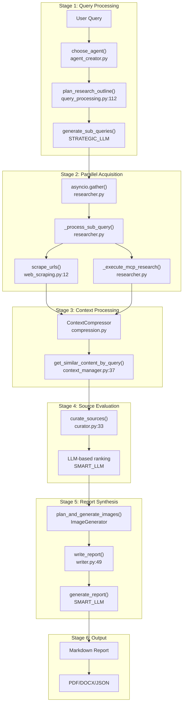
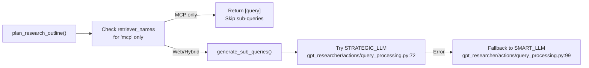

<!-- source: DeepWiki mcp.deepwiki.com · repo assafelovic/gpt-researcher · page 9 Research Pipeline Internals · fetched 2026-10-27 -->

# Research Pipeline Internals

Relevant source files

The following files were used as context for generating this wiki page:

- [docs/docs/gpt-researcher/gptr/config.md](docs/docs/gpt-researcher/gptr/config.md)
- [gpt_researcher/actions/query_processing.py](gpt_researcher/actions/query_processing.py)
- [gpt_researcher/agent.py](gpt_researcher/agent.py)
- [gpt_researcher/config/variables/base.py](gpt_researcher/config/variables/base.py)
- [gpt_researcher/config/variables/default.py](gpt_researcher/config/variables/default.py)
- [gpt_researcher/skills/browser.py](gpt_researcher/skills/browser.py)
- [gpt_researcher/skills/researcher.py](gpt_researcher/skills/researcher.py)

This document describes the internal mechanisms of the GPT Researcher pipeline that transforms a user query into a comprehensive research report. It covers the technical implementation details of query decomposition, parallel data acquisition, context processing, source evaluation, and report synthesis.

For high-level workflow orchestration by the `ResearchConductor` class, see [ResearchConductor and Workflow](#3.2). For configuration of LLMs used throughout the pipeline, see [Three-Tier LLM Strategy](#6.3). For specific research operation modes, see [Research Modes](#4).

---

## Pipeline Architecture Overview

The research pipeline consists of six sequential stages, each managed by specialized skill classes. The `GPTResearcher` class [gpt_researcher/agent.py:36-168]() orchestrates these stages through two primary methods: `conduct_research()` [gpt_researcher/skills/researcher.py:89-211]() (via the `ResearchConductor`) and `write_report()` [gpt_researcher/skills/writer.py:49-123]().

### End-to-End Pipeline Flow

**Sources:** [gpt_researcher/agent.py:36-168](), [gpt_researcher/skills/researcher.py:89-211](), [gpt_researcher/skills/writer.py:49-123]()

---

## Query Planning and Decomposition

The pipeline begins by analyzing the user query to generate focused sub-queries. This process uses the **Strategic LLM** tier with fallback to Smart LLM. For details, see [Query Planning and Decomposition](#9.1).

### Planning Process

The `plan_research_outline()` function [gpt_researcher/actions/query_processing.py:112-169]() coordinates query decomposition:

1.  **Initial Search**: Retrieves initial search results using `get_search_results` [gpt_researcher/actions/query_processing.py:12-35]().
2.  **Context Building**: Formats results as context for the planning LLM.
3.  **Sub-Query Generation**: Uses Strategic LLM (defined by `STRATEGIC_LLM` [gpt_researcher/config/variables/default.py:9]()) to generate sub-queries.
4.  **MCP Awareness**: Skips sub-query generation if MCP is the sole retriever [gpt_researcher/actions/query_processing.py:145-153]().

### Strategic LLM Usage with Fallback

**Sources:** [gpt_researcher/actions/query_processing.py:112-169](), [gpt_researcher/config/variables/default.py:7-12]()

---

## Parallel Sub-Query Processing

Once sub-queries are generated, the pipeline executes them in parallel to maximize throughput. For details, see [Parallel Sub-Query Processing](#9.2).

### Parallel Execution Architecture

The `ResearchConductor` manages the execution of these queries [gpt_researcher/skills/researcher.py:21-47]().

1.  **Worker Pool**: A `WorkerPool` is initialized in `BrowserManager` [gpt_researcher/skills/browser.py:32-35]() to handle concurrent scraping.
2.  **Scraping**: `scrape_urls` [gpt_researcher/actions/web_scraping.py:12-42]() processes the URLs found for each sub-query.
3.  **MCP Integration**: If configured, `MCP_STRATEGY` [gpt_researcher/config/variables/default.py:44]() determines how tools are called (fast vs deep).

**Sources:** [gpt_researcher/skills/researcher.py:89-211](), [gpt_researcher/skills/browser.py:32-35](), [gpt_researcher/actions/web_scraping.py:12-42]()

---

## Context Management and Compression

After acquiring raw content, the pipeline compresses and filters it to stay within LLM token limits. For details, see [Context Management and Compression](#9.3).

### Compression Architecture

The `ContextManager` [gpt_researcher/skills/context_manager.py:18-35]() handles this stage:

| Compressor | Purpose | Code Reference |
| :---------------------- | :------------------------------------------ | :------------------------------------------ |
| `ContextCompressor` | Compresses scraped web content | [gpt_researcher/skills/context_manager.py:55-63]() |
| `VectorstoreCompressor` | Retrieves and compresses from vector stores | [gpt_researcher/skills/context_manager.py:82-86]() |
| `WrittenContentCompressor` | Matches new queries against already written sections | [gpt_researcher/skills/context_manager.py:146-154]() |

**Sources:** [gpt_researcher/skills/context_manager.py:18-155](), [gpt_researcher/config/variables/default.py:13-15]()

---

## Source Curation and Validation

The `SourceCurator` [gpt_researcher/skills/curator.py:15-31]() performs LLM-based ranking to select the highest-quality sources. For details, see [Source Curation and Validation](#9.4).

### Curation Flow

1.  **Evaluation**: LLM evaluates sources based on credibility and relevance [gpt_researcher/skills/curator.py:33-48]().
2.  **Ranking**: Sources are ranked using the `SMART_LLM` model [gpt_researcher/config/variables/default.py:8]().
3.  **Filtering**: The top `max_results` (default 10) are returned [gpt_researcher/skills/curator.py:36]().

**Sources:** [gpt_researcher/skills/curator.py:15-97](), [gpt_researcher/config/variables/default.py:8]()

---

## Report Generation and Formatting

The final stage synthesizes curated sources into a coherent report. For details, see [Report Generation and Formatting](#9.5).

### Report Generation Pipeline

The `ReportGenerator` [gpt_researcher/skills/writer.py:20-47]() manages the final output:

-   **Introduction**: Written using `write_introduction` [gpt_researcher/skills/writer.py:164-193]().
-   **Main Body**: Generated via `write_report` [gpt_researcher/skills/writer.py:49-123]().
-   **Conclusion**: Finalized using `write_report_conclusion` [gpt_researcher/skills/writer.py:125-162]().

**Sources:** [gpt_researcher/skills/writer.py:20-253](), [gpt_researcher/config/variables/default.py:20-21]()

---

## Image Generation System

The image generation system produces contextually relevant illustrations using Google Gemini or Imagen models. For details, see [Image Generation System](#9.6).

### Generation Strategy

1.  **Planning**: The `ImageGenerator` [gpt_researcher/skills/image_generator.py]() identifies sections that need visual aids.
2.  **Prompts**: `generate_image_analysis_prompt` [gpt_researcher/prompts.py:121-175]() creates the instructions for the image model.
3.  **Style**: Controlled by `IMAGE_GENERATION_STYLE` (dark/light/auto) [gpt_researcher/config/variables/default.py:53]().

**Sources:** [gpt_researcher/skills/image_generator.py](), [gpt_researcher/prompts.py:121-192](), [gpt_researcher/config/variables/default.py:47-53]()

---

