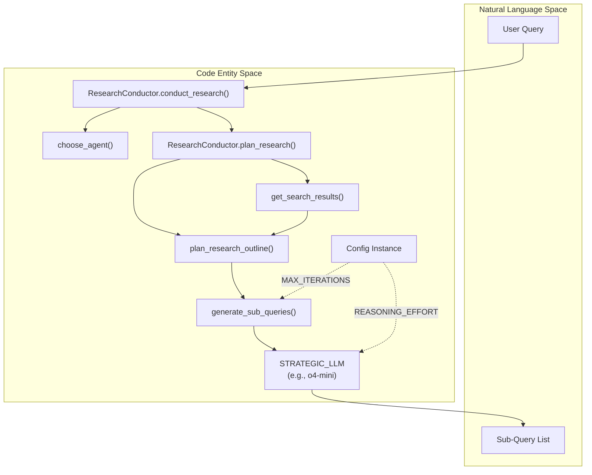
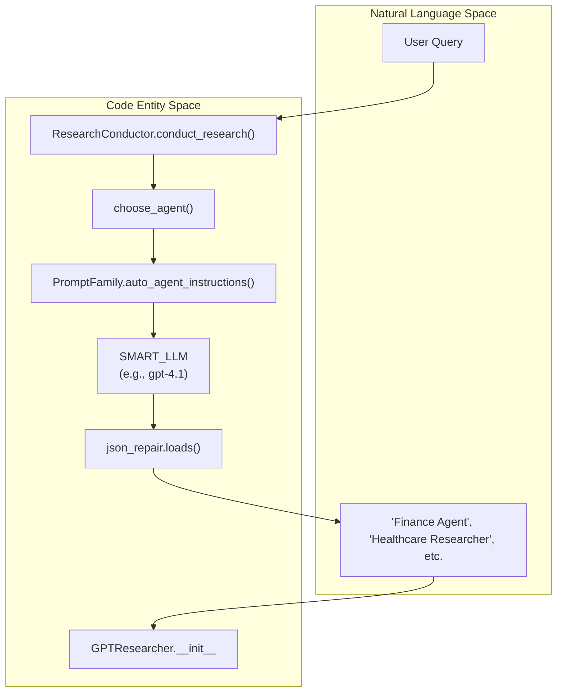

<!-- source: DeepWiki mcp.deepwiki.com · repo assafelovic/gpt-researcher · page 9.1 Query Planning and Decomposition · fetched 2026-10-27 -->

# Query Planning and Decomposition

<details>
<summary>Relevant source files</summary>

The following files were used as context for generating this wiki page:

- [.python-version](.python-version)
- [docs/docs/gpt-researcher/gptr/config.md](docs/docs/gpt-researcher/gptr/config.md)
- [gpt_researcher/actions/query_processing.py](gpt_researcher/actions/query_processing.py)
- [gpt_researcher/config/variables/base.py](gpt_researcher/config/variables/base.py)
- [gpt_researcher/config/variables/default.py](gpt_researcher/config/variables/default.py)
- [gpt_researcher/prompts.py](gpt_researcher/prompts.py)
- [gpt_researcher/utils/enum.py](gpt_researcher/utils/enum.py)
- [tests/test_quick_search.py](tests/test_quick_search.py)

</details>


## Purpose and Scope

This document explains how GPT Researcher decomposes user queries into executable research plans. The planning phase determines the research strategy by selecting an appropriate agent, gathering initial context, and generating focused sub-queries that guide parallel research execution. This process is primarily orchestrated by the `ResearchConductor` skill. For information about how these sub-queries are executed, see [Parallel Sub-Query Processing](9.2). For configuration of the models used in planning, see [Three-Tier LLM Strategy](6.3).

## Overview: From Query to Research Plan

Query planning transforms a single research question into a structured set of sub-queries that can be researched in parallel. This decomposition happens in three stages:

1.  **Agent Selection**: Choose a specialized research agent based on query characteristics.
2.  **Initial Search**: Gather preliminary context about the query domain to inform the plan.
3.  **Outline Planning**: Generate focused sub-queries using the `STRATEGIC_LLM`.

The planning process is managed by the `ResearchConductor` class and configured through settings like `STRATEGIC_LLM`, `REASONING_EFFORT`, and `MAX_ITERATIONS`.

Sources: [gpt_researcher/skills/researcher.py:1-87](), [gpt_researcher/actions/query_processing.py:112-169]()

## Query Planning Architecture

The following diagram illustrates the flow from a raw user query to a list of executable sub-queries, highlighting the interaction between the conductor and the strategic LLM.



**Diagram: Query Planning Pipeline**

The `ResearchConductor` coordinates planning by first gathering initial search results to provide context for the `STRATEGIC_LLM`, which then generates the research outline.

Sources: [gpt_researcher/skills/researcher.py:48-87](), [gpt_researcher/actions/query_processing.py:112-169](), [gpt_researcher/config/variables/default.py:9-12]()

## Agent Selection Process

Before generating sub-queries, GPT Researcher selects a specialized research agent tailored to the query domain. This is handled by the `choose_agent` action.

### Agent Selection Flow



**Diagram: Agent Selection Decision Tree**

The agent selection uses the `SMART_LLM` (defaulting to `gpt-4.1`) to analyze the query and return a JSON object containing the `agent_role_prompt`. If parsing fails, the system uses `json_repair` or falls back to a default "AI critical thinker" persona.

Sources: [gpt_researcher/actions/agent_creator.py:18-62](), [gpt_researcher/agent.py:119-127](), [gpt_researcher/config/variables/default.py:8]()

## Initial Search Phase

The planning process in `ResearchConductor.plan_research` begins by gathering initial context. This provides the LLM with real-world information about the query domain, allowing for more specific and relevant sub-query generation.

### Context Gathering Logic

The initial search uses only the first configured retriever to minimize latency:

```python
# gpt_researcher/skills/researcher.py:62
search_results = await get_search_results(query, self.researcher.retrievers[0], query_domains, researcher=self.researcher)
```

The results are passed to `plan_research_outline`, which serves as the bridge to sub-query generation.

Sources: [gpt_researcher/skills/researcher.py:48-87](), [gpt_researcher/actions/query_processing.py:12-35]()

## Research Outline Planning

With initial context gathered, the system generates a structured research outline by decomposing the query into focused sub-queries using the `STRATEGIC_LLM`.

### Sub-Query Generation Process

The `generate_sub_queries` function implements a robust fallback mechanism to ensure a research plan is always created:

1.  **Primary Attempt**: Calls `STRATEGIC_LLM` (e.g., `o4-mini`) with `REASONING_EFFORT` set to `medium`. [gpt_researcher/actions/query_processing.py:72-81]()
2.  **Token Limit Retry**: If the primary call fails (common with unbounded token requests on some providers), it retries using the `STRATEGIC_TOKEN_LIMIT`. [gpt_researcher/actions/query_processing.py:82-97]()
3.  **Smart LLM Fallback**: If strategic calls fail, it falls back to the `SMART_LLM` (e.g., `gpt-4.1`) with standard temperature settings. [gpt_researcher/actions/query_processing.py:98-108]()

Sources: [gpt_researcher/actions/query_processing.py:71-110](), [gpt_researcher/config/variables/default.py:9, 45]()

### Configuration Parameters

| Parameter | Default Value | Role in Planning |
| :--- | :--- | :--- |
| `STRATEGIC_LLM` | `openai:o4-mini` | Primary model for query decomposition [gpt_researcher/config/variables/default.py:9]() |
| `STRATEGIC_TOKEN_LIMIT` | `4000` | Token ceiling for planning responses [gpt_researcher/config/variables/default.py:12]() |
| `REASONING_EFFORT` | `medium` | Effort level for reasoning models (o1, o3, o4) [gpt_researcher/config/variables/default.py:45]() |
| `MAX_ITERATIONS` | `3` | Maximum number of sub-queries to generate [gpt_researcher/config/variables/default.py:22]() |
| `MAX_SUBTOPICS` | `3` | Limit for subtopic generation in detailed reports [gpt_researcher/config/variables/default.py:27]() |

Sources: [gpt_researcher/config/variables/default.py:9-12, 22, 27, 45]()

## Special Cases and Optimizations

### MCP Retriever Behavior

When Model Context Protocol (MCP) retrievers are configured, the query planning logic adapts. If MCP is the **only** retriever, the system skips sub-query generation entirely and uses the original query, as MCP servers often handle their own internal tool-calling and decomposition. [gpt_researcher/actions/query_processing.py:145-153]()

```python
# gpt_researcher/actions/query_processing.py:145-153
if retriever_names and ("mcp" in retriever_names or "MCPRetriever" in retriever_names):
    mcp_only = (len(retriever_names) == 1 and 
               ("mcp" in retriever_names or "MCPRetriever" in retriever_names))
    
    if mcp_only:
        logger.info("Using MCP retriever only - skipping sub-query generation")
        return [query]
```

Sources: [gpt_researcher/actions/query_processing.py:140-156](), [gpt_researcher/skills/researcher.py:129-133]()

### Detailed Report Subtopics

In `ReportType.DetailedReport` mode, the system uses subtopic construction to create a hierarchical plan. This involves generating a list of subtopics which are then individually researched as if they were standalone queries. This behavior is triggered by the `DetailedReport` enum value. [gpt_researcher/utils/enum.py:17, 25]()

Sources: [gpt_researcher/utils/enum.py:6-28](), [gpt_researcher/config/variables/default.py:27]()

## Integration with Research Execution

The output of the planning phase is a `List[str]` of sub-queries returned by `plan_research_outline`. [gpt_researcher/actions/query_processing.py:169]() The `ResearchConductor` then iterates through these queries to gather context:

1.  **Context Gathering**: Conducted via `_get_context_by_search` or specialized web/local methods.
2.  **Source Filtering**: If `REPORT_SOURCE` is set to `local` or `web`, the conductor directs retrieval accordingly. [gpt_researcher/config/variables/default.py:29]()
3.  **Aggregation**: All results are aggregated into the research context for the final report generation.

Sources: [gpt_researcher/skills/researcher.py:48-87](), [gpt_researcher/actions/query_processing.py:112-169]()

---

