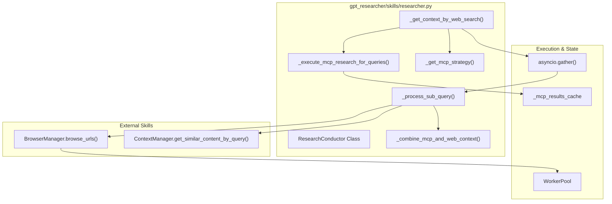
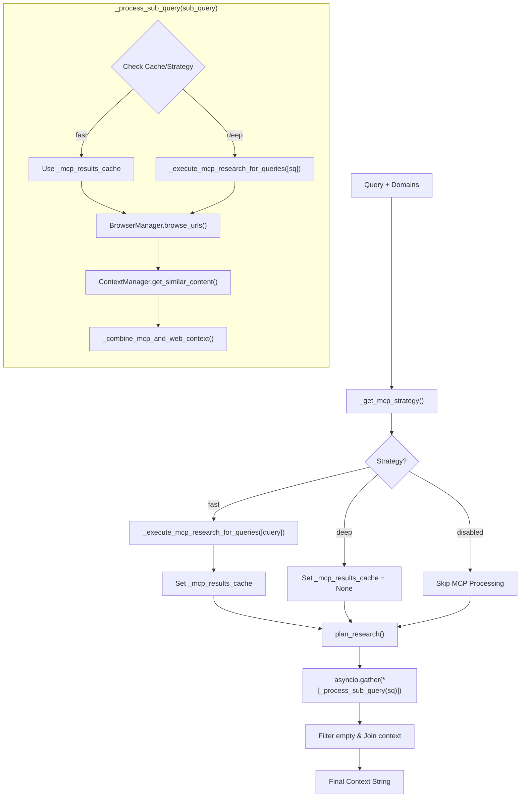
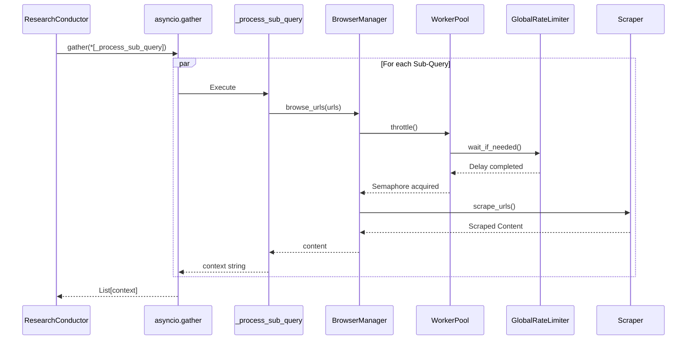

<!-- source: DeepWiki mcp.deepwiki.com · repo assafelovic/gpt-researcher · page 9.2 Parallel Sub-Query Processing · fetched 2026-10-27 -->

# Parallel Sub-Query Processing

Relevant source files

The following files were used as context for generating this wiki page:

- [backend/report_type/deep_research/example.py](backend/report_type/deep_research/example.py)
- [gpt_researcher/agent.py](gpt_researcher/agent.py)
- [gpt_researcher/skills/browser.py](gpt_researcher/skills/browser.py)
- [gpt_researcher/skills/deep_research.py](gpt_researcher/skills/deep_research.py)
- [gpt_researcher/skills/researcher.py](gpt_researcher/skills/researcher.py)
- [gpt_researcher/utils/rate_limiter.py](gpt_researcher/utils/rate_limiter.py)
- [gpt_researcher/utils/workers.py](gpt_researcher/utils/workers.py)
- [tests/test_deep_research_parsing.py](tests/test_deep_research_parsing.py)

## Purpose and Scope

This document explains how GPT Researcher executes multiple sub-queries concurrently to gather comprehensive research data efficiently. After query planning generates a list of sub-queries (see [9.1 Query Planning and Decomposition]), the system processes these queries in parallel to maximize throughput while managing API rate limits and resource constraints.

This page covers the parallel execution architecture, MCP (Model Context Protocol) strategy handling, result aggregation, and the coordination mechanisms that ensure efficient concurrent processing.

## Parallel Processing Architecture

The `ResearchConductor` class in [gpt_researcher/skills/researcher.py:21-32]() orchestrates parallel sub-query processing. The architecture separates concerns between MCP retrievers and traditional web retrievers, with configurable strategies for optimizing performance vs. thoroughness.

The main entry point for this parallel flow is `_get_context_by_web_search` [gpt_researcher/skills/researcher.py:266-266](), which coordinates the generation of sub-queries and their subsequent concurrent execution.

### System Entity Map: Research Conductor

**Sources:** [gpt_researcher/skills/researcher.py:21-32](), [gpt_researcher/skills/researcher.py:266-365](), [gpt_researcher/skills/browser.py:14-35]()

## Sub-Query Processing Pipeline

The parallel processing pipeline begins after sub-query generation and involves several coordinated stages:

### Pipeline Flow

**Sources:** [gpt_researcher/skills/researcher.py:266-365](), [gpt_researcher/skills/researcher.py:449-578]()

### Key Processing Methods

| Method | File:Line | Purpose |
|--------|-----------|---------|
| `_get_context_by_web_search` | [gpt_researcher/skills/researcher.py:266-266]() | Orchestrates the high-level parallel search flow. |
| `_process_sub_query` | [gpt_researcher/skills/researcher.py:449-449]() | Processes a single sub-query, combining MCP and web results. |
| `_execute_mcp_research_for_queries` | [gpt_researcher/skills/researcher.py:393-393]() | Interface for calling MCP-enabled tools for research. |
| `_get_mcp_strategy` | [gpt_researcher/skills/researcher.py:367-367]() | Resolves the MCP execution mode (fast, deep, disabled). |
| `_combine_mcp_and_web_context` | [gpt_researcher/skills/researcher.py:630-630]() | Merges results from different retrieval layers into one context. |

**Sources:** [gpt_researcher/skills/researcher.py:266-680]()

## MCP Strategy Configuration

The MCP strategy determines how specialized tools (via the Model Context Protocol) are invoked during research.

### Strategy Types

*   **Fast (Default)**: Runs MCP once with the original query. The results are cached in `_mcp_results_cache` [gpt_researcher/skills/researcher.py:44]() and reused for all sub-queries [gpt_researcher/skills/researcher.py:307-310]().
*   **Deep**: Runs MCP for every individual sub-query [gpt_researcher/skills/researcher.py:503-507](). This provides maximum thoroughness but increases API calls.
*   **Disabled**: Skips MCP entirely, relying solely on web retrievers [gpt_researcher/skills/researcher.py:284-287]().

### Strategy Resolution Priority

The `GPTResearcher` class resolves the strategy during initialization [gpt_researcher/agent.py:132-136]():
1.  Direct `mcp_strategy` parameter in `__init__`.
2.  `mcp_max_iterations` parameter (mapped to strategy for backward compatibility).
3.  Configuration file (`config.json`) or environment variables.
4.  Defaulting to `"fast"`.

**Sources:** [gpt_researcher/agent.py:132-136](), [gpt_researcher/skills/researcher.py:367-391]()

## Parallel Execution and Rate Limiting

The system uses Python's `asyncio.gather()` to execute sub-queries concurrently [gpt_researcher/skills/researcher.py:349-354](). To prevent overwhelming external APIs, a `WorkerPool` and `GlobalRateLimiter` manage the actual execution flow.

### Scraper Concurrency and Global Throttling

The `BrowserManager` utilizes a `WorkerPool` initialized with `max_scraper_workers` [gpt_researcher/skills/browser.py:32-35](). This pool integrates with a `GlobalRateLimiter` [gpt_researcher/utils/rate_limiter.py:13-19]() which enforces a minimum delay across all active researcher instances [gpt_researcher/utils/workers.py:21-24]().

**Sources:** [gpt_researcher/skills/researcher.py:349-354](), [gpt_researcher/skills/browser.py:32-35](), [gpt_researcher/utils/workers.py:8-29](), [gpt_researcher/utils/rate_limiter.py:60-80]()

## Result Aggregation and Filtering

Once `asyncio.gather` completes, the results are processed to ensure a clean context for the report generator:

1.  **Filtering**: The system filters out any empty results from failed queries [gpt_researcher/skills/researcher.py:357-357]().
2.  **Joining**: Valid context strings are joined with space separators to form a single continuous context block [gpt_researcher/skills/researcher.py:359-359]().
3.  **Logging**: The total size of the combined context is logged for observability [gpt_researcher/skills/researcher.py:360-360]().

### Context Combination Logic
The `_combine_mcp_and_web_context` function handles the merging of structured MCP results and unstructured web content [gpt_researcher/skills/researcher.py:630-680](). It iterates through `mcp_context` (a list of dictionaries) and appends the `web_context` (a string), ensuring that source information is preserved where possible.

**Sources:** [gpt_researcher/skills/researcher.py:357-360](), [gpt_researcher/skills/researcher.py:630-680]()

---

