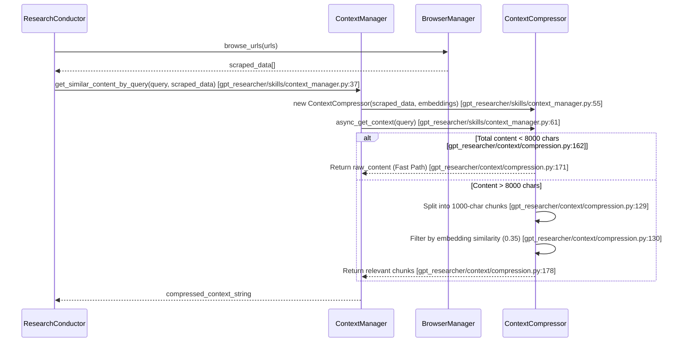

<!-- source: DeepWiki mcp.deepwiki.com · repo assafelovic/gpt-researcher · page 9.3 Context Management and Compression · fetched 2026-10-27 -->

# Context Management and Compression

<details>
<summary>Relevant source files</summary>

The following files were used as context for generating this wiki page:

- [gpt_researcher/__init__.py](gpt_researcher/__init__.py)
- [gpt_researcher/actions/__init__.py](gpt_researcher/actions/__init__.py)
- [gpt_researcher/actions/report_generation.py](gpt_researcher/actions/report_generation.py)
- [gpt_researcher/context/__init__.py](gpt_researcher/context/__init__.py)
- [gpt_researcher/context/compression.py](gpt_researcher/context/compression.py)
- [gpt_researcher/context/retriever.py](gpt_researcher/context/retriever.py)
- [gpt_researcher/skills/context_manager.py](gpt_researcher/skills/context_manager.py)
- [gpt_researcher/skills/writer.py](gpt_researcher/skills/writer.py)
- [gpt_researcher/vector_store/__init__.py](gpt_researcher/vector_store/__init__.py)
- [gpt_researcher/vector_store/vector_store.py](gpt_researcher/vector_store/vector_store.py)

</details>


This page documents the context management and compression subsystem in GPT Researcher. Context management is responsible for filtering, retrieving, and compressing large volumes of scraped web content and documents into relevant, concise contexts suitable for LLM processing. This involves embedding-based similarity matching, text chunking, and intelligent filtering to select only the most pertinent information for report generation.

For information about how research queries are planned and decomposed, see [Query Planning and Decomposition](9.1). For details on how sources are curated and validated after compression, see [Source Curation and Validation](9.4).

## Overview

The context management system addresses a fundamental challenge in autonomous research: converting large volumes of raw scraped content (often hundreds of pages) into compact, relevant contexts that fit within LLM token limits. The system uses embedding-based similarity filtering to identify the most relevant text chunks for a given query, reducing information overload while preserving essential details.

**Key responsibilities:**
- Compress raw scraped content based on query relevance.
- Retrieve similar content from vector stores.
- Find relevant previously-written content to avoid duplication and maintain consistency.
- Optimize for both quality (relevance) and performance (cost/speed) using a "fast path" for small datasets.

Sources: [gpt_researcher/skills/context_manager.py:1-155](), [gpt_researcher/context/compression.py:1-256]()

## Architecture Overview

The following diagram illustrates how the context management classes interact with the core research skills and the underlying LangChain-based compression pipeline.

### System Entity Map

```mermaid
graph TB
    subgraph "Research Workflow Integration"
        ResearchConductor["ResearchConductor<br/>(gpt_researcher/skills/researcher.py)"]
        GPTResearcher["GPTResearcher<br/>(gpt_researcher/agent.py)"]
    end
    
    subgraph "ContextManager Skill"
        ContextManager["ContextManager<br/>(gpt_researcher/skills/context_manager.py)"]
        
        GetSimilarByQuery["get_similar_content_by_query()"]
        GetSimilarVectorstore["get_similar_content_by_query_with_vectorstore()"]
        GetSimilarWritten["get_similar_written_contents_by_draft_section_titles()"]
    end
    
    subgraph "Compression Classes"
        ContextCompressor["ContextCompressor<br/>(gpt_researcher/context/compression.py)"]
        VectorstoreCompressor["VectorstoreCompressor<br/>(gpt_researcher/context/compression.py)"]
        WrittenContentCompressor["WrittenContentCompressor<br/>(gpt_researcher/context/compression.py)"]
    end
    
    subgraph "Pipeline Components"
        TextSplitter["RecursiveCharacterTextSplitter<br/>chunk_size=1000, overlap=100"]
        EmbeddingsFilter["EmbeddingsFilter<br/>similarity_threshold=0.35"]
        Embeddings["Memory.get_embeddings()"]
    end
    
    subgraph "Base Retrievers"
        SearchAPIRetriever["SearchAPIRetriever<br/>(gpt_researcher/context/retriever.py)"]
        SectionRetriever["SectionRetriever<br/>(gpt_researcher/context/retriever.py)"]
    end
    
    GPTResearcher -->|"initializes"| ContextManager [gpt_researcher/agent.py:182-186]()
    ResearchConductor -->|"calls"| GetSimilarByQuery [gpt_researcher/skills/researcher.py:526-528]()
    ResearchConductor -->|"calls"| GetSimilarVectorstore [gpt_researcher/skills/researcher.py:530-532]()
    
    GetSimilarByQuery -->|"creates"| ContextCompressor [gpt_researcher/skills/context_manager.py:55-60]()
    GetSimilarVectorstore -->|"creates"| VectorstoreCompressor [gpt_researcher/skills/context_manager.py:82-85]()
    GetSimilarWritten -->|"creates"| WrittenContentCompressor [gpt_researcher/skills/context_manager.py:146-151]()
    
    ContextCompressor -->|"uses"| TextSplitter [gpt_researcher/context/compression.py:129]()
    ContextCompressor -->|"uses"| EmbeddingsFilter [gpt_researcher/context/compression.py:130-131]()
    ContextCompressor -->|"uses"| SearchAPIRetriever [gpt_researcher/context/compression.py:135-137]()
    
    WrittenContentCompressor -->|"uses"| TextSplitter [gpt_researcher/context/compression.py:222]()
    WrittenContentCompressor -->|"uses"| EmbeddingsFilter [gpt_researcher/context/compression.py:223-224]()
    WrittenContentCompressor -->|"uses"| SectionRetriever [gpt_researcher/context/compression.py:218-220]()
    
    VectorstoreCompressor -->|"uses"| Embeddings [gpt_researcher/context/compression.py:71-82]()
```

**ContextManager as a Skill**

The `ContextManager` class is initialized as a skill within `GPTResearcher`. It provides high-level methods to the `ResearchConductor` for retrieving relevant data:

| Method | Purpose | Returns |
|--------|---------|---------|
| `get_similar_content_by_query()` | Compress raw scraped documents by query similarity | Formatted context string |
| `get_similar_content_by_query_with_vectorstore()` | Retrieve from existing vector store | Formatted context string |
| `get_similar_written_contents_by_draft_section_titles()` | Find similar previously-written sections to maintain context | List of content strings |

Sources: [gpt_researcher/skills/context_manager.py:18-155](), [gpt_researcher/agent.py:182-186]()

## Compression Classes

Three specialized compressor classes in `gpt_researcher/context/compression.py` handle different context sources.

### ContextCompressor

This is the primary class for handling web-scraped content. It implements an optimization to skip heavy processing for small inputs.

```mermaid
flowchart TD
    Input["Input: List of scraped documents<br/>(raw_content, url, title)"]
    
    CheckSize{"Total chars < COMPRESSION_THRESHOLD<br/>AND docs <= max_results?"}
    
    FastPath["Fast Path:<br/>Return documents directly<br/>(No embedding filtering)"]
    
    BuildPipeline["Build Compression Pipeline<br/>(ContextualCompressionRetriever)"]
    
    Split["RecursiveCharacterTextSplitter<br/>chunk_size=1000, overlap=100"]
    
    Embed["Generate embeddings<br/>for chunks and query"]
    
    Filter["EmbeddingsFilter<br/>similarity_threshold=0.35"]
    
    Format["pretty_print_docs()"]
    
    Output["Output: Compressed context string"]
    
    Input --> CheckSize [gpt_researcher/context/compression.py:158-162]()
    CheckSize -->|"Yes"| FastPath [gpt_researcher/context/compression.py:164-171]()
    CheckSize -->|"No"| BuildPipeline [gpt_researcher/context/compression.py:174]()
    
    FastPath --> Output
    
    BuildPipeline --> Split [gpt_researcher/context/compression.py:129]()
    Split --> Embed [gpt_researcher/context/compression.py:130]()
    Embed --> Filter [gpt_researcher/context/compression.py:131]()
    Filter --> Format [gpt_researcher/context/compression.py:178]()
    Format --> Output
```

**Key features:**
- **Optimization threshold**: If total content is under `COMPRESSION_THRESHOLD` (default 8000 chars) [gpt_researcher/context/compression.py:159-162](), it returns documents directly [gpt_researcher/context/compression.py:164-171]().
- **Text chunking**: Uses `RecursiveCharacterTextSplitter` with 1000-character chunks [gpt_researcher/context/compression.py:129]().
- **Similarity filtering**: `EmbeddingsFilter` removes chunks below `SIMILARITY_THRESHOLD` (default 0.35) [gpt_researcher/context/compression.py:119-131]().
- **Cost tracking**: Uses `estimate_embedding_cost` and a `cost_callback` to track API usage [gpt_researcher/context/compression.py:175-176]().

Sources: [gpt_researcher/context/compression.py:85-179]()

### VectorstoreCompressor

**Purpose:** Retrieves relevant documents from an existing vector store using similarity search. Used when research is conducted against a vector database [gpt_researcher/skills/context_manager.py:65-86]().

**Key features:**
- Wraps `VectorStoreWrapper` [gpt_researcher/context/compression.py:36-55]().
- Performs async similarity search with `asimilarity_search` [gpt_researcher/context/compression.py:71-82]().
- Supports metadata filtering via the `filter` attribute [gpt_researcher/context/compression.py:67]().

Sources: [gpt_researcher/context/compression.py:36-83](), [gpt_researcher/vector_store/vector_store.py:10-44]()

### WrittenContentCompressor

**Purpose:** Specialized compressor for finding relevant sections from previously written report content to prevent redundancy in detailed reports [gpt_researcher/context/compression.py:181-185]().

**Key features:**
- Uses `SectionRetriever` to process previously written content [gpt_researcher/context/compression.py:218-220]().
- Defaults to a higher similarity threshold (0.5) to ensure high relevance [gpt_researcher/context/compression.py:205]().
- Returns a list of relevant strings rather than a single concatenated string [gpt_researcher/context/compression.py:245-256]().

Sources: [gpt_researcher/context/compression.py:181-256](), [gpt_researcher/skills/context_manager.py:88-154]()

## Compression Pipeline Components

### Text Splitter
The system utilizes `RecursiveCharacterTextSplitter` from `langchain_text_splitters` to divide documents into chunks of 1000 characters with a 100-character overlap [gpt_researcher/context/compression.py:129](). This overlap ensures that semantic context is not lost at the split points.

### Embeddings Filter
The `EmbeddingsFilter` [gpt_researcher/context/compression.py:130-131]() is the core logic for reducing context size. It calculates the cosine similarity between the research query and each text chunk. Chunks that do not meet the `SIMILARITY_THRESHOLD` (defaulting to 0.35) are discarded [gpt_researcher/context/compression.py:119]().

### Base Retrievers
Two custom retrievers bridge the raw data into the LangChain compression pipeline:
- **`SearchAPIRetriever`**: Handles web-scraped page dictionaries [gpt_researcher/context/retriever.py:16-35]().
- **`SectionRetriever`**: Handles structured sections of written content [gpt_researcher/context/retriever.py:37-68]().

Sources: [gpt_researcher/context/retriever.py:1-68](), [gpt_researcher/context/compression.py:122-141]()

## Integration with Research Workflow

The `ResearchConductor` coordinates the flow from scraping to compression.



**Execution Steps:**
1. **Scraping**: `BrowserManager` scrapes content and updates the `research_sources` in the agent.
2. **Requesting Context**: `ResearchConductor` calls `ContextManager.get_similar_content_by_query` [gpt_researcher/skills/context_manager.py:37-63]().
3. **Embedding Selection**: The `ContextManager` retrieves the configured embedding model from the researcher's memory [gpt_researcher/skills/context_manager.py:57]().
4. **Compression**: The `ContextCompressor` executes the pipeline, applying text splitting and similarity filtering [gpt_researcher/context/compression.py:174-178]().
5. **Costing**: Embedding costs are estimated and added to the researcher's total cost via `add_costs` [gpt_researcher/context/compression.py:176]().

Sources: [gpt_researcher/skills/context_manager.py:37-63](), [gpt_researcher/context/compression.py:119-179]()

## Configuration and Optimization

### Environment Variables
The behavior of the compression system is controlled by several environment variables:

| Variable | Default | Purpose |
|----------|---------|---------|
| `SIMILARITY_THRESHOLD` | `0.35` | Minimum similarity score for a chunk to be included in context [gpt_researcher/context/compression.py:119](). |
| `COMPRESSION_THRESHOLD` | `8000` | Character count below which compression is skipped for performance [gpt_researcher/context/compression.py:159](). |
| `MAX_CONTENT_CHARS` | `50000` | Maximum characters of raw content to embed per document to avoid token limits [gpt_researcher/context/retriever.py:13](). |

### Context Formatting
Compressed documents are formatted into a readable string for the LLM using `PromptFamily.pretty_print_docs` [gpt_researcher/context/compression.py:82, 171, 178](). This ensures that the LLM receives structured data containing the source URL, title, and content for each relevant chunk.

Sources: [gpt_researcher/context/compression.py:119-171](), [gpt_researcher/context/retriever.py:13]()

---

