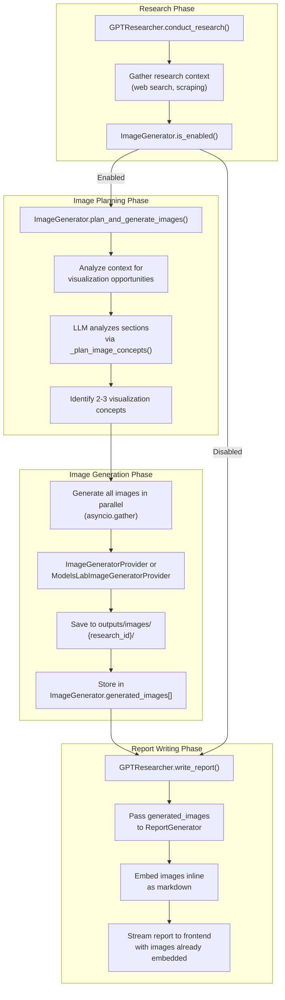
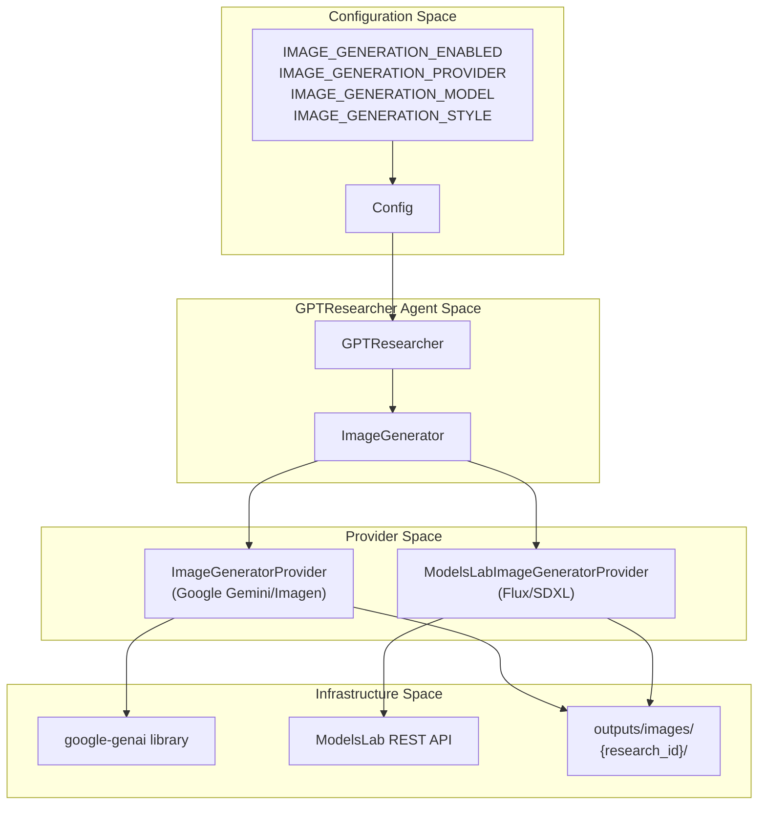

<!-- source: DeepWiki mcp.deepwiki.com · repo assafelovic/gpt-researcher · page 9.6 Image Generation System · fetched 2026-10-27 -->

# Image Generation System

Relevant source files

The following files were used as context for generating this wiki page:

- [docs/docs/gpt-researcher/gptr/ai-development.md](docs/docs/gpt-researcher/gptr/ai-development.md)
- [docs/docs/gpt-researcher/gptr/image_generation.md](docs/docs/gpt-researcher/gptr/image_generation.md)
- [frontend/nextjs/styles/markdown.css](frontend/nextjs/styles/markdown.css)
- [gpt_researcher/document/document.py](gpt_researcher/document/document.py)
- [gpt_researcher/llm_provider/image/__init__.py](gpt_researcher/llm_provider/image/__init__.py)
- [gpt_researcher/llm_provider/image/image_generator.py](gpt_researcher/llm_provider/image/image_generator.py)
- [gpt_researcher/llm_provider/image/modelslab_image_generator.py](gpt_researcher/llm_provider/image/modelslab_image_generator.py)
- [gpt_researcher/skills/image_generator.py](gpt_researcher/skills/image_generator.py)
- [pyproject.toml](pyproject.toml)
- [setup.py](setup.py)

The Image Generation System enables GPT Researcher to automatically create contextually relevant AI-generated illustrations that are embedded inline within research reports. This system uses Google's Gemini image generation models (referred to as "Nano Banana") or ModelsLab to analyze research context and produce professional diagrams, flowcharts, and conceptual visualizations.

---

## Overview and Architecture

The Image Generation System implements a **pre-generation strategy** where images are planned and created during the research phase, before report writing begins. This approach eliminates delays in report streaming and ensures a seamless user experience.

### System Flow

**Sources:** [gpt_researcher/skills/image_generator.py:77-180](), [docs/docs/gpt-researcher/gptr/image_generation.md:62-82](), [gpt_researcher/llm_provider/image/image_generator.py:101-105]()

---

## Component Architecture

### Core Components

**Sources:** [gpt_researcher/skills/image_generator.py:33-68](), [gpt_researcher/llm_provider/image/image_generator.py:22-44](), [gpt_researcher/llm_provider/image/modelslab_image_generator.py:24-34]()

### Key Classes and Methods

| Component | Location | Key Methods |
|-----------|----------|-------------|
| `ImageGenerator` | `gpt_researcher/skills/image_generator.py` | `plan_and_generate_images()`, `_init_provider()` |
| `ImageGeneratorProvider` | `gpt_researcher/llm_provider/image/image_generator.py` | `generate_image()`, `_build_enhanced_prompt()` |
| `ModelsLabImageGeneratorProvider` | `gpt_researcher/llm_provider/image/modelslab_image_generator.py` | `generate_image()`, `_poll_for_result()` |
| `DocumentLoader` | `gpt_researcher/document/document.py` | `load()`, `_load_document()` |

**Sources:** [gpt_researcher/skills/image_generator.py:20-43](), [gpt_researcher/llm_provider/image/image_generator.py:48-63](), [gpt_researcher/llm_provider/image/modelslab_image_generator.py:38-46]()

---

## Configuration System

### Environment Variables

The image generation system is controlled by the following environment variables:

| Variable | Type | Default | Description |
|----------|------|---------|-------------|
| `IMAGE_GENERATION_ENABLED` | boolean | `false` | Master switch to enable/disable feature |
| `IMAGE_GENERATION_PROVIDER` | string | `google` | Provider choice: `google` or `modelslab` |
| `GOOGLE_API_KEY` | string | - | Required for Google provider |
| `MODELSLAB_API_KEY` | string | - | Required for ModelsLab provider |
| `IMAGE_GENERATION_MODEL` | string | `models/gemini-2.5-flash-image` | Specific model identifier |
| `IMAGE_GENERATION_MAX_IMAGES` | integer | `3` | Maximum images per report |
| `IMAGE_GENERATION_STYLE` | string | `dark` | Style preset: `dark`, `light`, or `auto` |

**Sources:** [docs/docs/gpt-researcher/gptr/image_generation.md:20-36](), [gpt_researcher/skills/image_generator.py:42-62]()

---

## Provider Implementation

### Google Gemini / Imagen
The `ImageGeneratorProvider` uses the `google-genai` SDK. It distinguishes between standard Gemini models (free tier) and Imagen models (paid tier) [gpt_researcher/llm_provider/image/image_generator.py:32-44](). It includes a specialized `_crop_to_landscape` method using `PIL` to ensure images fit report layouts at a 16:9 ratio [gpt_researcher/llm_provider/image/image_generator.py:106-155]().

### ModelsLab
The `ModelsLabImageGeneratorProvider` interacts with the ModelsLab REST API. Since generation is often asynchronous, it implements `_poll_for_result` to check the fetch endpoint until the image is ready [gpt_researcher/llm_provider/image/modelslab_image_generator.py:84-121]().

---

## Image Styling and Prompting

The system automatically enhances user prompts to match specific aesthetics.

### Dark Mode (Default)
When `IMAGE_GENERATION_STYLE` is set to `dark`, the system appends instructions for:
- Dark backgrounds (`#0d1117`)
- Teal/Cyan accents (`#14b8a6`)
- Glowing, futuristic, and tech-forward aesthetics [gpt_researcher/llm_provider/image/image_generator.py:168-181]().

### Markdown Embedding
Images are saved locally and embedded using standard markdown syntax:
`` [docs/docs/gpt-researcher/gptr/image_generation.md:148-154]().

---

## Frontend Integration

### CSS Styling
The Next.js frontend provides specialized styling for generated visuals in `markdown.css`:
- **General Images**: 75% width, centered, with 8px border-radius [frontend/nextjs/styles/markdown.css:176-184]().
- **Generated Visuals**: Images with alt text starting with "Illustration:", "Diagram:", or "Visualization:" receive a teal accent border (`rgba(20, 184, 166, 0.3)`) and an enhanced box shadow [frontend/nextjs/styles/markdown.css:187-193]().

### WebSocket Events
The `ImageGenerator` streams status updates via WebSockets:
- `image_planning`: Analysis of context started.
- `image_concepts_identified`: Found N visualization opportunities.
- `image_generating`: Individual image creation in progress.
- `images_ready`: All images are saved and ready.

**Sources:** [gpt_researcher/skills/image_generator.py:102-171](), [docs/docs/gpt-researcher/gptr/image_generation.md:162-170]()

---

