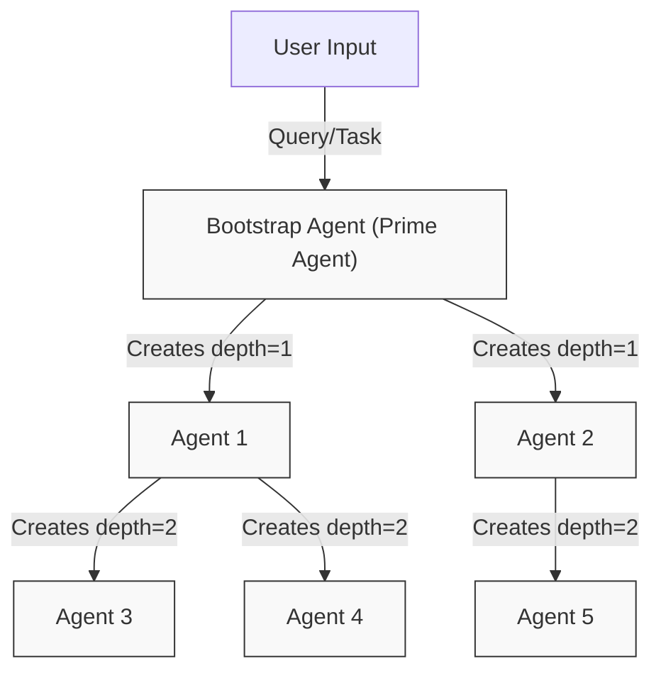
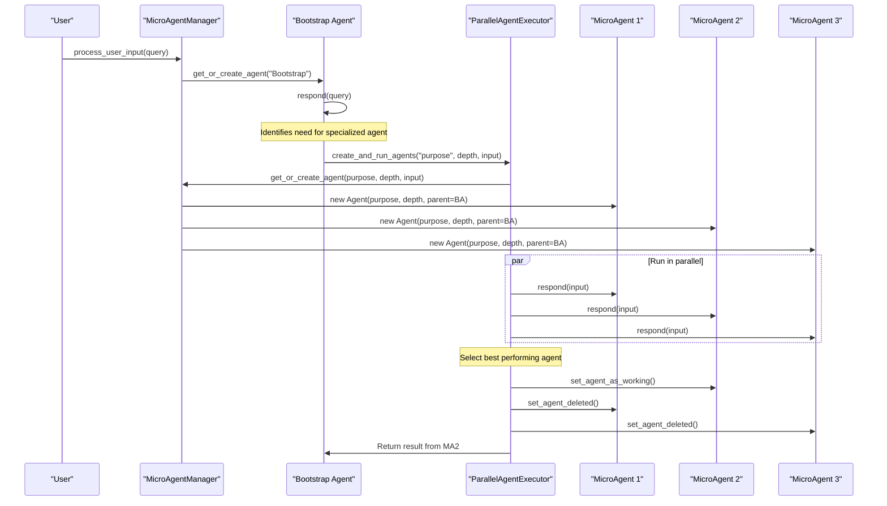
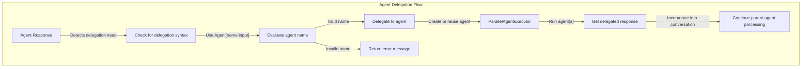
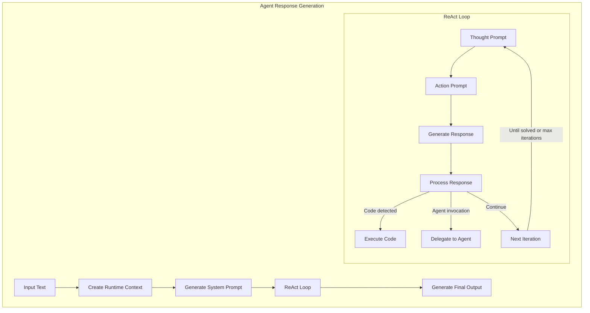

<!-- source: DeepWiki mcp.deepwiki.com · repo aymenfurter/microagents · page 2.1 Agent Hierarchy and Communication · fetched 2026-10-27 -->

# Agent Hierarchy and Communication

<details>
<summary>Relevant source files</summary>

The following files were used as context for generating this wiki page:

- [agents/agent_response.py](agents/agent_response.py)
- [agents/agent_stopped_exception.py](agents/agent_stopped_exception.py)
- [agents/microagent.py](agents/microagent.py)
- [agents/parallel_agent_executor.py](agents/parallel_agent_executor.py)

</details>


This document explains how agents in the Microagents system are organized hierarchically and communicate with each other. It covers the agent hierarchy structure, agent creation process, and communication mechanisms between agents. For information about the complete agent lifecycle from creation to persistence, see [Agent Lifecycle](#2.2).

## 1. Agent Hierarchy Structure

The Microagents system employs a hierarchical structure of agents, with each agent having a specific purpose and depth level.

### 1.1 Hierarchy Overview



The agent hierarchy follows these principles:

1. **Bootstrap Agent (Prime Agent)**: The top-level agent that receives user queries and delegates tasks to specialized agents.
2. **Depth Levels**: Agents are organized by depth (1, 2, 3...) with a default maximum depth of 3.
3. **Parent-Child Relationships**: Each agent (except the Bootstrap Agent) has a parent that created it.

Sources: [agents/microagent.py:22-51](), [agents/agent_response.py:26-46]()

### 1.2 Agent Properties

Each agent in the hierarchy has the following key properties related to the hierarchy:

| Property | Description |
|----------|-------------|
| `depth` | The agent's level in the hierarchy (0 for Bootstrap, 1, 2, etc.) |
| `max_depth` | Maximum allowed depth (default: 3) |
| `parent_id` | UUID of the parent agent |
| `id` | UUID of the agent (fixed for Prime agent) |
| `is_prime` | Boolean indicating if this is the Bootstrap Agent |
| `active_agents` | Dictionary tracking child agents currently in use |

Sources: [agents/microagent.py:23-67]()

## 2. Agent Creation Process

### 2.1 Creation Mechanisms



The Microagents system creates agents through:

1. **Direct Creation**: Single agent created for a specific purpose
2. **Parallel Creation**: Multiple versions of the same agent created in parallel to select the best performing one

Sources: [agents/parallel_agent_executor.py:16-45](), [agents/microagent.py:23-41]()

### 2.2 Parallel Agent Execution

When a new agent type is needed, the system:

1. Creates multiple instances (default: 3) of the same agent in parallel
2. Runs all instances on the same input
3. Selects the first agent to successfully complete the task
4. Deletes the unsuccessful agent variants
5. Keeps the successful agent for future use

This approach helps ensure high-quality agent responses by creating competition and selecting the best performer.

Sources: [agents/parallel_agent_executor.py:16-66]()

## 3. Agent Communication Patterns

### 3.1 Delegation Model



Agents communicate primarily through delegation, where:

1. An agent identifies the need to delegate a subtask
2. The agent specifies the target agent using the syntax: `Use Agent[AgentName: task]`
3. The system either creates a new agent or reuses an existing one
4. The parent agent incorporates the child agent's response into its processing

Sources: [agents/agent_response.py:95-141]()

### 3.2 Communication Implementation

The key communication mechanisms are:

1. **Agent Invocation Syntax**: `Use Agent[AgentName: task]` in the agent's response
2. **Parent-Child Tracking**: Parents track their active child agents
3. **Response Integration**: Child agent responses are incorporated into the parent's conversation

This code snippet illustrates how agent invocation is detected and processed:

```
# Detection of agent invocation in responses
def _is_agent_invocation(self, response):
    return "Use Agent[" in response

# Extracting agent name and input
def _parse_agent_info(self, response):
    agent_info = response.split('Use Agent[')[1].split(']')[0]
    split_info = agent_info.split(":", 1)
    agent_name = split_info[0].strip()
    input_text = split_info[1].strip() if len(split_info) > 1 else ""
    return agent_name, input_text
```

Sources: [agents/agent_response.py:106-127]()

### 3.3 Agent Context and Available Agents

During communication, each agent is aware of:

1. Its own purpose and capabilities
2. Available agents that can be delegated to
3. The ability to invent new agents as needed

The system informs each agent about available agents through the runtime context:

```
def _generate_runtime_context(self, dynamic_prompt):
    available_agents = self.manager.get_available_agents_for_agent(self.agent)
    available_agents_info = ', '.join([f"{agent.purpose} (depth={agent.depth})" for agent in available_agents])
    return f"Your Purpose: {dynamic_prompt}. Available agents (Feel free to invent new ones if required!): {available_agents_info}."
```

Sources: [agents/agent_response.py:52-55]()

## 4. Communication Flow and Response Handling

### 4.1 ReAct Framework for Agent Thinking



Agent communication occurs through a structured process based on the ReAct (Reasoning and Acting) framework:

1. A parent agent thinks through a problem step by step
2. The agent may choose to delegate to a child agent as part of its action steps
3. Child agents follow the same process, with awareness of their depth
4. Communication is managed through a structured conversation format with Thought, Action, Observation steps

Sources: [agents/agent_response.py:26-46](), [agents/agent_response.py:48-66]()

### 4.2 Agent Response Processing

When a parent agent receives a response from a child agent:

1. The response is appended to the parent's conversation accumulator
2. The parent updates its active agents tracking
3. The parent incorporates the child's response into its reasoning
4. The child agent is marked as either successful or deleted based on evaluation

Sources: [agents/agent_response.py:76-128](), [agents/microagent.py:76-82]()

### 4.3 Preventing Circular References

The system prevents circular references in agent communication through:

1. Preventing self-invocation: An agent cannot delegate to itself
2. Depth limiting: Agents have a maximum depth (default: 3)
3. Parent-child tracking: The system maintains parent-child relationships

Sources: [agents/agent_response.py:109-114](), [agents/microagent.py:23-41]()

## 5. Agent Hierarchy Management

### 5.1 Tree View of Active Agents

Each agent maintains a dictionary of active agents it has created:

```python
def update_active_agents(self, calling_agent, called_agent=None):
    """Update the tree view of active agents."""
    if called_agent:
        self.active_agents[calling_agent] = called_agent
    else:
        self.active_agents.pop(calling_agent, None)
    logger.info(f"Active agents updated: {self.active_agents}")
```

This allows the system to track the current hierarchy of active agents and their relationships.

Sources: [agents/microagent.py:76-82]()

### 5.2 Agent Stopped Exception Propagation

When an agent is stopped, the AgentStoppedException propagates through the hierarchy:

```python
def check_for_stopped(self):
    """Check if the agent has been stopped."""
    if self.stop_execution:
        self.current_status = "❌ Stopped"
        if self.is_prime:
            self.agent_lifecycle.reset_all_agents()
        raise AgentStoppedException("Agent stopped.")
```

If the prime (Bootstrap) agent is stopped, all agents in the system are reset.

Sources: [agents/microagent.py:106-112](), [agents/agent_stopped_exception.py:1-6]()

## 6. Summary

The agent hierarchy and communication system in Microagents provides:

1. A flexible hierarchical structure with parent-child relationships
2. Parallel agent creation and selection for optimal performance
3. Delegation-based communication between agents
4. A structured ReAct framework for agent reasoning and communication
5. Mechanisms to prevent circular references and properly manage the agent tree

This architecture allows the system to dynamically create specialized agents on demand, organize them in a hierarchy, and facilitate communication between them to solve complex problems.

Sources: [agents/microagent.py:17-139](), [agents/agent_response.py:10-141](), [agents/parallel_agent_executor.py:7-68]()

---

