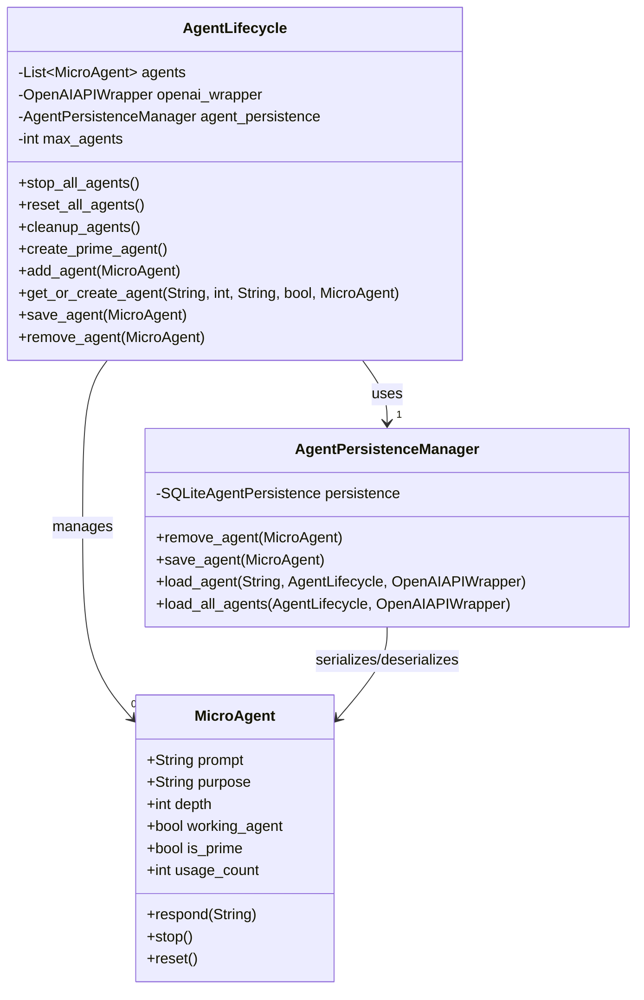
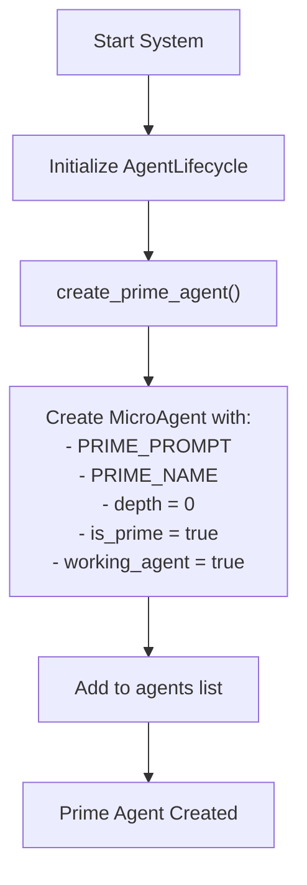
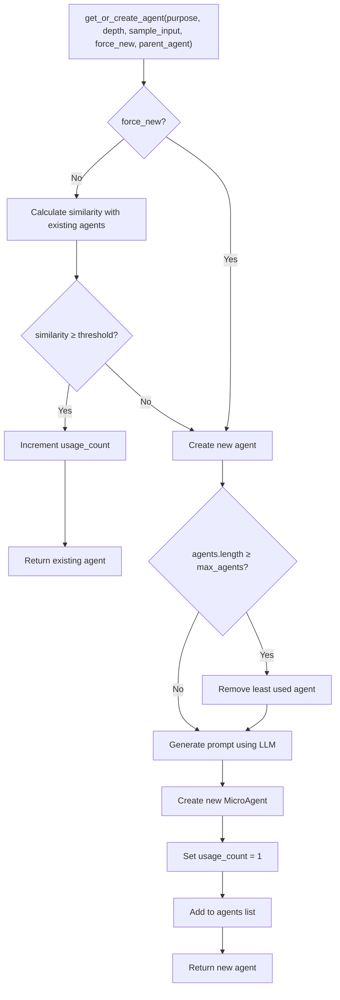
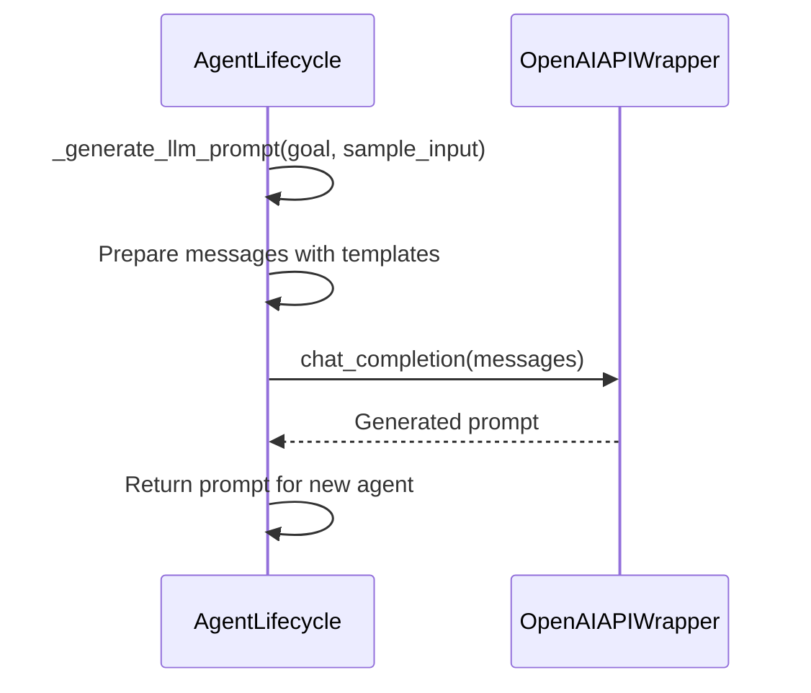
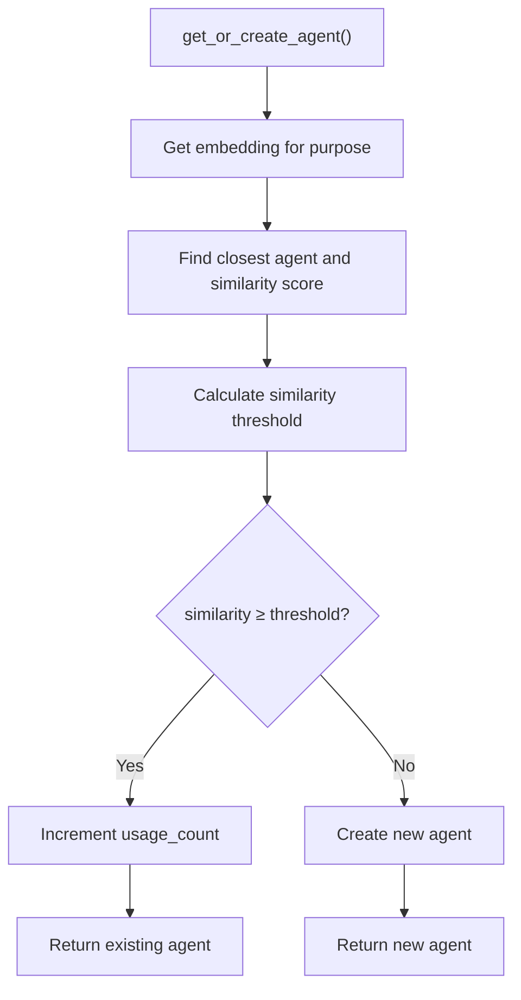
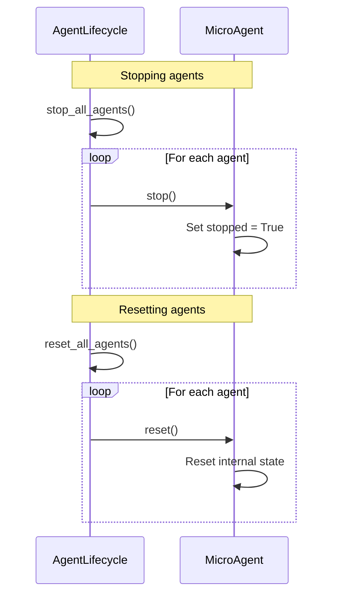
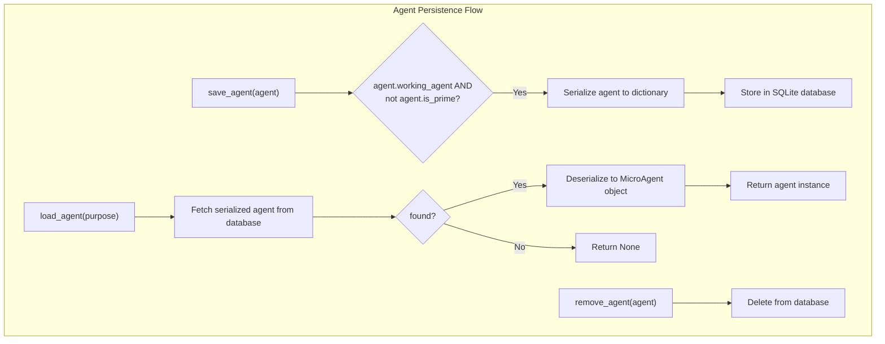
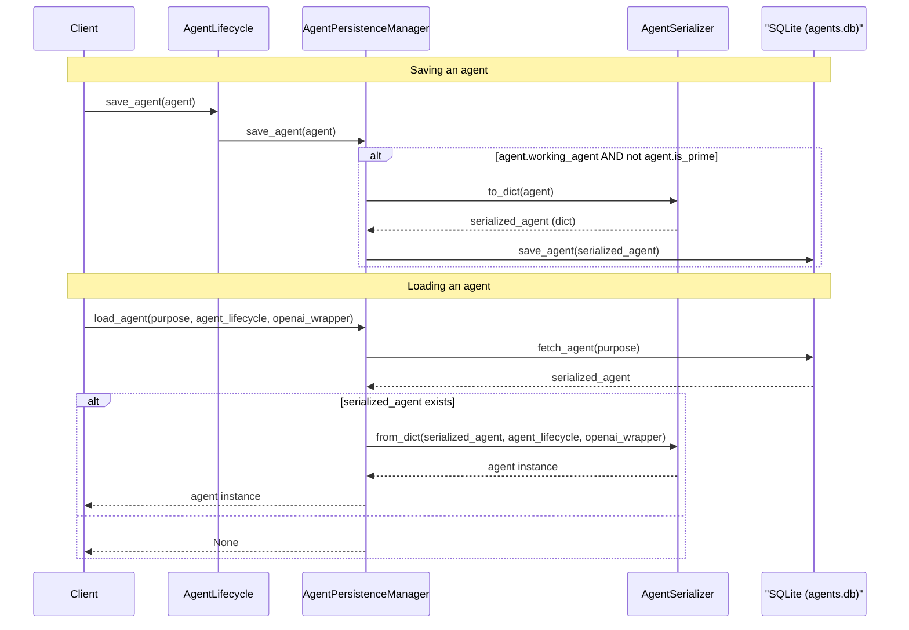
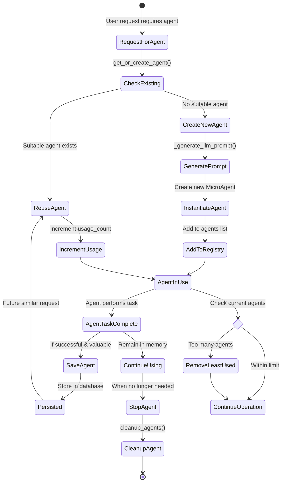

<!-- source: DeepWiki mcp.deepwiki.com · repo aymenfurter/microagents · page 2.2 Agent Lifecycle · fetched 2026-10-27 -->

# Agent Lifecycle

<details>
<summary>Relevant source files</summary>

The following files were used as context for generating this wiki page:

- [agents/agent_lifecycle.py](agents/agent_lifecycle.py)
- [agents/agent_persistence_manager.py](agents/agent_persistence_manager.py)
- [agents/response_extraction.py](agents/response_extraction.py)
- [utils/utility.py](utils/utility.py)

</details>


This document describes the complete lifecycle of agents in the Microagents system, from creation to persistence. It covers how agents are created, managed, reused, and persisted throughout their existence. For information about agent hierarchy and communication, see [Agent Hierarchy and Communication](#2.1).

## Components Overview

The agent lifecycle is primarily managed by two key components:

1. **AgentLifecycle**: Manages the creation, tracking, and disposal of agents
2. **AgentPersistenceManager**: Handles saving and loading agents to/from persistent storage

These components work together to provide a complete lifecycle management system for microagents.



Sources: [agents/agent_lifecycle.py:19-126](), [agents/agent_persistence_manager.py:6-43]()

## Agent Creation Process

The creation of agents follows different paths depending on whether the agent is a prime agent or a regular agent.

### Prime Agent Creation

The prime agent (also called the Bootstrap Agent) is a special agent that serves as the entry point for user queries and coordinates the delegation of tasks to other agents. It is created only once during system initialization.



Sources: [agents/agent_lifecycle.py:40-46]()

### Regular Agent Creation

Regular agents are created when there is a need to perform a specific task that is best handled by a dedicated agent. The system follows a "get-or-create" pattern, where it first checks if a suitable existing agent is available before creating a new one.



Sources: [agents/agent_lifecycle.py:64-94]()

### Prompt Generation

When creating a new agent, the system generates a specialized prompt for that agent using the language model. The prompt is generated based on the agent's purpose and a sample input.



Sources: [agents/agent_lifecycle.py:113-126]()

## Agent Similarity and Reuse

To optimize resource usage, the system implements a mechanism to reuse existing agents when their purpose is similar to what is needed for a new task.



Sources: [agents/agent_lifecycle.py:64-79]()

## Agent Management

The `AgentLifecycle` class provides several methods for managing agents throughout their lifecycle.

### Adding Agents

New agents are added to the internal list of agents maintained by the `AgentLifecycle`. This list is used to track all active agents in the system.

```python
def add_agent(self, agent: MicroAgent) -> None:
    """Adds an agent to the list of agents."""
    self.agents.append(agent)
```

Sources: [agents/agent_lifecycle.py:48-50]()

### Stopping and Resetting Agents

Agents can be stopped or reset:
- Stopping an agent marks it as no longer active
- Resetting an agent clears its internal state



Sources: [agents/agent_lifecycle.py:26-34]()

### Cleaning Up Agents

The system periodically removes agents that have been stopped to free up resources.

```python
def cleanup_agents(self):
    """Remove all agents with status stopped = True in an efficient manner."""
    self.agents = [agent for agent in self.agents if not agent.stopped]
```

Sources: [agents/agent_lifecycle.py:36-38]()

## Agent Persistence

Agents that have demonstrated their utility can be persisted to storage for future reuse, even across different sessions.



Sources: [agents/agent_lifecycle.py:96-111](), [agents/agent_persistence_manager.py:10-43]()

### Save & Load Process

The complete agent persistence process involves two components:
1. `AgentLifecycle` - Provides the interface for saving/removing agents
2. `AgentPersistenceManager` - Handles the actual persistence operations



Sources: [agents/agent_persistence_manager.py:16-31]()

## Complete Agent Lifecycle Flow

The following diagram illustrates the complete lifecycle of an agent in the Microagents system, from creation to persistence.



Sources: [agents/agent_lifecycle.py:19-126](), [agents/agent_persistence_manager.py:6-43]()

## Agent Lifecycle States and Transitions

Agents in the system progress through several distinct states during their lifecycle:

| State | Description | Transition Triggers |
|-------|-------------|---------------------|
| Creation | Agent is instantiated | User request or agent delegation requires a new capability |
| Active | Agent is being used to fulfill tasks | Successful creation or retrieval from persistence |
| Evaluation | Agent's performance is evaluated | After task completion |
| Persistence | Agent is saved to storage | Agent is determined to be valuable for future use |
| Stopped | Agent is marked as inactive | No longer needed or system shutdown |
| Removed | Agent is removed from the system | Cleanup operation or to make room for new agents |

Sources: [agents/agent_lifecycle.py:26-38](), [agents/agent_lifecycle.py:96-111]()

## Resource Management

The `AgentLifecycle` class implements mechanisms to manage system resources efficiently:

1. **Max Agents Limit**: Enforces a maximum number of active agents (default: 2000)
2. **Least-Used Removal**: When the limit is reached, the least used agent is removed
3. **Cleanup**: Periodically removes stopped agents from memory

```python
DEFAULT_MAX_AGENTS = 2000  # Default maximum number of agents

def _remove_least_used_agent(self):
    """Removes the least used agent."""
    least_used_agent = min(self.agents, key=lambda agent: agent.usage_count)
    self.agents.remove(least_used_agent)
```

Sources: [agents/agent_lifecycle.py:16](), [agents/agent_lifecycle.py:91-94]()

---

