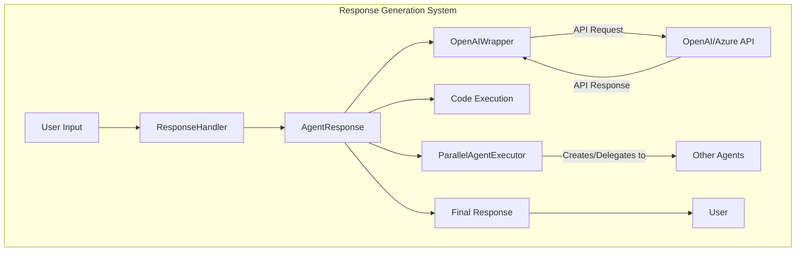
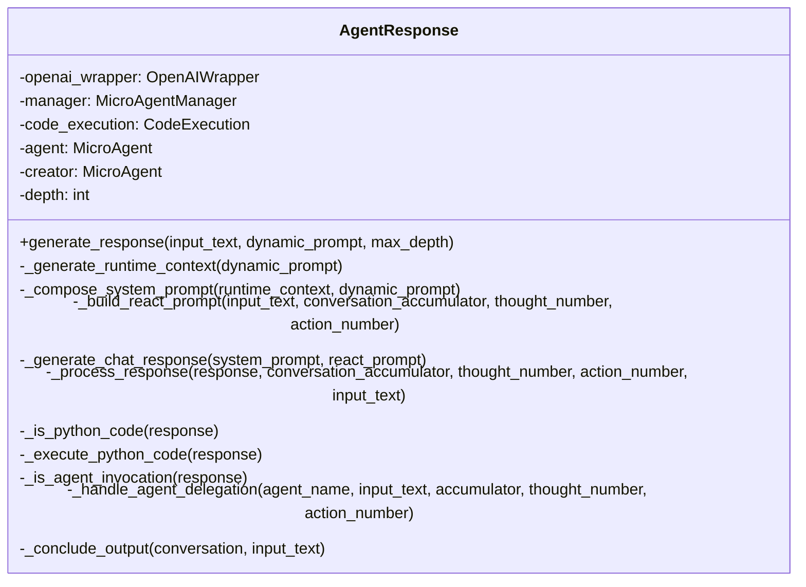
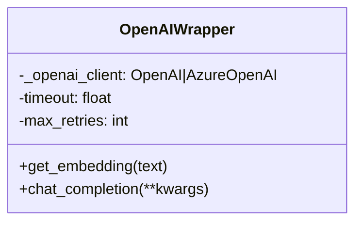
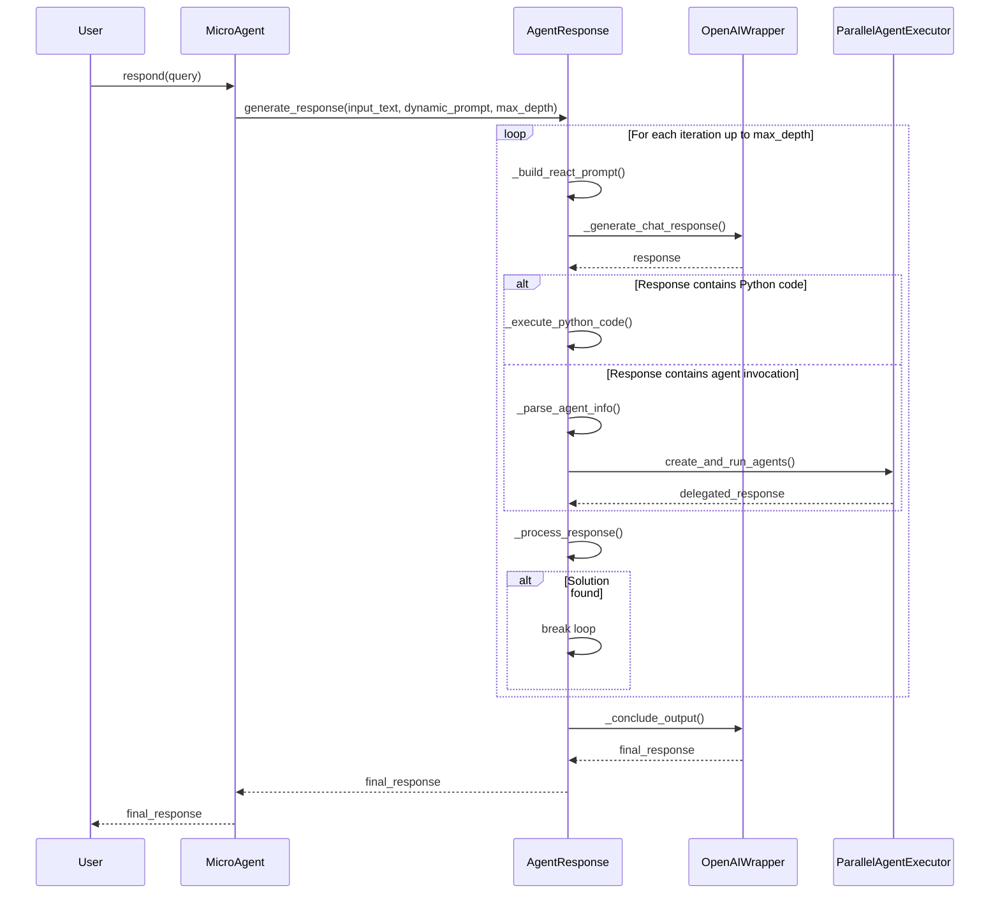
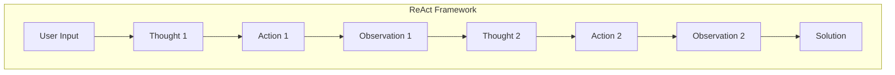

<!-- source: DeepWiki mcp.deepwiki.com · repo aymenfurter/microagents · page 3.1 Response Generation · fetched 2026-10-27 -->

# Response Generation

<details>
<summary>Relevant source files</summary>

The following files were used as context for generating this wiki page:

- [agents/agent_response.py](agents/agent_response.py)
- [integrations/openaiwrapper.py](integrations/openaiwrapper.py)

</details>


This document describes how microagents generate responses to user inputs. It covers the response generation process, including the ReAct framework implementation, code execution handling, and agent delegation capabilities. For information about agent evaluation and evolution, see [Agent Evaluation and Evolution](#3.3).

## Overview of Response Generation

The response generation system in microagents allows agents to:
- Process user queries through an OpenAI API-powered thinking process
- Execute Python code when needed
- Delegate tasks to other specialized agents
- Generate formatted, comprehensive responses



Sources: [agents/agent_response.py:10-141](), [integrations/openaiwrapper.py:99-198]()

## Core Components

### AgentResponse Class

The `AgentResponse` class is the primary component responsible for generating responses. It:

1. Takes user input and the agent's dynamic prompt
2. Constructs a system prompt with runtime context
3. Iteratively builds a conversation using the ReAct framework
4. Processes special response types (code, agent invocations)
5. Generates a final, formatted response



Sources: [agents/agent_response.py:10-141]()

### OpenAIWrapper Class

The `OpenAIWrapper` class provides a standardized interface for interacting with OpenAI and Azure OpenAI services. It handles:

- API authentication and organization settings
- Embeddings generation with caching
- Chat completions with model specifications
- Error handling, retries, and rate limiting



Sources: [integrations/openaiwrapper.py:99-198]()

## Response Generation Process

The response generation process follows a structured flow as shown below:



Sources: [agents/agent_response.py:26-46]()

### Step 1: Initialization

The `generate_response` method begins by:
1. Creating runtime context with available agents information
2. Composing a system prompt by combining the static prompt, runtime context, and the agent's dynamic prompt
3. Initializing the conversation accumulator and counters

Sources: [agents/agent_response.py:26-32](), [agents/agent_response.py:48-55]()

### Step 2: Iterative ReAct Process

The method then enters a loop (up to `max_depth` iterations) where it:
1. Builds a ReAct prompt that includes the current conversation state and prompts for the next thought/action
2. Updates the agent's status to show its thinking
3. Sends the prompt to OpenAI via the `OpenAIWrapper`
4. Processes the response and updates the conversation accumulator

Sources: [agents/agent_response.py:34-44](), [agents/agent_response.py:57-67]()

### Step 3: Response Processing

Response processing involves:
1. Appending the response to the conversation accumulator
2. Incrementing thought and action counters
3. Detecting and handling special response types (code, agent invocations)
4. Checking if a solution has been found

Sources: [agents/agent_response.py:76-90]()

### Step 4: Conclusion

Finally, the method:
1. Formats the entire conversation with additional context
2. Sends a final request to OpenAI to generate a well-structured conclusion
3. Returns the final response, the full conversation, a solution indicator, and the thought count

Sources: [agents/agent_response.py:129-141]()

## Special Response Handling

### Code Execution

When a response contains Python code (identified by ````python` markers), the `AgentResponse` class:
1. Identifies the code block using `_is_python_code()`
2. Updates the agent's status to indicate code execution
3. Executes the code using the provided `code_execution` instance
4. Appends the execution results to the conversation

```
Thought N: I need to test if this number is prime...
Action N: Let me write code to check if 17 is prime:
```python
def is_prime(n):
    if n <= 1:
        return False
    for i in range(2, int(n**0.5) + 1):
        if n % i == 0:
            return False
    return True
    
print(is_prime(17))
```

Observation: Executed Python code
Output: True
```

Sources: [agents/agent_response.py:95-104]()

### Agent Delegation

When a response contains an agent invocation (identified by `Use Agent[` markers), the system:
1. Identifies the agent invocation using `_is_agent_invocation()`
2. Parses the agent name and input text using `_parse_agent_info()`
3. Updates the agent's status and active agents record
4. Creates or reuses the specified agent through the `ParallelAgentExecutor`
5. Appends the delegated response to the conversation

```
Thought N: I need specialized help with this data analysis task.
Action N: Use Agent[DataAnalyzer: Analyze the temperature trends in the dataset]

Output N: Delegated task to Agent DataAnalyzer
Output of Agent N: The temperature data shows an upward trend of 1.2°C over the 10-year period...
```

Sources: [agents/agent_response.py:106-127]()

## ReAct Framework Implementation

The response generation process implements the ReAct (Reasoning and Acting) framework, which structures the agent's thinking into distinct steps:



The framework is implemented through:
1. The `_build_react_prompt()` method, which structures the prompt with "Thought N" and "Action N" sections
2. Different prompt templates for prime agents vs. regular agents
3. An accumulator that records the entire reasoning chain
4. A structured final output that presents the complete reasoning process

Sources: [agents/agent_response.py:57-66](), [agents/agent_response.py:4-6]()

## OpenAI Integration Details

The `OpenAIWrapper` provides a robust interface to OpenAI services with the following features:

| Feature | Description |
|---------|-------------|
| Service Options | Supports both OpenAI and Azure OpenAI services |
| Authentication | Handles API keys, Azure AD tokens, and organization IDs |
| API Retries | Implements configurable retry logic and timeout handling |
| Rate Limiting | Includes sleep mechanisms when rate limits are hit |
| Response Processing | Standardizes response format from different API versions |
| Caching | Implements memoization for embeddings to reduce API calls |

The wrapper is configured through environment variables, allowing flexible deployment options:

```
OPENAI_API_KEY or AZURE_OPENAI_API_KEY
OPENAI_MODEL (default: gpt-4-1106-preview)
OPENAI_BASE_URL (optional)
AZURE_OPENAI_ENDPOINT (if using Azure)
```

Sources: [integrations/openaiwrapper.py:14-96](), [integrations/openaiwrapper.py:165-198]()

## Response Formatting and Conclusion

The final step in response generation is the formatting of the output. The `_conclude_output()` method:

1. Takes the entire conversation accumulator
2. Adds context about the agent's purpose and the original question
3. Instructs the model to use Markdown formatting
4. Sends a final request to OpenAI with a special system prompt
5. Returns the formatted response

This ensures that the final response is comprehensive, well-structured, and visually appealing to the user.

Sources: [agents/agent_response.py:129-141]()

---

